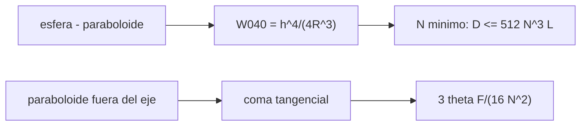

# B41-C13 — Aberración esférica y coma

<!-- nav:top -->
[🏠 Programa](../../../../README.md) · [📚 Bloque B41](../../../tronco-comun/B41-optica-geometrica-y-diseno-de-telescopios.md) · [← Anterior: B41-C12 — Difracción y límite de Rayleigh](../B41-C12-difraccion-y-limite-de-rayleigh/CLASE.md) · [Siguiente: B41-C14 — Aberración cromática y astigmatismo →](../B41-C14-aberracion-cromatica-y-astigmatismo/CLASE.md)
<!-- /nav -->

## 1. Ubicación, nivel y alcance

Clase 13 del bloque B41. Nivel N3. Mides la **aberración esférica** de un espejo esférico frente a un paraboloide y la **coma** de un paraboloide fuera del eje. Usas [B42](../../../tronco-comun/B42-optica-fisica-y-optica-adaptativa.md) y el trazado de la clase 4. Los datos son ilustrativos.

## 2. Por qué esta clase existe

Dos defectos limitan el campo y la relación focal. La decisión central: **¿hasta qué f/ sirve una esfera y qué campo tolera un paraboloide?**

## 3. Lo que podrás hacer al terminar

1. Comparar esfera y paraboloide por diferencia de camino.
2. Calcular `W040 = h⁴/(4R³)`.
3. Hallar la relación focal mínima de la esfera.
4. Trazar un abanico tangencial fuera del eje.
5. Medir la coma y compararla con `3θF/(16N²)`.
6. Comparar coma y disco de Airy.

La evidencia es la **ficha de aberración esférica y coma** del ejercicio 12 (sección 20).

## 4. Con qué llegas y cómo comprobarlo

1. ¿Qué es un rayo de luz en óptica geométrica?
2. ¿Qué dice la ley de Snell?
3. ¿Qué es la distancia focal de una lente o un espejo?
4. ¿Qué es un valor ilustrativo?
5. ¿Qué es una verificación numérica?

<details>
<summary>Ver respuestas</summary>

1. Una línea que indica la dirección de propagación de la energía. 2. `n₁ sen θ₁ = n₂ sen θ₂`. 3. La distancia del elemento al punto donde converge un haz paralelo. 4. Un valor propuesto para el ejemplo, no medido. 5. Comparar un cálculo con un caso independiente.
</details>

Con cuatro o cinco aciertos, sigue; si no, repasa los prerrequisitos.

## 5. Un caso de contexto y casos de referencia

Un espejo f/5 de `D = 200 mm`: la esfera se aparta del paraboloide `3128,91 nm` en el borde (`5,68` ondas); la esfera de `D = 200 mm` necesita al menos `f/8,92`. A `10 arcmin` la coma del paraboloide es `21,890 µm`, `3,26` veces el diámetro de Airy. Es el **ejemplo conductor**.

## 6. Vocabulario

La **aberración esférica**. La **diferencia de camino óptico** (OPD). El **coeficiente `W040`**. La **coma** (tangencial). El **abanico tangencial**. El **mejor foco**.

## 7. Modelo mental: un cometa

Como un cometa: la estrella fuera del eje se convierte en una cola; la cabeza es el rayo central y la cola crece con la distancia al eje y con la luminosidad del espejo.



*Descripción textual:* la diferencia de superficie da la aberración esférica y el trazado fuera de eje da la coma.

Analogía: un cometa. Límite: rayos meridionales y tercer orden.

## 8. La explicación, paso a paso

### 8.1 Aberración esférica

| h (mm) | OPD esfera − paraboloide (nm) | `h⁴/(4R³)` (nm) | Razón |
|---|---|---|---|
| 25 | 12,21 | 12,21 | 1,0001 |
| 50 | 195,37 | 195,31 | 1,0003 |
| 75 | 989,47 | 988,77 | 1,0007 |
| 100 | 3128,91 | 3125,00 | 1,0013 |

`W040 = 3125,0 nm = 5,682` ondas; con el mejor foco el pico a valle es `W040/4 = 1,420` ondas. La relación focal mínima de una esfera de 200 mm con `W040 ≤ 1` onda es `f/8,92`, igual a la fórmula cerrada `D ≤ 512 N³ λ`.

| Espejo | LSA marginal (mm) | Disco aproximado (µm) |
|---|---|---|
| esfera f/5 | 1,2523 | 250,5 |
| esfera f/10 | 0,6253 | 62,5 |

### 8.2 Coma

Con `θ = 10 arcmin` el rayo principal cae a `x = 2,90898 mm` (`F tan θ = 2,90889`). La coma tangencial vale `21,890 µm`; la fórmula `3θF/(16N²)` da `21,817 µm` (razón `1,0034`). Con campo doble la coma es `43,784 µm` (razón `2,0002`): crece con el campo. El disco de Airy mide `6,71 µm`: la coma es `3,26` veces mayor.

### 8.3 Lectura

La coma depende del cuadrado de la relación focal inversa: un f/5 tiene cuatro veces la coma de un f/10 para el mismo campo.

## 9. Magnitudes, símbolos y unidades

| Símbolo | Qué es | Unidad | Valor / nota |
|---|---|---|---|
| `W040` | coeficiente de aberración esférica | nm | 3125,0 (h = 100) |
| `R` | radio de curvatura | mm | 2000 |
| `N` | relación focal | — | 5; 10; 8,92 (mínimo) |
| `θ` | ángulo de campo | rad | 2,909 × 10⁻³ (10 arcmin) |
| `C_t` | coma tangencial | µm | 21,890 |

## 10. Convenciones y referencias

Distancias en milímetros salvo indicación; ángulos en radianes o grados según se rotule; las salidas del laboratorio usan punto decimal y el texto usa coma decimal. Los valores de vidrios, instrumentos y sensores son ilustrativos.

## 11. De dónde sale lo que afirmamos

| ID | Fuente | Localizador | Respalda | Estado |
|---|---|---|---|---|
| — | Sin fuente externa | — | relaciones de óptica geométrica de libro que verifica el laboratorio | No se consultó una fuente para esta clase; las cifras son ilustrativas |

Límites: las fórmulas de tercer orden son de libro; no se consultó una fuente y todas las dimensiones son ilustrativas.

## 12. Cómo ver esférica y coma

La esfera se aparta del paraboloide con `h⁴` y la coma crece linealmente con el campo.

## 13. Ejemplo trabajado: esfera f/5 de 200 mm

**Paso 1 · OPD.** `W040 = h⁴/(4R³) = 100⁴/(4 × 2000³) = 3,125 × 10⁻³ mm`.

**Paso 2 · Ondas.** `3125 nm/550 nm = 5,68`.

**Paso 3 · Mejor foco.** `5,68/4 = 1,42` ondas.

## 14. Distintas formas de describir el resultado

**Por fórmula:** la relación analítica. **Por tabla:** las cifras del laboratorio. **Por gráfica:** el diagrama de la sección 7. **Por código:** el script de la sección 17.

## 15. Práctica guiada

**Ejercicio 1 · con los pasos indicados.** `W040` en `h = 50` mm.

<details><summary>Solución comentada</summary>

`195,3 nm`.
</details>

**Ejercicio 2 · con una pista.** Ondas de `W040` en el borde.

<details><summary>Solución comentada</summary>

`5,68`.
</details>

**Ejercicio 3 · casi autónomo.** Relación focal mínima para `D = 100 mm`.

<details><summary>Solución comentada</summary>

`f/7,08`.
</details>

## 16. Práctica autónoma, transferencia e integrador

**Ejercicio 4.** Coma a `10 arcmin`.

<details><summary>Solución comentada</summary>

`21,89 µm`.
</details>

**Ejercicio 5.** Coma a `20 arcmin`.

<details><summary>Solución comentada</summary>

`43,78 µm`.
</details>

**Ejercicio 6.** Coma frente al diámetro de Airy.

<details><summary>Solución comentada</summary>

`3,26`.
</details>

**Ejercicio 7.** LSA de la esfera f/10.

<details><summary>Solución comentada</summary>

`0,6253 mm`.
</details>

**Ejercicio 8.** Cociente de blur f/5 a f/10.

<details><summary>Solución comentada</summary>

`250,5/62,5 = 4,0`.
</details>

**Ejercicio 9 · transferencia.** **Transferencia.** ¿Por qué la coma duplica el campo al duplicar `θ`?

<details><summary>Solución comentada</summary>

Es lineal en `θ`.
</details>

**Ejercicio 10 · transferencia.** **Transferencia.** ¿Qué hace un corrector de coma?

<details><summary>Solución comentada</summary>

Añade lentes que anulan la coma del primario.
</details>

**Ejercicio 11 · transferencia.** **Transferencia.** Coma de un f/10 con F=2000, a 10 arcmin.

<details><summary>Solución comentada</summary>

`3 × 2,909 × 10⁻³ × 2000/(16 × 100) = 10,9 µm`.
</details>

**Ejercicio 12.** **Integrador.** Elabora tu *ficha de aberración esférica y coma*.

<details><summary>Solución comentada</summary>

Secciones 8.1–8.3.
</details>

**Ejercicio 12 · integrador.** **Integrador.** Elabora tu *ficha de aberración esférica y coma*.

<details><summary>Solución modelo</summary>

Secciones 8.1–8.3.
</details>

## 17. Laboratorio: esférica y coma

El script [aberraciones.py](aberraciones.py) compara esfera y paraboloide por OPD y mide la coma con trazado exacto (**comprueba** la OPD a 2 % y la coma a 5 % contra la fórmula).

**Datos:** sin constantes; espejo **ilustrativo**. **Predice antes de ejecutar:** ¿cuántas ondas de `W040` en el borde? (≈ 5,7.) **Ejecución del 2026-11-09 (Python 3.12.9):**

```text
Python 3.12.9 (biblioteca estandar)
espejo f/5: R = 2000 mm, lambda = 550 nm
 h [mm]   OPD esfera-parab. [nm]   h^4/(4R^3) [nm]   razon
     25                    12.21             12.21  1.0001
     50                   195.37            195.31  1.0003
     75                   989.47            988.77  1.0007
    100                  3128.91           3125.00  1.0013
W040 en el borde = 3125.0 nm = 5.682 ondas ; con mejor foco P-V = W040/4 = 1.420 ondas
relacion focal minima de una esfera de D = 200 mm con W040 <= 1 onda: f/8.92 ; formula cerrada D <= 512 N^3 lambda -> N = 8.92
esfera f/5: LSA marginal = 1.2523 mm ; disco de aberracion (aprox.) = 250.5 micras
esfera f/10: LSA marginal = 0.6253 mm ; disco de aberracion (aprox.) = 62.5 micras
campo de 10 arcmin (2.908882e-03 rad): imagen del rayo principal x = 2.90898 mm (F tan th = 2.90889)
 h [mm]   x - x_principal [micras]
 -100.0                     18.915
  -70.7                      8.825
  -50.0                      3.976
   50.0                      6.941
   70.7                     13.022
  100.0                     24.866
coma tangencial (rayos marginales respecto al principal) = 21.890 micras ; 3 theta F/(16 N^2) = 21.817 micras ; razon = 1.0034
disco de Airy (2,44 lambda N) = 6.71 micras ; coma / diametro de Airy = 3.26
campo doble: coma = 43.784 micras ; razon con el campo simple = 2.0002
Pruebas superadas.
```

```bash
python programa/clases/B41/B41-C13-aberracion-esferica-y-coma/aberraciones.py
```

**Límites:** meridional, tercer orden.

## 18. Errores frecuentes y cómo corregirlos

**Creer que el paraboloide no tiene aberraciones.** Tiene coma y astigmatismo.

**Confundir `W040` con la LSA.** Se corrige con las dos tablas.

**Usar `D` en vez de `h`.** `h = D/2`.

**Olvidar el mejor foco.** Divide por 4.

## 19. Cómo sabrás que vas bien

Tras la sección 8: ¿qué resultado esperabas y cuál obtuviste? Si dudas, repasa el ejemplo 13. Tras el laboratorio: ¿qué comprueba? (ver la sección 17).

## 20. Qué entregas y cómo se evalúa

El producto es tu **ficha de aberración esférica y coma** (ejercicio 12).

| Criterio | Inicial | En desarrollo | Logrado | Destacado |
|---|---|---|---|---|
| Conceptos | Los confunde | Parciales | conceptos de la clase | Explica los límites |
| Cálculo | Sin unidades | Con errores | Tablas completas | Calcula casos nuevos |
| Numérico | Sin comprobar | Un caso | Contraste con el análisis | Interpreta las diferencias |
| Fuentes | Sin fuente | Sin fecha | fuentes con fecha | Declara lo ilustrativo |
| Límites | No los nombra | Uno | Tres | Discute qué falta del modelo |

**Condiciones críticas (no se compensan con promedio):** rotular lo ilustrativo; no presentar el modelo como un instrumento real; citar solo lo consultado.

## 21. Ética, seguridad y límites

Clase educativa: los modelos son simplificados. Accesibilidad: tablas equivalentes a las gráficas, fórmulas en texto, ejercicios sin conexión.

## 22. Para cerrar y seguir

Una esfera de 200 mm requiere `f/8,92` y un paraboloide f/5 tiene `21,9 µm` de coma a `10'`. Falta el color y el astigmatismo.

**Glosario español–inglés.** aberración esférica · *spherical aberration*; coma · *coma*; diferencia de camino óptico · *optical path difference*; mejor foco · *best focus*; abanico · *fan*.

**Continuidad.** [B41-C14](../B41-C14-aberracion-cromatica-y-astigmatismo/CLASE.md) estudia la aberración cromática y el astigmatismo.

**Referencias:** ver sección 11.

<!-- nav:bottom -->
---

[← Anterior: B41-C12 — Difracción y límite de Rayleigh](../B41-C12-difraccion-y-limite-de-rayleigh/CLASE.md) · [📚 Bloque B41](../../../tronco-comun/B41-optica-geometrica-y-diseno-de-telescopios.md) · [Siguiente: B41-C14 — Aberración cromática y astigmatismo →](../B41-C14-aberracion-cromatica-y-astigmatismo/CLASE.md)
<!-- /nav -->
