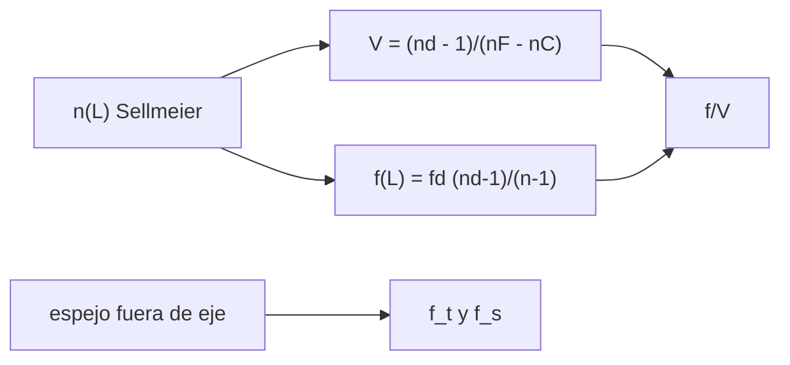

# B41-C14 — Aberración cromática y astigmatismo

<!-- nav:top -->
[🏠 Programa](../../../../README.md) · [📚 Bloque B41](../../../tronco-comun/B41-optica-geometrica-y-diseno-de-telescopios.md) · [← Anterior: B41-C13 — Aberración esférica y coma](../B41-C13-aberracion-esferica-y-coma/CLASE.md) · [Siguiente: B41-C15 — Refractores acromáticos y apocromáticos →](../B41-C15-refractores-acromaticos-y-apocromaticos/CLASE.md)
<!-- /nav -->

## 1. Ubicación, nivel y alcance

Clase 14 del bloque B41. Nivel N3. Calculas la **dispersión** de un vidrio con Sellmeier (coeficientes de memoria, **no consultados**), la **aberración cromática longitudinal** de una lente y el **astigmatismo** de un espejo esférico fuera del eje. Usas [B42](../../../tronco-comun/B42-optica-fisica-y-optica-adaptativa.md). Datos ilustrativos.

## 2. Por qué esta clase existe

El color y el astigmatismo degradan el campo de refractores y espejos. La decisión central: **¿cuánto se separan los focos por color y por plano?**

## 3. Lo que podrás hacer al terminar

1. Calcular `n(λ)` por Sellmeier.
2. Calcular el número de Abbe.
3. Medir la separación focal F–C.
4. Comparar con `f/V`.
5. Trazar focos tangencial y sagital.
6. Comparar con `(R/2) cos t` y `R/(2 cos t)`.

La evidencia es la **ficha de aberración cromática y astigmatismo** del ejercicio 12 (sección 20).

## 4. Con qué llegas y cómo comprobarlo

1. ¿Qué es un rayo de luz en óptica geométrica?
2. ¿Qué dice la ley de Snell?
3. ¿Qué es la distancia focal de una lente o un espejo?
4. ¿Qué es un valor ilustrativo?
5. ¿Qué es una verificación numérica?

<details>
<summary>Ver respuestas</summary>

1. Una línea que indica la dirección de propagación de la energía. 2. `n₁ sen θ₁ = n₂ sen θ₂`. 3. La distancia del elemento al punto donde converge un haz paralelo. 4. Un valor propuesto para el ejemplo, no medido. 5. Comparar un cálculo con un caso independiente.
</details>

Con cuatro o cinco aciertos, sigue; si no, repasa los prerrequisitos.

## 5. Un caso de contexto y casos de referencia

Un vidrio ilustrativo tipo crown (`V = 64,14`) con `f = 1000 mm` separa los focos F y C `15,498 mm` (fórmula `f/V` = `15,591`); un espejo esférico de `R = 2000 mm` a `5°` separa los focos sagital y tangencial `7,6251 mm`. Es el **ejemplo conductor**.

## 6. Vocabulario

La **dispersión**. El **número de Abbe** `V`. La **aberración cromática longitudinal**. Las líneas **F, d, C**. El **astigmatismo**. Los **focos tangencial y sagital**.

## 7. Modelo mental: un prisma

Como un prisma que abre la luz blanca en colores: la lente es un prisma curvo, cada color enfoca en un punto y el conjunto se desenfoca.



*Descripción textual:* la dispersión del vidrio fija la separación focal y el campo fuera de eje la del astigmatismo.

Analogía: un prisma. Límite: lente delgada y haz fino.

## 8. La explicación, paso a paso

### 8.1 Dispersión

`nF = 1,52238`, `nd = 1,51680`, `nC = 1,51432`, `V = 64,14`.

| λ (nm) | n | f (mm) | f − f_d (mm) |
|---|---|---|---|
| 400,0 | 1,53085 | 973,533 | −26,467 |
| 486,1 | 1,52238 | 989,318 | −10,682 |
| 550,0 | 1,51852 | 996,675 | −3,325 |
| 587,6 | 1,51680 | 1000,000 | 0,000 |
| 656,3 | 1,51432 | 1004,816 | 4,816 |
| 800,0 | 1,51078 | 1011,790 | 11,790 |

La separación F–C es `15,498 mm`; `f/V = 15,591 mm` (razón `0,9941`). El disco cromático en f/10 es `1549,8 µm`, `115,5` veces el disco de Airy de `13,4 µm`; la profundidad de enfoque `4λN²` es `0,220 mm`.

### 8.2 Astigmatismo

| t (°) | f_tang (mm) | `(R/2) cos t` | f_sag (mm) | `R/(2 cos t)` | f_s − f_t (mm) |
|---|---|---|---|---|---|
| 1 | 999,8477 | 999,8477 | 1000,1523 | 1000,1523 | 0,3046 |
| 3 | 998,6295 | 998,6295 | 1001,3723 | 1001,3723 | 2,7428 |
| 5 | 996,1947 | 996,1947 | 1003,8198 | 1003,8198 | 7,6251 |
| 8 | 990,2681 | 990,2681 | 1009,8276 | 1009,8276 | 19,5595 |

A `5°`, `(R/2) t² = 7,6154 mm`, cerca de la separación exacta.

### 8.3 Lectura

Una lente simple de 100 mm f/10 es 115 veces peor que la difracción por color: por eso se usan dobletes (clase 15) o espejos.

## 9. Magnitudes, símbolos y unidades

| Símbolo | Qué es | Unidad | Valor / nota |
|---|---|---|---|
| `V` | número de Abbe | — | 64,14 |
| `nF, nd, nC` | índices en F, d, C | — | 1,52238; 1,51680; 1,51432 |
| `Δf` | separación focal F–C | mm | 15,498 |
| `t` | ángulo de campo | ° | 1 a 8 |
| `f_t, f_s` | focos tangencial y sagital | mm | ver tabla |

## 10. Convenciones y referencias

Distancias en milímetros salvo indicación; ángulos en radianes o grados según se rotule; las salidas del laboratorio usan punto decimal y el texto usa coma decimal. Los valores de vidrios, instrumentos y sensores son ilustrativos.

## 11. De dónde sale lo que afirmamos

| ID | Fuente | Localizador | Respalda | Estado |
|---|---|---|---|---|
| — | Sin fuente externa | — | coeficientes de Sellmeier escritos de memoria | NO consultados; ilustrativos, no son un catálogo de fabricante |

Límites: los coeficientes de Sellmeier y las líneas espectrales son valores de libro recordados, no consultados.

## 12. Cómo ver color y astigmatismo

La dispersión del vidrio desplaza el foco por color y el espejo fuera de eje separa dos focos.

## 13. Ejemplo trabajado: separación F–C

**Paso 1 · Abbe.** `V = (1,51680−1)/(1,52238−1,51432) = 0,51680/0,00806 = 64,1`.

**Paso 2 · Separación.** `f/V = 1000/64,14 = 15,59 mm`.

**Paso 3 · Laboratorio.** La diferencia exacta da `15,498 mm` (0,6 % menos).

## 14. Distintas formas de describir el resultado

**Por fórmula:** la relación analítica. **Por tabla:** las cifras del laboratorio. **Por gráfica:** el diagrama de la sección 7. **Por código:** el script de la sección 17.

## 15. Práctica guiada

**Ejercicio 1 · con los pasos indicados.** `V` con `nd = 1,5168`, `nF = 1,5224`, `nC = 1,5143`.

<details><summary>Solución comentada</summary>

`≈ 63,8`.
</details>

**Ejercicio 2 · con una pista.** `f/V` con `f = 1000` y `V = 64,14`.

<details><summary>Solución comentada</summary>

`15,59 mm`.
</details>

**Ejercicio 3 · casi autónomo.** Disco cromático f/10 (`D = 100`) con `Δf = 15,5`.

<details><summary>Solución comentada</summary>

`1,55 mm`.
</details>

## 16. Práctica autónoma, transferencia e integrador

**Ejercicio 4.** Razón con el disco de Airy `13,4 µm`.

<details><summary>Solución comentada</summary>

`115`.
</details>

**Ejercicio 5.** `f_tang` a `5°` con `R = 2000`.

<details><summary>Solución comentada</summary>

`996,19 mm`.
</details>

**Ejercicio 6.** `f_sag` a `5°`.

<details><summary>Solución comentada</summary>

`1003,82 mm`.
</details>

**Ejercicio 7.** Separación a `5°`.

<details><summary>Solución comentada</summary>

`7,625 mm`.
</details>

**Ejercicio 8.** `(R/2) t²` a `5°`.

<details><summary>Solución comentada</summary>

`7,615 mm`.
</details>

**Ejercicio 9 · transferencia.** **Transferencia.** ¿Por qué un espejo no tiene aberración cromática?

<details><summary>Solución comentada</summary>

La reflexión no depende del índice.
</details>

**Ejercicio 10 · transferencia.** **Transferencia.** ¿Qué sentido tiene un número de Abbe mayor?

<details><summary>Solución comentada</summary>

Menos dispersión.
</details>

**Ejercicio 11 · transferencia.** **Transferencia.** ¿Por qué el astigmatismo crece con el cuadrado del ángulo?

<details><summary>Solución comentada</summary>

La separación `≈ (R/2) t²`.
</details>

**Ejercicio 12.** **Integrador.** Elabora tu *ficha de aberración cromática y astigmatismo*.

<details><summary>Solución comentada</summary>

Secciones 8.1–8.3.
</details>

**Ejercicio 12 · integrador.** **Integrador.** Elabora tu *ficha de aberración cromática y astigmatismo*.

<details><summary>Solución modelo</summary>

Secciones 8.1–8.3.
</details>

## 17. Laboratorio: dispersión y astigmatismo

El script [cromatica.py](cromatica.py) calcula la dispersión, el número de Abbe y los focos tangencial y sagital (**comprueba** `f/V` a 3 % y los focos a `10⁻⁴`).

**Datos:** sin constantes; Sellmeier **recordado, no consultado**. **Predice antes de ejecutar:** ¿qué separación da f/V? (≈ 15,6 mm.) **Ejecución del 2026-11-09 (Python 3.12.9):**

```text
Python 3.12.9 (biblioteca estandar)
nF = 1.52238 ; nd = 1.51680 ; nC = 1.51432 ; V = 64.14
 lambda [nm]         n     f [mm]  f - f_d [mm]
       400.0   1.53085    973.533       -26.467
       486.1   1.52238    989.318       -10.682
       550.0   1.51852    996.675        -3.325
       587.6   1.51680   1000.000         0.000
       656.3   1.51432   1004.816         4.816
       800.0   1.51078   1011.790        11.790
separacion focal F-C = 15.498 mm ; f/V = 15.591 mm ; razon = 0.9941
disco cromatico (f/10, F-C) = 1549.8 micras ; disco de Airy a 550 nm = 13.4 micras ; razon = 115.5
profundidad de enfoque total 4 lambda N^2 (f/10) = 0.220 mm ; dispersion F-C = 15.498 mm
espejo esferico R = 2000 mm : foco paraxial 1000.0 mm
 t [deg]  f_tang [mm]   (R/2)cos t   f_sag [mm]   R/(2cos t)  f_s - f_t [mm]
     1.0     999.8477     999.8477    1000.1523    1000.1523          0.3046
     3.0     998.6295     998.6295    1001.3723    1001.3723          2.7428
     5.0     996.1947     996.1947    1003.8198    1003.8198          7.6251
     8.0     990.2681     990.2681    1009.8276    1009.8276         19.5595
a 5 grados: separacion = 7.6251 mm ; (R/2) t^2 = 7.6154 mm
Pruebas superadas.
```

```bash
python programa/clases/B41/B41-C14-aberracion-cromatica-y-astigmatismo/cromatica.py
```

**Límites:** lente delgada, haz fino, tercer orden.

## 18. Errores frecuentes y cómo corregirlos

**Creer que el espejo tiene color.** No lo tiene.

**Confundir tangencial y sagital.** Se corrige con 8.2.

**Usar Sellmeier como dato de catálogo.** Son valores ilustrativos.

**Olvidar la profundidad de foco.** Se compara con `4λN²`.

## 19. Cómo sabrás que vas bien

Tras la sección 8: ¿qué resultado esperabas y cuál obtuviste? Si dudas, repasa el ejemplo 13. Tras el laboratorio: ¿qué comprueba? (ver la sección 17).

## 20. Qué entregas y cómo se evalúa

El producto es tu **ficha de aberración cromática y astigmatismo** (ejercicio 12).

| Criterio | Inicial | En desarrollo | Logrado | Destacado |
|---|---|---|---|---|
| Conceptos | Los confunde | Parciales | conceptos de la clase | Explica los límites |
| Cálculo | Sin unidades | Con errores | Tablas completas | Calcula casos nuevos |
| Numérico | Sin comprobar | Un caso | Contraste con el análisis | Interpreta las diferencias |
| Fuentes | Sin fuente | Sin fecha | fuentes con fecha | Declara lo ilustrativo |
| Límites | No los nombra | Uno | Tres | Discute qué falta del modelo |

**Condiciones críticas (no se compensan con promedio):** rotular lo ilustrativo; no presentar el modelo como un instrumento real; citar solo lo consultado.

## 21. Ética, seguridad y límites

Clase educativa: los modelos son simplificados. Accesibilidad: tablas equivalentes a las gráficas, fórmulas en texto, ejercicios sin conexión.

## 22. Para cerrar y seguir

La lente simple separa los colores `15,5 mm` y el espejo a `5°` separa los focos `7,6 mm`. El siguiente paso es el doblete.

**Glosario español–inglés.** dispersión · *dispersion*; número de Abbe · *Abbe number*; aberración cromática · *chromatic aberration*; astigmatismo · *astigmatism*; sagital · *sagittal*.

**Continuidad.** [B41-C15](../B41-C15-refractores-acromaticos-y-apocromaticos/CLASE.md) estudia los refractores acromáticos y apocromáticos.

**Referencias:** ver sección 11.

<!-- nav:bottom -->
---

[← Anterior: B41-C13 — Aberración esférica y coma](../B41-C13-aberracion-esferica-y-coma/CLASE.md) · [📚 Bloque B41](../../../tronco-comun/B41-optica-geometrica-y-diseno-de-telescopios.md) · [Siguiente: B41-C15 — Refractores acromáticos y apocromáticos →](../B41-C15-refractores-acromaticos-y-apocromaticos/CLASE.md)
<!-- /nav -->
