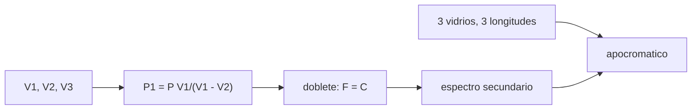

# B41-C15 — Refractores acromáticos y apocromáticos

<!-- nav:top -->
[🏠 Programa](../../../../README.md) · [📚 Bloque B41](../../../tronco-comun/B41-optica-geometrica-y-diseno-de-telescopios.md) · [← Anterior: B41-C14 — Aberración cromática y astigmatismo](../B41-C14-aberracion-cromatica-y-astigmatismo/CLASE.md) · [Siguiente: B41-C16 — Telescopios Newton y Dobson →](../B41-C16-telescopios-newton-y-dobson/CLASE.md)
<!-- /nav -->

## 1. Ubicación, nivel y alcance

Clase 15 del bloque B41. Nivel N3. Resuelves un **doblete acromático** (crown + flint) y un **triplete apocromático** (crown + flint + fluorita) de lentes delgadas en contacto con Sellmeier **recordado, no consultado**. Usas [B10](../../../tronco-comun/B10-algebra-lineal-y-matematicas-geometricas.md) (sistema lineal) y la clase 14.

## 2. Por qué esta clase existe

Un refractor sin color necesita combinar vidrios. La decisión central: **¿cuánto color queda con dos o tres vidrios?**

## 3. Lo que podrás hacer al terminar

1. Calcular `V` de cada vidrio.
2. Repartir la potencia del doblete con `P₁ = P V₁/(V₁−V₂)`.
3. Resolver los factores de forma.
4. Medir el espectro secundario.
5. Resolver el triplete en tres longitudes de onda.
6. Comparar con la profundidad de enfoque.

La evidencia es la **ficha de refractores acromáticos** del ejercicio 12 (sección 20).

## 4. Con qué llegas y cómo comprobarlo

1. ¿Qué es un rayo de luz en óptica geométrica?
2. ¿Qué dice la ley de Snell?
3. ¿Qué es la distancia focal de una lente o un espejo?
4. ¿Qué es un valor ilustrativo?
5. ¿Qué es una verificación numérica?

<details>
<summary>Ver respuestas</summary>

1. Una línea que indica la dirección de propagación de la energía. 2. `n₁ sen θ₁ = n₂ sen θ₂`. 3. La distancia del elemento al punto donde converge un haz paralelo. 4. Un valor propuesto para el ejemplo, no medido. 5. Comparar un cálculo con un caso independiente.
</details>

Con cuatro o cinco aciertos, sigue; si no, repasa los prerrequisitos.

## 5. Un caso de contexto y casos de referencia

El doblete (`V₁ = 64,14`, `V₂ = 36,35`) tiene `f₁ = 433,0 mm` y `f₂ = −764,1 mm` para `F = 1000 mm`; el desenfoque entre 486 y 656 nm baja de `10,682 mm` (singlete) a `0,565 mm` (`2,57` profundidades) y con el triplete a `0,032 mm` (`0,15`). Es el **ejemplo conductor**.

## 6. Vocabulario

El **doblete acromático**. El **espectro secundario**. El **triplete apocromático**. La **potencia** `P = 1/f`. El **factor de forma** `k`. La **profundidad de enfoque**.

## 7. Modelo mental: dos pesas y un contrapeso

Como equilibrar una balanza con dos pesas: el crown converge y el flint diverge, los colores extremos se igualan pero queda un resto en el medio; una tercera pesa lo reduce.



*Descripción textual:* se igualan los focos en dos o tres longitudes de onda y se mide el resto.

Analogía: dos pesas y un contrapeso. Límite: lentes delgadas en contacto y paraxial.

## 8. La explicación, paso a paso

### 8.1 Vidrios

| Vidrio | nd | V |
|---|---|---|
| crown | 1,51680 | 64,14 |
| flint | 1,62004 | 36,35 |
| fluorita | 1,43385 | 94,96 |

Doblete: `P₁` resuelto `2,3092` D frente a `2,3081` D de la fórmula (`0,05 %`); `f₁ = 433,0 mm`, `f₂ = −764,1 mm`.

### 8.2 Desenfoque (mm respecto de 1000)

| λ (nm) | singlete | doblete | triplete |
|---|---|---|---|
| 400,0 | −26,467 | 4,532 | 0,298 |
| 435,8 | −18,777 | 1,726 | 0,042 |
| 486,1 | −10,682 | 0,000 | −0,032 |
| 550,0 | −3,325 | −0,565 | 0,000 |
| 587,6 | 0,000 | −0,500 | 0,016 |
| 656,3 | 4,816 | 0,000 | −0,005 |
| 700,0 | 7,279 | 0,473 | −0,060 |
| 800,0 | 11,790 | 1,822 | −0,303 |

### 8.3 Comparación

Con profundidad de enfoque `4λN² = 0,220 mm` (N = 10): el singlete desenfoca `48,56` profundidades entre 486 y 656 nm, el doblete `2,57` y el triplete `0,15`; entre 400 y 800 nm: `26,467; 4,532; 0,303 mm`.

### 8.4 Lectura

Los factores del triplete `(−3,0533; −0,2394; 6,2841) × 10⁻³ mm⁻¹` son una solución algebraica, no un diseño fabricable: una fluorita con tanta potencia sería de poca práctica.

## 9. Magnitudes, símbolos y unidades

| Símbolo | Qué es | Unidad | Valor / nota |
|---|---|---|---|
| `V` | número de Abbe | — | 64,14; 36,35; 94,96 |
| `P` | potencia total | D | 1,0 |
| `f₁, f₂` | focales del doblete | mm | 433,0; −764,1 |
| `k` | factor de forma | mm⁻¹ | ver 8.4 |
| `ΔF` | desenfoque | mm | ver 8.2 |

## 10. Convenciones y referencias

Distancias en milímetros salvo indicación; ángulos en radianes o grados según se rotule; las salidas del laboratorio usan punto decimal y el texto usa coma decimal. Los valores de vidrios, instrumentos y sensores son ilustrativos.

## 11. De dónde sale lo que afirmamos

| ID | Fuente | Localizador | Respalda | Estado |
|---|---|---|---|---|
| — | Sin fuente externa | — | coeficientes de Sellmeier de tres vidrios escritos de memoria | NO consultados; ilustrativos |

Límites: los vidrios son ilustrativos, no de catálogo; el espectro secundario depende de ellos.

## 12. Cómo ver el color residual

Con dos vidrios coinciden dos colores; con tres, tres.

## 13. Ejemplo trabajado: reparto del doblete

**Paso 1 · Fórmula.** `P₁ = P V₁/(V₁−V₂) = 1 × 64,14/27,79 = 2,308 D`.

**Paso 2 · Focal.** `f₁ = 1000/2,308 = 433,3 mm`.

**Paso 3 · Segundo elemento.** `P₂ = P − P₁ = −1,308 D`, `f₂ = −764,5 mm`.

## 14. Distintas formas de describir el resultado

**Por fórmula:** la relación analítica. **Por tabla:** las cifras del laboratorio. **Por gráfica:** el diagrama de la sección 7. **Por código:** el script de la sección 17.

## 15. Práctica guiada

**Ejercicio 1 · con los pasos indicados.** `P₁` del doblete con `V₁ = 64,14`, `V₂ = 36,35`, `P = 1 D`.

<details><summary>Solución comentada</summary>

`2,308 D`.
</details>

**Ejercicio 2 · con una pista.** `f₁`.

<details><summary>Solución comentada</summary>

`433,3 mm`.
</details>

**Ejercicio 3 · casi autónomo.** `P₂ = P − P₁`.

<details><summary>Solución comentada</summary>

`−1,308 D`.
</details>

## 16. Práctica autónoma, transferencia e integrador

**Ejercicio 4.** Desenfoque del singlete entre F y C.

<details><summary>Solución comentada</summary>

`10,682 mm`.
</details>

**Ejercicio 5.** Idem con el doblete.

<details><summary>Solución comentada</summary>

`0,565 mm`.
</details>

**Ejercicio 6.** Idem con el triplete.

<details><summary>Solución comentada</summary>

`0,032 mm`.
</details>

**Ejercicio 7.** Profundidades de enfoque del doblete.

<details><summary>Solución comentada</summary>

`2,57`.
</details>

**Ejercicio 8.** Desenfoque del doblete en 400 nm.

<details><summary>Solución comentada</summary>

`4,532 mm`.
</details>

**Ejercicio 9 · transferencia.** **Transferencia.** ¿Por qué el doblete no es perfecto?

<details><summary>Solución comentada</summary>

Hay espectro secundario porque las dispersiones parciales no son proporcionales.
</details>

**Ejercicio 10 · transferencia.** **Transferencia.** ¿Qué gana el triplete?

<details><summary>Solución comentada</summary>

Reduce el resto 18 veces en 486–656 nm.
</details>

**Ejercicio 11 · transferencia.** **Transferencia.** Un refractor f/10 de 100 mm: ¿cuánto vale la profundidad de enfoque?

<details><summary>Solución comentada</summary>

`4 × 550 × 10⁻⁶ × 100 = 0,22 mm`.
</details>

**Ejercicio 12.** **Integrador.** Elabora tu *ficha de refractores acromáticos*.

<details><summary>Solución comentada</summary>

Secciones 8.1–8.4.
</details>

**Ejercicio 12 · integrador.** **Integrador.** Elabora tu *ficha de refractores acromáticos*.

<details><summary>Solución modelo</summary>

Secciones 8.1–8.4.
</details>

## 17. Laboratorio: doblete y triplete

El script [acromatico.py](acromatico.py) resuelve doblete y triplete por sistema lineal y mide el desenfoque en el espectro (**comprueba** `P₁` a 2 % de la fórmula y focales iguales en F y C a `10⁻⁶`).

**Datos:** sin constantes; Sellmeier **recordado, no consultado**. **Predice antes de ejecutar:** ¿cuántas profundidades quedan en el doblete? (≈ 2,6.) **Ejecución del 2026-11-09 (Python 3.12.9):**

```text
Python 3.12.9 (biblioteca estandar)
    crown: nd = 1.51680  V = 64.14
    flint: nd = 1.62004  V = 36.35
 fluorita: nd = 1.43385  V = 94.96
doblete crown+flint: P1(d) = 2.3092 dioptrias por resolucion ; formula de libro = 2.3081 ; diferencia 0.05 %
  focales de los elementos en d: f1 = 433.0 mm ; f2 = -764.1 mm
 lambda [nm]   singlete f-1000 [mm]   doblete [mm]   triplete [mm]
       400.0                -26.467          4.532           0.298
       435.8                -18.777          1.726           0.042
       486.1                -10.682          0.000          -0.032
       550.0                 -3.325         -0.565           0.000
       587.6                  0.000         -0.500           0.016
       656.3                  4.816          0.000          -0.005
       700.0                  7.279          0.473          -0.060
       800.0                 11.790          1.822          -0.303
factores de forma del triplete (k1, k2, k3) = (-3.0533, -0.2394, 6.2841) /1000 mm
profundidad de enfoque (4 lambda N^2 con N = 10) = 0.220 mm
  singlete: desenfoque maximo 486-656 nm = 10.682 mm (48.56 profundidades) ; 400-800 nm = 26.467 mm
   doblete: desenfoque maximo 486-656 nm = 0.565 mm (2.57 profundidades) ; 400-800 nm = 4.532 mm
  triplete: desenfoque maximo 486-656 nm = 0.032 mm (0.15 profundidades) ; 400-800 nm = 0.303 mm
Pruebas superadas.
```

```bash
python programa/clases/B41/B41-C15-refractores-acromaticos-y-apocromaticos/acromatico.py
```

**Límites:** lentes delgadas en contacto, sin esfericromatismo.

## 18. Errores frecuentes y cómo corregirlos

**Creer que el doblete elimina todo el color.** Queda espectro secundario.

**Tomar los vidrios como de catálogo.** Son ilustrativos.

**Confundir potencia con focal.** Se suman potencias.

**Ignorar el esfericromatismo.** El modelo es de lente delgada.

## 19. Cómo sabrás que vas bien

Tras la sección 8: ¿qué resultado esperabas y cuál obtuviste? Si dudas, repasa el ejemplo 13. Tras el laboratorio: ¿qué comprueba? (ver la sección 17).

## 20. Qué entregas y cómo se evalúa

El producto es tu **ficha de refractores acromáticos** (ejercicio 12).

| Criterio | Inicial | En desarrollo | Logrado | Destacado |
|---|---|---|---|---|
| Conceptos | Los confunde | Parciales | conceptos de la clase | Explica los límites |
| Cálculo | Sin unidades | Con errores | Tablas completas | Calcula casos nuevos |
| Numérico | Sin comprobar | Un caso | Contraste con el análisis | Interpreta las diferencias |
| Fuentes | Sin fuente | Sin fecha | fuentes con fecha | Declara lo ilustrativo |
| Límites | No los nombra | Uno | Tres | Discute qué falta del modelo |

**Condiciones críticas (no se compensan con promedio):** rotular lo ilustrativo; no presentar el modelo como un instrumento real; citar solo lo consultado.

## 21. Ética, seguridad y límites

Clase educativa: los modelos son simplificados. Accesibilidad: tablas equivalentes a las gráficas, fórmulas en texto, ejercicios sin conexión.

## 22. Para cerrar y seguir

El doblete reduce el color unas 19 veces y el triplete unas 330 en 486–656 nm, con vidrios ilustrativos. Falta el reflector: el telescopio Newton.

**Glosario español–inglés.** doblete acromático · *achromatic doublet*; apocromático · *apochromat*; espectro secundario · *secondary spectrum*; fluorita · *fluorite*; potencia · *power*.

**Continuidad.** [B41-C16](../B41-C16-telescopios-newton-y-dobson/CLASE.md) estudia los telescopios Newton y Dobson.

**Referencias:** ver sección 11.

<!-- nav:bottom -->
---

[← Anterior: B41-C14 — Aberración cromática y astigmatismo](../B41-C14-aberracion-cromatica-y-astigmatismo/CLASE.md) · [📚 Bloque B41](../../../tronco-comun/B41-optica-geometrica-y-diseno-de-telescopios.md) · [Siguiente: B41-C16 — Telescopios Newton y Dobson →](../B41-C16-telescopios-newton-y-dobson/CLASE.md)
<!-- /nav -->
