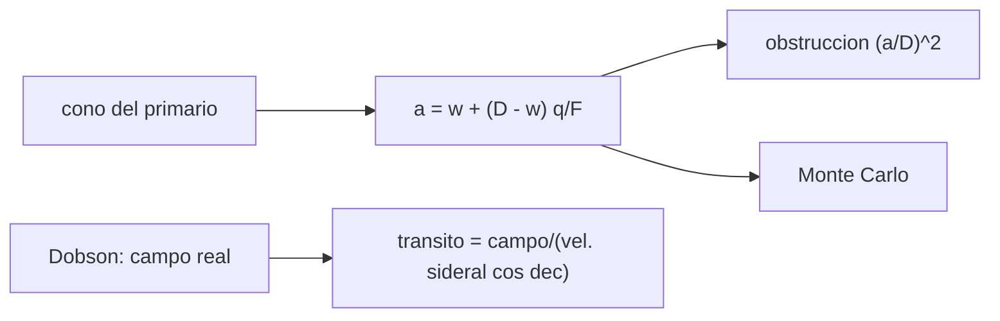

# B41-C16 — Telescopios Newton y Dobson

<!-- nav:top -->
[🏠 Programa](../../../../README.md) · [📚 Bloque B41](../../../tronco-comun/B41-optica-geometrica-y-diseno-de-telescopios.md) · [← Anterior: B41-C15 — Refractores acromáticos y apocromáticos](../B41-C15-refractores-acromaticos-y-apocromaticos/CLASE.md) · [Siguiente: B41-C17 — Telescopios Cassegrain y derivados →](../B41-C17-telescopios-cassegrain-y-derivados/CLASE.md)
<!-- /nav -->

## 1. Ubicación, nivel y alcance

Clase 16 del bloque B41. Nivel N3. Dimensionas el **espejo secundario plano** de un telescopio Newton, calculas su obstrucción y el tiempo de tránsito de un Dobson sin motor. Usas [B12](../../../tronco-comun/B12-probabilidad-estadistica-e-incertidumbre.md) para el Monte Carlo (semilla 20261109). Datos ilustrativos.

## 2. Por qué esta clase existe

El Newton es el reflector más simple y el Dobson su montura más barata. La decisión central: **¿qué tamaño de plano y qué ocular conviene?**

## 3. Lo que podrás hacer al terminar

1. Calcular el eje menor del plano `a = w + (D−w) q/F`.
2. Calcular la obstrucción lineal y por área.
3. Verificar con un Monte Carlo.
4. Ver cómo crece `a` con `q`.
5. Calcular el campo real de un ocular.
6. Calcular el tiempo de tránsito de una montura sin motor.

La evidencia es la **ficha de Newton y Dobson** del ejercicio 12 (sección 20).

## 4. Con qué llegas y cómo comprobarlo

1. ¿Qué es un rayo de luz en óptica geométrica?
2. ¿Qué dice la ley de Snell?
3. ¿Qué es la distancia focal de una lente o un espejo?
4. ¿Qué es un valor ilustrativo?
5. ¿Qué es una verificación numérica?

<details>
<summary>Ver respuestas</summary>

1. Una línea que indica la dirección de propagación de la energía. 2. `n₁ sen θ₁ = n₂ sen θ₂`. 3. La distancia del elemento al punto donde converge un haz paralelo. 4. Un valor propuesto para el ejemplo, no medido. 5. Comparar un cálculo con un caso independiente.
</details>

Con cuatro o cinco aciertos, sigue; si no, repasa los prerrequisitos.

## 5. Un caso de contexto y casos de referencia

En un Newton f/5 de `D = 200 mm` con campo plenamente iluminado de `20 mm` y `q = 130 mm`, el plano necesita `a = 43,40 mm` (`21,7 %` lineal, `4,71 %` por área, `0,0524` mag). Un ocular de 25 mm y campo aparente de 52° da `1,3000°` y un tránsito de `311,1 s` en el ecuador. Es el **ejemplo conductor**.

## 6. Vocabulario

El **secundario plano** a 45°. El **eje menor** y el **eje mayor** (`a√2`). El **campo plenamente iluminado**. La **montura Dobson** (altazimutal sin motor). El **campo real** y el **campo aparente**. La **velocidad sideral**.

## 7. Modelo mental: una linterna con espejo

Como el espejo de un periscopio: debe ser lo bastante grande para recoger el cono de luz y la imagen del campo, pero cada milímetro extra tapa luz del primario.



*Descripción textual:* el cono de luz y el campo definen el plano; el campo real y la velocidad sideral dan el tránsito.

Analogía: una linterna con espejo. Límite: primario perfecto y secundario a 45°.

## 8. La explicación, paso a paso

### 8.1 Secundario

`a = 20 + 180 × 130/1000 = 43,40 mm`; eje mayor `61,38 mm`; obstrucción lineal `21,7 %`, por área `4,71 %`, pérdida `0,0524` mag. El Monte Carlo (400 000 rayos, semilla 20261109) da un radio máximo `21,5146 mm` frente a `21,7000` (razón `0,9915`).

| q (mm) | a (mm) | Obstrucción lineal (%) |
|---|---|---|
| 100 | 38,00 | 19,0 |
| 130 | 43,40 | 21,7 |
| 160 | 48,80 | 24,4 |
| 200 | 56,00 | 28,0 |

### 8.2 Dobson

Velocidad sideral `15,0411 "/s`. Con ocular de 25 mm (aumento 40) y campo aparente de 52° el campo real es `1,3000° = 4680 "`.

| Declinación (°) | Tránsito (s) |
|---|---|
| 0 | 311,1 |
| 30 | 359,3 |
| 60 | 622,3 |
| 75 | 1202,2 |

Con aumento doble el tránsito en el ecuador dura la mitad: `155,6 s`.

### 8.3 Lectura

El Monte Carlo verifica la geometría del cono, no un trazado óptico independiente; el plano real requiere además margen mecánico.

## 9. Magnitudes, símbolos y unidades

| Símbolo | Qué es | Unidad | Valor / nota |
|---|---|---|---|
| `a` | eje menor del plano | mm | 43,40 |
| `w` | campo plenamente iluminado | mm | 20 |
| `q` | distancia plano-foco | mm | 130 |
| `Ω` | velocidad sideral | "/s | 15,0411 |
| `t` | tiempo de tránsito | s | 311,1 |

## 10. Convenciones y referencias

Distancias en milímetros salvo indicación; ángulos en radianes o grados según se rotule; las salidas del laboratorio usan punto decimal y el texto usa coma decimal. Los valores de vidrios, instrumentos y sensores son ilustrativos.

## 11. De dónde sale lo que afirmamos

| ID | Fuente | Localizador | Respalda | Estado |
|---|---|---|---|---|
| — | Sin fuente externa | — | relaciones geométricas de libro; día sideral 86 164,0905 s recordado | No consultado; ilustrativo |

Límites: el día sideral es un valor de libro no consultado; la geometría del plano es derivable y se verifica con una simulación.

## 12. Cómo ver el plano y el tránsito

El plano debe recoger el cono más el campo; la montura sin motor fija el tiempo de observación.

## 13. Ejemplo trabajado: plano de un Newton f/5

**Paso 1 · Cono.** `D q/F = 200 × 130/1000 = 26 mm`.

**Paso 2 · Campo.** `w (1 − q/F) = 20 × 0,87 = 17,4 mm`.

**Paso 3 · Suma.** `a = 43,4 mm`; `a/D = 21,7 %`.

## 14. Distintas formas de describir el resultado

**Por fórmula:** la relación analítica. **Por tabla:** las cifras del laboratorio. **Por gráfica:** el diagrama de la sección 7. **Por código:** el script de la sección 17.

## 15. Práctica guiada

**Ejercicio 1 · con los pasos indicados.** `a` con `q = 100 mm`.

<details><summary>Solución comentada</summary>

`38,0 mm`.
</details>

**Ejercicio 2 · con una pista.** Obstrucción lineal con `q = 100`.

<details><summary>Solución comentada</summary>

`19,0 %`.
</details>

**Ejercicio 3 · casi autónomo.** Eje mayor con `a = 43,4`.

<details><summary>Solución comentada</summary>

`61,38 mm`.
</details>

## 16. Práctica autónoma, transferencia e integrador

**Ejercicio 4.** Pérdida de área con `a/D = 0,217`.

<details><summary>Solución comentada</summary>

`4,71 %`.
</details>

**Ejercicio 5.** Campo real con ocular de 25 mm (52°).

<details><summary>Solución comentada</summary>

`1,3°`.
</details>

**Ejercicio 6.** Tránsito en dec 0.

<details><summary>Solución comentada</summary>

`311,1 s`.
</details>

**Ejercicio 7.** Tránsito en dec 60.

<details><summary>Solución comentada</summary>

`622,3 s`.
</details>

**Ejercicio 8.** Tránsito con ocular de 12,5 mm (dec 0).

<details><summary>Solución comentada</summary>

`155,6 s`.
</details>

**Ejercicio 9 · transferencia.** **Transferencia.** ¿Por qué un Dobson f/5 es corto y estable?

<details><summary>Solución comentada</summary>

La focal es 5 `D`.
</details>

**Ejercicio 10 · transferencia.** **Transferencia.** ¿Por qué el tránsito crece con la declinación?

<details><summary>Solución comentada</summary>

La velocidad aparente baja con `cos δ`.
</details>

**Ejercicio 11 · transferencia.** **Transferencia.** ¿Qué haría un campo plenamente iluminado de 0?

<details><summary>Solución comentada</summary>

`a = D q/F = 26 mm`.
</details>

**Ejercicio 12.** **Integrador.** Elabora tu *ficha de Newton y Dobson*.

<details><summary>Solución comentada</summary>

Secciones 8.1–8.3.
</details>

**Ejercicio 12 · integrador.** **Integrador.** Elabora tu *ficha de Newton y Dobson*.

<details><summary>Solución modelo</summary>

Secciones 8.1–8.3.
</details>

## 17. Laboratorio: plano y tránsito

El script [newton.py](newton.py) calcula el plano secundario con Monte Carlo de semilla fija y el tránsito en una montura sin motor (**comprueba** el radio a 2 % de la fórmula).

**Datos:** sin constantes; día sideral **no consultado**. **Predice antes de ejecutar:** ¿cuánto mide el plano? (≈ 43,4 mm.) **Ejecución del 2026-11-09 (Python 3.12.9):**

```text
Python 3.12.9 (biblioteca estandar)
Newton f/5: D = 200 mm, F = 1000 mm, campo plenamente iluminado w = 20 mm, q = 130 mm
eje menor del plano a = w + (D - w) q/F = 43.40 mm ; eje mayor (a por raiz de 2) = 61.38 mm
obstruccion lineal = 21.7 % ; por area = 4.71 % ; perdida de luz = 0.0524 mag
Monte Carlo (400000 rayos, semilla 20261109): radio maximo = 21.5146 mm ; formula a/2 = 21.7000 mm ; razon = 0.9915
 q [mm]   a [mm]   obstruccion lineal [%]
    100    38.00                     19.0
    130    43.40                     21.7
    160    48.80                     24.4
    200    56.00                     28.0
velocidad sideral = 15.0411 arcsec/s
ocular 25 mm: aumento 40 ; campo real = 1.3000 deg = 4680.0 arcsec
dec [deg]  transito [s]
        0         311.1
       30         359.3
       60         622.3
       75        1202.2
con aumento doble el transito dura la mitad: 155.6 s en dec 0
Pruebas superadas.
```

```bash
python programa/clases/B41/B41-C16-telescopios-newton-y-dobson/newton.py
```

**Límites:** primario perfecto, plano perpendicular al eje en la medición.

## 18. Errores frecuentes y cómo corregirlos

**Dimensionar el plano solo por el cono.** Hay que sumar el campo.

**Medir `q` desde el borde del tubo.** Es la distancia plano-foco.

**Olvidar `cos δ`.** Se corrige con 8.2.

**Creer que el Monte Carlo es un trazado completo.** Solo verifica la geometría.

## 19. Cómo sabrás que vas bien

Tras la sección 8: ¿qué resultado esperabas y cuál obtuviste? Si dudas, repasa el ejemplo 13. Tras el laboratorio: ¿qué comprueba? (ver la sección 17).

## 20. Qué entregas y cómo se evalúa

El producto es tu **ficha de Newton y Dobson** (ejercicio 12).

| Criterio | Inicial | En desarrollo | Logrado | Destacado |
|---|---|---|---|---|
| Conceptos | Los confunde | Parciales | conceptos de la clase | Explica los límites |
| Cálculo | Sin unidades | Con errores | Tablas completas | Calcula casos nuevos |
| Numérico | Sin comprobar | Un caso | Contraste con el análisis | Interpreta las diferencias |
| Fuentes | Sin fuente | Sin fecha | fuentes con fecha | Declara lo ilustrativo |
| Límites | No los nombra | Uno | Tres | Discute qué falta del modelo |

**Condiciones críticas (no se compensan con promedio):** rotular lo ilustrativo; no presentar el modelo como un instrumento real; citar solo lo consultado.

## 21. Ética, seguridad y límites

Clase educativa: los modelos son simplificados. Accesibilidad: tablas equivalentes a las gráficas, fórmulas en texto, ejercicios sin conexión.

## 22. Para cerrar y seguir

Un plano de `43,4 mm` en un f/5 de 200 mm obstruye `21,7 %` lineal; el Dobson sin motor da 311 s de tránsito. Falta el Cassegrain.

**Glosario español–inglés.** secundario · *secondary mirror*; Dobson · *Dobsonian*; obstrucción · *obstruction*; campo real · *true field*; tránsito · *drift time*.

**Continuidad.** [B41-C17](../B41-C17-telescopios-cassegrain-y-derivados/CLASE.md) estudia los Cassegrain y derivados.

**Referencias:** ver sección 11.

<!-- nav:bottom -->
---

[← Anterior: B41-C15 — Refractores acromáticos y apocromáticos](../B41-C15-refractores-acromaticos-y-apocromaticos/CLASE.md) · [📚 Bloque B41](../../../tronco-comun/B41-optica-geometrica-y-diseno-de-telescopios.md) · [Siguiente: B41-C17 — Telescopios Cassegrain y derivados →](../B41-C17-telescopios-cassegrain-y-derivados/CLASE.md)
<!-- /nav -->
