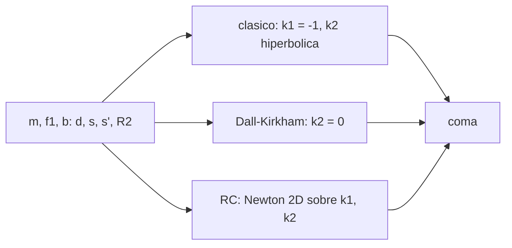

# B41-C17 — Telescopios Cassegrain y derivados

<!-- nav:top -->
[🏠 Programa](../../../../README.md) · [📚 Bloque B41](../../../tronco-comun/B41-optica-geometrica-y-diseno-de-telescopios.md) · [← Anterior: B41-C16 — Telescopios Newton y Dobson](../B41-C16-telescopios-newton-y-dobson/CLASE.md) · [Siguiente: B41-C18 — Monturas y mecanismos de seguimiento →](../B41-C18-monturas-y-mecanismos-de-seguimiento/CLASE.md)
<!-- /nav -->

## 1. Ubicación, nivel y alcance

Clase 17 del bloque B41. Nivel N3. Trazas dos espejos cónicos exactos para un **Cassegrain clásico**, un **Dall-Kirkham** y un **Ritchey-Chrétien** de `D = 200 mm`, `f₁ = 400 mm` y focal efectiva `2000 mm`, y resuelves por Newton las constantes cónicas. Usas [B10](../../../tronco-comun/B10-algebra-lineal-y-matematicas-geometricas.md). Los datos son ilustrativos.

## 2. Por qué esta clase existe

Dos espejos permiten un tubo corto y focal larga, y distintos diseños eligen qué aberración corregir. La decisión central: **¿qué diseño corrige la coma y a qué costo?**

## 3. Lo que podrás hacer al terminar

1. Calcular la geometría de primer orden.
2. Calcular `k₂ = −((m+1)/(m−1))²`.
3. Trazar dos espejos cónicos.
4. Resolver Dall-Kirkham (`k₂ = 0`).
5. Resolver Ritchey-Chrétien por Newton 2D.
6. Comparar las comas.

La evidencia es la **ficha de Cassegrain y derivados** del ejercicio 12 (sección 20).

## 4. Con qué llegas y cómo comprobarlo

1. ¿Qué es un rayo de luz en óptica geométrica?
2. ¿Qué dice la ley de Snell?
3. ¿Qué es la distancia focal de una lente o un espejo?
4. ¿Qué es un valor ilustrativo?
5. ¿Qué es una verificación numérica?

<details>
<summary>Ver respuestas</summary>

1. Una línea que indica la dirección de propagación de la energía. 2. `n₁ sen θ₁ = n₂ sen θ₂`. 3. La distancia del elemento al punto donde converge un haz paralelo. 4. Un valor propuesto para el ejemplo, no medido. 5. Comparar un cálculo con un caso independiente.
</details>

Con cuatro o cinco aciertos, sigue; si no, repasa los prerrequisitos.

## 5. Un caso de contexto y casos de referencia

Con `m = 5` y foco `100 mm` tras el primario: `d = 316,667 mm`, `R₂ = 208,333 mm` y `k₂ = −2,25`; el clásico da coma `10,955 µm` a 10', el Dall-Kirkham `135,089 µm` y el Ritchey-Chrétien `0` (`k₁ = −1,02130`, `k₂ = −2,44971`). Es el **ejemplo conductor**.

## 6. Vocabulario

El **Cassegrain clásico** (primario parabólico, secundario hiperbólico). El **Dall-Kirkham** (secundario esférico). El **Ritchey-Chrétien** (aplanático). El **aumento del secundario** `m`. La **focal efectiva**. La **constante cónica** `k`.

## 7. Modelo mental: un periscopio plegado

Como un periscopio que pliega la luz en dos: el secundario convexo la devuelve al primario y la focal efectiva es `m` veces la del primario en un tubo corto.



*Descripción textual:* la geometría de primer orden fija las curvaturas y las constantes cónicas anulan la aberración esférica y, en el RC, la coma.

Analogía: un periscopio plegado. Límite: rayos meridionales, sin obstrucción modelada.

## 8. La explicación, paso a paso

### 8.1 Geometría

`d = 316,667 mm`, `s = 83,333`, `s' = 416,667`, `R₁ = 800,0`, `R₂ = 208,333 mm` (convexo). La focal efectiva medida es `1999,77 mm` (esperada `2000`).

### 8.2 Tres diseños

| Diseño | k₁ | k₂ | Aberración esférica (mm) | Coma a 10' (µm) |
|---|---|---|---|---|
| Cassegrain | −1,00000 | −2,25000 | −3,2 × 10⁻¹⁴ | 10,955 |
| Dall-Kirkham | −0,76197 | 0,00000 | 4,6 × 10⁻¹⁴ | 135,089 |
| Ritchey-Chrétien | −1,02130 | −2,44971 | 4,2 × 10⁻¹² | −0,000000 |

La coma del paraboloide f/10 con la misma focal es `10,908 µm`: el Cassegrain clásico (`10,955`) coincide (razón `1,004`).

### 8.3 Más campo

A `30 arcmin` la coma residual es `1,338 µm` en el RC y `33,775 µm` en el clásico. El secundario intercepta un cono de `20,83 mm` de radio: obstrucción lineal mínima `20,8 %`.

### 8.4 Lectura

El Dall-Kirkham es fácil de fabricar (secundario esférico) pero paga `12,3` veces más coma; el RC exige dos hiperboloides, pero es plano de coma y aplanático.

## 9. Magnitudes, símbolos y unidades

| Símbolo | Qué es | Unidad | Valor / nota |
|---|---|---|---|
| `m` | aumento del secundario | — | 5 |
| `d` | separación de espejos | mm | 316,667 |
| `R₂` | radio del secundario | mm | 208,333 |
| `k₁, k₂` | constantes cónicas | — | ver 8.2 |
| `F` | focal efectiva | mm | 2000 |

## 10. Convenciones y referencias

Distancias en milímetros salvo indicación; ángulos en radianes o grados según se rotule; las salidas del laboratorio usan punto decimal y el texto usa coma decimal. Los valores de vidrios, instrumentos y sensores son ilustrativos.

## 11. De dónde sale lo que afirmamos

| ID | Fuente | Localizador | Respalda | Estado |
|---|---|---|---|---|
| — | Sin fuente externa | — | relaciones de óptica geométrica de libro que verifica el laboratorio | No se consultó una fuente para esta clase; las cifras son ilustrativas |

Límites: las fórmulas de primer orden y las cónicas son de libro; el Ritchey-Chrétien se obtiene numéricamente y no se contrastó con una fuente.

## 12. Cómo ver tres diseños

Las constantes cónicas deciden qué aberración se anula.

## 13. Ejemplo trabajado: geometría del Cassegrain

**Paso 1 · Separación.** `d = (m f₁ − b)/(m+1) = (2000 − 100)/6 = 316,667 mm`.

**Paso 2 · Distancias.** `s = f₁ − d = 83,333`, `s' = d + b = 416,667`.

**Paso 3 · Radio.** `R₂ = 2 s s'/(s' − s) = 2 × 34 722,2/333,333 = 208,333 mm`.

## 14. Distintas formas de describir el resultado

**Por fórmula:** la relación analítica. **Por tabla:** las cifras del laboratorio. **Por gráfica:** el diagrama de la sección 7. **Por código:** el script de la sección 17.

## 15. Práctica guiada

**Ejercicio 1 · con los pasos indicados.** `d` con `m = 5`, `f₁ = 400`, `b = 100`.

<details><summary>Solución comentada</summary>

`316,667 mm`.
</details>

**Ejercicio 2 · con una pista.** `s` y `s'`.

<details><summary>Solución comentada</summary>

`83,333`; `416,667 mm`.
</details>

**Ejercicio 3 · casi autónomo.** `k₂` del clásico.

<details><summary>Solución comentada</summary>

`−2,25`.
</details>

## 16. Práctica autónoma, transferencia e integrador

**Ejercicio 4.** `R₂`.

<details><summary>Solución comentada</summary>

`208,333 mm`.
</details>

**Ejercicio 5.** Coma del clásico a 10'.

<details><summary>Solución comentada</summary>

`10,955 µm`.
</details>

**Ejercicio 6.** Cociente de comas DK/clásico.

<details><summary>Solución comentada</summary>

`12,3`.
</details>

**Ejercicio 7.** Coma del RC a 30'.

<details><summary>Solución comentada</summary>

`1,338 µm`.
</details>

**Ejercicio 8.** Obstrucción lineal mínima.

<details><summary>Solución comentada</summary>

`20,8 %`.
</details>

**Ejercicio 9 · transferencia.** **Transferencia.** ¿Por qué se usan Ritchey-Chrétien en telescopios grandes?

<details><summary>Solución comentada</summary>

Corrigen coma y esférica con campo amplio.
</details>

**Ejercicio 10 · transferencia.** **Transferencia.** ¿Qué cambia con `m = 4`?

<details><summary>Solución comentada</summary>

La focal efectiva baja a 1600 mm y cambian `d`, `R₂`, `k₂`.
</details>

**Ejercicio 11 · transferencia.** **Transferencia.** ¿Y el astigmatismo?

<details><summary>Solución comentada</summary>

No se anula con dos cónicas; queda en los bordes.
</details>

**Ejercicio 12.** **Integrador.** Elabora tu *ficha de Cassegrain y derivados*.

<details><summary>Solución comentada</summary>

Secciones 8.1–8.4.
</details>

**Ejercicio 12 · integrador.** **Integrador.** Elabora tu *ficha de Cassegrain y derivados*.

<details><summary>Solución modelo</summary>

Secciones 8.1–8.4.
</details>

## 17. Laboratorio: dos espejos cónicos

El script [cassegrain.py](cassegrain.py) traza dos espejos cónicos exactos, resuelve Dall-Kirkham por bisección y Ritchey-Chrétien por Newton 2D (**comprueba** la aberración esférica a `10⁻⁶ mm` y la coma del clásico a 10 % de la fórmula).

**Datos:** sin constantes; geometría **ilustrativa**. **Predice antes de ejecutar:** ¿cuál tendrá menos coma? (el RC.) **Ejecución del 2026-11-09 (Python 3.12.9):**

```text
Python 3.12.9 (biblioteca estandar)
geometria de primer orden: separacion d = 316.667 mm ; s = 83.333 ; s' = 416.667 ; R1 = 800.0 ; R2 = 208.333 mm (convexo)
        diseno         k1         k2  esferica [mm]   coma 10 arcmin [micras]
    Cassegrain   -1.00000   -2.25000      -3.20e-14                    10.955
focal efectiva medida = 1999.77 mm (esperada 2000 mm)
  coma del paraboloide f/10 con la misma focal: 3 theta F/(16 N^2) = 10.908 micras ; razon con el clasico = 1.004
  Dall-Kirkham   -0.76197    0.00000       4.62e-14                   135.089
Ritchey-Chretien   -1.02130   -2.44971       4.22e-12                 -0.000000
a 30 arcmin la coma residual del RC = 1.338 micras ; del clasico = 33.775 micras
el secundario intercepta un cono de radio 20.83 mm: obstruccion lineal minima = 20.8 % (sin campo)
Pruebas superadas.
```

```bash
python programa/clases/B41/B41-C17-telescopios-cassegrain-y-derivados/cassegrain.py
```

**Límites:** meridional, sin obstrucción modelada en el trazado.

## 18. Errores frecuentes y cómo corregirlos

**Usar `k₂ = 0` esperando un Cassegrain perfecto.** Es el Dall-Kirkham.

**Confundir `R₂` convexo con cóncavo.** Es convexo.

**Olvidar el foco trasero `b`.** Define `d`.

**Creer que el RC no tiene aberraciones.** Conserva astigmatismo.

## 19. Cómo sabrás que vas bien

Tras la sección 8: ¿qué resultado esperabas y cuál obtuviste? Si dudas, repasa el ejemplo 13. Tras el laboratorio: ¿qué comprueba? (ver la sección 17).

## 20. Qué entregas y cómo se evalúa

El producto es tu **ficha de Cassegrain y derivados** (ejercicio 12).

| Criterio | Inicial | En desarrollo | Logrado | Destacado |
|---|---|---|---|---|
| Conceptos | Los confunde | Parciales | conceptos de la clase | Explica los límites |
| Cálculo | Sin unidades | Con errores | Tablas completas | Calcula casos nuevos |
| Numérico | Sin comprobar | Un caso | Contraste con el análisis | Interpreta las diferencias |
| Fuentes | Sin fuente | Sin fecha | fuentes con fecha | Declara lo ilustrativo |
| Límites | No los nombra | Uno | Tres | Discute qué falta del modelo |

**Condiciones críticas (no se compensan con promedio):** rotular lo ilustrativo; no presentar el modelo como un instrumento real; citar solo lo consultado.

## 21. Ética, seguridad y límites

Clase educativa: los modelos son simplificados. Accesibilidad: tablas equivalentes a las gráficas, fórmulas en texto, ejercicios sin conexión.

## 22. Para cerrar y seguir

El RC anula la coma que el clásico deja en `10,955 µm` y el Dall-Kirkham aumenta a `135 µm`. Falta mover el instrumento: monturas y seguimiento.

**Glosario español–inglés.** Cassegrain · *Cassegrain*; Ritchey-Chrétien · *Ritchey-Chrétien*; Dall-Kirkham · *Dall-Kirkham*; hiperboloide · *hyperboloid*; aplanático · *aplanatic*.

**Continuidad.** [B41-C18](../B41-C18-monturas-y-mecanismos-de-seguimiento/CLASE.md) estudia las monturas y los mecanismos de seguimiento.

**Referencias:** ver sección 11.

<!-- nav:bottom -->
---

[← Anterior: B41-C16 — Telescopios Newton y Dobson](../B41-C16-telescopios-newton-y-dobson/CLASE.md) · [📚 Bloque B41](../../../tronco-comun/B41-optica-geometrica-y-diseno-de-telescopios.md) · [Siguiente: B41-C18 — Monturas y mecanismos de seguimiento →](../B41-C18-monturas-y-mecanismos-de-seguimiento/CLASE.md)
<!-- /nav -->
