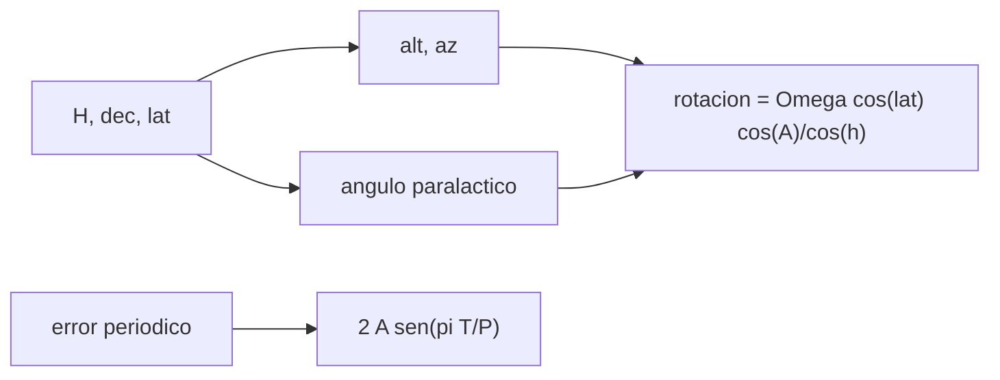

# B41-C18 — Monturas y mecanismos de seguimiento

<!-- nav:top -->
[🏠 Programa](../../../../README.md) · [📚 Bloque B41](../../../tronco-comun/B41-optica-geometrica-y-diseno-de-telescopios.md) · [← Anterior: B41-C17 — Telescopios Cassegrain y derivados](../B41-C17-telescopios-cassegrain-y-derivados/CLASE.md) · [Siguiente: B41-C19 — Colimación y prueba de enfoque →](../B41-C19-colimacion-y-prueba-de-enfoque/CLASE.md)
<!-- /nav -->

## 1. Ubicación, nivel y alcance

Clase 18 del bloque B41. Nivel N3. Calculas la **rotación de campo** de una montura altazimutal con el ángulo paralactico y la **deriva** que produce el **error periódico** de un tornillo sin fin con una simulación de semilla 20261109. Usas [B05](../../../tronco-comun/B05-fisica-fundamental-para-el-espacio.md) y [B12](../../../tronco-comun/B12-probabilidad-estadistica-e-incertidumbre.md). Datos ilustrativos.

## 2. Por qué esta clase existe

La montura decide cuánto tiempo se puede exponer. La decisión central: **¿altazimutal o ecuatorial y qué exposición máxima sin guiado?**

## 3. Lo que podrás hacer al terminar

1. Calcular altitud y azimut desde ángulo horario.
2. Calcular el ángulo paralactico.
3. Comparar la rotación de campo con la fórmula.
4. Ver el paso casi cenital.
5. Calcular la deriva `2A sen(πT/P)`.
6. Hallar la exposición máxima sin guiado.

La evidencia es la **ficha de monturas y seguimiento** del ejercicio 12 (sección 20).

## 4. Con qué llegas y cómo comprobarlo

1. ¿Qué es un rayo de luz en óptica geométrica?
2. ¿Qué dice la ley de Snell?
3. ¿Qué es la distancia focal de una lente o un espejo?
4. ¿Qué es un valor ilustrativo?
5. ¿Qué es una verificación numérica?

<details>
<summary>Ver respuestas</summary>

1. Una línea que indica la dirección de propagación de la energía. 2. `n₁ sen θ₁ = n₂ sen θ₂`. 3. La distancia del elemento al punto donde converge un haz paralelo. 4. Un valor propuesto para el ejemplo, no medido. 5. Comparar un cálculo con un caso independiente.
</details>

Con cuatro o cinco aciertos, sigue; si no, repasa los prerrequisitos.

## 5. Un caso de contexto y casos de referencia

A latitud `−30°` y declinación `−20°`, la rotación de campo es de `24,4448 "/s` a 1 h del meridiano y `50,4262 "/s` a 30 min; cerca del cenit llega a `1255,412 "/s`. Con error periódico de `15 "` y periodo `479 s`, la exposición sin guiado para derivar menos de `1 "` es `5,08 s`. Es el **ejemplo conductor**.

## 6. Vocabulario

La **montura ecuatorial**. La **montura altazimutal**. La **rotación de campo**. El **ángulo paralactico**. El **error periódico**. El **guiado**.

## 7. Modelo mental: un disco giratorio

Como un tocadiscos: la ecuatorial gira a un solo ritmo y mantiene el campo; la altazimutal necesita dos ejes a ritmos variables y el campo gira.



*Descripción textual:* la geometría esférica da la rotación de campo y el error del tornillo limita el tiempo sin guiado.

Analogía: un disco giratorio. Límite: refracción y flexiones despreciadas.

## 8. La explicación, paso a paso

### 8.1 Rotación de campo (módulo)

| H (h) | Altitud (°) | Azimut (°) | Fórmula ("/s) | Derivada numérica ("/s) |
|---|---|---|---|---|
| −3,0 | 48,284 | 86,896 | 1,0600 | 1,0600 |
| −1,0 | 73,152 | 57,050 | 24,4448 | 24,4448 |
| −0,5 | 77,917 | 35,870 | 50,4262 | 50,4262 |
| 0,5 | 77,917 | −35,870 | 50,4262 | 50,4262 |
| 1,0 | 73,152 | −57,050 | 24,4448 | 24,4448 |
| 3,0 | 48,284 | −86,896 | 1,0600 | 1,0600 |

Cerca del cenit (dec −29,5°):

| H (min) | Altitud (°) | Rotación ("/s) |
|---|---|---|
| −20,0 | 85,631 | 15,868 |
| −5,0 | 88,805 | 258,301 |
| −1,0 | 89,455 | 1255,412 |
| 1,0 | 89,455 | 1255,412 |

### 8.2 Error periódico (P = 479 s, A = 15 ")

| T (s) | Analítica (") | Simulación (") |
|---|---|---|
| 1,0 | 0,1968 | 0,1968 |
| 5,0 | 0,9836 | 0,9836 |
| 20,0 | 3,9239 | 3,9239 |
| 60,0 | 11,5032 | 11,5032 |
| 120,0 | 21,2480 | 21,2480 |
| 239,5 | 30,0000 | 30,0000 |

La exposición sin guiado con deriva menor de `1 "` es `5,08 s`.

### 8.3 Lectura

Una altazimutal sin rotador de campo no sirve para exposiciones largas cerca del cenit; el sinfin ecuatorial exige guiado para pasar de unos segundos. La simulación toma el máximo sobre 4000 fases y coincide con la analítica.

## 9. Magnitudes, símbolos y unidades

| Símbolo | Qué es | Unidad | Valor / nota |
|---|---|---|---|
| `Ω` | velocidad sideral | "/s | 15,0411 |
| `H` | ángulo horario | h | −3 a 3 |
| `P` | periodo del tornillo | s | 479 (ilustrativo) |
| `A` | amplitud del error | " | 15 (ilustrativo) |
| `T` | exposición | s | 1 a 239,5 |

## 10. Convenciones y referencias

Distancias en milímetros salvo indicación; ángulos en radianes o grados según se rotule; las salidas del laboratorio usan punto decimal y el texto usa coma decimal. Los valores de vidrios, instrumentos y sensores son ilustrativos.

## 11. De dónde sale lo que afirmamos

| ID | Fuente | Localizador | Respalda | Estado |
|---|---|---|---|---|
| — | Sin fuente externa | — | fórmulas de astronomía esférica; día sideral 86 164,0905 s recordado | No consultado; ilustrativo |

Límites: la velocidad sideral usa un día sideral de libro no consultado; el signo de la rotación depende del hemisferio y no se verificó el convenio.

## 12. Cómo ver rotación y deriva

La altazimutal paga con rotación de campo y el tornillo con deriva periódica.

## 13. Ejemplo trabajado: estrella a 1 h del meridiano

**Paso 1 · Altitud y azimut.** `alt = 73,152°`, `az = 57,050°`.

**Paso 2 · Fórmula.** `15,0411 × cos(−30°) × cos 57,05°/cos 73,152° = 24,44 "/s`.

**Paso 3 · Comprobación.** La derivada numérica del ángulo paralactico da `24,4448 "/s` (módulo).

## 14. Distintas formas de describir el resultado

**Por fórmula:** la relación analítica. **Por tabla:** las cifras del laboratorio. **Por gráfica:** el diagrama de la sección 7. **Por código:** el script de la sección 17.

## 15. Práctica guiada

**Ejercicio 1 · con los pasos indicados.** Rotación a `H = ±1 h`.

<details><summary>Solución comentada</summary>

`24,4448 "/s`.
</details>

**Ejercicio 2 · con una pista.** Rotación a `H = ±0,5 h`.

<details><summary>Solución comentada</summary>

`50,4262 "/s`.
</details>

**Ejercicio 3 · casi autónomo.** Rotación a `H = ±3 h`.

<details><summary>Solución comentada</summary>

`1,0600 "/s`.
</details>

## 16. Práctica autónoma, transferencia e integrador

**Ejercicio 4.** Rotación cerca del cenit (1 min).

<details><summary>Solución comentada</summary>

`1255,41 "/s`.
</details>

**Ejercicio 5.** Deriva a `T = 5 s`.

<details><summary>Solución comentada</summary>

`0,9836 "`.
</details>

**Ejercicio 6.** Deriva a `T = 60 s`.

<details><summary>Solución comentada</summary>

`11,50 "`.
</details>

**Ejercicio 7.** Deriva máxima.

<details><summary>Solución comentada</summary>

`2A = 30 "`.
</details>

**Ejercicio 8.** `T` máxima sin guiado para 1 ".

<details><summary>Solución comentada</summary>

`5,08 s`.
</details>

**Ejercicio 9 · transferencia.** **Transferencia.** ¿Por qué las ecuatoriales no rotan el campo?

<details><summary>Solución comentada</summary>

Su eje polar es paralelo al de la Tierra.
</details>

**Ejercicio 10 · transferencia.** **Transferencia.** ¿Qué hace el guiado?

<details><summary>Solución comentada</summary>

Corrige la deriva con una cámara y un lazo de realimentación.
</details>

**Ejercicio 11 · transferencia.** **Transferencia.** ¿Cuánto vale la deriva a medio periodo?

<details><summary>Solución comentada</summary>

`2A = 30 "`.
</details>

**Ejercicio 12.** **Integrador.** Elabora tu *ficha de monturas y seguimiento*.

<details><summary>Solución comentada</summary>

Secciones 8.1–8.3.
</details>

**Ejercicio 12 · integrador.** **Integrador.** Elabora tu *ficha de monturas y seguimiento*.

<details><summary>Solución modelo</summary>

Secciones 8.1–8.3.
</details>

## 17. Laboratorio: rotación de campo y error periódico

El script [monturas.py](monturas.py) compara la fórmula de rotación con la derivada numérica del ángulo paralactico y simula el error periódico (**comprueba** el módulo a `10⁻⁴` y la deriva a 1 %).

**Datos:** sin constantes; día sideral **no consultado**. **Predice antes de ejecutar:** ¿cuánto rota el campo a 1 h del meridiano? (≈ 24 "/s.) **Ejecución del 2026-11-09 (Python 3.12.9):**

```text
Python 3.12.9 (biblioteca estandar)
velocidad sideral = 15.0411 arcsec/s
latitud -30 deg, declinacion -20 deg
 H [h]  alt [deg]  az [deg]  formula [arcsec/s]  numerica (modulo) [arcsec/s]
  -3.0     48.284    86.896              1.0600                        1.0600
  -1.0     73.152    57.050             24.4448                       24.4448
  -0.5     77.917    35.870             50.4262                       50.4262
   0.5     77.917   -35.870             50.4262                       50.4262
   1.0     73.152   -57.050             24.4448                       24.4448
   3.0     48.284   -86.896              1.0600                        1.0600
paso casi cenital (dec -29,5 deg): la rotacion crece sin limite
  H =  -20.0 min : alt =   85.631 deg ; rotacion =     15.868 arcsec/s
  H =   -5.0 min : alt =   88.805 deg ; rotacion =    258.301 arcsec/s
  H =   -1.0 min : alt =   89.455 deg ; rotacion =   1255.412 arcsec/s
  H =    1.0 min : alt =   89.455 deg ; rotacion =   1255.412 arcsec/s
error periodico: P = 479 s, A = 15 arcsec
 T [s]  analitica [arcsec]  simulacion [arcsec]
   1.0              0.1968               0.1968
   5.0              0.9836               0.9836
  20.0              3.9239               3.9239
  60.0             11.5032              11.5032
 120.0             21.2480              21.2480
 239.5             30.0000              30.0000
exposicion maxima sin guiado para derivar menos de 1 arcsec = 5.08 s
Pruebas superadas.
```

```bash
python programa/clases/B41/B41-C18-monturas-y-mecanismos-de-seguimiento/monturas.py
```

**Límites:** geometría esférica, sin refracción.

## 18. Errores frecuentes y cómo corregirlos

**Confundir azimut con ángulo horario.** Son distintos.

**Ignorar el cenit.** La rotación diverge.

**Creer que el sinfin no tiene error.** Tiene un error periódico.

**Usar el signo sin convenio.** Compara el módulo.

## 19. Cómo sabrás que vas bien

Tras la sección 8: ¿qué resultado esperabas y cuál obtuviste? Si dudas, repasa el ejemplo 13. Tras el laboratorio: ¿qué comprueba? (ver la sección 17).

## 20. Qué entregas y cómo se evalúa

El producto es tu **ficha de monturas y seguimiento** (ejercicio 12).

| Criterio | Inicial | En desarrollo | Logrado | Destacado |
|---|---|---|---|---|
| Conceptos | Los confunde | Parciales | conceptos de la clase | Explica los límites |
| Cálculo | Sin unidades | Con errores | Tablas completas | Calcula casos nuevos |
| Numérico | Sin comprobar | Un caso | Contraste con el análisis | Interpreta las diferencias |
| Fuentes | Sin fuente | Sin fecha | fuentes con fecha | Declara lo ilustrativo |
| Límites | No los nombra | Uno | Tres | Discute qué falta del modelo |

**Condiciones críticas (no se compensan con promedio):** rotular lo ilustrativo; no presentar el modelo como un instrumento real; citar solo lo consultado.

## 21. Ética, seguridad y límites

Clase educativa: los modelos son simplificados. Accesibilidad: tablas equivalentes a las gráficas, fórmulas en texto, ejercicios sin conexión.

## 22. Para cerrar y seguir

La rotación de campo vale `24,4` "/s a 1 h y crece sin límite en el cenit; el error periódico limita la exposición sin guiado a `5,08 s`. Falta el ajuste fino: la colimación.

**Glosario español–inglés.** montura ecuatorial · *equatorial mount*; montura altazimutal · *alt-azimuth mount*; rotación de campo · *field rotation*; ángulo paralactico · *parallactic angle*; guiado · *guiding*.

**Continuidad.** [B41-C19](../B41-C19-colimacion-y-prueba-de-enfoque/CLASE.md) estudia la colimación y la prueba de enfoque.

**Referencias:** ver sección 11.

<!-- nav:bottom -->
---

[← Anterior: B41-C17 — Telescopios Cassegrain y derivados](../B41-C17-telescopios-cassegrain-y-derivados/CLASE.md) · [📚 Bloque B41](../../../tronco-comun/B41-optica-geometrica-y-diseno-de-telescopios.md) · [Siguiente: B41-C19 — Colimación y prueba de enfoque →](../B41-C19-colimacion-y-prueba-de-enfoque/CLASE.md)
<!-- /nav -->
