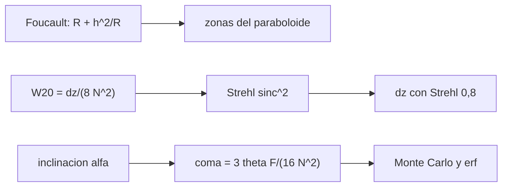

# B41-C19 — Colimación y prueba de enfoque

<!-- nav:top -->
[🏠 Programa](../../../../README.md) · [📚 Bloque B41](../../../tronco-comun/B41-optica-geometrica-y-diseno-de-telescopios.md) · [← Anterior: B41-C18 — Monturas y mecanismos de seguimiento](../B41-C18-monturas-y-mecanismos-de-seguimiento/CLASE.md) · [Siguiente: B41-C20 — Diseño preliminar de un telescopio →](../B41-C20-diseno-preliminar-de-un-telescopio/CLASE.md)
<!-- /nav -->

## 1. Ubicación, nivel y alcance

Clase 19 del bloque B41. Nivel N3. Calculas la tolerancia de **colimación** de un Newton, la **profundidad de foco** con el **Strehl** y las zonas de la **prueba de Foucault** de un paraboloide, con un Monte Carlo de semilla 20261109. Usas [B12](../../../tronco-comun/B12-probabilidad-estadistica-e-incertidumbre.md) y [B42](../../../tronco-comun/B42-optica-fisica-y-optica-adaptativa.md). Datos ilustrativos.

## 2. Por qué esta clase existe

Un buen espejo mal colimado rinde mal. La decisión central: **¿cuánta descolimación y cuánto desenfoque se toleran?**

## 3. Lo que podrás hacer al terminar

1. Trazar la prueba de Foucault en el centro de curvatura.
2. Calcular `R + h²/R`.
3. Calcular el Strehl del desenfoque por integral.
4. Comparar con `sinc²`.
5. Hallar la tolerancia de inclinación del secundario.
6. Estimar la fracción de equipos bien colimados.

La evidencia es la **ficha de colimación y enfoque** del ejercicio 12 (sección 20).

## 4. Con qué llegas y cómo comprobarlo

1. ¿Qué es un rayo de luz en óptica geométrica?
2. ¿Qué dice la ley de Snell?
3. ¿Qué es la distancia focal de una lente o un espejo?
4. ¿Qué es un valor ilustrativo?
5. ¿Qué es una verificación numérica?

<details>
<summary>Ver respuestas</summary>

1. Una línea que indica la dirección de propagación de la energía. 2. `n₁ sen θ₁ = n₂ sen θ₂`. 3. La distancia del elemento al punto donde converge un haz paralelo. 4. Un valor propuesto para el ejemplo, no medido. 5. Comparar un cálculo con un caso independiente.
</details>

Con cuatro o cinco aciertos, sigue; si no, repasa los prerrequisitos.

## 5. Un caso de contexto y casos de referencia

Un paraboloide de `R = 2000 mm` probado en su centro de curvatura corta el eje a `R + 5,006 mm` en `h = 100 mm`; el desenfoque que baja el Strehl a `0,8` es `±28,33 µm` (`2,060 λN²`); un secundario inclinado `0,0986°` produce coma igual al radio de Airy y con sigma `0,1°` el `67,5 %` queda dentro. Es el **ejemplo conductor**.

## 6. Vocabulario

La **colimación**. La **prueba de Foucault**. El **centro de curvatura**. La **razón de Strehl**. La **profundidad de foco** (`±2 λ N²`). La **descolimación** del secundario.

## 7. Modelo mental: afinar una guitarra

Como afinar una guitarra: hay una tolerancia por debajo de la cual no se oye la diferencia; aquí la tolerancia es una fracción del disco de Airy.



*Descripción textual:* tres comprobaciones independientes fijan las tolerancias de zonas, de foco y de inclinación.

Analogía: afinar una guitarra. Límite: paraboloide perfecto, solo el secundario descolimado.

## 8. La explicación, paso a paso

### 8.1 Foucault

| h (mm) | Corte del eje (mm) | R + h²/R (mm) | Diferencia con R (mm) |
|---|---|---|---|
| 20,0 | 2000,200010 | 2000,200000 | 0,200010 |
| 50,0 | 2001,250391 | 2001,250000 | 1,250391 |
| 70,7 | 2002,500807 | 2002,499245 | 2,500807 |
| 100,0 | 2005,006250 | 2005,000000 | 5,006250 |

La diferencia entre el trazado exacto y el tercer orden en `h = 100` es `0,006250 mm`.

### 8.2 Strehl y enfoque (f/5, `2 λ N² = 27,5 µm`)

| dz (µm) | W20 (ondas) | Strehl numérico | Cerrado |
|---|---|---|---|
| 0 | 0,0000 | 1,00000 | 1,00000 |
| 13,75 | 0,1250 | 0,94964 | 0,94964 |
| 27,50 | 0,2500 | 0,81057 | 0,81057 |
| 55,00 | 0,5000 | 0,40528 | 0,40528 |
| 110,00 | 1,0000 | 0,00000 | 0,00000 |

El desenfoque con Strehl 0,8 es `±28,33 µm = 2,060 λN²`.

### 8.3 Colimación (radio de Airy `3,36 µm`)

| α (°) | Descentrado (mm) | θ eq. (arcmin) | Coma (µm) | Coma/radio Airy |
|---|---|---|---|---|
| 0,02 | 0,0908 | 0,312 | 0,681 | 0,203 |
| 0,05 | 0,2269 | 0,780 | 1,702 | 0,507 |
| 0,10 | 0,4538 | 1,560 | 3,403 | 1,014 |
| 0,20 | 0,9076 | 3,120 | 6,807 | 2,029 |
| 0,50 | 2,2689 | 7,800 | 17,017 | 5,072 |

El `α` máximo con coma igual al radio de Airy es `0,0986° = 5,91'`. Con descolimación normal de sigma `0,1°`, la fracción de equipos con coma menor es `0,6750` (Monte Carlo) frente a `0,6758` (erf).

### 8.4 Lectura

La coma por descolimación usa la fórmula verificada en la clase 13; el modelo no incluye efectos de segundo orden. En un f/5 hay que colimar a mejor que `0,1°`.

## 9. Magnitudes, símbolos y unidades

| Símbolo | Qué es | Unidad | Valor / nota |
|---|---|---|---|
| `R` | radio de curvatura | mm | 2000 |
| `dz` | desenfoque | µm | 28,33 (Strehl 0,8) |
| `W20` | coeficiente de desenfoque | ondas | 0,2500 (27,5 µm) |
| `α` | inclinación del secundario | ° | 0,0986 (máximo) |
| `S` | razón de Strehl | — | 0,8106 |

## 10. Convenciones y referencias

Distancias en milímetros salvo indicación; ángulos en radianes o grados según se rotule; las salidas del laboratorio usan punto decimal y el texto usa coma decimal. Los valores de vidrios, instrumentos y sensores son ilustrativos.

## 11. De dónde sale lo que afirmamos

| ID | Fuente | Localizador | Respalda | Estado |
|---|---|---|---|---|
| — | Sin fuente externa | — | relaciones de óptica geométrica de libro que verifica el laboratorio | No se consultó una fuente para esta clase; las cifras son ilustrativas |

Límites: las relaciones de Foucault, Strehl y coma son de libro; la regla `±2 λN²` no se consultó y el modelo de colimación es de primer orden.

## 12. Cómo ver tolerancias

Cada tolerancia sale de comparar la aberración con el disco de Airy.

## 13. Ejemplo trabajado: tolerancia de inclinación

**Paso 1 · Descentrado.** `2 α q = 2 × 1,745 × 10⁻³ × 130 = 0,4538 mm` para `α = 0,1°`.

**Paso 2 · Ángulo.** `θ = 0,4538/1000 = 4,54 × 10⁻⁴ rad = 1,56'`.

**Paso 3 · Coma.** `3 θ F/(16 N²) = 3,403 µm`, `1,014` radios de Airy.

## 14. Distintas formas de describir el resultado

**Por fórmula:** la relación analítica. **Por tabla:** las cifras del laboratorio. **Por gráfica:** el diagrama de la sección 7. **Por código:** el script de la sección 17.

## 15. Práctica guiada

**Ejercicio 1 · con los pasos indicados.** Corte exacto del eje en `h = 50`.

<details><summary>Solución comentada</summary>

`2001,2504 mm`.
</details>

**Ejercicio 2 · con una pista.** `h²/R` en `h = 100`.

<details><summary>Solución comentada</summary>

`5,0 mm`.
</details>

**Ejercicio 3 · casi autónomo.** Strehl para `dz = 27,5 µm`.

<details><summary>Solución comentada</summary>

`0,8106`.
</details>

## 16. Práctica autónoma, transferencia e integrador

**Ejercicio 4.** `W20` para `dz = 55 µm`.

<details><summary>Solución comentada</summary>

`0,5 ondas`.
</details>

**Ejercicio 5.** Strehl para `dz = 55 µm`.

<details><summary>Solución comentada</summary>

`0,405`.
</details>

**Ejercicio 6.** Descentrado para `α = 0,05°`.

<details><summary>Solución comentada</summary>

`0,2269 mm`.
</details>

**Ejercicio 7.** Coma para `α = 0,2°`.

<details><summary>Solución comentada</summary>

`6,807 µm`.
</details>

**Ejercicio 8.** `α` máximo.

<details><summary>Solución comentada</summary>

`0,0986°`.
</details>

**Ejercicio 9 · transferencia.** **Transferencia.** ¿Por qué un f/10 es más tolerante al desenfoque?

<details><summary>Solución comentada</summary>

La profundidad es `2 λ N²`: crece con `N²`.
</details>

**Ejercicio 10 · transferencia.** **Transferencia.** ¿Qué fracción queda bien colimada con sigma `0,05°`?

<details><summary>Solución comentada</summary>

`erf(0,0986/(0,05√2)) ≈ 0,95`.
</details>

**Ejercicio 11 · transferencia.** **Transferencia.** ¿Por qué la prueba de Foucault detecta zonas?

<details><summary>Solución comentada</summary>

Cada zona del paraboloide corta el eje en un punto distinto.
</details>

**Ejercicio 12.** **Integrador.** Elabora tu *ficha de colimación y enfoque*.

<details><summary>Solución comentada</summary>

Secciones 8.1–8.4.
</details>

**Ejercicio 12 · integrador.** **Integrador.** Elabora tu *ficha de colimación y enfoque*.

<details><summary>Solución modelo</summary>

Secciones 8.1–8.4.
</details>

## 17. Laboratorio: tolerancias de colimación y enfoque

El script [colimacion.py](colimacion.py) traza Foucault, integra el Strehl y simula una descolimación normal (**comprueba** Strehl a `10⁻⁶` y la fracción a 1,5 % de la `erf`).

**Datos:** sin constantes; todo **ilustrativo**. **Predice antes de ejecutar:** ¿qué fracción queda colimada con sigma 0,1°? (≈ 0,68.) **Ejecución del 2026-11-09 (Python 3.12.9):**

```text
Python 3.12.9 (biblioteca estandar)
Foucault: fuente en el centro de curvatura de un paraboloide, R = 2000 mm
 h [mm]  corte del eje [mm]   R + h^2/R [mm]  dif. con R [mm]
   20.0         2000.200010      2000.200000         0.200010
   50.0         2001.250391      2001.250000         1.250391
   70.7         2002.500807      2002.499245         2.500807
  100.0         2005.006250      2005.000000         5.006250
  diferencia exacta - tercer orden en h = 100 mm: 0.006250 mm
f/5: 2 lambda N^2 = 27.5 micras
 dz [micras]  W20 [ondas]  Strehl num.    cerrado
        0.00       0.0000      1.00000    1.00000
       13.75       0.1250      0.94964    0.94964
       27.50       0.2500      0.81057    0.81057
       55.00       0.5000      0.40528    0.40528
      110.00       1.0000      0.00000    0.00000
dz con Strehl 0,8 = +-28.33 micras = 2.060 lambda N^2 (la regla de libro usa 2 lambda N^2)
radio de Airy 1,22 lambda N = 3.36 micras
alfa [deg]  descentrado [mm]  theta eq. [arcmin]  coma [micras]  coma/radio Airy
      0.02            0.0908               0.312          0.681            0.203
      0.05            0.2269               0.780          1.702            0.507
      0.10            0.4538               1.560          3.403            1.014
      0.20            0.9076               3.120          6.807            2.029
      0.50            2.2689               7.800         17.017            5.072
alfa maximo con coma igual al radio de Airy = 0.0986 deg = 5.91 arcmin
descolimacion normal de sigma = 0.1 deg: fraccion con coma < radio de Airy = 0.6750 (Monte Carlo) frente a erf = 0.6758
Pruebas superadas.
```

```bash
python programa/clases/B41/B41-C19-colimacion-y-prueba-de-enfoque/colimacion.py
```

**Límites:** tercer orden, ángulos pequeños, solo el secundario.

## 18. Errores frecuentes y cómo corregirlos

**Confundir el centro de curvatura con el foco.** Está al doble.

**Creer que el Strehl 0,8 es nítido a ojo.** Es el criterio de Maréchal.

**Ignorar la coma por inclinación.** Se corrige con 8.3.

**Tomar la `erf` sin comprobar.** El Monte Carlo la reproduce.

## 19. Cómo sabrás que vas bien

Tras la sección 8: ¿qué resultado esperabas y cuál obtuviste? Si dudas, repasa el ejemplo 13. Tras el laboratorio: ¿qué comprueba? (ver la sección 17).

## 20. Qué entregas y cómo se evalúa

El producto es tu **ficha de colimación y enfoque** (ejercicio 12).

| Criterio | Inicial | En desarrollo | Logrado | Destacado |
|---|---|---|---|---|
| Conceptos | Los confunde | Parciales | conceptos de la clase | Explica los límites |
| Cálculo | Sin unidades | Con errores | Tablas completas | Calcula casos nuevos |
| Numérico | Sin comprobar | Un caso | Contraste con el análisis | Interpreta las diferencias |
| Fuentes | Sin fuente | Sin fecha | fuentes con fecha | Declara lo ilustrativo |
| Límites | No los nombra | Uno | Tres | Discute qué falta del modelo |

**Condiciones críticas (no se compensan con promedio):** rotular lo ilustrativo; no presentar el modelo como un instrumento real; citar solo lo consultado.

## 21. Ética, seguridad y límites

Clase educativa: los modelos son simplificados. Accesibilidad: tablas equivalentes a las gráficas, fórmulas en texto, ejercicios sin conexión.

## 22. Para cerrar y seguir

La tolerancia de inclinación es `0,0986°`, el desenfoque `±28 µm` y la zona del paraboloide se desplaza `h²/R`. Falta reunirlo en un diseño.

**Glosario español–inglés.** colimación · *collimation*; prueba de Foucault · *Foucault test*; razón de Strehl · *Strehl ratio*; profundidad de foco · *depth of focus*; centro de curvatura · *center of curvature*.

**Continuidad.** [B41-C20](../B41-C20-diseno-preliminar-de-un-telescopio/CLASE.md) cierra el bloque con el diseño preliminar de un telescopio.

**Referencias:** ver sección 11.

<!-- nav:bottom -->
---

[← Anterior: B41-C18 — Monturas y mecanismos de seguimiento](../B41-C18-monturas-y-mecanismos-de-seguimiento/CLASE.md) · [📚 Bloque B41](../../../tronco-comun/B41-optica-geometrica-y-diseno-de-telescopios.md) · [Siguiente: B41-C20 — Diseño preliminar de un telescopio →](../B41-C20-diseno-preliminar-de-un-telescopio/CLASE.md)
<!-- /nav -->
