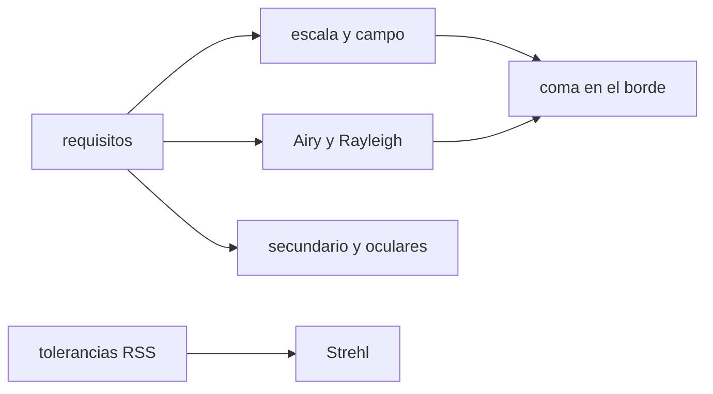

# B41-C20 — Diseño preliminar de un telescopio

<!-- nav:top -->
[🏠 Programa](../../../../README.md) · [📚 Bloque B41](../../../tronco-comun/B41-optica-geometrica-y-diseno-de-telescopios.md) · [← Anterior: B41-C19 — Colimación y prueba de enfoque](../B41-C19-colimacion-y-prueba-de-enfoque/CLASE.md) · [Siguiente: B42-C01 — Ecuaciones de onda electromagnética →](../../../tronco-comun/B42-optica-fisica-y-optica-adaptativa.md#b42-c01)
<!-- /nav -->

## 1. Ubicación, nivel y alcance

Clase 20 del bloque B41. Nivel N3. Cierras el bloque con un **presupuesto de diseño preliminar** de un Newton f/5 de `250 mm` con sensor `22,3 × 14,9 mm`: apertura, focal, campo, difracción, coma, secundario, oculares y tolerancias con Strehl de Maréchal. Reúnes las clases 9–19. Es un diseño **ilustrativo**, no un instrumento real. Usas [B12](../../../tronco-comun/B12-probabilidad-estadistica-e-incertidumbre.md).

## 2. Por qué esta clase existe

Un diseño es un conjunto de compromisos. La decisión central: **¿qué apertura y qué focal cumplen el objetivo y qué defecto domina?**

## 3. Lo que podrás hacer al terminar

1. Reunir escala, campo y muestreo.
2. Calcular Airy y Rayleigh.
3. Evaluar la coma en el borde del sensor.
4. Dimensionar el secundario.
5. Elegir oculares y aumentos.
6. Presupuestar tolerancias con Strehl.

La evidencia es la **memoria de diseño preliminar** del ejercicio 12 (sección 20).

## 4. Con qué llegas y cómo comprobarlo

1. ¿Qué es un rayo de luz en óptica geométrica?
2. ¿Qué dice la ley de Snell?
3. ¿Qué es la distancia focal de una lente o un espejo?
4. ¿Qué es un valor ilustrativo?
5. ¿Qué es una verificación numérica?

<details>
<summary>Ver respuestas</summary>

1. Una línea que indica la dirección de propagación de la energía. 2. `n₁ sen θ₁ = n₂ sen θ₂`. 3. La distancia del elemento al punto donde converge un haz paralelo. 4. Un valor propuesto para el ejemplo, no medido. 5. Comparar un cálculo con un caso independiente.
</details>

Con cuatro o cinco aciertos, sigue; si no, repasa los prerrequisitos.

## 5. Un caso de contexto y casos de referencia

El diseño da `0,7096 "/píxel`, campo `1,022° × 0,683°`, disco de Airy `6,71 µm`, Rayleigh `0,553 "`, plano de `56,3 mm` (`22,5 %`) y Strehl `0,875`. La conclusión importante: la **coma en el borde** del sensor es `100,57 µm`, unas `30` veces el radio de Airy: se necesita un corrector. Es el **ejemplo conductor**.

## 6. Vocabulario

El **presupuesto de diseño**. El **corrector de coma**. El **Strehl de Maréchal**. La **suma en cuadratura (RSS)**. El **aumento mínimo** y el **máximo**. La **pantalla de fase**.

## 7. Modelo mental: un presupuesto familiar

Como un presupuesto familiar: cada partida (espejo, plano, enfoque) gasta una parte del error total, y se suman en cuadratura; se mira cuál gasta más.



*Descripción textual:* las relaciones de las clases anteriores se reúnen en un presupuesto con una conclusión crítica.

Analogía: un presupuesto familiar. Límite: paraboloide perfecto, seeing aparte, sin refracción.

## 8. La explicación, paso a paso

### 8.1 Primera cifra

f/5,0; área `490,9 cm²`; ganancia `7,76` mag sobre un ojo de 7 mm. Airy `6,71 µm = 1,107 "`; Rayleigh `0,553 "`. Escala `0,7096 "/píxel`; campo `1,022° × 0,683°`. Para 2 píxeles por FWHM de seeing (2 ") la focal sería `887 mm`; para 3, `1330 mm`.

### 8.2 Campo y aberraciones

La semidiagonal del sensor es `13,41 mm = 36,88'`; la coma en el borde `100,57 µm` es `29,98` veces el radio de Airy y `8,298` veces el FWHM del seeing. El semicampo con coma igual al radio de Airy es `1,23'` (`0,45 mm`).

### 8.3 Secundario y oculares

Plano `a = 56,3 mm` (`22,5 %` lineal, `5,1 %` por área, `0,056` mag); flecha del primario `3,125 mm`.

| Ocular (mm) | Aumento | Pupila de salida (mm) |
|---|---|---|
| 32 | 39,1 | 6,40 |
| 12 | 104,2 | 2,40 |
| 6 | 208,3 | 1,20 |

Aumento mínimo (pupila de 7 mm) `35,7`; máximo orientativo `500`.

### 8.4 Tolerancias

| Término | Sigma (ondas RMS) |
|---|---|
| primario (1/40 RMS de superficie, frente ×2) | 0,0500 |
| secundario plano (1/60, ×1,414) | 0,0236 |
| desenfoque (¼ de la zona 2 λN², `dz = 6,88 µm`) | 0,0180 |
| total RSS | 0,0581 |

El desenfoque `W20 = 0,0625` ondas tiene `σ = 0,018042` (numérico y `W20/√12` coinciden). Strehl de Maréchal `0,875`; la pantalla de fase blanca de 40 000 puntos da `0,873`.

### 8.5 Lectura

El cálculo muestra que el espejo y el plano cumplen, pero que el instrumento **no** cubre el sensor completo sin un corrector de coma: la conclusión del diseño no es «todo cumple» sino qué hay que añadir.

## 9. Magnitudes, símbolos y unidades

| Símbolo | Qué es | Unidad | Valor / nota |
|---|---|---|---|
| `D, F` | apertura y focal | mm | 250; 1250 |
| `N` | relación focal | — | 5,0 |
| `σ` | frente de onda RMS | ondas | 0,0581 |
| `S` | Strehl de Maréchal | — | 0,875 |
| `C_t` | coma en el borde | µm | 100,57 |

## 10. Convenciones y referencias

Distancias en milímetros salvo indicación; ángulos en radianes o grados según se rotule; las salidas del laboratorio usan punto decimal y el texto usa coma decimal. Los valores de vidrios, instrumentos y sensores son ilustrativos.

## 11. De dónde sale lo que afirmamos

| ID | Fuente | Localizador | Respalda | Estado |
|---|---|---|---|---|
| — | Sin fuente externa | — | relaciones de óptica geométrica de libro que verifica el laboratorio | No se consultó una fuente para esta clase; las cifras son ilustrativas |

Límites: todo el diseño es ilustrativo; no se consultaron fuentes ni se describe un instrumento real.

## 12. Cómo ver el presupuesto

La coma en el borde es la partida que domina y exige un corrector.

## 13. Ejemplo trabajado: escala y coma del diseño

**Paso 1 · Escala.** `206 264,806/1250 × 0,0043 = 0,7096 "/píxel`.

**Paso 2 · Coma.** `θ = 13,41/1250 = 0,01073 rad`; `3 θ F/(16 N²) = 3 × 0,01073 × 1250/400 = 0,1006 mm = 100,6 µm`.

**Paso 3 · Conclusión.** `100,6/3,36 ≈ 30` radios de Airy.

## 14. Distintas formas de describir el resultado

**Por fórmula:** la relación analítica. **Por tabla:** las cifras del laboratorio. **Por gráfica:** el diagrama de la sección 7. **Por código:** el script de la sección 17.

## 15. Práctica guiada

**Ejercicio 1 · con los pasos indicados.** Relación focal del diseño.

<details><summary>Solución comentada</summary>

`1250/250 = 5`.
</details>

**Ejercicio 2 · con una pista.** Escala por píxel.

<details><summary>Solución comentada</summary>

`0,7096 "`.
</details>

**Ejercicio 3 · casi autónomo.** Rayleigh de 250 mm a 550 nm.

<details><summary>Solución comentada</summary>

`0,553 "`.
</details>

## 16. Práctica autónoma, transferencia e integrador

**Ejercicio 4.** Pupila de salida del ocular de 12 mm.

<details><summary>Solución comentada</summary>

`2,40 mm`.
</details>

**Ejercicio 5.** Obstrucción por área del plano de 56,3 mm.

<details><summary>Solución comentada</summary>

`5,1 %`.
</details>

**Ejercicio 6.** Strehl con `σ = 0,0581` ondas.

<details><summary>Solución comentada</summary>

`0,875`.
</details>

**Ejercicio 7.** `σ` de un desenfoque de `0,0625` ondas.

<details><summary>Solución comentada</summary>

`0,0180`.
</details>

**Ejercicio 8.** Cociente coma en el borde / radio de Airy.

<details><summary>Solución comentada</summary>

`≈ 30`.
</details>

**Ejercicio 9 · transferencia.** **Transferencia.** ¿Qué haría con un corrector de coma?

<details><summary>Solución comentada</summary>

Añadirlo y rehacer el presupuesto con su transmisión y su aberración.
</details>

**Ejercicio 10 · transferencia.** **Transferencia.** Si cambio a F=1330 mm, ¿qué escala?

<details><summary>Solución comentada</summary>

`206 264,806/1330 × 0,0043 = 0,667 "/píxel`.
</details>

**Ejercicio 11 · transferencia.** **Transferencia.** ¿Qué partida del RSS reduciría primero?

<details><summary>Solución comentada</summary>

El primario (`0,0500`), la mayor.
</details>

**Ejercicio 12.** **Integrador.** Elabora tu *memoria de diseño preliminar*: requisitos, cifras clave, defecto dominante y recomendación.

<details><summary>Solución comentada</summary>

Secciones 8.1–8.5.
</details>

**Ejercicio 12 · integrador.** **Integrador.** Elabora tu *memoria de diseño preliminar*: requisitos, cifras clave, defecto dominante y recomendación.

<details><summary>Solución modelo</summary>

Secciones 8.1–8.5.
</details>

## 17. Laboratorio: presupuesto de diseño

El script [diseno.py](diseno.py) reúne escala, campo, Airy, coma, plano, oculares y tolerancias con un Strehl numérico (**comprueba** el Strehl de la pantalla de fase a `0,005` de `exp(−σ²)` y `σ` del desenfoque a `10⁻⁴`).

**Datos:** sin constantes; **todo ilustrativo**. **Predice antes de ejecutar:** ¿cubre el sensor completo sin corrector? (no: coma ≈ 30 radios de Airy.) **Ejecución del 2026-11-09 (Python 3.12.9):**

```text
Python 3.12.9 (biblioteca estandar)
== Requisitos y primera cifra ==
relacion focal f/5.0 ; area colectora = 490.9 cm2 ; ganancia sobre un ojo de 7 mm = 7.76 mag
disco de Airy (diametro) = 6.71 micras = 1.107 arcsec ; Rayleigh = 0.553 arcsec
escala = 0.7096 arcsec/pixel ; campo = 1.022 x 0.683 deg ; pixel / (seeing/2) = 0.71
  2 pixeles por FWHM de seeing -> escala 1.000 arcsec/pixel -> F = 887 mm
  3 pixeles por FWHM de seeing -> escala 0.667 arcsec/pixel -> F = 1330 mm
== Campo y aberraciones ==
semidiagonal del sensor = 13.41 mm = 36.88 arcmin ; coma en el borde = 100.57 micras ; radio de Airy = 3.36 micras ; razon = 29.98
campo con coma igual al radio de Airy: semicampo = 1.23 arcmin = 0.45 mm de altura de imagen
coma en el borde = 8.298 del FWHM del seeing (12.1 micras)
== Secundario y obstruccion ==
secundario para iluminar todo el sensor: eje menor a = 56.3 mm ; obstruccion lineal = 22.5 % ; por area = 5.1 % ; perdida = 0.056 mag
flecha del primario (paraboloide) = 3.125 mm ; radio de curvatura = 2500 mm
== Oculares ==
ocular   32 mm: aumento  39.1 ; pupila de salida  6.40 mm ; ok
ocular   12 mm: aumento 104.2 ; pupila de salida  2.40 mm ; ok
ocular    6 mm: aumento 208.3 ; pupila de salida  1.20 mm ; ok
aumento minimo (pupila 7 mm) = 35.7 ; maximo orientativo 2 D[mm] = 500
== Tolerancias (Marechal) ==
RMS de frente de onda 1/14 de onda -> Strehl = 0.818
desenfoque dz = 6.88 micras: W20 = 0.0625 ondas ; sigma (numerico) = 0.018042 ; W20/sqrt(12) = 0.018042
  primario (superficie 1/40 RMS, frente x2): 0.0500 ondas RMS
  secundario plano (1/60 RMS, frente x1,414): 0.0236 ondas RMS
  desenfoque de un cuarto de la zona 2 lambda N^2 (W20): 0.0180 ondas RMS
total RSS = 0.0581 ondas RMS ; Strehl de Marechal = 0.875
pantalla de fase blanca con la misma sigma (40000 puntos, semilla 20261109): Strehl = 0.873 ; exp(-sigma^2) = 0.875
Pruebas superadas.
```

```bash
python programa/clases/B41/B41-C20-diseno-preliminar-de-un-telescopio/diseno.py
```

**Límites:** preliminar; orden de magnitud con tolerancias.

## 18. Errores frecuentes y cómo corregirlos

**Concluir que todo cumple.** La coma domina el borde.

**Sumar sigmas linealmente.** Se suman en cuadratura.

**Presentar el diseño como un instrumento real.** Es un ejercicio ilustrativo.

**Olvidar el seeing.** Se compara aparte.

## 19. Cómo sabrás que vas bien

Tras la sección 8: ¿qué resultado esperabas y cuál obtuviste? Si dudas, repasa el ejemplo 13. Tras el laboratorio: ¿qué comprueba? (ver la sección 17).

## 20. Qué entregas y cómo se evalúa

El producto es tu **memoria de diseño preliminar** (ejercicio 12).

| Criterio | Inicial | En desarrollo | Logrado | Destacado |
|---|---|---|---|---|
| Conceptos | Los confunde | Parciales | conceptos de la clase | Explica los límites |
| Cálculo | Sin unidades | Con errores | Tablas completas | Calcula casos nuevos |
| Numérico | Sin comprobar | Un caso | Contraste con el análisis | Interpreta las diferencias |
| Fuentes | Sin fuente | Sin fecha | fuentes con fecha | Declara lo ilustrativo |
| Límites | No los nombra | Uno | Tres | Discute qué falta del modelo |

**Condiciones críticas (no se compensan con promedio):** rotular lo ilustrativo; no presentar el modelo como un instrumento real; citar solo lo consultado.

## 21. Ética, seguridad y límites

Clase educativa: los modelos son simplificados. Accesibilidad: tablas equivalentes a las gráficas, fórmulas en texto, ejercicios sin conexión.

## 22. Para cerrar y seguir

El diseño cierra el bloque: apertura 250 mm f/5, Strehl `0,875` y coma `30` veces el radio de Airy en el borde, que exige un corrector. Termina B41; B42 sigue con la óptica física.

**Glosario español–inglés.** diseño preliminar · *preliminary design*; presupuesto · *budget*; corrector de coma · *coma corrector*; razón de Strehl · *Strehl ratio*; en cuadratura · *in quadrature*.

**Continuidad.** cierra el bloque; continúa en B42.

**Referencias:** ver sección 11.

<!-- nav:bottom -->
---

[← Anterior: B41-C19 — Colimación y prueba de enfoque](../B41-C19-colimacion-y-prueba-de-enfoque/CLASE.md) · [📚 Bloque B41](../../../tronco-comun/B41-optica-geometrica-y-diseno-de-telescopios.md) · [Siguiente: B42-C01 — Ecuaciones de onda electromagnética →](../../../tronco-comun/B42-optica-fisica-y-optica-adaptativa.md#b42-c01)
<!-- /nav -->
