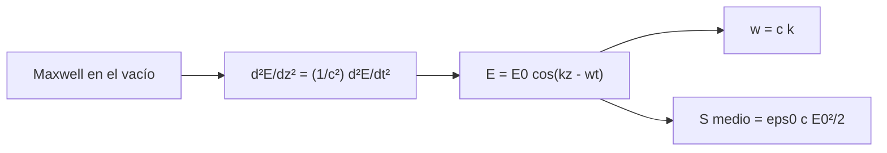

# B42-C01 — Ecuaciones de onda electromagnética

<!-- nav:top -->
<!-- /nav -->

## 1. Ubicación, nivel y alcance

Clase 1 del bloque B42. Nivel N3. Esta clase abre el bloque [B42](../../../tronco-comun/B42-optica-fisica-y-optica-adaptativa.md): parte de las ecuaciones de Maxwell en el vacío y llega a la **ecuación de onda**, a la relación `ω = c k` y al flujo de energía de una onda plana. Usas [B05](../../../tronco-comun/B05-fisica-fundamental-para-el-espacio.md) (campos y energía). Todo lo que sigue en el bloque (difracción, PSF, interferometría) descansa en que la luz es una onda con fase.

## 2. Por qué esta clase existe

Sin una descripción ondulatoria no hay fase, y sin fase no hay difracción, interferencia ni óptica adaptativa. La decisión central: **¿qué parte de la luz se puede tratar como una onda escalar con amplitud y fase y qué parte exige el campo vectorial completo?**

## 3. Lo que podrás hacer al terminar

1. Escribir la ecuación de onda para un campo eléctrico en el vacío.
2. Relacionar `λ`, `k`, `ω`, `f` y `T` de una onda plana.
3. Calcular el flujo medio de energía (vector de Poynting) de una onda plana.
4. Comprobar `c = 1/√(ε₀μ₀)` con constantes de NIST.
5. Verificar la ecuación de onda por diferencias finitas.
6. Distinguir una onda escalar de una onda vectorial transversal.

La evidencia es la **ficha de la onda electromagnética** del ejercicio 12 (sección 20).

## 4. Con qué llegas y cómo comprobarlo

1. ¿Qué es una incertidumbre?
2. ¿Qué es una simulación Monte Carlo?
3. ¿Qué es una tabla de resultados?
4. ¿Qué es un valor ilustrativo?
5. ¿Qué es una verificación?

<details>
<summary>Ver respuestas</summary>

1. Un intervalo en que se espera el valor verdadero. 2. Repetir con números aleatorios de semilla fija. 3. Un resumen ordenado de cálculos. 4. Un valor propuesto para el ejemplo, no medido. 5. Comparar un cálculo con un caso independiente.
</details>

Con cuatro o cinco aciertos, sigue; si no, repasa los prerrequisitos.

## 5. Un caso de contexto y casos de referencia

Una onda plana de `λ = 550 nm` y `E₀ = 1 V/m` (ilustrativo) tiene `k = 1,142397 × 10⁷ rad/m`, `f = 5,450772 × 10¹⁴ Hz` y un flujo medio de `1,327209 × 10⁻³ W/m²`. Es el **ejemplo conductor**.

## 6. Vocabulario

El **campo eléctrico** `E` y el **campo magnético** `B`. La **onda plana**: frentes de fase planos. El **número de onda** `k = 2π/λ`. La **frecuencia angular** `ω = 2πf`. El **vector de Poynting** `S = E × B/μ₀`. La **impedancia del vacío** `Z₀ = √(μ₀/ε₀)`.

## 7. Modelo mental: una ola en una cuerda tensa

Como una ola que viaja por una cuerda larga: la forma avanza a velocidad `c` aunque cada punto solo sube y baja. Aquí lo que sube y baja es el campo eléctrico.



*Descripción textual:* las ecuaciones de Maxwell producen la ecuación de onda; su solución plana fija la relación entre `ω` y `k` y el flujo de energía.

Analogía: una ola en una cuerda tensa. Límite: la luz real no es una onda plana perfecta ni escalar.

## 8. La explicación, paso a paso

### 8.1 Constantes y relación de dispersión

La velocidad `c = 299 792 458 m/s` (exacta) coincide con `1/√(ε₀μ₀)` (con `ε₀ = 8,8541878188 × 10⁻¹² F/m` y `μ₀ = 1,25663706127 × 10⁻⁶ N/A²`) con error relativo `6,0 × 10⁻¹³`. Para `λ = 550 nm`:

| Magnitud | Valor |
|---|---|
| `k = 2π/λ` | 1,142397 × 10⁷ rad/m |
| `f = c/λ` | 5,450772 × 10¹⁴ Hz |
| `T = 1/f` | 1,8346 × 10⁻¹⁵ s |

### 8.2 Ecuación de onda y energía

Por diferencias finitas el residuo `|∂²E/∂z² − (1/c²)∂²E/∂t²|/(k²E₀)` es `6,75 × 10⁻¹³` (solo error de redondeo y de segundo orden). El flujo medio es `⟨S⟩ = ε₀ c E₀²/2 = 1,327209 × 10⁻³ W/m²`, igual al numérico con error `1,2 × 10⁻¹²`. Las densidades medias de energía eléctrica y magnética son iguales (`2,213547 × 10⁻¹² J/m³` cada una; cociente `1,00000000`). La impedancia `√(μ₀/ε₀) = 376,730313 Ω`, igual al valor de NIST.

### 8.3 Lectura

El laboratorio **no demuestra** que la luz sea una onda: comprueba que un campo con esa forma satisface la ecuación y las relaciones de energía. Una onda escalar basta para la difracción y la interferometría de este bloque; la polarización (C08) exige el carácter vectorial.

## 9. Magnitudes, símbolos y unidades

| Símbolo | Qué es | Unidad | Valor / nota |
|---|---|---|---|
| `λ` | longitud de onda | m | 550 nm (ilustrativo) |
| `k` | número de onda | rad/m | 1,142397 × 10⁷ |
| `ω` | frecuencia angular | rad/s | `c k` |
| `S` | flujo medio de energía | W/m² | 1,327209 × 10⁻³ para `E₀ = 1 V/m` |

## 10. Convenciones y referencias

SI; convenio de fase `cos(kz − ωt)` (la onda viaja hacia `+z`); `c`, `ε₀`, `μ₀` y la impedancia, de NIST CODATA 2022 consultada el 2026-11-09.

## 11. De dónde sale lo que afirmamos

| ID | Fuente | Localizador | Respalda | Estado |
|---|---|---|---|---|
| S1 | NIST, *Fundamental Physical Constants* (CODATA 2022) | https://physics.nist.gov/cuu/Constants/Table/allascii.txt | constantes citadas en la sección 9 | Consultada el 2026-11-09 |

Límites: solo se consultó la tabla de constantes; las ecuaciones de Maxwell y la forma de la onda plana son resultados clásicos que aquí se verifican numéricamente, no se citan de una fuente.

## 12. Cómo ver la onda y su flujo

| Magnitud | Valor |
|---|---|
| `c` por `ε₀`, `μ₀` (error) | 6,0 × 10⁻¹³ |
| residuo de la ecuación de onda | 6,75 × 10⁻¹³ |
| `⟨S⟩` numérico = analítico | 1,327209 × 10⁻³ W/m² |
| `Z₀` | 376,730313 Ω |

Descripción larga: todas las comprobaciones coinciden con el análisis a precisión de máquina.

## 13. Ejemplo trabajado: el flujo de una onda de 1 V/m

**Paso 1 · Fórmula.** `⟨S⟩ = ε₀ c E₀²/2`.

**Paso 2 · Producto.** `ε₀ c = 8,8541878188 × 10⁻¹² × 299 792 458 = 2,654420 × 10⁻³`.

**Paso 3 · Valor.** `2,654420 × 10⁻³ × 1²/2 = 1,327210 × 10⁻³ W/m²`.

**Paso 4 · Lectura.** Una onda de 1 V/m transporta apenas 1,3 mW/m².

## 14. Distintas formas de describir el resultado

**Por ecuación:** `∂²E/∂z² = (1/c²)∂²E/∂t²`. **Por fórmula:** `E = E₀ cos(kz − ωt)`. **Por tabla:** `λ → k, f, T`. **Por código:** `onda_plana.py`.

## 15. Práctica guiada

**Ejercicio 1 · con los pasos indicados.** Frecuencia de `λ = 550 nm`. *Pasos:* `f = c/λ`.

<details><summary>Solución comentada</summary>

`5,4508 × 10¹⁴ Hz`.
</details>

**Ejercicio 2 · con una pista.** Número de onda de `λ = 550 nm`. *Pista:* `2π/λ`.

<details><summary>Solución comentada</summary>

`1,1424 × 10⁷ rad/m`.
</details>

**Ejercicio 3 · casi autónomo.** Flujo medio de una onda con `E₀ = 2 V/m`.

<details><summary>Solución comentada</summary>

El flujo escala con `E₀²`: `4 × 1,327 × 10⁻³ = 5,309 × 10⁻³ W/m²`.
</details>

## 16. Práctica autónoma, transferencia e integrador

**Ejercicio 4.** ¿Por cuánto se multiplica el flujo si `E₀` se duplica?

<details><summary>Solución comentada</summary>

Por 4.
</details>

**Ejercicio 5.** `E₀` necesario para `S = 1 W/m²`.

<details><summary>Solución comentada</summary>

`√(2S/(ε₀c)) = √(2/2,6544 × 10⁻³) = 27,45 V/m`.
</details>

**Ejercicio 6.** Amplitud del campo magnético si `E₀ = 1 V/m`.

<details><summary>Solución comentada</summary>

`B₀ = E₀/c = 3,336 × 10⁻⁹ T`.
</details>

**Ejercicio 7.** Periodo de la onda de 550 nm.

<details><summary>Solución comentada</summary>

`T = 1/f = 1,8346 × 10⁻¹⁵ s`.
</details>

**Ejercicio 8.** `Z₀` por `μ₀ c`.

<details><summary>Solución comentada</summary>

`1,25663706127 × 10⁻⁶ × 299 792 458 = 376,7303 Ω`.
</details>

**Ejercicio 9 · transferencia.** **Transferencia.** Un compañero dice que el laboratorio demuestra que la luz es una onda electromagnética. Responde.

<details><summary>Solución comentada</summary>

Solo verifica que una onda con esa forma satisface la ecuación y las relaciones de energía; la evidencia de que la luz es una onda es experimental y no se produce aquí.
</details>

**Ejercicio 10 · transferencia.** **Transferencia.** ¿Por qué el residuo de la ecuación de onda no es exactamente cero?

<details><summary>Solución comentada</summary>

Porque las diferencias finitas centradas tienen error de orden `h²` y la aritmética de punto flotante redondea.
</details>

**Ejercicio 11 · transferencia.** **Transferencia.** ¿Qué potencia recoge un colector de 1 m² perpendicular a una onda con `S = 1,327 × 10⁻³ W/m²`?

<details><summary>Solución comentada</summary>

`1,327 mW`, si la onda es plana y se absorbe toda.
</details>

**Ejercicio 12.** **Integrador.** Elabora tu *ficha de la onda electromagnética*: la ecuación, `k`, `f`, `⟨S⟩` para un caso a tu elección y qué comprueba y qué no el laboratorio.

<details><summary>Solución comentada</summary>

Secciones 8.1–8.3.
</details>

**Ejercicio 12 · integrador.** **Integrador.** Elabora tu *ficha de la onda electromagnética*: la ecuación, `k`, `f`, `⟨S⟩` para un caso a tu elección y qué comprueba y qué no el laboratorio.

<details><summary>Solución modelo</summary>

Secciones 8.1–8.3.
</details>

## 17. Laboratorio: onda plana de 550 nm

El script [onda_plana.py](onda_plana.py) verifica `c = 1/√(ε₀μ₀)`, la ecuación de onda por diferencias finitas y el flujo de Poynting (**comprueba** a `10⁻⁹`, `10⁻⁴` y `10⁻⁶` relativos).

**Datos:** `c`, `ε₀`, `μ₀` de NIST CODATA 2022 (consultada el 2026-11-09); `λ` y `E₀` ilustrativos. **Predice antes de ejecutar:** ¿cuánto vale el flujo de una onda de 1 V/m? (≈ 1,3 mW/m².) **Ejecución del 2026-11-09 (Python 3.12.9):**

```text
Python 3.12.9 (biblioteca estandar)
c de NIST = 299792458 m/s ; 1/sqrt(eps0 mu0) = 299792458.000 m/s ; error relativo = 5.97e-13
lambda = 550 nm ; k = 1.142397e+07 rad/m ; f = 5.450772e+14 Hz ; T = 1.8346e-15 s
ecuacion de onda: max |d2E/dz2 - (1/c^2) d2E/dt2| / (k^2 E0) = 6.75e-13
<S> numerico = 1.327209e-03 W/m2 ; eps0 c E0^2 / 2 = 1.327209e-03 W/m2 ; error relativo = 1.19e-12
impedancia del vacio sqrt(mu0/eps0) = 376.730313 ohm (NIST: 376.730 313 412)
<u_E> = 2.213547e-12 J/m3 ; <u_B> = 2.213547e-12 J/m3 ; cociente = 1.00000000
Pruebas superadas.
```

```bash
python programa/clases/B42/B42-C01-ecuaciones-de-onda-electromagnetica/onda_plana.py
```

**Límites:** onda plana monocromática en el vacío; no hay medios ni fuentes.

## 18. Errores frecuentes y cómo corregirlos

**Creer que el flujo es proporcional a `E₀`.** Es proporcional a `E₀²`; ver 8.2.

**Usar `f` donde se necesita `ω`.** Se corrige con la sección 9: `ω = 2πf`.

**Pensar que la onda transporta materia.** Transporta energía y momento; el medio (aquí el vacío) no se desplaza.

**Confundir verificación numérica con demostración física.** Se corrige con 8.3.

## 19. Cómo sabrás que vas bien

Tras la sección 8: ¿qué resultado esperabas y cuál obtuviste? Si dudas, repasa el ejemplo 13. Tras el laboratorio: ¿qué comprueba? (ver la sección 17).

## 20. Qué entregas y cómo se evalúa

El producto es tu **ficha de la onda electromagnética** (ejercicio 12).

| Criterio | Inicial | En desarrollo | Logrado | Destacado |
|---|---|---|---|---|
| Conceptos | Los confunde | Parciales | conceptos de la clase | Explica los límites |
| Cálculo | Sin unidades | Con errores | Tablas completas | Calcula casos nuevos |
| Numérico | Sin comprobar | Un caso | Contraste con el análisis | Interpreta las diferencias |
| Fuentes | Sin fuente | Sin fecha | fuentes con fecha | Declara lo ilustrativo |
| Límites | No los nombra | Uno | Tres | Discute qué falta del modelo |

**Condiciones críticas (no se compensan con promedio):** citar solo la tabla de NIST; no presentar la verificación numérica como demostración; indicar unidades.

## 21. Ética, seguridad y límites

Clase educativa: los modelos son simplificados. Accesibilidad: tablas equivalentes a las gráficas, fórmulas en texto, ejercicios sin conexión.

## 22. Para cerrar y seguir

Una onda de 550 nm tiene `k = 1,1424 × 10⁷ rad/m`, `f = 5,45 × 10¹⁴ Hz` y, con 1 V/m, un flujo de 1,3 mW/m². Falta saber qué hace esa onda al pasar por un hueco.

**Glosario español–inglés.** onda · *wave*; número de onda · *wavenumber*; frente de onda · *wavefront*; flujo de Poynting · *Poynting flux*; impedancia del vacío · *impedance of free space*.

**Continuidad.** [B42-C02](../B42-C02-principio-de-huygens-fresnel/CLASE.md) estudia el principio de Huygens-Fresnel.

**Referencias:** ver sección 11.

<!-- nav:bottom -->
---

<!-- /nav -->
