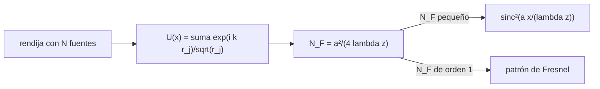

# B42-C02 — Principio de Huygens-Fresnel

<!-- nav:top -->
<!-- /nav -->

## 1. Ubicación, nivel y alcance

Clase 2 del bloque B42. Nivel N3. El **principio de Huygens-Fresnel** dice que cada punto de un frente de onda actúa como fuente de ondas esféricas secundarias cuya suma da el frente siguiente. Aquí sumas ondas secundarias de una rendija y las comparas con la fórmula de Fraunhofer. Usas [B42](../../../tronco-comun/B42-optica-fisica-y-optica-adaptativa.md) (C01) y [B10](../../../tronco-comun/B10-algebra-lineal-y-matematicas-geometricas.md) (sumas complejas).

## 2. Por qué esta clase existe

Sin este principio no hay un procedimiento para calcular qué le pasa a la luz al pasar por una apertura (la pupila de un telescopio es una). La decisión central: **¿a qué distancia vale la aproximación de campo lejano y cuándo hay que sumar las ondas secundarias una por una?**

## 3. Lo que podrás hacer al terminar

1. Escribir el campo como suma de ondas secundarias `exp(ikr)/√r`.
2. Calcular el número de Fresnel `N_F = a²/(4λz)`.
3. Reconocer el régimen de Fraunhofer (`N_F ≪ 1`) y el de Fresnel (`N_F ≳ 1`).
4. Contrastar la suma directa con `sinc²(a x/(λ z))`.
5. Localizar el primer cero en `x = λz/a`.
6. Reconocer los límites de la teoría escalar sin oblicuidad.

La evidencia es la **ficha de Huygens-Fresnel** del ejercicio 12 (sección 20).

## 4. Con qué llegas y cómo comprobarlo

1. ¿Qué es una incertidumbre?
2. ¿Qué es una simulación Monte Carlo?
3. ¿Qué es una tabla de resultados?
4. ¿Qué es un valor ilustrativo?
5. ¿Qué es una verificación?

<details>
<summary>Ver respuestas</summary>

1. Un intervalo en que se espera el valor verdadero. 2. Repetir con números aleatorios de semilla fija. 3. Un resumen ordenado de cálculos. 4. Un valor propuesto para el ejemplo, no medido. 5. Comparar un cálculo con un caso independiente.
</details>

Con cuatro o cinco aciertos, sigue; si no, repasa los prerrequisitos.

## 5. Un caso de contexto y casos de referencia

Con `λ = 633 nm`, rendija de `a = 100 µm` y pantalla a `z = 5 m` (ilustrativos), `N_F = 0,0008` y el primer cero está en `31,65 mm`; a `z = 2 mm` el número de Fresnel es `1,975` y el patrón ya no es una `sinc²`. Es el **ejemplo conductor**.

## 6. Vocabulario

El **frente de onda secundario**: onda esférica (aquí cilíndrica, 2D) emitida por cada punto. La **apertura**. El **campo lejano** (Fraunhofer) y el **campo cercano** (Fresnel). El **número de Fresnel** `N_F = a²/(4λz)`. La función `sinc(u) = sin(πu)/(πu)`.

## 7. Modelo mental: gotas en un estanque

Como gotas que caen en cada punto de una rendija de un estanque: cada gota crea ondas circulares y lo que ves lejos es su suma con diferencias de camino.



*Descripción textual:* la suma de ondas secundarias de la rendija se compara con la fórmula analítica de campo lejano, y el número de Fresnel decide cuál vale.

Analogía: gotas en un estanque. Límite: teoría escalar 2D sin factor de oblicuidad.

## 8. La explicación, paso a paso

### 8.1 Campo lejano

Con `N = 400` fuentes secundarias y `z = 5 m`, la intensidad normalizada `x` en unidades de `λz/a` coincide con `sinc²`:

| `u = x/(λz/a)` | `I` suma | `sinc²(u)` |
|---|---|---|
| 0,00 | 1,0000 | 1,0000 |
| 0,25 | 0,8106 | 0,8106 |
| 0,50 | 0,4053 | 0,4053 |
| 0,75 | 0,0901 | 0,0901 |
| 1,00 | 0,0000 | 0,0000 |
| 1,25 | 0,0324 | 0,0324 |
| 1,50 | 0,0450 | 0,0450 |

El primer mínimo numérico está en `31,6500 mm` (error `0,00 %`, `I = 6,33 × 10⁻⁸`).

### 8.2 Campo cercano

A `z = 2 mm`, `N_F = 1,975` y la máxima diferencia con `sinc²` (con el eje escalado por `z`) es `1,900`: la fórmula de Fraunhofer ya no describe el patrón.

### 8.3 Lectura

El número de Fresnel es la regla práctica: `N_F ≪ 1` autoriza la transformada de Fourier. La pupila de un telescopio observando una estrella cumple siempre ese límite (la fuente está en el infinito y el detector en el foco).

## 9. Magnitudes, símbolos y unidades

| Símbolo | Qué es | Unidad | Valor / nota |
|---|---|---|---|
| `a` | ancho de la rendija | m | 100 µm (ilustrativo) |
| `z` | distancia a la pantalla | m | 5 m |
| `N_F` | número de Fresnel | — | 0,0008 |
| `x₁` | primer cero | m | `λz/a = 31,65 mm` |

## 10. Convenciones y referencias

Teoría escalar 2D; sin factor de oblicuidad; fase `exp(ikr)`; `a` es el ancho completo.

## 11. De dónde sale lo que afirmamos

| ID | Fuente | Localizador | Respalda | Estado |
|---|---|---|---|---|
| — | Huygens y Fresnel (formulación original) y la integral de Fresnel-Kirchhoff | — | el principio y las fórmulas que se verifican | No consultado |

Límites: no se consultó ninguna fuente; se verifican numéricamente resultados clásicos (suma de ondas contra `sinc²`).

## 12. Cómo ver el patrón de la rendija

| Magnitud | Valor |
|---|---|
| `N_F` (z = 5 m) | 0,0008 |
| primer mínimo | 31,65 mm |
| `N_F` (z = 2 mm) | 1,975 |

Descripción larga: en campo lejano la suma coincide con `sinc²`; en campo cercano no.

## 13. Ejemplo trabajado: el primer cero

**Paso 1 · Fórmula.** `x₁ = λz/a`.

**Paso 2 · Valores.** `λ = 6,33 × 10⁻⁷ m`, `z = 5 m`, `a = 10⁻⁴ m`.

**Paso 3 · Cuenta.** `6,33 × 10⁻⁷ × 5/10⁻⁴ = 0,03165 m`.

**Paso 4 · Lectura.** `31,65 mm`: 316 veces el ancho de la rendija.

## 14. Distintas formas de describir el resultado

**Por suma:** `U = Σ exp(ikr)/√r`. **Por fórmula:** `sinc²`. **Por regla:** `N_F`. **Por código:** `huygens.py`.

## 15. Práctica guiada

**Ejercicio 1 · con los pasos indicados.** `sinc²(0,5)`. *Pasos:* `(sin(π/2)/(π/2))²`.

<details><summary>Solución comentada</summary>

`0,4053`.
</details>

**Ejercicio 2 · con una pista.** `sinc²(0,25)`. *Pista:* `sin(π/4) = 0,7071`.

<details><summary>Solución comentada</summary>

`0,8106`.
</details>

**Ejercicio 3 · casi autónomo.** `N_F` para `a = 1 mm`, `λ = 633 nm`, `z = 5 m`.

<details><summary>Solución comentada</summary>

`10⁻⁶/(4 × 6,33 × 10⁻⁷ × 5) = 0,079`.
</details>

## 16. Práctica autónoma, transferencia e integrador

**Ejercicio 4.** Primer cero si `a = 200 µm`.

<details><summary>Solución comentada</summary>

La mitad: `15,8 mm`.
</details>

**Ejercicio 5.** Primer cero si `z = 10 m`.

<details><summary>Solución comentada</summary>

El doble: `63,3 mm`.
</details>

**Ejercicio 6.** `sinc²(0,75)`.

<details><summary>Solución comentada</summary>

`0,0901`.
</details>

**Ejercicio 7.** Anchura del lóbulo central (de cero a cero).

<details><summary>Solución comentada</summary>

`2x₁ = 63,3 mm`.
</details>

**Ejercicio 8.** Distancia `z` en que `N_F = 1` para `a = 100 µm`.

<details><summary>Solución comentada</summary>

`a²/(4λ) = 10⁻⁸/(2,532 × 10⁻⁶) = 3,95 mm`.
</details>

**Ejercicio 9 · transferencia.** **Transferencia.** ¿Por qué la pupila de un telescopio ve a una estrella en régimen de Fraunhofer?

<details><summary>Solución comentada</summary>

Porque la fuente está a distancia infinita y el plano focal es el plano conjugado del infinito; efectivamente `N_F → 0`.
</details>

**Ejercicio 10 · transferencia.** **Transferencia.** Un compañero dice que la suma de ondas secundarias es solo una receta. Responde.

<details><summary>Solución comentada</summary>

Es una formulación aproximada (escalar, sin oblicuidad) que reproduce el resultado analítico en el límite de Fraunhofer.
</details>

**Ejercicio 11 · transferencia.** **Transferencia.** ¿Qué cambia si la rendija se ilumina con luz de `λ` doble?

<details><summary>Solución comentada</summary>

El patrón se ensancha al doble.
</details>

**Ejercicio 12.** **Integrador.** Elabora tu *ficha de Huygens-Fresnel*: suma de ondas, `N_F`, primer cero y los regímenes.

<details><summary>Solución comentada</summary>

Secciones 8.1–8.3.
</details>

**Ejercicio 12 · integrador.** **Integrador.** Elabora tu *ficha de Huygens-Fresnel*: suma de ondas, `N_F`, primer cero y los regímenes.

<details><summary>Solución modelo</summary>

Secciones 8.1–8.3.
</details>

## 17. Laboratorio: suma de ondas secundarias de una rendija

El script [huygens.py](huygens.py) suma ondas secundarias de una rendija y la contrasta con `sinc²` (**comprueba** a `3 × 10⁻²` y el primer mínimo a `2 %`).

**Datos:** sin constantes; `λ`, `a` y `z` ilustrativos. **Predice antes de ejecutar:** ¿dónde cae el primer cero? (≈ 31,65 mm.) **Ejecución del 2026-11-09 (Python 3.12.9):**

```text
Python 3.12.9 (biblioteca estandar)
lambda = 633 nm ; a = 100 um ; z = 5.0 m ; numero de Fresnel N_F = 0.0008
primer cero esperado en x = lambda z / a = 31.6500 mm
  x/(lambda z/a)     I suma    I sinc2        dif
            0.00     1.0000     1.0000    +0.0000
            0.25     0.8106     0.8106    +0.0000
            0.50     0.4053     0.4053    +0.0000
            0.75     0.0901     0.0901    +0.0000
            1.00     0.0000     0.0000    +0.0000
            1.25     0.0324     0.0324    -0.0000
            1.50     0.0450     0.0450    +0.0000
primer minimo numerico en x = 31.6500 mm (I = 6.33e-08) ; error relativo = 0.00%
z = 0.002 m: N_F = 1.975 ; maxima diferencia con sinc2 = 1.900 (Fraunhofer ya no describe el patron)
Pruebas superadas.
```

```bash
python programa/clases/B42/B42-C02-principio-de-huygens-fresnel/huygens.py
```

**Límites:** teoría escalar, 2D, sin oblicuidad.

## 18. Errores frecuentes y cómo corregirlos

**Usar Fraunhofer a distancia corta.** Se corrige con 8.2.

**Olvidar que `a` es el ancho completo.** Se corrige en la sección 10.

**Confundir ceros con máximos de `sinc²`.** Los ceros son `u = ±1, ±2, …`.

**Pensar que `N` (número de fuentes) cambia el patrón.** Mientras `N` sea grande el patrón converge.

## 19. Cómo sabrás que vas bien

Tras la sección 8: ¿qué resultado esperabas y cuál obtuviste? Si dudas, repasa el ejemplo 13. Tras el laboratorio: ¿qué comprueba? (ver la sección 17).

## 20. Qué entregas y cómo se evalúa

El producto es tu **ficha de Huygens-Fresnel** (ejercicio 12).

| Criterio | Inicial | En desarrollo | Logrado | Destacado |
|---|---|---|---|---|
| Conceptos | Los confunde | Parciales | conceptos de la clase | Explica los límites |
| Cálculo | Sin unidades | Con errores | Tablas completas | Calcula casos nuevos |
| Numérico | Sin comprobar | Un caso | Contraste con el análisis | Interpreta las diferencias |
| Fuentes | Sin fuente | Sin fecha | fuentes con fecha | Declara lo ilustrativo |
| Límites | No los nombra | Uno | Tres | Discute qué falta del modelo |

**Condiciones críticas (no se compensan con promedio):** rotular lo ilustrativo; no extender la teoría escalar a polarización; indicar el régimen.

## 21. Ética, seguridad y límites

Clase educativa: los modelos son simplificados. Accesibilidad: tablas equivalentes a las gráficas, fórmulas en texto, ejercicios sin conexión.

## 22. Para cerrar y seguir

La suma de ondas secundarias de una rendija reproduce la `sinc²` con primer cero en 31,65 mm cuando `N_F = 0,0008`. Falta ver cuándo dos ondas se suman con contraste completo.

**Glosario español–inglés.** principio de Huygens-Fresnel · *Huygens-Fresnel principle*; número de Fresnel · *Fresnel number*; campo lejano · *far field*; apertura · *aperture*; onda secundaria · *secondary wavelet*.

**Continuidad.** [B42-C03](../B42-C03-interferencia-y-coherencia/CLASE.md) estudia la interferencia y la coherencia.

**Referencias:** ver sección 11.

<!-- nav:bottom -->
---

<!-- /nav -->
