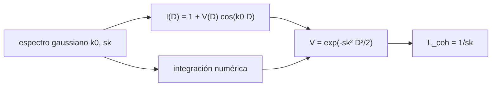

# B42-C03 — Interferencia y coherencia

<!-- nav:top -->
<!-- /nav -->

## 1. Ubicación, nivel y alcance

Clase 3 del bloque B42. Nivel N3. La **interferencia** es la suma de dos ondas con fase; la **coherencia** mide cuánto se conserva esa relación de fase. Calculas la visibilidad de franjas de una fuente de espectro gaussiano en función de la diferencia de camino. Usas [B42](../../../tronco-comun/B42-optica-fisica-y-optica-adaptativa.md) (C01–C02) y [B15](../../../tronco-comun/B15-senales-imagenes-y-estimacion-cientifica.md) (espectros y transformadas).

## 2. Por qué esta clase existe

Sin coherencia no hay franjas: una fuente ancha en frecuencia o en tamaño borra la interferencia. La decisión central: **¿hasta qué diferencia de camino se ven franjas con una fuente de ancho espectral dado?**

## 3. Lo que podrás hacer al terminar

1. Escribir la intensidad de dos haces `I = 1 + V cos(k₀D)`.
2. Calcular la visibilidad `V` de un espectro gaussiano.
3. Definir la longitud de coherencia `1/σ_k`.
4. Contrastar `V` por integración numérica y por la fórmula `exp(−σ_k²D²/2)`.
5. Relacionar `Δλ` con `λ²/Δλ`.
6. Reconocer el límite de la coherencia temporal frente a la espacial.

La evidencia es la **ficha de interferencia y coherencia** del ejercicio 12 (sección 20).

## 4. Con qué llegas y cómo comprobarlo

1. ¿Qué es una incertidumbre?
2. ¿Qué es una simulación Monte Carlo?
3. ¿Qué es una tabla de resultados?
4. ¿Qué es un valor ilustrativo?
5. ¿Qué es una verificación?

<details>
<summary>Ver respuestas</summary>

1. Un intervalo en que se espera el valor verdadero. 2. Repetir con números aleatorios de semilla fija. 3. Un resumen ordenado de cálculos. 4. Un valor propuesto para el ejemplo, no medido. 5. Comparar un cálculo con un caso independiente.
</details>

Con cuatro o cinco aciertos, sigue; si no, repasa los prerrequisitos.

## 5. Un caso de contexto y casos de referencia

Con `λ₀ = 600 nm` y un ancho de `10 nm` (ilustrativos) la longitud de coherencia `1/σ_k` es `13,49 µm` y la visibilidad a esa diferencia de camino es `0,6065`. Es el **ejemplo conductor**.

## 6. Vocabulario

La **visibilidad** `V = (Imáx − Imín)/(Imáx + Imín)`. La **diferencia de camino** `D`. La **coherencia temporal**: relación entre fases en instantes distintos. La **longitud de coherencia** `L = 1/σ_k`. El **espectro** gaussiano de desviación `σ_k` en número de onda.

## 7. Modelo mental: un grupo de corredores

Como un grupo de corredores que parte junto: al principio van acompasados y luego se desfasan; la longitud de coherencia es el tramo en que aún van en grupo.



*Descripción textual:* el espectro ancho promedia franjas de distinto periodo, por eso baja la visibilidad con `D`.

Analogía: un grupo de corredores. Límite: fuente puntual y dos haces iguales.

## 8. La explicación, paso a paso

### 8.1 Visibilidad frente a diferencia de camino

| FWHM (nm) | `L = 1/σ_k` (µm) | `D/L` | `V` integral | `V` teoría |
|---|---|---|---|---|
| 1 | 134,921 | 0,5 | 0,8825 | 0,8825 |
| 1 | 134,921 | 1 | 0,6065 | 0,6065 |
| 1 | 134,921 | 2 | 0,1353 | 0,1353 |
| 10 | 13,492 | 1 | 0,6065 | 0,6065 |
| 50 | 2,698 | 1 | 0,6065 | 0,6065 |

La visibilidad depende solo de `D/L`. Para `1 nm` el contraste medido en las franjas da `0,8827`, `0,6073` y `0,1355`.

### 8.2 Casos límite

En `D = 0` la intensidad es `2,000000` (máximo con `V = 1`) y en `D = λ₀/2` vale `0,000247` (franja oscura). Además `λ₀²/Δλ = 36,00 µm` para 10 nm, frente a `13,49 µm`: mismo orden, pero difieren en un factor `2,668`, así que la fórmula `λ²/Δλ` es una estimación y no una definición.

### 8.3 Lectura

Cuanto más ancho el espectro, más corta la coherencia: una luz blanca da unas pocas franjas; un láser, millones.

## 9. Magnitudes, símbolos y unidades

| Símbolo | Qué es | Unidad | Valor / nota |
|---|---|---|---|
| `σ_k` | dispersión del número de onda | rad/m | 7,41 × 10³ (para 1 nm) |
| `L` | longitud de coherencia | m | 1/σ_k |
| `V` | visibilidad | — | `exp(−σ_k²D²/2)` |
| `D` | diferencia de camino | m | ver 8.1 |

## 10. Convenciones y referencias

Espectro gaussiano en número de onda; FWHM de `Δλ` convertido con `Δk = 2π Δλ/λ₀²`; `V` es el módulo de la media espectral de `exp(ikD)`.

## 11. De dónde sale lo que afirmamos

| ID | Fuente | Localizador | Respalda | Estado |
|---|---|---|---|---|
| — | Definiciones de coherencia temporal (libros de óptica) | — | relaciones teóricas que el laboratorio verifica | No consultado |

Límites: no se consultó una fuente; se contrastan dos formas independientes de calcular `V` (integral y fórmula) y el contraste medido en las franjas.

## 12. Cómo ver la visibilidad

| Magnitud | Valor |
|---|---|
| `L` (10 nm) | 13,492 µm |
| `V(L)` | 0,6065 |
| `V(2L)` | 0,1353 |
| `λ²/Δλ` (10 nm) | 36,00 µm |

Descripción larga: `V` cae de 1 a 0,14 entre `D = 0` y `D = 2L`.

## 13. Ejemplo trabajado: el contraste a distancia `L`

**Paso 1 · Fórmula.** `V = exp(−σ_k²D²/2)`.

**Paso 2 · Con `D = L`.** `σ_k D = 1`.

**Paso 3 · Valor.** `exp(−1/2) = 0,6065`.

**Paso 4 · Lectura.** A la longitud de coherencia queda el 61 % del contraste.

## 14. Distintas formas de describir el resultado

**Por franjas:** `I(D)`. **Por fórmula:** `V = exp(...)`. **Por tabla:** `V` frente a `D/L`. **Por código:** `coherencia.py`.

## 15. Práctica guiada

**Ejercicio 1 · con los pasos indicados.** `V` en `D = 0,5 L`. *Pasos:* `exp(−1/8)`.

<details><summary>Solución comentada</summary>

`0,8825`.
</details>

**Ejercicio 2 · con una pista.** `V` en `D = 2L`. *Pista:* `exp(−2)`.

<details><summary>Solución comentada</summary>

`0,1353`.
</details>

**Ejercicio 3 · casi autónomo.** `L` para un espectro de 50 nm.

<details><summary>Solución comentada</summary>

`2,698 µm`.
</details>

## 16. Práctica autónoma, transferencia e integrador

**Ejercicio 4.** ¿Por cuánto se reduce `L` si el ancho aumenta 5 veces?

<details><summary>Solución comentada</summary>

Por 5.
</details>

**Ejercicio 5.** `D` en que `V = 0,5` para 10 nm.

<details><summary>Solución comentada</summary>

`σ_kD = √(2 ln 2) = 1,1774`; `D = 1,1774 × 13,49 = 15,9 µm`.
</details>

**Ejercicio 6.** Cantidad de franjas visibles aproximada para 10 nm.

<details><summary>Solución comentada</summary>

`L/λ₀ = 13,49/0,6 ≈ 22`.
</details>

**Ejercicio 7.** Intensidad en `D = λ₀/2`.

<details><summary>Solución comentada</summary>

`0,000247`: franja oscura.
</details>

**Ejercicio 8.** `λ₀²/Δλ` para 1 nm.

<details><summary>Solución comentada</summary>

`3,6 × 10⁻¹³/10⁻⁹ = 360 µm`, frente a `134,9 µm`.
</details>

**Ejercicio 9 · transferencia.** **Transferencia.** ¿Por qué una estrella vista con un interferómetro de brazos desiguales pierde franjas si se usa banda ancha?

<details><summary>Solución comentada</summary>

Porque la diferencia de camino supera la longitud de coherencia del filtro.
</details>

**Ejercicio 10 · transferencia.** **Transferencia.** Un compañero dice que `V = 0,6` significa que el 60 % de la luz interfiere. Responde.

<details><summary>Solución comentada</summary>

Significa que el contraste relativo es 0,6; no es una fracción de luz.
</details>

**Ejercicio 11 · transferencia.** **Transferencia.** ¿Cómo se alarga la coherencia sin cambiar la fuente?

<details><summary>Solución comentada</summary>

Con un filtro más estrecho (pierde flujo).
</details>

**Ejercicio 12.** **Integrador.** Elabora tu *ficha de interferencia y coherencia*: `V(D)`, `L` y su dependencia con el ancho.

<details><summary>Solución comentada</summary>

Secciones 8.1–8.3.
</details>

**Ejercicio 12 · integrador.** **Integrador.** Elabora tu *ficha de interferencia y coherencia*: `V(D)`, `L` y su dependencia con el ancho.

<details><summary>Solución modelo</summary>

Secciones 8.1–8.3.
</details>

## 17. Laboratorio: visibilidad con espectro gaussiano

El script [coherencia.py](coherencia.py) calcula `V` por integral y por fórmula y la mide en las franjas (**comprueba** a `10⁻⁴` y `2 × 10⁻³`).

**Datos:** sin constantes; `λ₀` y los anchos ilustrativos. **Predice antes de ejecutar:** ¿cuánto vale `V` a la longitud de coherencia? (≈ 0,61.) **Ejecución del 2026-11-09 (Python 3.12.9):**

```text
Python 3.12.9 (biblioteca estandar)
 FWHM [nm]  L_coh=1/sk [um]   D [um]  V integral    V teo  V franjas
       1.0          134.921   67.461      0.8825   0.8825     0.8827
       1.0          134.921  134.921      0.6065   0.6065     0.6073
       1.0          134.921  269.843      0.1353   0.1353     0.1355
      10.0           13.492    6.746      0.8825   0.8825          -
      10.0           13.492   13.492      0.6065   0.6065          -
      10.0           13.492   26.984      0.1353   0.1353          -
      50.0            2.698    1.349      0.8825   0.8825          -
      50.0            2.698    2.698      0.6065   0.6065          -
      50.0            2.698    5.397      0.1353   0.1353          -
D = 0: I = 2.000000 (maximo, V=1) ; D = lambda0/2: I = 0.000247 (franja oscura)
lambda0^2 / dlambda = 36.00 um frente a 1/sk = 13.49 um (mismo orden; difieren en un factor 2.668)
Pruebas superadas.
```

```bash
python programa/clases/B42/B42-C03-interferencia-y-coherencia/coherencia.py
```

**Límites:** espectro gaussiano; coherencia espacial no incluida.

## 18. Errores frecuentes y cómo corregirlos

**Confundir FWHM con `σ`.** Se corrige con la sección 10.

**Dar `V > 1`.** `V` está entre 0 y 1.

**Usar `λ²/Δλ` como exacta.** Se corrige con 8.2.

**Olvidar la coherencia espacial.** Una fuente extensa también reduce `V`; se trata en C10.

## 19. Cómo sabrás que vas bien

Tras la sección 8: ¿qué resultado esperabas y cuál obtuviste? Si dudas, repasa el ejemplo 13. Tras el laboratorio: ¿qué comprueba? (ver la sección 17).

## 20. Qué entregas y cómo se evalúa

El producto es tu **ficha de interferencia y coherencia** (ejercicio 12).

| Criterio | Inicial | En desarrollo | Logrado | Destacado |
|---|---|---|---|---|
| Conceptos | Los confunde | Parciales | conceptos de la clase | Explica los límites |
| Cálculo | Sin unidades | Con errores | Tablas completas | Calcula casos nuevos |
| Numérico | Sin comprobar | Un caso | Contraste con el análisis | Interpreta las diferencias |
| Fuentes | Sin fuente | Sin fecha | fuentes con fecha | Declara lo ilustrativo |
| Límites | No los nombra | Uno | Tres | Discute qué falta del modelo |

**Condiciones críticas (no se compensan con promedio):** no confundir coherencia temporal con espacial; rotular el espectro como ilustrativo.

## 21. Ética, seguridad y límites

Clase educativa: los modelos son simplificados. Accesibilidad: tablas equivalentes a las gráficas, fórmulas en texto, ejercicios sin conexión.

## 22. Para cerrar y seguir

El contraste de las franjas cae como `exp(−σ_k²D²/2)`; a la longitud de coherencia vale 0,6065. Falta ver cómo la apertura limitada da forma al patrón.

**Glosario español–inglés.** coherencia · *coherence*; visibilidad · *visibility*; franja · *fringe*; longitud de coherencia · *coherence length*; diferencia de camino · *optical path difference*.

**Continuidad.** [B42-C04](../B42-C04-difraccion-de-aperturas/CLASE.md) estudia la difracción de aperturas.

**Referencias:** ver sección 11.

<!-- nav:bottom -->
---

<!-- /nav -->
