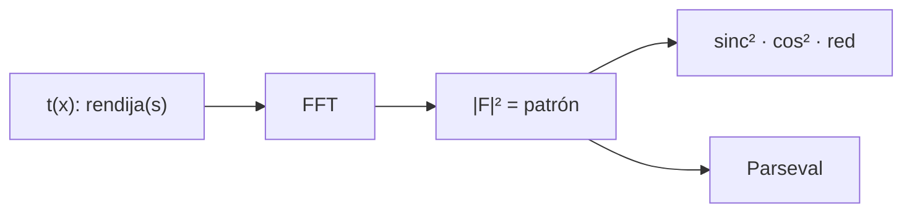

# B42-C04 — Difracción de aperturas

<!-- nav:top -->
<!-- /nav -->

## 1. Ubicación, nivel y alcance

Clase 4 del bloque B42. Nivel N3. En campo lejano, el patrón de difracción es la **transformada de Fourier de la transmitancia** de la apertura. Calculas con FFT los patrones de una rendija, dos rendijas y una red y los comparas con las fórmulas. Usas [B42](../../../tronco-comun/B42-optica-fisica-y-optica-adaptativa.md) (C02) y [B15](../../../tronco-comun/B15-senales-imagenes-y-estimacion-cientifica.md) (Fourier).

## 2. Por qué esta clase existe

La pupila de un telescopio es una apertura: su forma fija la imagen de una estrella. La decisión central: **¿cómo cambia el patrón cuando cambia la forma o el número de aberturas?**

## 3. Lo que podrás hacer al terminar

1. Escribir `I(u) ∝ |F{t(x)}|²` con `u = sen θ/λ`.
2. Calcular el patrón de una rendija (`sinc²`).
3. Añadir el factor `cos²` de una doble rendija.
4. Reconocer los `N − 2` máximos secundarios de una red de `N` rendijas.
5. Verificar Parseval entre apertura y patrón.
6. Reconocer los límites de la apertura unidimensional.

La evidencia es la **ficha de la difracción de aperturas** del ejercicio 12 (sección 20).

## 4. Con qué llegas y cómo comprobarlo

1. ¿Qué es una incertidumbre?
2. ¿Qué es una simulación Monte Carlo?
3. ¿Qué es una tabla de resultados?
4. ¿Qué es un valor ilustrativo?
5. ¿Qué es una verificación?

<details>
<summary>Ver respuestas</summary>

1. Un intervalo en que se espera el valor verdadero. 2. Repetir con números aleatorios de semilla fija. 3. Un resumen ordenado de cálculos. 4. Un valor propuesto para el ejemplo, no medido. 5. Comparar un cálculo con un caso independiente.
</details>

Con cuatro o cinco aciertos, sigue; si no, repasa los prerrequisitos.

## 5. Un caso de contexto y casos de referencia

Con `a = 50 µm`, `d = 200 µm` y `λ = 500 nm` (ilustrativos) el primer cero de la rendija está en `10,00 mrad`, las franjas de la doble rendija se separan `2,5 mrad` y una red de 5 rendijas tiene 3 máximos secundarios de altura `0,0613`. Es el **ejemplo conductor**.

## 6. Vocabulario

La **transmitancia** `t(x)`. La **frecuencia espacial** `u = sen θ/λ`. La **rendija** de ancho `a`. La **doble rendija** de separación `d`. La **red** de difracción de `N` rendijas. Los **máximos principales** (`u = n/d`) y **secundarios**.

## 7. Modelo mental: una sombra que se descompone en notas

Como una chispa que se descompone en frecuencias: una apertura estrecha tiene un patrón ancho y viceversa.



*Descripción textual:* la FFT de la apertura da el patrón en campo lejano; se compara con sinc², cos² y la fórmula de la red.

Analogía: una sombra que se descompone en notas. Límite: apertura unidimensional y monocromática.

## 8. La explicación, paso a paso

### 8.1 Una rendija

El paso de la malla es `Δu = 122,07 m⁻¹` (`61,0 µrad`). El primer cero está en `u = 1/a = 20 000 m⁻¹` (`θ = 10,00 mrad`).

| `a u` | `I` FFT | `sinc²` |
|---|---|---|
| 0,25 | 0,81030 | 0,81023 |
| 0,50 | 0,40463 | 0,40449 |
| 1,00 | 0,00000 | 0,00000 |
| 1,50 | 0,04508 | 0,04494 |
| 2,50 | 0,01631 | 0,01618 |

La intensidad en el primer cero es `9,53 × 10⁻⁷`.

### 8.2 Doble rendija y red

Para dos rendijas, la máxima diferencia con `sinc²·cos²` sobre 22 puntos es `1,32 × 10⁻⁴` y las franjas se separan `1/d = 5000 m⁻¹` (`λ/d = 2,5 mrad`). Para una red de 5 rendijas el máximo secundario entre principales es `0,0613` (cota de la fórmula: `0,0611`) y hay `3 = N − 2` secundarios; la diferencia máxima con la fórmula es `1,32 × 10⁻⁴`. Parseval: `Σ|g|² = 50,0` y `Σ|G|²/N = 50,0`.

### 8.3 Lectura

Una apertura estrecha da un patrón ancho (`θ ≈ λ/a`). Varias rendijas añaden estructura fina (período `λ/d`) dentro de la envolvente.

## 9. Magnitudes, símbolos y unidades

| Símbolo | Qué es | Unidad | Valor / nota |
|---|---|---|---|
| `a` | ancho de rendija | m | 50 µm (ilustrativo) |
| `d` | separación | m | 200 µm |
| `u` | frecuencia espacial | 1/m | `sen θ/λ` |
| `N` | número de rendijas | — | 5 en la red |

## 10. Convenciones y referencias

Transmitancia 1 o 0; FFT de `N = 8192` puntos con muestreo `1 µm`; `u = sen θ/λ`; intensidades normalizadas al origen.

## 11. De dónde sale lo que afirmamos

| ID | Fuente | Localizador | Respalda | Estado |
|---|---|---|---|---|
| — | Teoría de Fraunhofer de rendijas y redes (libros de óptica) | — | fórmulas `sinc²`, `cos²` y de la red | No consultado |

Límites: no se consultó una fuente; todas las fórmulas son resultados clásicos verificados por FFT.

## 12. Cómo ver los patrones de rendijas

| Magnitud | Valor |
|---|---|
| primer cero (1 rendija) | 10,00 mrad |
| separación de franjas (2 rendijas) | 2,5 mrad |
| máximo secundario (N=5) | 0,0613 |
| secundarios en la red | 3 |

Descripción larga: las tres formas del patrón coinciden con sus fórmulas a `10⁻⁴`.

## 13. Ejemplo trabajado: el primer cero

**Paso 1 · Fórmula.** `θ₁ = λ/a`.

**Paso 2 · Valores.** `λ = 5 × 10⁻⁷ m`, `a = 5 × 10⁻⁵ m`.

**Paso 3 · Cuenta.** `θ₁ = 0,01 rad = 10 mrad`.

**Paso 4 · Lectura.** La apertura de 50 µm abre el haz 10 mrad.

## 14. Distintas formas de describir el resultado

**Por transformada:** `|F{t}|²`. **Por fórmula:** `sinc²`, `cos²`. **Por tabla:** los valores de 8.1. **Por código:** `aperturas.py`.

## 15. Práctica guiada

**Ejercicio 1 · con los pasos indicados.** Primer cero para `a = 100 µm`. *Pasos:* `λ/a`.

<details><summary>Solución comentada</summary>

`5 mrad`.
</details>

**Ejercicio 2 · con una pista.** Separación de franjas con `d = 200 µm`. *Pista:* `λ/d`.

<details><summary>Solución comentada</summary>

`2,5 mrad`.
</details>

**Ejercicio 3 · casi autónomo.** Franjas brillantes dentro del lóbulo central (con `d/a = 4`).

<details><summary>Solución comentada</summary>

El cuarto orden cae en el cero: quedan 7 (órdenes −3 a 3).
</details>

## 16. Práctica autónoma, transferencia e integrador

**Ejercicio 4.** `sinc²(1,5)`.

<details><summary>Solución comentada</summary>

`(sin(1,5π)/(1,5π))² = (1/4,712)² = 0,0450`.
</details>

**Ejercicio 5.** Máximos secundarios de una red de 8 rendijas.

<details><summary>Solución comentada</summary>

`N − 2 = 6`.
</details>

**Ejercicio 6.** Altura límite del secundario relativo para `N` grande.

<details><summary>Solución comentada</summary>

`(1/(1,5π))² = 0,045`.
</details>

**Ejercicio 7.** `λ/a` para `λ = 1 µm`, `a = 50 µm`.

<details><summary>Solución comentada</summary>

`20 mrad`.
</details>

**Ejercicio 8.** Verificación de Parseval: ¿qué conserva?

<details><summary>Solución comentada</summary>

La energía total entre apertura y patrón.
</details>

**Ejercicio 9 · transferencia.** **Transferencia.** ¿Cómo cambia el patrón de una rendija si se duplica el ancho?

<details><summary>Solución comentada</summary>

El patrón se estrecha a la mitad y el pico sube en 4.
</details>

**Ejercicio 10 · transferencia.** **Transferencia.** Un compañero dice que más rendijas aumentan el ancho de los máximos. Responde.

<details><summary>Solución comentada</summary>

Los máximos principales se afinan: su ancho es `∼λ/(Nd)`.
</details>

**Ejercicio 11 · transferencia.** **Transferencia.** ¿Por qué la pupila circular no da `sinc²`?

<details><summary>Solución comentada</summary>

Porque la geometría circular cambia la transformada (patrón de Airy, C05).
</details>

**Ejercicio 12.** **Integrador.** Elabora tu *ficha de la difracción de aperturas*: patrón, ceros y comprobaciones.

<details><summary>Solución comentada</summary>

Secciones 8.1–8.3.
</details>

**Ejercicio 12 · integrador.** **Integrador.** Elabora tu *ficha de la difracción de aperturas*: patrón, ceros y comprobaciones.

<details><summary>Solución modelo</summary>

Secciones 8.1–8.3.
</details>

## 17. Laboratorio: rendijas por transformada de Fourier

El script [aperturas.py](aperturas.py) calcula con FFT los patrones de una, dos y cinco rendijas y los compara con las fórmulas (**comprueba** a `2 × 10⁻³` y los ceros).

**Datos:** sin constantes; geometría ilustrativa. **Predice antes de ejecutar:** ¿dónde cae el primer cero? (≈ 10 mrad.) **Ejecución del 2026-11-09 (Python 3.12.9):**

```text
Python 3.12.9 (biblioteca estandar)
paso en u = 122.07 1/m ; paso angular = 61.0 urad ; primer cero de la rendija en u = 1/a = 20000 1/m (theta = 10.00 mrad)
   u a      I FFT      sinc2
  0.25    0.81030    0.81023
  0.50    0.40463    0.40449
  1.00    0.00000    0.00000
  1.50    0.04508    0.04494
  2.00    0.00000    0.00000
  2.50    0.01631    0.01618
intensidad en el primer cero (k = 164): 9.53e-07
doble rendija: maximo |I FFT - sinc2 * cos2| sobre 22 puntos = 1.32e-04 ; franjas separadas por u = 1/d = 5000 1/m
red de 5 rendijas: maxima secundario entre principales = 0.0613 ; cantidad de secundarios = 3 (esperados N-2 = 3) ; cota 1/(N sin(1.5 pi/N))^2 = 0.0611
red: maximo |I FFT - formula| = 1.32e-04
Parseval: sum|g|^2 = 50.0 ; sum|G|^2 / N = 50.0
Pruebas superadas.
```

```bash
python programa/clases/B42/B42-C04-difraccion-de-aperturas/aperturas.py
```

**Límites:** apertura unidimensional.

## 18. Errores frecuentes y cómo corregirlos

**Confundir `a` con el semiancho.** Se corrige en la sección 10.

**Pensar que la red cambia la envolvente.** La envolvente es la `sinc²` de una rendija.

**Contar mal los secundarios.** Son `N − 2`.

**Olvidar normalizar el patrón.** Se normaliza al origen.

## 19. Cómo sabrás que vas bien

Tras la sección 8: ¿qué resultado esperabas y cuál obtuviste? Si dudas, repasa el ejemplo 13. Tras el laboratorio: ¿qué comprueba? (ver la sección 17).

## 20. Qué entregas y cómo se evalúa

El producto es tu **ficha de la difracción de aperturas** (ejercicio 12).

| Criterio | Inicial | En desarrollo | Logrado | Destacado |
|---|---|---|---|---|
| Conceptos | Los confunde | Parciales | conceptos de la clase | Explica los límites |
| Cálculo | Sin unidades | Con errores | Tablas completas | Calcula casos nuevos |
| Numérico | Sin comprobar | Un caso | Contraste con el análisis | Interpreta las diferencias |
| Fuentes | Sin fuente | Sin fecha | fuentes con fecha | Declara lo ilustrativo |
| Límites | No los nombra | Uno | Tres | Discute qué falta del modelo |

**Condiciones críticas (no se compensan con promedio):** indicar que la apertura es 1D; no extender a pupilas circulares.

## 21. Ética, seguridad y límites

Clase educativa: los modelos son simplificados. Accesibilidad: tablas equivalentes a las gráficas, fórmulas en texto, ejercicios sin conexión.

## 22. Para cerrar y seguir

La FFT de una rendija da la `sinc²` con cero en 10 mrad; dos y cinco rendijas añaden franjas y `N − 2` secundarios. Falta el caso circular.

**Glosario español–inglés.** difracción · *diffraction*; rendija · *slit*; red · *grating*; máximo secundario · *side maximum*; frecuencia espacial · *spatial frequency*.

**Continuidad.** [B42-C05](../B42-C05-patrones-de-airy/CLASE.md) estudia los patrones de Airy.

**Referencias:** ver sección 11.

<!-- nav:bottom -->
---

<!-- /nav -->
