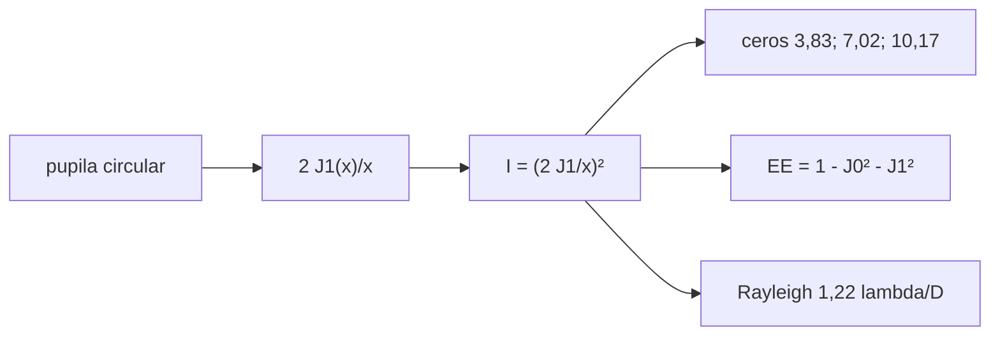

# B42-C05 — Patrones de Airy

<!-- nav:top -->
<!-- /nav -->

## 1. Ubicación, nivel y alcance

Clase 5 del bloque B42. Nivel N3. El patrón de Airy es la difracción de una apertura circular. Aquí calculas sus ceros, su anchura, la energía encerrada y el criterio de Rayleigh con funciones de Bessel calculadas por integración numérica. Usas [B42](../../../tronco-comun/B42-optica-fisica-y-optica-adaptativa.md) (C04).

## 2. Por qué esta clase existe

El patrón de Airy es el límite de resolución de cualquier telescopio sin atmósfera. La decisión central: **¿cuánto vale la resolución de una apertura circular y qué fracción de la luz queda en el disco central?**

## 3. Lo que podrás hacer al terminar

1. Escribir `I(x) = [2J₁(x)/x]²` con `x = πDθ/λ`.
2. Calcular los ceros de `J₁` por bisección.
3. Calcular el FWHM y el radio de Rayleigh.
4. Integrar la energía encerrada y compararla con `1 − J₀² − J₁²`.
5. Convertir `λ/D` a arcsec.
6. Reconocer los límites de una pupila ideal.

La evidencia es la **ficha del patrón de Airy** del ejercicio 12 (sección 20).

## 4. Con qué llegas y cómo comprobarlo

1. ¿Qué es una incertidumbre?
2. ¿Qué es una simulación Monte Carlo?
3. ¿Qué es una tabla de resultados?
4. ¿Qué es un valor ilustrativo?
5. ¿Qué es una verificación?

<details>
<summary>Ver respuestas</summary>

1. Un intervalo en que se espera el valor verdadero. 2. Repetir con números aleatorios de semilla fija. 3. Un resumen ordenado de cálculos. 4. Un valor propuesto para el ejemplo, no medido. 5. Comparar un cálculo con un caso independiente.
</details>

Con cuatro o cinco aciertos, sigue; si no, repasa los prerrequisitos.

## 5. Un caso de contexto y casos de referencia

Con `D = 8 m` y `λ = 2,2 µm` (ilustrativos) `λ/D = 0,05672 arcsec`; el primer cero está en `1,2197 λ/D`, el FWHM en `1,0290 λ/D` y el disco de Airy encierra el `83,78 %`. Es el **ejemplo conductor**.

## 6. Vocabulario

El **patrón de Airy**. La **función de Bessel** `J₁`. El **disco de Airy**. El **criterio de Rayleigh**: separación igual al primer cero. El **FWHM**. La **energía encerrada**.

## 7. Modelo mental: una piedra en un estanque

Como una piedra en un estanque circular: un pico central y anillos que se apagan; el disco de Airy es el primer anillo oscuro.



*Descripción textual:* el patrón de Airy se evalúa con Bessel y se contrastan sus ceros, anchura y energía.

Analogía: una piedra en un estanque. Límite: pupila uniforme, sin obstrucción.

## 8. La explicación, paso a paso

### 8.1 Ceros

| cero | `x` | tabla | `θ/(λ/D)` |
|---|---|---|---|
| 1 | 3,83171 | 3,8317 | 1,2197 |
| 2 | 7,01559 | 7,0156 | 2,2331 |
| 3 | 10,17347 | 10,1735 | 3,2383 |

Los valores de la tabla son de libro y no se consultaron; la bisección los reproduce a `10⁻⁴`.

### 8.2 FWHM, energía y Rayleigh

El FWHM es `1,0290 λ/D`. La energía encerrada numérica y la forma cerrada coinciden:

| `x` | EE numérica | EE cerrada |
|---|---|---|
| 3,8317 | 0,837785 | 0,837785 |
| 7,0156 | 0,909931 | 0,909931 |
| 10,1735 | 0,937648 | 0,937647 |

La separación de Rayleigh es `1,2197 λ/D = 0,06918 arcsec`; a esa separación el cociente `I(punto medio)/I(pico) = 0,7350`.

### 8.3 Lectura

El 16,2 % de la luz cae fuera del primer cero. La energía acumulada hasta el segundo cero es `0,9099`: el primer anillo brillante aporta `7,2` puntos porcentuales.

## 9. Magnitudes, símbolos y unidades

| Símbolo | Qué es | Unidad | Valor / nota |
|---|---|---|---|
| `D` | diámetro | m | 8 m (ilustrativo) |
| `λ/D` | unidad angular | rad | 2,75 × 10⁻⁷ = 0,05672 arcsec |
| `x` | `πDθ/λ` | — | ver 8.1 |
| `EE` | energía encerrada | — | 0,8378 en el 1.er cero |

## 10. Convenciones y referencias

`J₁` por la integral de Bessel (Simpson, 400 intervalos); `1 arcsec = 1/206264,806 rad`; ceros y 0,735 de libro (no consultados).

## 11. De dónde sale lo que afirmamos

| ID | Fuente | Localizador | Respalda | Estado |
|---|---|---|---|---|
| — | Teoría del patrón de Airy (libros de óptica) | — | ceros, FWHM 1,029 y EE | No consultado |

Límites: no se consultó una fuente; se contrastan dos vías numéricas (bisección contra tabla de libro e integral de 2πxI contra forma cerrada).

## 12. Cómo ver el patrón y sus anillos

| Magnitud | Valor |
|---|---|
| primer cero | 1,2197 λ/D |
| FWHM | 1,0290 λ/D |
| EE en el 1.er cero | 0,8378 |
| Rayleigh en arcsec (D=8 m, 2,2 µm) | 0,06918 |

Descripción larga: el 83,8 % de la luz está en el disco central.

## 13. Ejemplo trabajado: el límite de Rayleigh

**Paso 1 · Fórmula.** `θ_R = 1,2197 λ/D`.

**Paso 2 · Unidad.** `λ/D = 2,2 × 10⁻⁶/8 = 2,75 × 10⁻⁷ rad = 0,05672 arcsec`.

**Paso 3 · Producto.** `1,2197 × 0,05672 = 0,06918 arcsec`.

**Paso 4 · Lectura.** Menos de 0,07 arcsec: unas 7 veces más fino que un seeing de 0,5 arcsec (`0,5/0,0692 = 7,2`).

## 14. Distintas formas de describir el resultado

**Por Bessel:** `[2J₁/x]²`. **Por tabla:** ceros. **Por integral:** `EE`. **Por código:** `airy.py`.

## 15. Práctica guiada

**Ejercicio 1 · con los pasos indicados.** `θ_R` en arcsec para `D = 8 m`, `λ = 2,2 µm`. *Pasos:* ejemplo 13.

<details><summary>Solución comentada</summary>

`0,06918 arcsec`.
</details>

**Ejercicio 2 · con una pista.** FWHM en arcsec.

<details><summary>Solución comentada</summary>

`1,029 × 0,05672 = 0,05837 arcsec`.
</details>

**Ejercicio 3 · casi autónomo.** Fracción fuera del disco de Airy.

<details><summary>Solución comentada</summary>

`1 − 0,8378 = 0,1622`.
</details>

## 16. Práctica autónoma, transferencia e integrador

**Ejercicio 4.** Cociente `0,5 arcsec/0,05672 arcsec`.

<details><summary>Solución comentada</summary>

`8,8`: seeing frente al límite de difracción.
</details>

**Ejercicio 5.** Primer cero en radianes para `D = 39 m`, `λ = 2,2 µm`.

<details><summary>Solución comentada</summary>

`1,2197 × 5,64 × 10⁻⁸ = 6,88 × 10⁻⁸ rad`.
</details>

**Ejercicio 6.** Energía encerrada hasta el segundo cero.

<details><summary>Solución comentada</summary>

`0,9099`.
</details>

**Ejercicio 7.** Posición del segundo cero en `λ/D`.

<details><summary>Solución comentada</summary>

`2,2331`.
</details>

**Ejercicio 8.** Cociente `I(punto medio)/I(pico)` a Rayleigh.

<details><summary>Solución comentada</summary>

`0,735`.
</details>

**Ejercicio 9 · transferencia.** **Transferencia.** ¿Por qué un telescopio mayor ve detalles más finos?

<details><summary>Solución comentada</summary>

Porque `λ/D` disminuye.
</details>

**Ejercicio 10 · transferencia.** **Transferencia.** Un compañero dice que no se pueden separar fuentes a menos de Rayleigh. Responde.

<details><summary>Solución comentada</summary>

Es un criterio convencional; con buena señal/ruido y modelo se puede separar menos (C19).
</details>

**Ejercicio 11 · transferencia.** **Transferencia.** ¿Qué pasa al 83,8 % si hay obstrucción central?

<details><summary>Solución comentada</summary>

Baja: la luz pasa a los anillos.
</details>

**Ejercicio 12.** **Integrador.** Elabora tu *ficha del patrón de Airy*: ceros, FWHM, EE y Rayleigh en arcsec para tu caso.

<details><summary>Solución comentada</summary>

Secciones 8.1–8.3.
</details>

**Ejercicio 12 · integrador.** **Integrador.** Elabora tu *ficha del patrón de Airy*: ceros, FWHM, EE y Rayleigh en arcsec para tu caso.

<details><summary>Solución modelo</summary>

Secciones 8.1–8.3.
</details>

## 17. Laboratorio: patrón de Airy numérico

El script [airy.py](airy.py) evalúa Bessel, ceros, FWHM, EE y Rayleigh (**comprueba** a `10⁻⁴`, `10⁻⁵` y `10⁻³`).

**Datos:** sin constantes; `D` y `λ` ilustrativos. **Predice antes de ejecutar:** ¿cuánto vale la resolución de Rayleigh? (≈ 0,069 arcsec.) **Ejecución del 2026-11-09 (Python 3.12.9):**

```text
Python 3.12.9 (biblioteca estandar)
lambda/D = 2.7500e-07 rad = 0.05672 arcsec
 cero          x    tabla  theta/(lambda/D)
    1    3.83171   3.8317            1.2197
    2    7.01559   7.0156            2.2331
    3   10.17347  10.1735            3.2383
FWHM = 1.0290 lambda/D (1,029 esperado)
       x  EE numerica   EE cerrada
  3.8317     0.837785     0.837785
  7.0156     0.909931     0.909931
 10.1735     0.937648     0.937647
EE hasta el primer cero = 0.8378 (84 % en el disco de Airy) ; segundo anillo hasta el 2o cero = 0.9099
separacion de Rayleigh = 1.2197 lambda/D = 0.06918 arcsec ; primer cero = 1.2197 lambda/D
cociente I(punto medio)/I(pico) a la separacion de Rayleigh = 0.7350 (teoria ~ 0,735)
Pruebas superadas.
```

```bash
python programa/clases/B42/B42-C05-patrones-de-airy/airy.py
```

**Límites:** pupila circular uniforme.

## 18. Errores frecuentes y cómo corregirlos

**Confundir `x` con `θ`.** `x = πDθ/λ`.

**Usar `D` como radio.** Se corrige en la sección 10.

**Creer que Rayleigh es un límite absoluto.** Es convencional.

**Olvidar que el 16 % queda en los anillos.** Ver 8.2.

## 19. Cómo sabrás que vas bien

Tras la sección 8: ¿qué resultado esperabas y cuál obtuviste? Si dudas, repasa el ejemplo 13. Tras el laboratorio: ¿qué comprueba? (ver la sección 17).

## 20. Qué entregas y cómo se evalúa

El producto es tu **ficha del patrón de Airy** (ejercicio 12).

| Criterio | Inicial | En desarrollo | Logrado | Destacado |
|---|---|---|---|---|
| Conceptos | Los confunde | Parciales | conceptos de la clase | Explica los límites |
| Cálculo | Sin unidades | Con errores | Tablas completas | Calcula casos nuevos |
| Numérico | Sin comprobar | Un caso | Contraste con el análisis | Interpreta las diferencias |
| Fuentes | Sin fuente | Sin fecha | fuentes con fecha | Declara lo ilustrativo |
| Límites | No los nombra | Uno | Tres | Discute qué falta del modelo |

**Condiciones críticas (no se compensan con promedio):** no atribuir 0,06918 arcsec a ningún telescopio; es un cálculo con `D` y `λ` ilustrativos.

## 21. Ética, seguridad y límites

Clase educativa: los modelos son simplificados. Accesibilidad: tablas equivalentes a las gráficas, fórmulas en texto, ejercicios sin conexión.

## 22. Para cerrar y seguir

El patrón de Airy tiene su primer cero en 1,2197 `λ/D`, FWHM 1,029 `λ/D` y 83,8 % de la energía en el disco central. Falta ver cómo se calcula la imagen con una pupila arbitraria.

**Glosario español–inglés.** patrón de Airy · *Airy pattern*; disco de Airy · *Airy disk*; energía encerrada · *encircled energy*; criterio de Rayleigh · *Rayleigh criterion*; función de Bessel · *Bessel function*.

**Continuidad.** [B42-C06](../B42-C06-funcion-de-dispersion-puntual/CLASE.md) estudia la función de dispersión puntual.

**Referencias:** ver sección 11.

<!-- nav:bottom -->
---

<!-- /nav -->
