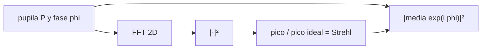

# B42-C06 — Función de dispersión puntual

<!-- nav:top -->
<!-- /nav -->

## 1. Ubicación, nivel y alcance

Clase 6 del bloque B42. Nivel N3. La **función de dispersión puntual** (PSF) es la imagen de una fuente puntual: la potencia de la transformada de la pupila. Calculas la PSF con FFT, la contrastas con Airy y mides el cociente de Strehl. Usas [B42](../../../tronco-comun/B42-optica-fisica-y-optica-adaptativa.md) (C05) y [B15](../../../tronco-comun/B15-senales-imagenes-y-estimacion-cientifica.md) (FFT).

## 2. Por qué esta clase existe

Toda imagen es la escena convolucionada con la PSF; si la PSF se degrada, se pierde resolución y contraste. La decisión central: **¿cómo se calcula la PSF de una pupila con aberraciones y cuándo basta el pico?**

## 3. Lo que podrás hacer al terminar

1. Calcular `PSF = |F{P e^{iφ}}|²` con FFT 2D.
2. Normalizar al pico sin aberración.
3. Comparar el perfil con Airy.
4. Calcular el Strehl por tres vías.
5. Aplicar el teorema del desplazamiento a una inclinación.
6. Reconocer el muestreo (píxeles por λ/D).

La evidencia es la **ficha de la PSF** del ejercicio 12 (sección 20).

## 4. Con qué llegas y cómo comprobarlo

1. ¿Qué es una incertidumbre?
2. ¿Qué es una simulación Monte Carlo?
3. ¿Qué es una tabla de resultados?
4. ¿Qué es un valor ilustrativo?
5. ¿Qué es una verificación?

<details>
<summary>Ver respuestas</summary>

1. Un intervalo en que se espera el valor verdadero. 2. Repetir con números aleatorios de semilla fija. 3. Un resumen ordenado de cálculos. 4. Un valor propuesto para el ejemplo, no medido. 5. Comparar un cálculo con un caso independiente.
</details>

Con cuatro o cinco aciertos, sigue; si no, repasa los prerrequisitos.

## 5. Un caso de contexto y casos de referencia

Con una pupila de 32 píxeles en una malla de 128 (4 píxeles por `λ/D`) y 0,10 rad rms de desenfoque (ilustrativos) el Strehl por pico es `0,989869`, igual a `|⟨e^{iφ}⟩|²` y casi igual a `exp(−σ²) = 0,989879`. Es el **ejemplo conductor**.

## 6. Vocabulario

La **PSF**. La **pupila** `P(x)`. La **fase** `φ(x)`. El **cociente de Strehl** `S`. El **muestreo**: píxeles por `λ/D`. El **teorema del desplazamiento**: un término lineal en la fase mueve la PSF.

## 7. Modelo mental: una linterna con lente

Como la mancha que deja una linterna: cuanto más perfecta la lente, más pequeña y brillante.



*Descripción textual:* la PSF se obtiene de la pupila por FFT y su pico entrega el Strehl, que coincide con una identidad exacta sobre la pupila.

Analogía: una linterna con lente. Límite: pupila muestreada en píxeles.

## 8. La explicación, paso a paso

### 8.1 PSF ideal y Airy

La pupila tiene `812` píxeles (disco ideal `804,2`); el pico sin aberración vale `659 344 = 812²`. Parseval: `ΣPSF/N² = 812,000`.

| `r` (px) | `r` (λ/D) | PSF/pico | Airy |
|---|---|---|---|
| 1 | 0,25 | 0,85409 | 0,85535 |
| 2 | 0,50 | 0,51753 | 0,52085 |
| 4 | 1,00 | 0,03127 | 0,03283 |
| 6 | 1,50 | 0,01451 | 0,01429 |
| 12 | 3,00 | 0,00119 | 0,00141 |

### 8.2 Strehl y desplazamiento

Con `σ = 0,1009 rad`: Strehl por pico `0,989869`; identidad `|⟨e^{iφ}⟩|² = 0,989869`; Maréchal `0,989879`. Una inclinación de 5 ciclos por pupila mueve el pico de la columna 0 a la 5 sin cambiar su valor (`1,000000`).

### 8.3 Lectura

La fracción de energía en el píxel central es `812/16 384 = 0,0496`: con 4 píxeles por `λ/D`, el pico reparte su flujo en muchos píxeles.

## 9. Magnitudes, símbolos y unidades

| Símbolo | Qué es | Unidad | Valor / nota |
|---|---|---|---|
| `P` | pupila | — | 812 píxeles |
| `φ` | fase | rad | 0,10 rad rms |
| `S` | Strehl | — | 0,989869 |
| `N` | malla | px | 128; 4 px por λ/D |

## 10. Convenciones y referencias

FFT radix 2 de 128 × 128; origen de la PSF en el píxel [0,0]; normalización al pico ideal (mismo flujo por Parseval).

## 11. De dónde sale lo que afirmamos

| ID | Fuente | Localizador | Respalda | Estado |
|---|---|---|---|---|
| — | Teoría de Fourier de la formación de imágenes (libros de óptica) | — | PSF como |FFT de la pupila|² | No consultado |

Límites: no se consultó una fuente; se contrastan Airy, la identidad exacta y Maréchal.

## 12. Cómo ver la PSF y su Strehl

| Magnitud | Valor |
|---|---|
| pico ideal | 659 344 |
| Strehl por pico | 0,989869 |
| Maréchal | 0,989879 |
| desplazamiento | 5 píxeles |

Descripción larga: tres cálculos independientes del Strehl coinciden.

## 13. Ejemplo trabajado: el Strehl con 0,1 rad

**Paso 1 · Fórmula.** `S ≈ exp(−σ²)`.

**Paso 2 · Valor.** `σ = 0,1`.

**Paso 3 · Cuenta.** `exp(−0,01) = 0,99005`.

**Paso 4 · Lectura.** El 1 % del pico se pierde con 0,1 rad rms.

## 14. Distintas formas de describir el resultado

**Por FFT:** `|F{Pe^{iφ}}|²`. **Por identidad:** `|⟨e^{iφ}⟩|²`. **Por aproximación:** `e^{−σ²}`. **Por código:** `psf.py`.

## 15. Práctica guiada

**Ejercicio 1 · con los pasos indicados.** Strehl para `σ = 0,3 rad`. *Pasos:* `exp(−0,09)`.

<details><summary>Solución comentada</summary>

`0,9139`.
</details>

**Ejercicio 2 · con una pista.** Fracción de energía en el píxel central.

<details><summary>Solución comentada</summary>

`812/16 384 = 0,0496`.
</details>

**Ejercicio 3 · casi autónomo.** Pico en píxeles de pupila `n_p`.

<details><summary>Solución comentada</summary>

`n_p² = 659 344`.
</details>

## 16. Práctica autónoma, transferencia e integrador

**Ejercicio 4.** Escala de pixel en arcsec si `D = 8 m`, `λ = 2,2 µm`.

<details><summary>Solución comentada</summary>

`0,25 × 0,05672 = 0,0142 arcsec`.
</details>

**Ejercicio 5.** Columna del pico con 3 ciclos de inclinación.

<details><summary>Solución comentada</summary>

La 3.
</details>

**Ejercicio 6.** ¿Qué valor tiene `ΣPSF/N²`?

<details><summary>Solución comentada</summary>

`812` (Parseval).
</details>

**Ejercicio 7.** Strehl para `σ = 0,5`.

<details><summary>Solución comentada</summary>

`exp(−0,25) = 0,7788`.
</details>

**Ejercicio 8.** Radio del primer cero en píxeles.

<details><summary>Solución comentada</summary>

`1,2197 × 4 = 4,88`.
</details>

**Ejercicio 9 · transferencia.** **Transferencia.** ¿Qué pasa con el muestreo a 1 píxel por λ/D?

<details><summary>Solución comentada</summary>

Se pierde información: la PSF queda submuestreada (C07).
</details>

**Ejercicio 10 · transferencia.** **Transferencia.** Un compañero dice que el pico de la PSF aberrada es siempre el origen. Responde.

<details><summary>Solución comentada</summary>

No, con inclinación o aberraciones fuertes se desplaza.
</details>

**Ejercicio 11 · transferencia.** **Transferencia.** ¿Por qué no importa el signo de la inclinación para el Strehl?

<details><summary>Solución comentada</summary>

Solo desplaza la PSF.
</details>

**Ejercicio 12.** **Integrador.** Elabora tu *ficha de la PSF*: PSF ideal, Strehl con una aberración, y el muestreo.

<details><summary>Solución comentada</summary>

Secciones 8.1–8.3.
</details>

**Ejercicio 12 · integrador.** **Integrador.** Elabora tu *ficha de la PSF*: PSF ideal, Strehl con una aberración, y el muestreo.

<details><summary>Solución modelo</summary>

Secciones 8.1–8.3.
</details>

## 17. Laboratorio: PSF por FFT

El script [psf.py](psf.py) calcula la PSF, la compara con Airy, mide el Strehl por tres vías y verifica el desplazamiento (**comprueba** a `0,02`, `10⁻⁹` y `5 × 10⁻³`).

**Datos:** sin constantes; pupila y aberración ilustrativas. **Predice antes de ejecutar:** ¿cuánto vale el Strehl con 0,1 rad rms? (≈ 0,99.) **Ejecución del 2026-11-09 (Python 3.12.9):**

```text
Python 3.12.9 (biblioteca estandar)
pixeles de pupila = 812 (disco ideal 804.2) ; pico sin aberracion = 659344.0 (= npix^2 = 659344.0)
Parseval: sum PSF / N^2 = 812.000 ; sum |P|^2 = 812.0
 r [px]  r [lambda/D]   PSF/pico       Airy
      1          0.25    0.85409    0.85535
      2          0.50    0.51753    0.52085
      3          0.75    0.19834    0.20181
      4          1.00    0.03127    0.03283
      5          1.25    0.00051    0.00037
      6          1.50    0.01451    0.01429
      8          2.00    0.00417    0.00457
     10          2.50    0.00299    0.00289
     12          3.00    0.00119    0.00141
sigma_fase (rms) = 0.1009 rad ; Strehl por pico = 0.989869 ; |<exp(i phi)>|^2 = 0.989869 ; Marechal exp(-sigma^2) = 0.989879
inclinacion de 5 ciclos por pupila: el pico pasa de la columna 0 a la columna 5 (esperado 5) ; pico = 1.000000
Pruebas superadas.
```

```bash
python programa/clases/B42/B42-C06-funcion-de-dispersion-puntual/psf.py
```

**Límites:** pupila circular uniforme muestreada.

## 18. Errores frecuentes y cómo corregirlos

**Normalizar con un pico distinto.** Normaliza al pico ideal del mismo flujo.

**Ignorar el muestreo.** Ver 8.3.

**Confundir pico con Strehl.** Es el pico relativo al ideal.

**Olvidar el piston.** No afecta a la PSF.

## 19. Cómo sabrás que vas bien

Tras la sección 8: ¿qué resultado esperabas y cuál obtuviste? Si dudas, repasa el ejemplo 13. Tras el laboratorio: ¿qué comprueba? (ver la sección 17).

## 20. Qué entregas y cómo se evalúa

El producto es tu **ficha de la PSF** (ejercicio 12).

| Criterio | Inicial | En desarrollo | Logrado | Destacado |
|---|---|---|---|---|
| Conceptos | Los confunde | Parciales | conceptos de la clase | Explica los límites |
| Cálculo | Sin unidades | Con errores | Tablas completas | Calcula casos nuevos |
| Numérico | Sin comprobar | Un caso | Contraste con el análisis | Interpreta las diferencias |
| Fuentes | Sin fuente | Sin fecha | fuentes con fecha | Declara lo ilustrativo |
| Límites | No los nombra | Uno | Tres | Discute qué falta del modelo |

**Condiciones críticas (no se compensan con promedio):** rotular la aberración como ilustrativa; no usar el Strehl como único criterio.

## 21. Ética, seguridad y límites

Clase educativa: los modelos son simplificados. Accesibilidad: tablas equivalentes a las gráficas, fórmulas en texto, ejercicios sin conexión.

## 22. Para cerrar y seguir

La PSF es |FFT(P e^{iφ})|²; con 0,1 rad rms el Strehl es 0,9899. Falta pasar al dominio de frecuencias.

**Glosario español–inglés.** función de dispersión puntual · *point spread function*; cociente de Strehl · *Strehl ratio*; pupila · *pupil*; muestreo · *sampling*; teorema del desplazamiento · *shift theorem*.

**Continuidad.** [B42-C07](../B42-C07-funcion-de-transferencia-optica/CLASE.md) estudia la función de transferencia óptica.

**Referencias:** ver sección 11.

<!-- nav:bottom -->
---

<!-- /nav -->
