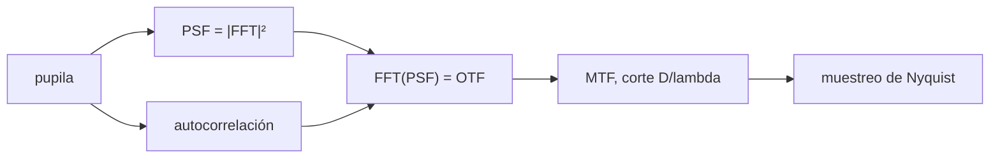

# B42-C07 — Función de transferencia óptica

<!-- nav:top -->
[🏠 Programa](../../../../README.md) · [📚 Bloque B42](../../../tronco-comun/B42-optica-fisica-y-optica-adaptativa.md) · [← Anterior: B42-C06 — Función de dispersión puntual](../B42-C06-funcion-de-dispersion-puntual/CLASE.md) · [Siguiente: B42-C08 — Polarización de la luz →](../B42-C08-polarizacion-de-la-luz/CLASE.md)
<!-- /nav -->

## 1. Ubicación, nivel y alcance

Clase 7 del bloque B42. Nivel N3. La **función de transferencia óptica** (OTF) es la transformada de Fourier de la PSF; su módulo es la MTF. Calculas la OTF de tres formas (FFT de la PSF, autocorrelación de la pupila y fórmula analítica) y estudias el submuestreo. Usas [B42](../../../tronco-comun/B42-optica-fisica-y-optica-adaptativa.md) (C06) y [B15](../../../tronco-comun/B15-senales-imagenes-y-estimacion-cientifica.md).

## 2. Por qué esta clase existe

La OTF dice qué detalles (frecuencias espaciales) pasan por el sistema y cuáles se pierden; fija el muestreo necesario del detector. La decisión central: **¿hasta qué frecuencia transmite el telescopio y qué muestreo exige?**

## 3. Lo que podrás hacer al terminar

1. Calcular la OTF como `F{PSF}` normalizada.
2. Calcularla como autocorrelación de la pupila.
3. Comparar con la MTF analítica `(2/π)[acos v − v√(1−v²)]`.
4. Identificar el corte `D/λ`.
5. Predecir el solapamiento por submuestreo.
6. Reconocer los límites de una pupila ideal.

La evidencia es la **ficha de la OTF** del ejercicio 12 (sección 20).

## 4. Con qué llegas y cómo comprobarlo

1. ¿Qué es una incertidumbre?
2. ¿Qué es una simulación Monte Carlo?
3. ¿Qué es una tabla de resultados?
4. ¿Qué es un valor ilustrativo?
5. ¿Qué es una verificación?

<details>
<summary>Ver respuestas</summary>

1. Un intervalo en que se espera el valor verdadero. 2. Repetir con números aleatorios de semilla fija. 3. Un resumen ordenado de cálculos. 4. Un valor propuesto para el ejemplo, no medido. 5. Comparar un cálculo con un caso independiente.
</details>

Con cuatro o cinco aciertos, sigue; si no, repasa los prerrequisitos.

## 5. Un caso de contexto y casos de referencia

Con una pupila de 32 píxeles en malla de 128 (ilustrativos) la MTF a `v = 0,5` es `0,39409` (FFT y autocorrelación) frente a `0,39100` analítica, y al submuestrear la PSF a 1 píxel por `λ/D` la OTF medida a `v = 0,5` sube a `0,78818` por el solapamiento. Es el **ejemplo conductor**.

## 6. Vocabulario

La **OTF**: transformada normalizada de la PSF. La **MTF**: su módulo. La **frecuencia de corte** `D/λ`. La **autocorrelación** de la pupila. El **muestreo de Nyquist**: al menos 2 píxeles por `λ/D`. El **solapamiento** (*aliasing*).

## 7. Modelo mental: un filtro paso bajo

Como un filtro de audio que deja pasar graves y corta agudos: la OTF deja pasar las frecuencias espaciales bajas y corta las altas.



*Descripción textual:* la OTF es a la vez la FFT de la PSF y la autocorrelación de la pupila, y su soporte fija el muestreo.

Analogía: un filtro paso bajo. Límite: pupila ideal incoherente.

## 8. La explicación, paso a paso

### 8.1 MTF

`OTF(0) = 13 303 808 = N²·n_pupila`. Cortes a lo largo de un eje:

| retraso (px) | `v = lag/32` | OTF FFT | autocorrelación | analítica |
|---|---|---|---|---|
| 4 | 0,125 | 0,84236 | 0,84236 | 0,84126 |
| 8 | 0,250 | 0,68473 | 0,68473 | 0,68504 |
| 16 | 0,500 | 0,39409 | 0,39409 | 0,39100 |
| 24 | 0,750 | 0,14778 | 0,14778 | 0,14429 |
| 28 | 0,875 | 0,05419 | 0,05419 | 0,05205 |
| 32 | 1,000 | 0,00000 | 0,00000 | 0,00000 |

La parte imaginaria máxima es `6,1 × 10⁻¹⁶`.

### 8.2 Submuestreo

Si la PSF se toma cada 4 píxeles (1 por `λ/D`) la OTF medida suma `MTF(v) + MTF(1 − v)`:

| `v` | OTF submuestreada | `MTF(v)+MTF(1−v)` | `MTF(v)` |
|---|---|---|---|
| 0,0625 | 0,94089 | 0,93905 | 0,92047 |
| 0,250 | 0,83251 | 0,82933 | 0,68504 |
| 0,500 | 0,78818 | 0,78200 | 0,39100 |

### 8.3 Lectura

La OTF de una pupila ideal se anula en `D/λ`; para `D = 8 m` y `λ = 2,2 µm` ese corte es `3,64 × 10⁶ rad⁻¹ = 17,6 ciclos/arcsec`. Un detector con píxeles de más de `λ/(2D)` (aquí `0,0284 arcsec`) pierde información o la pliega.

## 9. Magnitudes, símbolos y unidades

| Símbolo | Qué es | Unidad | Valor / nota |
|---|---|---|---|
| `v` | frecuencia normalizada `f λ/D` | — | 0 a 1 |
| `D/λ` | corte | rad⁻¹ | 3,64 × 10⁶ (ilustrativo) |
| OTF(v) | función de transferencia | — | ver 8.1 |
| `p` | paso del detector | arcsec | ≤ 0,0284 (Nyquist) |

## 10. Convenciones y referencias

Retrasos en píxeles de pupila (corte 32); `v = lag/32`; OTF normalizada a 1 en el origen.

## 11. De dónde sale lo que afirmamos

| ID | Fuente | Localizador | Respalda | Estado |
|---|---|---|---|---|
| — | Teoría de la OTF (libros de óptica) | — | autocorrelación y fórmula de la MTF | No consultado |

Límites: no se consultó una fuente; las tres vías de la OTF se contrastan entre sí.

## 12. Cómo ver la MTF

| Magnitud | Valor |
|---|---|
| MTF(0,5) FFT | 0,39409 |
| MTF(0,5) analítica | 0,39100 |
| OTF submuestreada (0,5) | 0,78818 |
| corte | 17,6 ciclos/arcsec |

Descripción larga: la FFT y la autocorrelación coinciden exactamente; la fórmula analítica difiere por la discretización.

## 13. Ejemplo trabajado: MTF(0,5)

**Paso 1 · Fórmula.** `MTF = (2/π)[acos v − v√(1−v²)]`.

**Paso 2 · Valores.** `acos 0,5 = 1,0472`; `0,5·√0,75 = 0,4330`.

**Paso 3 · Cuenta.** `0,6366 × 0,6142 = 0,3910`.

**Paso 4 · Lectura.** A la mitad del corte se transmite el 39 %.

## 14. Distintas formas de describir el resultado

**Por FFT:** `F{PSF}`. **Por autocorrelación:** `P ⋆ P`. **Por fórmula:** MTF analítica. **Por código:** `otf.py`.

## 15. Práctica guiada

**Ejercicio 1 · con los pasos indicados.** MTF(0,25). *Pasos:* ejemplo 13.

<details><summary>Solución comentada</summary>

`0,6850`.
</details>

**Ejercicio 2 · con una pista.** Corte en ciclos/arcsec para `D = 8 m`, `λ = 2,2 µm`.

<details><summary>Solución comentada</summary>

`17,6`.
</details>

**Ejercicio 3 · casi autónomo.** Paso de Nyquist del detector.

<details><summary>Solución comentada</summary>

`λ/(2D) = 0,0284 arcsec`.
</details>

## 16. Práctica autónoma, transferencia e integrador

**Ejercicio 4.** MTF(1).

<details><summary>Solución comentada</summary>

`0`.
</details>

**Ejercicio 5.** Valor que suma el solapamiento a `v = 0,25`.

<details><summary>Solución comentada</summary>

`MTF(0,75) = 0,1443`.
</details>

**Ejercicio 6.** OTF submuestreada predicha a `v = 0,25`.

<details><summary>Solución comentada</summary>

`0,6850 + 0,1443 = 0,8293`.
</details>

**Ejercicio 7.** Píxeles por `λ/D` del laboratorio.

<details><summary>Solución comentada</summary>

4.
</details>

**Ejercicio 8.** ¿Por qué `Im(OTF) ≈ 0`?

<details><summary>Solución comentada</summary>

La PSF es simétrica.
</details>

**Ejercicio 9 · transferencia.** **Transferencia.** ¿Por qué un detector con píxeles grandes pliega frecuencias?

<details><summary>Solución comentada</summary>

Porque no cumple Nyquist.
</details>

**Ejercicio 10 · transferencia.** **Transferencia.** Un compañero dice que la MTF de un sistema real puede ser mayor que la ideal. Responde.

<details><summary>Solución comentada</summary>

No: las aberraciones solo la reducen.
</details>

**Ejercicio 11 · transferencia.** **Transferencia.** ¿Qué hace una obstrucción central a la MTF?

<details><summary>Solución comentada</summary>

Reduce las frecuencias medias (el laboratorio no la incluye).
</details>

**Ejercicio 12.** **Integrador.** Elabora tu *ficha de la OTF*: MTF, corte y muestreo para tu caso.

<details><summary>Solución comentada</summary>

Secciones 8.1–8.3.
</details>

**Ejercicio 12 · integrador.** **Integrador.** Elabora tu *ficha de la OTF*: MTF, corte y muestreo para tu caso.

<details><summary>Solución modelo</summary>

Secciones 8.1–8.3.
</details>

## 17. Laboratorio: OTF por tres vías

El script [otf.py](otf.py) calcula la OTF por FFT, autocorrelación y fórmula y predice el solapamiento (**comprueba** a `10⁻⁹`, `0,02` y `0,03`).

**Datos:** sin constantes; pupila ilustrativa. **Predice antes de ejecutar:** ¿cuánto vale la MTF a la mitad del corte? (≈ 0,39.) **Ejecución del 2026-11-09 (Python 3.12.9):**

```text
Python 3.12.9 (biblioteca estandar)
OTF(0) = 13303808.0 = N^2 * npix = 13303808.0
 lag [px]  v=lag/32   OTF FFT  autocorr analitica
        0     0.000   1.00000   1.00000   1.00000
        4     0.125   0.84236   0.84236   0.84126
        8     0.250   0.68473   0.68473   0.68504
       12     0.375   0.53695   0.53695   0.53397
       16     0.500   0.39409   0.39409   0.39100
       20     0.625   0.26108   0.26108   0.25960
       24     0.750   0.14778   0.14778   0.14429
       28     0.875   0.05419   0.05419   0.05205
       32     1.000  -0.00000   0.00000   0.00000
       36     1.125  -0.00000   0.00000   0.00000
parte imaginaria maxima de la OTF (PSF simetrica): 6.11e-16
     v  OTF submuestreada  MTF(v)+MTF(1-v)   MTF(v)
 0.062            0.94089          0.93905  0.92047
 0.125            0.89655          0.89331  0.84126
 0.250            0.83251          0.82933  0.68504
 0.375            0.79803          0.79357  0.53397
 0.500            0.78818          0.78200  0.39100
Pruebas superadas.
```

```bash
python programa/clases/B42/B42-C07-funcion-de-transferencia-optica/otf.py
```

**Límites:** pupila circular uniforme, luz incoherente.

## 18. Errores frecuentes y cómo corregirlos

**Confundir OTF con PSF.** La OTF es su transformada.

**Olvidar normalizar.** Se normaliza en el origen.

**Pensar que Nyquist es opcional.** Ver 8.2.

**Aplicar la fórmula sin escalar `v`.** `v = f λ/D`.

## 19. Cómo sabrás que vas bien

Tras la sección 8: ¿qué resultado esperabas y cuál obtuviste? Si dudas, repasa el ejemplo 13. Tras el laboratorio: ¿qué comprueba? (ver la sección 17).

## 20. Qué entregas y cómo se evalúa

El producto es tu **ficha de la OTF** (ejercicio 12).

| Criterio | Inicial | En desarrollo | Logrado | Destacado |
|---|---|---|---|---|
| Conceptos | Los confunde | Parciales | conceptos de la clase | Explica los límites |
| Cálculo | Sin unidades | Con errores | Tablas completas | Calcula casos nuevos |
| Numérico | Sin comprobar | Un caso | Contraste con el análisis | Interpreta las diferencias |
| Fuentes | Sin fuente | Sin fecha | fuentes con fecha | Declara lo ilustrativo |
| Límites | No los nombra | Uno | Tres | Discute qué falta del modelo |

**Condiciones críticas (no se compensan con promedio):** rotular la pupila como ilustrativa; no presentar la MTF como la de un instrumento real.

## 21. Ética, seguridad y límites

Clase educativa: los modelos son simplificados. Accesibilidad: tablas equivalentes a las gráficas, fórmulas en texto, ejercicios sin conexión.

## 22. Para cerrar y seguir

La OTF de la pupila ideal vale 0,39 a la mitad del corte y se anula en `D/λ`; muestrear peor que Nyquist pliega 0,39 en 0,79. Falta la parte vectorial de la luz.

**Glosario español–inglés.** función de transferencia óptica · *optical transfer function*; MTF · *modulation transfer function*; solapamiento · *aliasing*; autocorrelación · *autocorrelation*; frecuencia de corte · *cutoff frequency*.

**Continuidad.** [B42-C08](../B42-C08-polarizacion-de-la-luz/CLASE.md) estudia la polarización de la luz.

**Referencias:** ver sección 11.

<!-- nav:bottom -->
---

[← Anterior: B42-C06 — Función de dispersión puntual](../B42-C06-funcion-de-dispersion-puntual/CLASE.md) · [📚 Bloque B42](../../../tronco-comun/B42-optica-fisica-y-optica-adaptativa.md) · [Siguiente: B42-C08 — Polarización de la luz →](../B42-C08-polarizacion-de-la-luz/CLASE.md)
<!-- /nav -->
