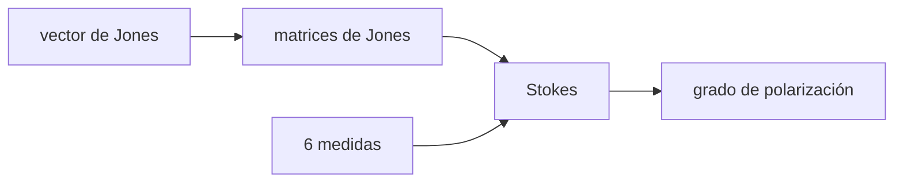

# B42-C08 — Polarización de la luz

<!-- nav:top -->
[🏠 Programa](../../../../README.md) · [📚 Bloque B42](../../../tronco-comun/B42-optica-fisica-y-optica-adaptativa.md) · [← Anterior: B42-C07 — Función de transferencia óptica](../B42-C07-funcion-de-transferencia-optica/CLASE.md) · [Siguiente: B42-C09 — Interferometría de dos haces →](../B42-C09-interferometria-de-dos-haces/CLASE.md)
<!-- /nav -->

## 1. Ubicación, nivel y alcance

Clase 8 del bloque B42. Nivel N3. La luz es una onda transversal: su campo eléctrico oscila en un plano. Describes estados de polarización con **vectores de Jones** y **parámetros de Stokes** y compruebas la ley de Malus y láminas de retardo. Usas [B42](../../../tronco-comun/B42-optica-fisica-y-optica-adaptativa.md) (C01) y [B10](../../../tronco-comun/B10-algebra-lineal-y-matematicas-geometricas.md) (álgebra lineal compleja).

## 2. Por qué esta clase existe

La polarización cambia cuánto flujo pasa por un instrumento (espejos, divisores, filtros) y revela procesos físicos de la fuente. La decisión central: **¿cómo se describe y se mide un estado de polarización y cómo lo transforma un elemento óptico?**

## 3. Lo que podrás hacer al terminar

1. Representar un estado con un vector de Jones.
2. Aplicar polarizadores y láminas con matrices de Jones.
3. Verificar la ley de Malus `cos²θ`.
4. Calcular los parámetros de Stokes por Jones y por seis medidas.
5. Estimar el grado de polarización de una mezcla.
6. Reconocer los límites de los elementos ideales.

La evidencia es la **ficha de polarización** del ejercicio 12 (sección 20).

## 4. Con qué llegas y cómo comprobarlo

1. ¿Qué es una incertidumbre?
2. ¿Qué es una simulación Monte Carlo?
3. ¿Qué es una tabla de resultados?
4. ¿Qué es un valor ilustrativo?
5. ¿Qué es una verificación?

<details>
<summary>Ver respuestas</summary>

1. Un intervalo en que se espera el valor verdadero. 2. Repetir con números aleatorios de semilla fija. 3. Un resumen ordenado de cálculos. 4. Un valor propuesto para el ejemplo, no medido. 5. Comparar un cálculo con un caso independiente.
</details>

Con cuatro o cinco aciertos, sigue; si no, repasa los prerrequisitos.

## 5. Un caso de contexto y casos de referencia

Con un polarizador a 30° de luz lineal horizontal pasa el `0,7500`; una lámina de cuarto de onda a 45° la vuelve circular (`S₃ = −1`) y una mezcla con 60 % polarizado da un grado de polarización muestral de `0,5941`. Es el **ejemplo conductor**.

## 6. Vocabulario

El **vector de Jones** `(Eₓ, E_y)`. Los **parámetros de Stokes** `S₀…S₃`. El **polarizador**. La **lámina de retardo** (cuarto y media onda). La **ley de Malus**. El **grado de polarización** `√(S₁²+S₂²+S₃²)/S₀`.

## 7. Modelo mental: una cuerda a través de una reja

Como una cuerda que pasa por una reja: solo pasa la oscilación alineada con la reja.



*Descripción textual:* un estado se transforma con matrices 2×2 y se reconstruye con seis intensidades; los parámetros de Stokes permiten luz parcialmente polarizada.

Analogía: una cuerda a través de una reja. Límite: elementos ideales y luz monocromática.

## 8. La explicación, paso a paso

### 8.1 Ley de Malus y láminas

| `θ` | `I/I₀` numérico | `cos²θ` |
|---|---|---|
| 0° | 1,000000 | 1,000000 |
| 30° | 0,750000 | 0,750000 |
| 45° | 0,500000 | 0,500000 |
| 60° | 0,250000 | 0,250000 |
| 90° | 0,000000 | 0,000000 |

Una lámina de cuarto de onda a 45° sobre luz horizontal da Stokes `(1; 0; 0; −1)`: circular. Una de media onda a 20° rota el azimut a `40,0000°` (`2 × 20°`).

### 8.2 Stokes

Para `E = (0,8 e^{0,3i}; 0,5 e^{−1,1i})`: Stokes por Jones `(0,89; 0,39; 0,135974; −0,78836)` y por seis medidas el mismo, con diferencia `1,1 × 10⁻¹⁶`. El grado de polarización del estado puro es `1,000000000000`.

### 8.3 Luz parcialmente polarizada

Con 20 000 muestras, 60 % polarizado y 40 % natural, Stokes muestral `(1,0; 0,2647; 0,0898; −0,5242)` y grado `0,5941` frente a `0,6000` esperado. La diferencia `0,006` es ruido muestral.

## 9. Magnitudes, símbolos y unidades

| Símbolo | Qué es | Unidad | Valor / nota |
|---|---|---|---|
| `S₀` | intensidad total | — | 0,89 en el ejemplo |
| `S₁, S₂, S₃` | parámetros de Stokes | — | ver 8.2 |
| `θ` | ángulo del polarizador | grados | 30° |
| `p` | grado de polarización | — | 0,6 (mezcla ilustrativa) |

## 10. Convenciones y referencias

Convenio `S₃ = −2 Im(Eₓ E_y*)` con dependencia temporal `exp(−iωt)`; los rótulos «derecha/izquierda» siguen el signo de `S₃`, no una convención de lateralidad.

## 11. De dónde sale lo que afirmamos

| ID | Fuente | Localizador | Respalda | Estado |
|---|---|---|---|---|
| — | Cálculo de Jones y parámetros de Stokes (libros de óptica) | — | matrices y definiciones | No consultado |

Límites: no se consultó una fuente; todo se verifica algebraicamente.

## 12. Cómo ver los parámetros de Stokes

| Magnitud | Valor |
|---|---|
| Malus a 30° | 0,7500 |
| azimut tras media onda a 20° | 40,0° |
| `S₃` tras cuarto de onda | −1 |
| grado de la mezcla | 0,5941 |

Descripción larga: las dos vías (Jones y seis medidas) coinciden a precisión de máquina.

## 13. Ejemplo trabajado: el flujo tras un polarizador a 30°

**Paso 1 · Ley.** `I = I₀ cos²θ`.

**Paso 2 · Valor.** `cos 30° = 0,8660`.

**Paso 3 · Cuadrado.** `0,8660² = 0,7500`.

**Paso 4 · Lectura.** Pasa el 75 %.

## 14. Distintas formas de describir el resultado

**Por vector:** Jones. **Por matriz:** polarizadores y láminas. **Por medidas:** Stokes. **Por código:** `polarizacion.py`.

## 15. Práctica guiada

**Ejercicio 1 · con los pasos indicados.** `I/I₀` a 60°. *Pasos:* `cos² 60°`.

<details><summary>Solución comentada</summary>

`0,25`.
</details>

**Ejercicio 2 · con una pista.** Flujo de luz natural tras un polarizador ideal.

<details><summary>Solución comentada</summary>

La mitad.
</details>

**Ejercicio 3 · casi autónomo.** Azimut tras media onda a 15°.

<details><summary>Solución comentada</summary>

30°.
</details>

## 16. Práctica autónoma, transferencia e integrador

**Ejercicio 4.** `S₁` del estado ejemplo.

<details><summary>Solución comentada</summary>

`0,64 − 0,25 = 0,39`.
</details>

**Ejercicio 5.** Grado de la mezcla `p = 0,6`.

<details><summary>Solución comentada</summary>

0,6.
</details>

**Ejercicio 6.** ¿Qué polarización da un cuarto de onda a 45°?

<details><summary>Solución comentada</summary>

Circular.
</details>

**Ejercicio 7.** Intensidad tras dos polarizadores cruzados (0° y 90°).

<details><summary>Solución comentada</summary>

0.
</details>

**Ejercicio 8.** Intensidad con un tercer polarizador a 45° entre ambos.

<details><summary>Solución comentada</summary>

`0,25 I₀`.
</details>

**Ejercicio 9 · transferencia.** **Transferencia.** ¿Por qué se usan polarizadores en un espectrógrafo?

<details><summary>Solución comentada</summary>

Para medir la polarización de la fuente.
</details>

**Ejercicio 10 · transferencia.** **Transferencia.** Un compañero dice que los vectores de Jones sirven para luz natural. Responde.

<details><summary>Solución comentada</summary>

No: solo describen luz totalmente polarizada; se usa Stokes.
</details>

**Ejercicio 11 · transferencia.** **Transferencia.** ¿Qué instrumento mide `S₃`?

<details><summary>Solución comentada</summary>

Un analizador circular (cuarto de onda más polarizador).
</details>

**Ejercicio 12.** **Integrador.** Elabora tu *ficha de polarización*: Jones, Malus y Stokes para un caso.

<details><summary>Solución comentada</summary>

Secciones 8.1–8.3.
</details>

**Ejercicio 12 · integrador.** **Integrador.** Elabora tu *ficha de polarización*: Jones, Malus y Stokes para un caso.

<details><summary>Solución modelo</summary>

Secciones 8.1–8.3.
</details>

## 17. Laboratorio: Jones, Malus y Stokes

El script [polarizacion.py](polarizacion.py) aplica matrices de Jones, verifica Malus y obtiene Stokes por dos vías (**comprueba** a `10⁻¹²` y el grado a `0,02`).

**Datos:** sin constantes; ángulos y mezcla ilustrativos. **Predice antes de ejecutar:** ¿qué fracción pasa a 30°? (0,75.) **Ejecución del 2026-11-09 (Python 3.12.9):**

```text
Python 3.12.9 (biblioteca estandar)
 theta [grados]  I/I0 numerico      cos^2
              0       1.000000   1.000000
             30       0.750000   0.750000
             45       0.500000   0.500000
             60       0.250000   0.250000
             90       0.000000   0.000000
QWP a 45 grados sobre horizontal: Stokes = (1.0000, 0.0000, 0.0000, -1.0000) -> circular
HWP a 20 grados sobre horizontal: azimut resultante = 40.0000 grados (esperado 2 x 20 = 40)
Stokes por Jones = (0.89, 0.39, 0.135974, -0.78836)
Stokes por 6 medidas = (0.89, 0.39, 0.135974, -0.78836)
diferencia maxima = 1.11e-16
grado de polarizacion del estado puro = 1.000000000000
mezcla p = 0.6: Stokes muestral = (1.0, 0.2647, 0.0898, -0.5242) ; DOP muestral = 0.5941 ; esperado = 0.6000
Pruebas superadas.
```

```bash
python programa/clases/B42/B42-C08-polarizacion-de-la-luz/polarizacion.py
```

**Límites:** elementos ideales, monocromático.

## 18. Errores frecuentes y cómo corregirlos

**Usar Jones para luz natural.** Se corrige con 8.3.

**Confundir signos de `S₃`.** Ver sección 10.

**Olvidar rotar la matriz.** `R(θ) M R(−θ)`.

**Dar `p > 1`.** `p` va de 0 a 1.

## 19. Cómo sabrás que vas bien

Tras la sección 8: ¿qué resultado esperabas y cuál obtuviste? Si dudas, repasa el ejemplo 13. Tras el laboratorio: ¿qué comprueba? (ver la sección 17).

## 20. Qué entregas y cómo se evalúa

El producto es tu **ficha de polarización** (ejercicio 12).

| Criterio | Inicial | En desarrollo | Logrado | Destacado |
|---|---|---|---|---|
| Conceptos | Los confunde | Parciales | conceptos de la clase | Explica los límites |
| Cálculo | Sin unidades | Con errores | Tablas completas | Calcula casos nuevos |
| Numérico | Sin comprobar | Un caso | Contraste con el análisis | Interpreta las diferencias |
| Fuentes | Sin fuente | Sin fecha | fuentes con fecha | Declara lo ilustrativo |
| Límites | No los nombra | Uno | Tres | Discute qué falta del modelo |

**Condiciones críticas (no se compensan con promedio):** indicar el convenio de signos; no presentar la mezcla como luz de una fuente real.

## 21. Ética, seguridad y límites

Clase educativa: los modelos son simplificados. Accesibilidad: tablas equivalentes a las gráficas, fórmulas en texto, ejercicios sin conexión.

## 22. Para cerrar y seguir

Malus da 0,75 a 30°, una lámina de cuarto de onda produce luz circular y una mezcla 60/40 da un grado 0,594. Falta combinar dos haces de forma controlada.

**Glosario español–inglés.** polarización · *polarization*; vector de Jones · *Jones vector*; parámetros de Stokes · *Stokes parameters*; lámina de retardo · *retarder*; ley de Malus · *Malus' law*.

**Continuidad.** [B42-C09](../B42-C09-interferometria-de-dos-haces/CLASE.md) estudia la interferometría de dos haces.

**Referencias:** ver sección 11.

<!-- nav:bottom -->
---

[← Anterior: B42-C07 — Función de transferencia óptica](../B42-C07-funcion-de-transferencia-optica/CLASE.md) · [📚 Bloque B42](../../../tronco-comun/B42-optica-fisica-y-optica-adaptativa.md) · [Siguiente: B42-C09 — Interferometría de dos haces →](../B42-C09-interferometria-de-dos-haces/CLASE.md)
<!-- /nav -->
