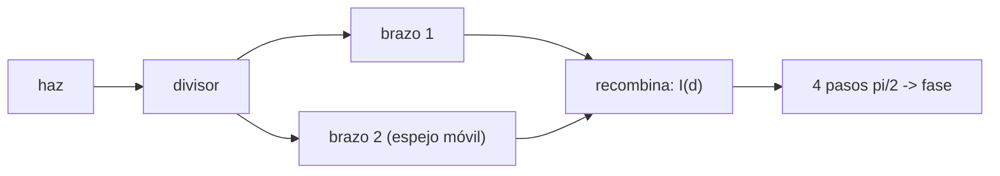

# B42-C09 — Interferometría de dos haces

<!-- nav:top -->
<!-- /nav -->

## 1. Ubicación, nivel y alcance

Clase 9 del bloque B42. Nivel N3. Un interferómetro de Michelson divide un haz en dos y los recombina; la diferencia de camino se lee en las franjas. Calculas visibilidad, periodo de franjas y recuperas la fase con **cuatro pasos de `π/2`** con ruido. Usas [B42](../../../tronco-comun/B42-optica-fisica-y-optica-adaptativa.md) (C03) y [B12](../../../tronco-comun/B12-probabilidad-estadistica-e-incertidumbre.md) (ruido).

## 2. Por qué esta clase existe

La medida interferométrica de fase es la base de la metrología óptica (superficies, frentes de onda; C13). La decisión central: **¿con qué precisión se mide una fase dado el ruido y la visibilidad?**

## 3. Lo que podrás hacer al terminar

1. Escribir `I = I₁ + I₂ + 2√(I₁I₂)cos(Δφ)`.
2. Calcular la visibilidad `2√(I₁I₂)/(I₁+I₂)`.
3. Relacionar fase y desplazamiento del espejo (`λ/2` por franja).
4. Recuperar la fase con `atan2(I₄−I₂, I₁−I₃)`.
5. Predecir la dispersión `σ/(√2 A)` y comprobarla con Monte Carlo.
6. Reconocer los límites (ruido aditivo, sin desenrollado).

La evidencia es la **ficha del interferómetro de dos haces** del ejercicio 12 (sección 20).

## 4. Con qué llegas y cómo comprobarlo

1. ¿Qué es una incertidumbre?
2. ¿Qué es una simulación Monte Carlo?
3. ¿Qué es una tabla de resultados?
4. ¿Qué es un valor ilustrativo?
5. ¿Qué es una verificación?

<details>
<summary>Ver respuestas</summary>

1. Un intervalo en que se espera el valor verdadero. 2. Repetir con números aleatorios de semilla fija. 3. Un resumen ordenado de cálculos. 4. Un valor propuesto para el ejemplo, no medido. 5. Comparar un cálculo con un caso independiente.
</details>

Con cuatro o cinco aciertos, sigue; si no, repasa los prerrequisitos.

## 5. Un caso de contexto y casos de referencia

Con `λ = 632,8 nm`, brazos 1 y 0,5 y ruido `σ = 0,01` (ilustrativos) la visibilidad es `0,942809`, las franjas distan `316,40 nm` y la fase de cuatro pasos tiene una dispersión de `4,9744 mrad` frente a `5,0000 mrad` previstos. Es el **ejemplo conductor**.

## 6. Vocabulario

El **interferómetro de Michelson**. La **diferencia de camino** `2d`. La **franja**: un ciclo de fase. El **paso de fase** (`π/2`). La **amplitud de modulación** `A = 2√(I₁I₂)`. La **visibilidad** `V`.

## 7. Modelo mental: dos corredores en pistas de distinto largo

Como dos corredores que salen juntos por pistas de distinto largo: si llegan acompasados se suman, si llegan desfasados se restan.



*Descripción textual:* la intensidad depende de la diferencia de camino; cuatro medidas desplazadas dan la fase con ruido propagado.

Analogía: dos corredores en pistas de distinto largo. Límite: fuente monocromática y espejos sin inclinación.

## 8. La explicación, paso a paso

### 8.1 Franjas

`V = 2√(I₁I₂)/(I₁+I₂) = 0,942809`; medida en el barrido, `0,942809` (`I_máx = 2,9142`, `I_mín = 0,0858`). El periodo de las franjas es `316,40 nm = λ/2`.

### 8.2 Fase por cuatro pasos

Sin ruido el error de fase es `4,4 × 10⁻¹⁶ rad`. Con `σ = 0,01` y 20 000 repeticiones:

| Magnitud | Valor |
|---|---|
| dispersión de la fase | 4,9744 mrad |
| predicción `σ/(√2 A)` | 5,0000 mrad |
| sesgo | +0,0648 mrad |
| altura de superficie (camino doble) | 250,49 pm |

Un desplazamiento de 80 nm equivale a `1,5887 rad = 0,2528` franjas.

### 8.3 Lectura

La fase mejora con visibilidad alta y amplitud de modulación grande; con la mitad de visibilidad el error se duplicaría.

## 9. Magnitudes, símbolos y unidades

| Símbolo | Qué es | Unidad | Valor / nota |
|---|---|---|---|
| `λ` | longitud de onda | m | 632,8 nm (ilustrativo) |
| `V` | visibilidad | — | 0,942809 |
| `σ` | ruido de intensidad | — | 0,01 |
| `φ` | fase | rad | ver 8.2 |

## 10. Convenciones y referencias

Fase de los pasos `kπ/2`; `atan2(I₄−I₂, I₁−I₃)`; la diferencia de camino es el doble del desplazamiento del espejo.

## 11. De dónde sale lo que afirmamos

| ID | Fuente | Localizador | Respalda | Estado |
|---|---|---|---|---|
| — | Interferometría de Michelson y algoritmos de desplazamiento de fase (libros de óptica) | — | fórmulas verificadas por Monte Carlo | No consultado |

Límites: no se consultó una fuente; se contrasta la propagación de ruido teórica con 20 000 repeticiones.

## 12. Cómo ver la fase de cuatro pasos

| Magnitud | Valor |
|---|---|
| visibilidad | 0,942809 |
| periodo de franja | 316,40 nm |
| σ de fase | 4,9744 mrad |
| σ de altura | 250,49 pm |

Descripción larga: la dispersión simulada coincide con la teórica a menos del 1 %.

## 13. Ejemplo trabajado: la dispersión de la fase

**Paso 1 · Amplitud.** `A = 2√(1 × 0,5) = 1,4142`.

**Paso 2 · Fórmula.** `σ_φ = σ/(√2 A)`.

**Paso 3 · Cuenta.** `0,01/(1,4142 × 1,4142) = 0,005 rad`.

**Paso 4 · Lectura.** 5 mrad.

## 14. Distintas formas de describir el resultado

**Por fórmula:** `I(d)`. **Por algoritmo:** `atan2`. **Por tabla:** ruido. **Por código:** `dos_haces.py`.

## 15. Práctica guiada

**Ejercicio 1 · con los pasos indicados.** Visibilidad con brazos 1 y 1.

<details><summary>Solución comentada</summary>

1.
</details>

**Ejercicio 2 · con una pista.** `A` con brazos 1 y 0,5.

<details><summary>Solución comentada</summary>

1,4142.
</details>

**Ejercicio 3 · casi autónomo.** `σ_φ` con `σ = 0,02`.

<details><summary>Solución comentada</summary>

10 mrad.
</details>

## 16. Práctica autónoma, transferencia e integrador

**Ejercicio 4.** Periodo de franjas para 632,8 nm.

<details><summary>Solución comentada</summary>

316,4 nm.
</details>

**Ejercicio 5.** Altura para 1 mrad.

<details><summary>Solución comentada</summary>

`λ/(4π) × 10⁻³ = 50,4 pm`.
</details>

**Ejercicio 6.** Fase de un desplazamiento de 100 nm.

<details><summary>Solución comentada</summary>

`4π × 100/632,8 = 1,986 rad`.
</details>

**Ejercicio 7.** Franjas de 200 nm.

<details><summary>Solución comentada</summary>

`0,632`.
</details>

**Ejercicio 8.** ¿Qué pasa con `V = 0`?

<details><summary>Solución comentada</summary>

No hay modulación: fase indeterminada.
</details>

**Ejercicio 9 · transferencia.** **Transferencia.** ¿Por qué se usan cuatro pasos y no dos?

<details><summary>Solución comentada</summary>

Con dos no se separan fase, visibilidad y fondo.
</details>

**Ejercicio 10 · transferencia.** **Transferencia.** Un compañero dice que el sesgo de 0,06 mrad demuestra un error del algoritmo. Responde.

<details><summary>Solución comentada</summary>

Es compatible con el ruido muestral (`4,97/√20 000 = 0,035 mrad` por componente...) y no es significativo.
</details>

**Ejercicio 11 · transferencia.** **Transferencia.** ¿Qué limita la precisión real?

<details><summary>Solución comentada</summary>

Vibración, deriva y no linealidad del actuador.
</details>

**Ejercicio 12.** **Integrador.** Elabora tu *ficha del interferómetro de dos haces*: visibilidad, periodo y precisión de fase.

<details><summary>Solución comentada</summary>

Secciones 8.1–8.3.
</details>

**Ejercicio 12 · integrador.** **Integrador.** Elabora tu *ficha del interferómetro de dos haces*: visibilidad, periodo y precisión de fase.

<details><summary>Solución modelo</summary>

Secciones 8.1–8.3.
</details>

## 17. Laboratorio: interferómetro de dos haces y fase de cuatro pasos

El script [dos_haces.py](dos_haces.py) calcula visibilidad y periodo, recupera la fase y contrasta el ruido (**comprueba** a `10⁻⁴`, `10⁻¹²` y `3 %`).

**Datos:** sin constantes; `λ`, intensidades y ruido ilustrativos. **Predice antes de ejecutar:** ¿cuánto vale `σ_φ`? (≈ 5 mrad.) **Ejecución del 2026-11-09 (Python 3.12.9):**

```text
Python 3.12.9 (biblioteca estandar)
visibilidad teorica = 0.942809 ; medida en el barrido = 0.942809 ; Imax = 2.9142 ; Imin = 0.0858
periodo de franjas = 316.40 nm (lambda/2 = 316.40 nm)
fase sin ruido: error maximo = 4.44e-16 rad
ruido sigma = 0.01 : desviacion de la fase = 4.9744 mrad ; prediccion sigma/(sqrt(2) A) = 5.0000 mrad ; sesgo = +0.0648 mrad
en altura de superficie (camino doble): sigma_h = lambda/(4 pi) * sigma_phi = 250.49 pm
desplazamiento de 80 nm -> fase 1.5887 rad = 0.2528 franjas ; lambda/2 = 1 franja
Pruebas superadas.
```

```bash
python programa/clases/B42/B42-C09-interferometria-de-dos-haces/dos_haces.py
```

**Límites:** ruido aditivo independiente, sin desenrollado.

## 18. Errores frecuentes y cómo corregirlos

**Olvidar el factor 2 del camino.** Franja cada `λ/2` de espejo.

**Usar `arctan` en vez de `atan2`.** Pierde el cuadrante.

**Ignorar la visibilidad.** Ver 8.3.

**Confundir `σ` de intensidad con de fase.** Se corrige con el ejemplo 13.

## 19. Cómo sabrás que vas bien

Tras la sección 8: ¿qué resultado esperabas y cuál obtuviste? Si dudas, repasa el ejemplo 13. Tras el laboratorio: ¿qué comprueba? (ver la sección 17).

## 20. Qué entregas y cómo se evalúa

El producto es tu **ficha del interferómetro de dos haces** (ejercicio 12).

| Criterio | Inicial | En desarrollo | Logrado | Destacado |
|---|---|---|---|---|
| Conceptos | Los confunde | Parciales | conceptos de la clase | Explica los límites |
| Cálculo | Sin unidades | Con errores | Tablas completas | Calcula casos nuevos |
| Numérico | Sin comprobar | Un caso | Contraste con el análisis | Interpreta las diferencias |
| Fuentes | Sin fuente | Sin fecha | fuentes con fecha | Declara lo ilustrativo |
| Límites | No los nombra | Uno | Tres | Discute qué falta del modelo |

**Condiciones críticas (no se compensan con promedio):** rotular valores ilustrativos; no presentar 250 pm como la precisión de un instrumento.

## 21. Ética, seguridad y límites

Clase educativa: los modelos son simplificados. Accesibilidad: tablas equivalentes a las gráficas, fórmulas en texto, ejercicios sin conexión.

## 22. Para cerrar y seguir

Cuatro pasos de `π/2` recuperan la fase con 5 mrad de dispersión a `σ = 0,01`; ya sabes combinar dos haces. Falta usar varios telescopios.

**Glosario español–inglés.** interferómetro de Michelson · *Michelson interferometer*; franja · *fringe*; desplazamiento de fase · *phase shifting*; visibilidad · *visibility*; amplitud de modulación · *modulation amplitude*.

**Continuidad.** [B42-C10](../B42-C10-interferometria-de-multiples-telescopios/CLASE.md) estudia la interferometría de múltiples telescopios.

**Referencias:** ver sección 11.

<!-- nav:bottom -->
---

<!-- /nav -->
