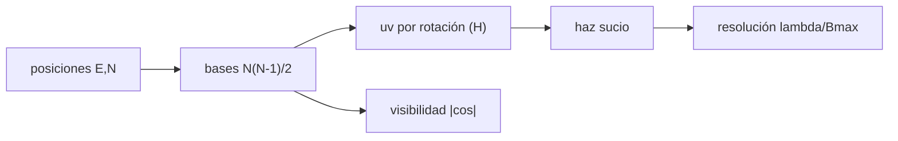

# B42-C10 — Interferometría de múltiples telescopios

<!-- nav:top -->
<!-- /nav -->

## 1. Ubicación, nivel y alcance

Clase 10 del bloque B42. Nivel N3. Un interferómetro de varios telescopios mide **visibilidades** entre pares (líneas base) y la rotación de la Tierra completa la cobertura del plano `uv`. Calculas bases, cobertura uv y haz sucio de un conjunto **ilustrativo** de cuatro telescopios. Usas [B42](../../../tronco-comun/B42-optica-fisica-y-optica-adaptativa.md) (C03, C09) y [B15](../../../tronco-comun/B15-senales-imagenes-y-estimacion-cientifica.md).

## 2. Por qué esta clase existe

La resolución depende de la línea base, no del diámetro de cada telescopio, y la calidad de la imagen de la cobertura uv. La decisión central: **¿qué resolución y qué calidad de imagen da una disposición de telescopios?**

## 3. Lo que podrás hacer al terminar

1. Contar las bases `N(N−1)/2`.
2. Calcular la visibilidad de dos fuentes `|cos(πBθ/λ)|`.
3. Obtener las coordenadas uv con la rotación terrestre.
4. Calcular la resolución `λ/B_máx`.
5. Evaluar el haz sucio y sus lóbulos laterales.
6. Reconocer los límites de una síntesis simplificada.

La evidencia es la **ficha de la interferometría multitelescopio** del ejercicio 12 (sección 20).

## 4. Con qué llegas y cómo comprobarlo

1. ¿Qué es una incertidumbre?
2. ¿Qué es una simulación Monte Carlo?
3. ¿Qué es una tabla de resultados?
4. ¿Qué es un valor ilustrativo?
5. ¿Qué es una verificación?

<details>
<summary>Ver respuestas</summary>

1. Un intervalo en que se espera el valor verdadero. 2. Repetir con números aleatorios de semilla fija. 3. Un resumen ordenado de cálculos. 4. Un valor propuesto para el ejemplo, no medido. 5. Comparar un cálculo con un caso independiente.
</details>

Con cuatro o cinco aciertos, sigue; si no, repasa los prerrequisitos.

## 5. Un caso de contexto y casos de referencia

Con cuatro telescopios (ilustrativos), 6 bases de `42,7` a `129,8 m` y `λ = 2,2 µm` la resolución `λ/B_máx` es `3,4958 mas`; el haz sucio mide `4,5 × 2,3 mas` y su mayor lóbulo lateral es `0,560`. Es el **ejemplo conductor**.

## 6. Vocabulario

La **línea base** `B`. La **visibilidad** `V`. El plano **uv** (frecuencias espaciales en longitudes de onda). La **síntesis de apertura** (cobertura por rotación). El **haz sucio**: transformada de la cobertura. El **mas**: milisegundo de arco.

## 7. Modelo mental: una red de pescar

Como lanzar una red con pocos nudos: cada par de telescopios es un nudo en el plano uv; cuantos más nudos, menos huecos y mejor imagen.



*Descripción textual:* las bases se proyectan sobre el cielo y se mueven con la rotación terrestre; el haz sucio resume qué frecuencias se miden.

Analogía: una red de pescar. Límite: fuentes puntuales y cielo plano.

## 8. La explicación, paso a paso

### 8.1 Bases y visibilidad

Con 4 telescopios hay 6 bases (`N(N−1)/2`); la más corta mide `42,7 m` y la más larga `129,8 m`. La visibilidad de dos fuentes iguales con base de 50 m:

| `θ` (mas) | `V` suma | `|cos|` |
|---|---|---|
| 0 | 1,000000 | 1,000000 |
| 5 | 0,159303 | 0,159303 |
| 10 | 0,949245 | 0,949245 |
| 20 | 0,802133 | 0,802133 |
| 40 | 0,286834 | 0,286834 |

El primer nulo está en `λ/(2B) = 4,538 mas`.

### 8.2 Cobertura y haz sucio

Entre `−4 h` y `+4 h` hay `1164` puntos uv (con simetría hermitiana); `|uv|_máx = 5,8992 × 10⁷ λ` y `λ/|uv|_máx = 3,4965 mas`. Los anchos del haz sucio son `4,500 mas` (x) y `2,300 mas` (y) frente a `λ/B_máx = 3,496 mas`. El mayor lóbulo lateral fuera del lóbulo central es `0,560`.

### 8.3 Lectura

Con pocos telescopios el haz sucio tiene lóbulos laterales grandes (0,56); por eso las imágenes de estos arreglos exigen deconvolución (C19).

## 9. Magnitudes, símbolos y unidades

| Símbolo | Qué es | Unidad | Valor / nota |
|---|---|---|---|
| `B` | línea base | m | 42,7 a 129,8 |
| `λ/B` | resolución | rad | 3,4958 mas |
| `(u,v)` | coordenadas del plano uv | λ | ver 8.2 |
| `H` | ángulo horario | h | −4 a +4 |

## 10. Convenciones y referencias

Latitud −24,6° y declinación −30° ilustrativas; fórmulas de uv de libro (no consultadas); `1 mas = 4,848 × 10⁻⁹ rad`.

## 11. De dónde sale lo que afirmamos

| ID | Fuente | Localizador | Respalda | Estado |
|---|---|---|---|---|
| — | Fórmulas de síntesis de apertura (libros de radio e interferometría óptica) | — | uv y haz sucio | No consultado |

Límites: no se consultó una fuente; la distribución es ilustrativa y no corresponde a ningún observatorio.

## 12. Cómo ver la cobertura uv

| Magnitud | Valor |
|---|---|
| bases | 6 |
| `λ/B_máx` | 3,4958 mas |
| puntos uv | 1164 |
| lóbulo lateral máximo | 0,560 |

Descripción larga: el haz sucio es más fino en x que en y por la orientación de las bases.

## 13. Ejemplo trabajado: la resolución

**Paso 1 · Fórmula.** `θ = λ/B`.

**Paso 2 · Valores.** `λ = 2,2 × 10⁻⁶ m`, `B = 129,8 m`.

**Paso 3 · Cuenta.** `1,695 × 10⁻⁸ rad`.

**Paso 4 · Lectura.** `3,496 mas`.

## 14. Distintas formas de describir el resultado

**Por bases:** `N(N−1)/2`. **Por fórmula:** uv. **Por tabla:** visibilidad. **Por código:** `multitelescopio.py`.

## 15. Práctica guiada

**Ejercicio 1 · con los pasos indicados.** Bases con 6 telescopios.

<details><summary>Solución comentada</summary>

15.
</details>

**Ejercicio 2 · con una pista.** Bases con 27 telescopios.

<details><summary>Solución comentada</summary>

351.
</details>

**Ejercicio 3 · casi autónomo.** Nulo con `B = 50 m`.

<details><summary>Solución comentada</summary>

4,538 mas.
</details>

## 16. Práctica autónoma, transferencia e integrador

**Ejercicio 4.** Resolución con `B = 1 km`.

<details><summary>Solución comentada</summary>

0,454 mas.
</details>

**Ejercicio 5.** `V` con `θ = 10 mas`, `B = 50 m`.

<details><summary>Solución comentada</summary>

0,949.
</details>

**Ejercicio 6.** Puntos uv con simetría para 6 bases y 97 horas angulares.

<details><summary>Solución comentada</summary>

`2 × 6 × 97 = 1164`.
</details>

**Ejercicio 7.** `λ/B` para `B = 100 m`.

<details><summary>Solución comentada</summary>

4,54 mas.
</details>

**Ejercicio 8.** ¿Por qué x e y tienen anchos distintos?

<details><summary>Solución comentada</summary>

Por la orientación y proyección de las bases.
</details>

**Ejercicio 9 · transferencia.** **Transferencia.** ¿Por qué observar durante horas mejora la imagen?

<details><summary>Solución comentada</summary>

La rotación terrestre rellena el plano uv.
</details>

**Ejercicio 10 · transferencia.** **Transferencia.** Un compañero dice que más telescopios solo suben el flujo. Responde.

<details><summary>Solución comentada</summary>

Aumentan también la cobertura uv y la calidad de imagen.
</details>

**Ejercicio 11 · transferencia.** **Transferencia.** ¿Qué limita un interferómetro óptico real?

<details><summary>Solución comentada</summary>

Fase atmosférica y retardos (no simulados aquí).
</details>

**Ejercicio 12.** **Integrador.** Elabora tu *ficha de la interferometría multitelescopio*: bases, resolución y cobertura.

<details><summary>Solución comentada</summary>

Secciones 8.1–8.3.
</details>

**Ejercicio 12 · integrador.** **Integrador.** Elabora tu *ficha de la interferometría multitelescopio*: bases, resolución y cobertura.

<details><summary>Solución modelo</summary>

Secciones 8.1–8.3.
</details>

## 17. Laboratorio: cobertura uv de cuatro telescopios

El script [multitelescopio.py](multitelescopio.py) calcula bases, visibilidades, cobertura uv y haz sucio (**comprueba** el número de bases y las visibilidades a `10⁻¹²`).

**Datos:** sin datos reales; posiciones y declinación ilustrativas. **Predice antes de ejecutar:** ¿qué resolución da la base mayor? (≈ 3,5 mas.) **Ejecución del 2026-11-09 (Python 3.12.9):**

```text
Python 3.12.9 (biblioteca estandar)
telescopios = 4 ; bases independientes = 6 (N(N-1)/2 = 6)
base mas corta = 42.7 m ; mas larga = 129.8 m ; resolucion lambda/B_max = 3.4958 mas
 theta [mas]     V suma      |cos|
         0.0   1.000000   1.000000
         5.0   0.159303   0.159303
        10.0   0.949245   0.949245
        20.0   0.802133   0.802133
        40.0   0.286834   0.286834
primer nulo de visibilidad en theta = lambda / (2 B) = 4.538 mas
puntos uv (con simetria hermitica) = 1164
|uv| maximo = 5.8992e+07 lambda ; lambda/|uv|max = 3.4965 mas
anchos del haz sucio: 4.500 mas (x), 2.300 mas (y) ; lambda/B_max = 3.496 mas
mayor lobulo lateral en el campo de +-15 mas fuera del lobulo central = 0.560
Pruebas superadas.
```

```bash
python programa/clases/B42/B42-C10-interferometria-de-multiples-telescopios/multitelescopio.py
```

**Límites:** fuentes puntuales y cielo plano.

## 18. Errores frecuentes y cómo corregirlos

**Confundir diámetro con línea base.** La resolución depende de `B`.

**Olvidar la simetría hermitiana.** Cada base da dos puntos uv.

**Mezclar unidades uv.** En longitudes de onda.

**Confundir haz sucio con limpio.** El sucio no está deconvolucionado.

## 19. Cómo sabrás que vas bien

Tras la sección 8: ¿qué resultado esperabas y cuál obtuviste? Si dudas, repasa el ejemplo 13. Tras el laboratorio: ¿qué comprueba? (ver la sección 17).

## 20. Qué entregas y cómo se evalúa

El producto es tu **ficha de la interferometría multitelescopio** (ejercicio 12).

| Criterio | Inicial | En desarrollo | Logrado | Destacado |
|---|---|---|---|---|
| Conceptos | Los confunde | Parciales | conceptos de la clase | Explica los límites |
| Cálculo | Sin unidades | Con errores | Tablas completas | Calcula casos nuevos |
| Numérico | Sin comprobar | Un caso | Contraste con el análisis | Interpreta las diferencias |
| Fuentes | Sin fuente | Sin fecha | fuentes con fecha | Declara lo ilustrativo |
| Límites | No los nombra | Uno | Tres | Discute qué falta del modelo |

**Condiciones críticas (no se compensan con promedio):** rotular la disposición como ilustrativa; no atribuirla a ningún observatorio.

## 21. Ética, seguridad y límites

Clase educativa: los modelos son simplificados. Accesibilidad: tablas equivalentes a las gráficas, fórmulas en texto, ejercicios sin conexión.

## 22. Para cerrar y seguir

Cuatro telescopios dan 6 bases, 1164 puntos uv y 3,5 mas de resolución con lóbulos de 0,56. Falta entender qué hace la atmósfera.

**Glosario español–inglés.** línea base · *baseline*; plano uv · *uv plane*; síntesis de apertura · *aperture synthesis*; haz sucio · *dirty beam*; visibilidad · *visibility*.

**Continuidad.** [B42-C11](../B42-C11-turbulencia-atmosferica/CLASE.md) estudia la turbulencia atmosférica.

**Referencias:** ver sección 11.

<!-- nav:bottom -->
---

<!-- /nav -->
