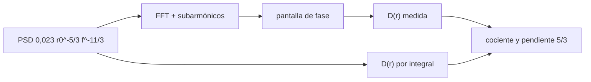

# B42-C11 — Turbulencia atmosférica

<!-- nav:top -->
[🏠 Programa](../../../../README.md) · [📚 Bloque B42](../../../tronco-comun/B42-optica-fisica-y-optica-adaptativa.md) · [← Anterior: B42-C10 — Interferometría de múltiples telescopios](../B42-C10-interferometria-de-multiples-telescopios/CLASE.md) · [Siguiente: B42-C12 — Parámetro de Fried →](../B42-C12-parametro-de-fried/CLASE.md)
<!-- /nav -->

## 1. Ubicación, nivel y alcance

Clase 11 del bloque B42. Nivel N3. La turbulencia atmosférica deforma el frente de onda de forma aleatoria. Generas **pantallas de fase de Kolmogorov** por FFT con subarmónicos y mides su **función de estructura**. Usas [B42](../../../tronco-comun/B42-optica-fisica-y-optica-adaptativa.md) (C01) y [B12](../../../tronco-comun/B12-probabilidad-estadistica-e-incertidumbre.md).

## 2. Por qué esta clase existe

La atmósfera fija el límite de resolución de los telescopios terrestres y es la perturbación que corrige la óptica adaptativa. La decisión central: **¿cómo se simula una pantalla de fase con la estadística correcta y qué errores introduce la malla?**

## 3. Lo que podrás hacer al terminar

1. Escribir el espectro de fase `0,023 r₀^{−5/3} f^{−11/3}`.
2. Generar pantallas con FFT y subarmónicos.
3. Estimar `D(r)` desde las pantallas.
4. Comparar con la integral espectral y con `6,88 (r/r₀)^{5/3}`.
5. Medir la pendiente `5/3`.
6. Cuantificar el déficit de potencia por la malla.

La evidencia es la **ficha de la turbulencia** del ejercicio 12 (sección 20).

## 4. Con qué llegas y cómo comprobarlo

1. ¿Qué es una incertidumbre?
2. ¿Qué es una simulación Monte Carlo?
3. ¿Qué es una tabla de resultados?
4. ¿Qué es un valor ilustrativo?
5. ¿Qué es una verificación?

<details>
<summary>Ver respuestas</summary>

1. Un intervalo en que se espera el valor verdadero. 2. Repetir con números aleatorios de semilla fija. 3. Un resumen ordenado de cálculos. 4. Un valor propuesto para el ejemplo, no medido. 5. Comparar un cálculo con un caso independiente.
</details>

Con cuatro o cinco aciertos, sigue; si no, repasa los prerrequisitos.

## 5. Un caso de contexto y casos de referencia

Con `r₀ = 0,15 m`, malla de 128 × 128 con paso 0,02 m y 40 pantallas (ilustrativos) la función de estructura medida a `r = 0,08 m` es `1,9643 rad²` frente a `2,0628` de la integral espectral y `2,4132` de la teoría infinita; la pendiente log-log es `1,640`. Es el **ejemplo conductor**.

## 6. Vocabulario

La **pantalla de fase**. El **espectro de potencia** de Kolmogorov. La **función de estructura** `D(r) = ⟨[φ(x)−φ(x+r)]²⟩`. El **parámetro** `r₀`. Los **subarmónicos**: frecuencias bajas añadidas. La **frecuencia de Nyquist** de la malla.

## 7. Modelo mental: un río turbulento

Como un río con remolinos de todos los tamaños: los grandes llevan la mayor parte de la energía y los pequeños la completan.



*Descripción textual:* una pantalla gaussiana con el espectro de Kolmogorov reproduce, con déficit conocido, la función de estructura teórica.

Analogía: un río turbulento. Límite: turbulencia estacionaria, sin escala externa finita.

## 8. La explicación, paso a paso

### 8.1 Función de estructura

Con `df = 0,391 m⁻¹` (escala máxima `2,56 m`) y 40 pantallas:

| `r` (m) | `D` pantallas | `D` integral PSD | `D` teoría | cociente |
|---|---|---|---|---|
| 0,020 | 0,1950 | 0,2014 | 0,2394 | 0,814 |
| 0,040 | 0,6364 | 0,6619 | 0,7601 | 0,837 |
| 0,080 | 1,9643 | 2,0628 | 2,4132 | 0,814 |
| 0,120 | 3,7569 | 3,9709 | 4,7432 | 0,792 |
| 0,160 | 5,9279 | 6,2963 | 7,6613 | 0,774 |

La pendiente log-log de `D(r)` es `1,640` (teoría `5/3 = 1,667`).

### 8.2 Déficit

El déficit frente a la teoría infinita (15 % a 23 %) no es un error de código: la malla pierde potencia por encima de Nyquist y, para `r = 0,64 m` (`L/4`), la integral espectral da `55,157` frente a `77,221` (déficit `28,6 %`) por las frecuencias bajas que faltan aun con subarmónicos.

### 8.3 Lectura

Las dos vías (pantallas e integral espectral) concuerdan a menos del 10 %: la diferencia con la teoría es de muestreo, no de generación. Sin subarmónicos el déficit a 0,08 m era de 35 %.

## 9. Magnitudes, símbolos y unidades

| Símbolo | Qué es | Unidad | Valor / nota |
|---|---|---|---|
| `r₀` | parámetro de Fried | m | 0,15 (ilustrativo) |
| `D(r)` | función de estructura | rad² | ver 8.1 |
| `df` | paso en frecuencia | m⁻¹ | 0,391 |
| `L` | lado de la malla | m | 2,56 |

## 10. Convenciones y referencias

PSD de fase `0,023 r₀^{−5/3} f^{−11/3}` (coeficientes de libro, no consultados); tres niveles de subarmónicos con rejilla 3×3; pares de píxeles sin envolver.

## 11. De dónde sale lo que afirmamos

| ID | Fuente | Localizador | Respalda | Estado |
|---|---|---|---|---|
| — | Espectro de Kolmogorov y método de subarmónicos (libros) | — | coeficientes 0,023 y 6,88; método | No consultado |

Límites: no se consultó una fuente; los coeficientes son de libro de texto y se contrasta la coherencia interna entre pantallas e integral espectral.

## 12. Cómo ver la función de estructura

| Magnitud | Valor |
|---|---|
| `D(0,08 m)` pantallas | 1,9643 rad² |
| `D(0,08 m)` integral | 2,0628 rad² |
| `D(0,08 m)` teoría | 2,4132 rad² |
| pendiente | 1,640 |

Descripción larga: pantallas e integral coinciden; la teoría infinita es mayor por el truncado de frecuencias.

## 13. Ejemplo trabajado: D a 8 cm

**Paso 1 · Fórmula.** `D = 6,88 (r/r₀)^{5/3}`.

**Paso 2 · Razón.** `r/r₀ = 0,08/0,15 = 0,5333`; `0,5333^{5/3} = 0,3507`.

**Paso 3 · Producto.** `6,88 × 0,3507 = 2,413`.

**Paso 4 · Lectura.** La malla da 81 % de esa cifra.

## 14. Distintas formas de describir el resultado

**Por espectro:** PSD. **Por pantallas:** FFT. **Por estructura:** `D(r)`. **Por código:** `kolmogorov.py`.

## 15. Práctica guiada

**Ejercicio 1 · con los pasos indicados.** `D(r₀)` con la teoría. *Pasos:* `6,88 × 1`.

<details><summary>Solución comentada</summary>

`6,88 rad²`.
</details>

**Ejercicio 2 · con una pista.** `D(0,04 m)` teórico. *Pista:* `r/r₀ = 0,2667`.

<details><summary>Solución comentada</summary>

`0,760`.
</details>

**Ejercicio 3 · casi autónomo.** Cociente `D(0,16)/D(0,08)` teórico.

<details><summary>Solución comentada</summary>

`2^{5/3} = 3,17`.
</details>

## 16. Práctica autónoma, transferencia e integrador

**Ejercicio 4.** Cociente medido de las pantallas.

<details><summary>Solución comentada</summary>

`5,9279/1,9643 = 3,02`.
</details>

**Ejercicio 5.** Frecuencia mínima de la malla.

<details><summary>Solución comentada</summary>

0,391 m⁻¹.
</details>

**Ejercicio 6.** Frecuencia de Nyquist.

<details><summary>Solución comentada</summary>

`1/(2×0,02) = 25 m⁻¹`.
</details>

**Ejercicio 7.** Déficit a 0,64 m.

<details><summary>Solución comentada</summary>

28,6 %.
</details>

**Ejercicio 8.** ¿Qué indica una pendiente 1,640 vs 1,667?

<details><summary>Solución comentada</summary>

Un 1,6 % de diferencia: buena.
</details>

**Ejercicio 9 · transferencia.** **Transferencia.** ¿Por qué hacen falta subarmónicos?

<details><summary>Solución comentada</summary>

Porque la FFT no contiene las frecuencias menores que `1/L`.
</details>

**Ejercicio 10 · transferencia.** **Transferencia.** Un compañero dice que el déficit invalida las pantallas. Responde.

<details><summary>Solución comentada</summary>

No: se acota y puede mitigarse con malla mayor o más subarmónicos.
</details>

**Ejercicio 11 · transferencia.** **Transferencia.** ¿Qué cambia con el paso de la malla?

<details><summary>Solución comentada</summary>

Cambia la frecuencia de Nyquist y el déficit de alta frecuencia.
</details>

**Ejercicio 12.** **Integrador.** Elabora tu *ficha de la turbulencia*: espectro, `D(r)`, pendiente y déficit.

<details><summary>Solución comentada</summary>

Secciones 8.1–8.3.
</details>

**Ejercicio 12 · integrador.** **Integrador.** Elabora tu *ficha de la turbulencia*: espectro, `D(r)`, pendiente y déficit.

<details><summary>Solución modelo</summary>

Secciones 8.1–8.3.
</details>

## 17. Laboratorio: pantallas de fase de Kolmogorov

El script [kolmogorov.py](kolmogorov.py) genera pantallas con subarmónicos, mide `D(r)` y la compara con la integral espectral y la teoría (**comprueba** a `10 %` y pendiente a `0,15`).

**Datos:** sin datos atmosféricos; `r₀`, malla y semilla ilustrativos. **Predice antes de ejecutar:** ¿cuánto vale `D` a 8 cm? (≈ 2,0 rad².) **Ejecución del 2026-11-09 (Python 3.12.9):**

```text
Python 3.12.9 (biblioteca estandar)
40 pantallas ; df = 0.391 1/m ; frecuencia minima = 0.391 1/m (escala maxima 1/df = 2.56 m)
  r [m]  D pantallas  D integral PSD   D teoria 6,88(r/r0)^5/3  cociente
  0.020       0.1950          0.2014                    0.2394     0.814
  0.040       0.6364          0.6619                    0.7601     0.837
  0.080       1.9643          2.0628                    2.4132     0.814
  0.120       3.7569          3.9709                    4.7432     0.792
  0.160       5.9279          6.2963                    7.6613     0.774
pendiente log-log de D(r) = 1.640 (teoria 5/3 = 1.667)
r = 0.64 m (L/4): D por integral PSD = 55.157 ; teoria infinita = 77.221 ; deficit = 28.6% por frecuencias bajas ausentes
Pruebas superadas.
```

```bash
python programa/clases/B42/B42-C11-turbulencia-atmosferica/kolmogorov.py
```

**Límites:** turbulencia estacionaria sin escala externa.

## 18. Errores frecuentes y cómo corregirlos

**Creer que la FFT simple basta.** Ver 8.2.

**Comparar a `r` grande sin discutir `L`.** Ver 8.2.

**Olvidar los pares sin envolver.** Los subarmónicos no son periódicos.

**Dar `r₀` sin longitud de onda.** Se corrige en la clase C12.

## 19. Cómo sabrás que vas bien

Tras la sección 8: ¿qué resultado esperabas y cuál obtuviste? Si dudas, repasa el ejemplo 13. Tras el laboratorio: ¿qué comprueba? (ver la sección 17).

## 20. Qué entregas y cómo se evalúa

El producto es tu **ficha de la turbulencia** (ejercicio 12).

| Criterio | Inicial | En desarrollo | Logrado | Destacado |
|---|---|---|---|---|
| Conceptos | Los confunde | Parciales | conceptos de la clase | Explica los límites |
| Cálculo | Sin unidades | Con errores | Tablas completas | Calcula casos nuevos |
| Numérico | Sin comprobar | Un caso | Contraste con el análisis | Interpreta las diferencias |
| Fuentes | Sin fuente | Sin fecha | fuentes con fecha | Declara lo ilustrativo |
| Límites | No los nombra | Uno | Tres | Discute qué falta del modelo |

**Condiciones críticas (no se compensan con promedio):** rotular el modelo como sintético; mencionar el déficit; no presentar `r₀` como medido.

## 21. Ética, seguridad y límites

Clase educativa: los modelos son simplificados. Accesibilidad: tablas equivalentes a las gráficas, fórmulas en texto, ejercicios sin conexión.

## 22. Para cerrar y seguir

Las pantallas reproducen `D(r)` con 77 % a 84 % de la teoría infinita y pendiente 1,640. Falta cuantificar la turbulencia con un parámetro.

**Glosario español–inglés.** turbulencia · *turbulence*; función de estructura · *structure function*; pantalla de fase · *phase screen*; subarmónico · *subharmonic*; espectro de Kolmogorov · *Kolmogorov spectrum*.

**Continuidad.** [B42-C12](../B42-C12-parametro-de-fried/CLASE.md) estudia el parámetro de Fried.

**Referencias:** ver sección 11.

<!-- nav:bottom -->
---

[← Anterior: B42-C10 — Interferometría de múltiples telescopios](../B42-C10-interferometria-de-multiples-telescopios/CLASE.md) · [📚 Bloque B42](../../../tronco-comun/B42-optica-fisica-y-optica-adaptativa.md) · [Siguiente: B42-C12 — Parámetro de Fried →](../B42-C12-parametro-de-fried/CLASE.md)
<!-- /nav -->
