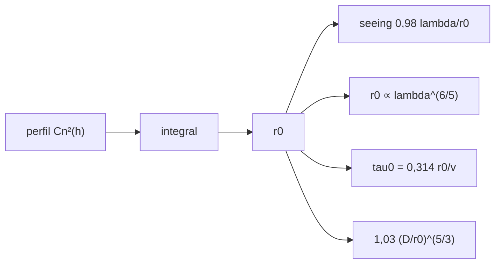

# B42-C12 — Parámetro de Fried

<!-- nav:top -->
<!-- /nav -->

## 1. Ubicación, nivel y alcance

Clase 12 del bloque B42. Nivel N3. El **parámetro de Fried `r₀`** resume la turbulencia en una longitud. Lo calculas desde un perfil `C_n²(h)` ilustrativo, obtienes el seeing, el escalado con la longitud de onda y el tiempo de coherencia. Usas [B42](../../../tronco-comun/B42-optica-fisica-y-optica-adaptativa.md) (C11) y [B12](../../../tronco-comun/B12-probabilidad-estadistica-e-incertidumbre.md).

## 2. Por qué esta clase existe

`r₀` decide cuántos actuadores y qué tasa de muestreo necesita la óptica adaptativa. La decisión central: **¿cómo se obtiene `r₀`, cómo escala con `λ` y qué implica para la apertura y el lazo?**

## 3. Lo que podrás hacer al terminar

1. Calcular `r₀ = [0,423 k² ∫C_n² dh]^{−3/5}`.
2. Calcular el seeing `0,98 λ/r₀`.
3. Verificar el escalado `r₀ ∝ λ^{6/5}`.
4. Estimar `τ₀ = 0,314 r₀/v_ef`.
5. Calcular la varianza de fase `1,03 (D/r₀)^{5/3}`.
6. Reconocer que el perfil es ilustrativo.

La evidencia es la **ficha del parámetro de Fried** del ejercicio 12 (sección 20).

## 4. Con qué llegas y cómo comprobarlo

1. ¿Qué es una incertidumbre?
2. ¿Qué es una simulación Monte Carlo?
3. ¿Qué es una tabla de resultados?
4. ¿Qué es un valor ilustrativo?
5. ¿Qué es una verificación?

<details>
<summary>Ver respuestas</summary>

1. Un intervalo en que se espera el valor verdadero. 2. Repetir con números aleatorios de semilla fija. 3. Un resumen ordenado de cálculos. 4. Un valor propuesto para el ejemplo, no medido. 5. Comparar un cálculo con un caso independiente.
</details>

Con cuatro o cinco aciertos, sigue; si no, repasa los prerrequisitos.

## 5. Un caso de contexto y casos de referencia

Con un perfil ilustrativo (exponencial de 1 km más una capa a 8 km) `r₀(500 nm) = 13,40 cm`, seeing `0,7542 arcsec`, `r₀(2200 nm) = 79,30 cm` y `τ₀ = 3,871 ms` a 500 nm. Es el **ejemplo conductor**.

## 6. Vocabulario

El **parámetro de Fried** `r₀`. La integral de turbulencia `∫C_n² dh`. El **seeing**: anchura a media altura de la imagen de larga exposición, `0,98 λ/r₀`. El **tiempo de coherencia** `τ₀`. La **velocidad efectiva** del viento. La **varianza de fase** sobre la apertura.

## 7. Modelo mental: el tamaño de un remolino típico

Como el ancho de una ola típica: una apertura menor que `r₀` ve el frente casi plano; una mayor lo ve muy deformado.



*Descripción textual:* un perfil de turbulencia integrado produce `r₀`, de donde salen seeing, escalado, tiempo de coherencia y varianza de fase.

Analogía: el tamaño de un remolino típico. Límite: perfil estacionario y campo cercano.

## 8. La explicación, paso a paso

### 8.1 `r₀` y seeing

La integral `∫C_n² dh = 4,2659 × 10⁻¹³ m^{1/3}`. Para un perfil exponencial puro la integral numérica y la forma cerrada difieren en `1,8 × 10⁻¹¹`.

| `λ` (nm) | `r₀` (cm) | seeing (arcsec) |
|---|---|---|
| 500 | 13,40 | 0,7542 |
| 1650 | 56,15 | 0,5940 |
| 2200 | 79,30 | 0,5608 |

`r₀(2200)/r₀(500) = 5,9175673812`, igual a `(2200/500)^{6/5}`; el seeing escala como `λ^{−1/5}` (cociente `0,743549`).

### 8.2 Tiempo y varianza

Con 10 m/s bajo 5 km y 20 m/s sobre 5 km, `v_ef = 10,869 m/s` y `τ₀ = 3,871 ms` a 500 nm (`22,910 ms` a 2200 nm).

| `D` (m) | `D/r₀` | `σ²` (rad²) | `exp(−σ²)` |
|---|---|---|---|
| 0,1 | 0,75 | 0,632 | 0,5314 |
| 0,5 | 3,73 | 9,245 | 9,66 × 10⁻⁵ |
| 2,0 | 14,92 | 93,180 | 3,4 × 10⁻⁴¹ |
| 8,0 | 59,70 | 939,193 | 0 |

### 8.3 Lectura

La apertura con 1 rad² de varianza es `r₀/1,03^{3/5} = 13,17 cm`, cerca de `r₀`. Sin corrección, un telescopio de 8 m en 500 nm no tiene Strehl; en infrarrojo `r₀` es 6 veces mayor.

## 9. Magnitudes, símbolos y unidades

| Símbolo | Qué es | Unidad | Valor / nota |
|---|---|---|---|
| `r₀` | parámetro de Fried | m | 0,1340 (500 nm, ilustrativo) |
| `C_n²` | estructura del índice | m^{−2/3} | perfil ilustrativo |
| `τ₀` | tiempo de coherencia | s | 3,871 ms |
| `v_ef` | viento efectivo | m/s | 10,869 |

## 10. Convenciones y referencias

Perfil 4,0 × 10⁻¹⁶ exp(−h/1 km) + 10⁻¹⁷ gaussiana a 8 km (ilustrativo); coeficientes 0,423, 0,98, 0,314 y 1,03 de libro (no consultados).

## 11. De dónde sale lo que afirmamos

| ID | Fuente | Localizador | Respalda | Estado |
|---|---|---|---|---|
| — | Parámetro de Fried y seeing (libros y revisiones) | — | coeficientes de libro | No consultado |

Límites: no se consultó una fuente; el perfil es ilustrativo y no corresponde a ningún sitio. Las revisiones de óptica adaptativa discuten estos parámetros pero aquí no se leyeron.

## 12. Cómo ver r₀ y el seeing

| Magnitud | Valor |
|---|---|
| `r₀` (500 nm) | 13,40 cm |
| seeing (500 nm) | 0,7542 arcsec |
| escalado `λ^{6/5}` | 5,9176 |
| `τ₀` (500 nm) | 3,871 ms |

Descripción larga: el escalado cumple la ley exactamente porque el cálculo la usa; lo que se verifica es la implementación.

## 13. Ejemplo trabajado: el seeing para r₀ = 10 cm

**Paso 1 · Fórmula.** `seeing = 0,98 λ/r₀`.

**Paso 2 · Cuenta.** `0,98 × 5 × 10⁻⁷/0,1 = 4,9 × 10⁻⁶ rad`.

**Paso 3 · Conversión.** `4,9 × 10⁻⁶ × 206 265 = 1,011 arcsec`.

**Paso 4 · Lectura.** Un `r₀` de 10 cm es seeing de 1 arcsec en el visible.

## 14. Distintas formas de describir el resultado

**Por perfil:** integral. **Por ley:** escalado. **Por fórmula:** seeing, `τ₀`. **Por código:** `fried.py`.

## 15. Práctica guiada

**Ejercicio 1 · con los pasos indicados.** Seeing para `r₀ = 10 cm`, 500 nm. *Pasos:* ejemplo 13.

<details><summary>Solución comentada</summary>

`1,011 arcsec`.
</details>

**Ejercicio 2 · con una pista.** `r₀` a 2,2 µm si es 10 cm a 500 nm.

<details><summary>Solución comentada</summary>

`10 × 5,9176 = 59,2 cm`.
</details>

**Ejercicio 3 · casi autónomo.** `τ₀` con `r₀ = 13,4 cm`, `v = 10,869 m/s`.

<details><summary>Solución comentada</summary>

`3,871 ms`.
</details>

## 16. Práctica autónoma, transferencia e integrador

**Ejercicio 4.** `D/r₀` de 8 m con `r₀ = 13,4 cm`.

<details><summary>Solución comentada</summary>

59,7.
</details>

**Ejercicio 5.** Cociente de seeing 2200/500.

<details><summary>Solución comentada</summary>

`0,7435`.
</details>

**Ejercicio 6.** Varianza de 0,5 m.

<details><summary>Solución comentada</summary>

9,245 rad².
</details>

**Ejercicio 7.** Apertura de 1 rad².

<details><summary>Solución comentada</summary>

13,17 cm.
</details>

**Ejercicio 8.** ¿Cuánto vale `r₀(1650)/r₀(500)`?

<details><summary>Solución comentada</summary>

`4,19`.
</details>

**Ejercicio 9 · transferencia.** **Transferencia.** ¿Por qué se prefiere observar en infrarrojo con óptica adaptativa?

<details><summary>Solución comentada</summary>

Porque `r₀` crece como `λ^{6/5}`.
</details>

**Ejercicio 10 · transferencia.** **Transferencia.** Un compañero dice que el seeing no depende de la longitud de onda. Responde.

<details><summary>Solución comentada</summary>

Depende débilmente: `λ^{−1/5}`.
</details>

**Ejercicio 11 · transferencia.** **Transferencia.** ¿Qué implica `τ₀ = 3,9 ms` para la tasa del lazo?

<details><summary>Solución comentada</summary>

Debe ser ≫ 250 Hz; en la práctica 1 kHz o más.
</details>

**Ejercicio 12.** **Integrador.** Elabora tu *ficha del parámetro de Fried*: `r₀`, seeing, escalado y `τ₀`.

<details><summary>Solución comentada</summary>

Secciones 8.1–8.3.
</details>

**Ejercicio 12 · integrador.** **Integrador.** Elabora tu *ficha del parámetro de Fried*: `r₀`, seeing, escalado y `τ₀`.

<details><summary>Solución modelo</summary>

Secciones 8.1–8.3.
</details>

## 17. Laboratorio: r₀, seeing y tiempo de coherencia

El script [fried.py](fried.py) calcula `r₀` desde un perfil, el seeing, el escalado, `τ₀` y la varianza (**comprueba** la integral a `10⁻⁹` y el escalado a `10⁻¹²`).

**Datos:** sin datos atmosféricos; perfil y viento ilustrativos. **Predice antes de ejecutar:** ¿cuánto vale el seeing a 500 nm? (≈ 0,75 arcsec.) **Ejecución del 2026-11-09 (Python 3.12.9):**

```text
Python 3.12.9 (biblioteca estandar)
integral de Cn^2 dh = 4.2659e-13 m^(1/3) ; r0(500 nm) = 13.40 cm
perfil exponencial: integral numerica = 4.00000000e-13 ; forma cerrada = 4.00000000e-13 ; error relativo = 1.76e-11
 lambda [nm]   r0 [cm]  seeing [arcsec]
         500     13.40           0.7542
        1650     56.15           0.5940
        2200     79.30           0.5608
r0(2200)/r0(500) = 5.9175673812 ; (2200/500)^(6/5) = 5.9175673812
seeing(2200)/seeing(500) = 0.743549 ; (lambda2/lambda1)^(-1/5) * 1 = 0.743549
v_eff = 10.869 m/s ; tau0 = 0,314 r0 / v_eff = 3.871 ms a 500 nm ; a 2200 nm: 22.910 ms
  D [m]     D/r0  sigma^2 = 1,03 (D/r0)^5/3 [rad^2]  Strehl exp(-s^2)
    0.1     0.75                              0.632         5.314e-01
    0.5     3.73                              9.245         9.663e-05
    2.0    14.92                             93.180         3.408e-41
    8.0    59.70                            939.193         0.000e+00
apertura con 1 rad^2 de varianza = r0 / 1,03^(3/5) = 13.17 cm (cerca de r0 = 13.40 cm)
Pruebas superadas.
```

```bash
python programa/clases/B42/B42-C12-parametro-de-fried/fried.py
```

**Límites:** Kolmogorov, campo cercano, perfil estacionario.

## 18. Errores frecuentes y cómo corregirlos

**Dar `r₀` sin `λ`.** Se corrige en la sección 10.

**Usar `D/r₀` con `D` en cm y `r₀` en m.** Unidades.

**Creer que el seeing es medido.** Aquí es calculado.

**Olvidar la altitud sobre el sitio.** El perfil depende de `h`.

## 19. Cómo sabrás que vas bien

Tras la sección 8: ¿qué resultado esperabas y cuál obtuviste? Si dudas, repasa el ejemplo 13. Tras el laboratorio: ¿qué comprueba? (ver la sección 17).

## 20. Qué entregas y cómo se evalúa

El producto es tu **ficha del parámetro de Fried** (ejercicio 12).

| Criterio | Inicial | En desarrollo | Logrado | Destacado |
|---|---|---|---|---|
| Conceptos | Los confunde | Parciales | conceptos de la clase | Explica los límites |
| Cálculo | Sin unidades | Con errores | Tablas completas | Calcula casos nuevos |
| Numérico | Sin comprobar | Un caso | Contraste con el análisis | Interpreta las diferencias |
| Fuentes | Sin fuente | Sin fecha | fuentes con fecha | Declara lo ilustrativo |
| Límites | No los nombra | Uno | Tres | Discute qué falta del modelo |

**Condiciones críticas (no se compensan con promedio):** rotular el perfil como ilustrativo; no atribuir el seeing a ningún observatorio.

## 21. Ética, seguridad y límites

Clase educativa: los modelos son simplificados. Accesibilidad: tablas equivalentes a las gráficas, fórmulas en texto, ejercicios sin conexión.

## 22. Para cerrar y seguir

Con el perfil ilustrativo, `r₀(500 nm) = 13,4 cm` y el seeing es 0,75 arcsec; en 2,2 µm `r₀` es 79 cm. Falta medir el frente de onda deformado.

**Glosario español–inglés.** parámetro de Fried · *Fried parameter*; seeing · *seeing*; tiempo de coherencia · *coherence time*; perfil de turbulencia · *turbulence profile*; varianza de fase · *phase variance*.

**Continuidad.** [B42-C13](../B42-C13-medicion-de-frente-de-onda/CLASE.md) estudia la medición del frente de onda.

**Referencias:** ver sección 11.

<!-- nav:bottom -->
---

<!-- /nav -->
