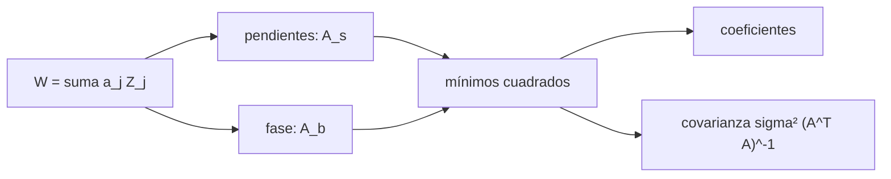

# B42-C13 — Medición de frente de onda

<!-- nav:top -->
[🏠 Programa](../../../../README.md) · [📚 Bloque B42](../../../tronco-comun/B42-optica-fisica-y-optica-adaptativa.md) · [← Anterior: B42-C12 — Parámetro de Fried](../B42-C12-parametro-de-fried/CLASE.md) · [Siguiente: B42-C14 — Sensores Shack-Hartmann →](../B42-C14-sensores-shack-hartmann/CLASE.md)
<!-- /nav -->

## 1. Ubicación, nivel y alcance

Clase 13 del bloque B42. Nivel N3. Medir un frente de onda es estimar la fase en la pupila. Comparas dos vías: **pendientes** (tipo Hartmann) y **fase interferométrica** (C09), ambas ajustadas a modos de Zernike, y propagas el ruido. Usas [B42](../../../tronco-comun/B42-optica-fisica-y-optica-adaptativa.md) (C09, C12) y [B10](../../../tronco-comun/B10-algebra-lineal-y-matematicas-geometricas.md) (mínimos cuadrados).

## 2. Por qué esta clase existe

La óptica adaptativa solo corrige lo que mide. La decisión central: **¿qué se mide (pendientes o fase), cuántos modos se ajustan y cuánto ruido llega a los coeficientes?**

## 3. Lo que podrás hacer al terminar

1. Escribir `W = Σ aⱼ Zⱼ` con Zernike normalizados.
2. Construir la matriz de diseño de pendientes y de fase.
3. Resolver los coeficientes por mínimos cuadrados.
4. Predecir la covarianza `σ²(AᵀA)⁻¹`.
5. Contrastarla con Monte Carlo.
6. Reconocer los límites de un ajuste modal truncado.

La evidencia es la **ficha de la medición de frente de onda** del ejercicio 12 (sección 20).

## 4. Con qué llegas y cómo comprobarlo

1. ¿Qué es una incertidumbre?
2. ¿Qué es una simulación Monte Carlo?
3. ¿Qué es una tabla de resultados?
4. ¿Qué es un valor ilustrativo?
5. ¿Qué es una verificación?

<details>
<summary>Ver respuestas</summary>

1. Un intervalo en que se espera el valor verdadero. 2. Repetir con números aleatorios de semilla fija. 3. Un resumen ordenado de cálculos. 4. Un valor propuesto para el ejemplo, no medido. 5. Comparar un cálculo con un caso independiente.
</details>

Con cuatro o cinco aciertos, sigue; si no, repasa los prerrequisitos.

## 5. Un caso de contexto y casos de referencia

Con 8 modos (coeficientes de `−20` a `+60 nm`, rms total `81,351 nm`, ilustrativos) y 448 puntos de pupila, ambas vías recuperan los coeficientes a `10⁻¹¹ nm` sin ruido; con ruido, la dispersión de cada coeficiente coincide con la previsión dentro de 12 %. Es el **ejemplo conductor**.

## 6. Vocabulario

El **frente de onda** `W(x,y)`. Los **modos de Zernike** (base ortonormal en el disco). La **matriz de diseño** `A`. El **sensor de pendientes** y el de **fase**. La **covarianza** de los coeficientes `σ²(AᵀA)⁻¹`. El **error de truncado**.

## 7. Modelo mental: ajustar una curva a puntos con ruido

Como ajustar una curva a puntos ruidosos: la forma elegida (los modos) limita lo que se puede describir y el ruido limita cuán bien se fijan los coeficientes.



*Descripción textual:* dos sensores distintos miden el mismo frente; el ajuste modal y su covarianza dependen de la matriz de diseño.

Analogía: ajustar una curva a puntos con ruido. Límite: modos conocidos y ruido blanco.

## 8. La explicación, paso a paso

### 8.1 Sin ruido

Hay `448` puntos en la pupila (malla de 24 × 24). La ortonormalidad numérica de los 8 modos se desvía como máximo `0,048` de la identidad por la malla finita. Sin ruido el error máximo es `1,15 × 10⁻¹¹ nm` (pendientes) y `7,1 × 10⁻¹⁵ nm` (fase).

### 8.2 Con ruido

Ruido de pendiente `1 nm` por unidad de radio y de fase `0,005 rad` a 633 nm (`0,5037 nm` por punto). Dispersión (nm) tras 400 repeticiones:

| modo | pendientes MC | pendientes teoría | fase MC | fase teoría |
|---|---|---|---|---|
| inclinación x | 0,0256 | 0,0254 | 0,0248 | 0,0239 |
| desenfoque | 0,0111 | 0,0118 | 0,0240 | 0,0241 |
| astigmatismo 0 | 0,0128 | 0,0137 | 0,0239 | 0,0237 |
| coma x | 0,0069 | 0,0069 | 0,0246 | 0,0242 |
| esférica | 0,0053 | 0,0054 | 0,0250 | 0,0244 |

El error total del frente reconstruido con 8 modos es `0,044 nm` (pendientes) y `0,068 nm` (fase).

### 8.3 Lectura

Las pendientes miden mejor los modos de orden alto (coma, esférica) porque las derivadas los realzan; la fase propaga ruido casi igual a todos los modos. Un resumen de arXiv reporta que, frente al ruido de fotones, un sensor de contraste de fase de Zernike es el más sensible y el Shack-Hartmann bastante menos (solo del resumen); este laboratorio no compara esos sensores.

## 9. Magnitudes, símbolos y unidades

| Símbolo | Qué es | Unidad | Valor / nota |
|---|---|---|---|
| `aⱼ` | coeficientes de Zernike | nm | 30, −20, 60, … |
| `A` | matriz de diseño | — | 448 × 8 (fase), 896 × 8 (pendientes) |
| `σ_s` | ruido de pendiente | nm/R | 1 (ilustrativo) |
| `σ_w` | ruido de fase | nm | 0,5037 |

## 10. Convenciones y referencias

Zernike de Noll con rms unitario; pendientes por diferencias centradas; `λ = 633 nm`; semilla 20261109.

## 11. De dónde sale lo que afirmamos

| ID | Fuente | Localizador | Respalda | Estado |
|---|---|---|---|---|
| S1 | Guyon, *Limits of Adaptive Optics for high contrast imaging* | https://arxiv.org/abs/astro-ph/0505086 | el sensor de contraste de fase de Zernike es el más sensible al ruido de fotones y el Shack-Hartmann bastante menos; el contraste límite por escintilación cromática en un telescopio de 8 m es del orden de 1e-4 a 1e-5 (solo del resumen) | Solo resumen, consultado el 2026-11-09 |
| S2 | Polinomios de Zernike con normalización de Noll | — | las fórmulas de los modos, escritas de memoria y verificadas en la ejecución | No consultado |

Límites: de Guyon solo se leyó el resumen; no se comparan sensores en el laboratorio.

## 12. Cómo ver los coeficientes y su incertidumbre

| Magnitud | Valor |
|---|---|
| puntos de pupila | 448 |
| error sin ruido (pendientes) | 1,15 × 10⁻¹¹ nm |
| σ del desenfoque (pendientes) | 0,0111 nm |
| error total (fase) | 0,068 nm |

Descripción larga: el Monte Carlo coincide con la teoría a menos del 12 %.

## 13. Ejemplo trabajado: el ruido de un coeficiente

**Paso 1 · Fórmula.** `σ_a = σ √[(AᵀA)⁻¹]ᵢᵢ`.

**Paso 2 · Ruido de fase.** `σ_w = 0,005 × 633/(2π) = 0,5037 nm`.

**Paso 3 · Cuenta.** Con `[(AᵀA)⁻¹]ᵢᵢ ≈ 1/448` por modo ortonormal: `0,5037/√448 = 0,0238 nm`.

**Paso 4 · Lectura.** Coincide con 0,0239–0,0244 de la tabla.

## 14. Distintas formas de describir el resultado

**Por modos:** `W = Σ aZ`. **Por matriz:** `A`. **Por tabla:** MC frente a teoría. **Por código:** `frente_de_onda.py`.

## 15. Práctica guiada

**Ejercicio 1 · con los pasos indicados.** `σ_w` con `0,005 rad`, 633 nm. *Pasos:* ejemplo 13.

<details><summary>Solución comentada</summary>

0,5037 nm.
</details>

**Ejercicio 2 · con una pista.** `σ_a` por fase para 448 puntos.

<details><summary>Solución comentada</summary>

`σ_w/√448 = 0,0238 nm`.
</details>

**Ejercicio 3 · casi autónomo.** rms total de los coeficientes.

<details><summary>Solución comentada</summary>

`√6618 = 81,35 nm`.
</details>

## 16. Práctica autónoma, transferencia e integrador

**Ejercicio 4.** Fase en radianes equivalente a 80 nm a 633 nm.

<details><summary>Solución comentada</summary>

0,794 rad.
</details>

**Ejercicio 5.** Cociente `σ_a` MC/teoría del coma y.

<details><summary>Solución comentada</summary>

~1,0.
</details>

**Ejercicio 6.** Puntos de pupila para malla 24×24 en disco.

<details><summary>Solución comentada</summary>

448.
</details>

**Ejercicio 7.** ¿Por qué los modos altos se miden mejor con pendientes?

<details><summary>Solución comentada</summary>

Derivar realza las frecuencias altas.
</details>

**Ejercicio 8.** Error total de la vía de fase (nm).

<details><summary>Solución comentada</summary>

0,068.
</details>

**Ejercicio 9 · transferencia.** **Transferencia.** ¿Qué pasa si se ajustan 3 modos pero el frente tiene 8?

<details><summary>Solución comentada</summary>

El resto es error de truncado.
</details>

**Ejercicio 10 · transferencia.** **Transferencia.** Un compañero dice que la vía de pendientes es siempre mejor. Responde.

<details><summary>Solución comentada</summary>

Depende del modo y del ruido de cada sensor.
</details>

**Ejercicio 11 · transferencia.** **Transferencia.** ¿Qué limita la precisión real de un interferómetro en el cielo?

<details><summary>Solución comentada</summary>

La luz de las estrellas es débil y el ruido de fotones domina.
</details>

**Ejercicio 12.** **Integrador.** Elabora tu *ficha de la medición de frente de onda*: método, coeficientes y ruido.

<details><summary>Solución comentada</summary>

Secciones 8.1–8.3.
</details>

**Ejercicio 12 · integrador.** **Integrador.** Elabora tu *ficha de la medición de frente de onda*: método, coeficientes y ruido.

<details><summary>Solución modelo</summary>

Secciones 8.1–8.3.
</details>

## 17. Laboratorio: pendientes frente a fase

El script [frente_de_onda.py](frente_de_onda.py) recupera 8 coeficientes de Zernike por dos vías y contrasta la covarianza con Monte Carlo (**comprueba** a `10⁻³ nm` y a 12 %).

**Datos:** sin datos reales; coeficientes y ruido ilustrativos. **Predice antes de ejecutar:** ¿qué vía propaga menos ruido? (depende del modo.) **Ejecución del 2026-11-09 (Python 3.12.9):**

```text
Python 3.12.9 (biblioteca estandar)
puntos en la pupila = 448 ; maxima desviacion de la ortonormalidad (malla 24x24) = 0.048
sin ruido: error maximo via pendientes = 1.15e-11 nm ; via fase = 7.11e-15 nm
rms del frente de onda verdadero = 81.351 nm (suma cuadratica de los 8 coeficientes)
ruido de fase 0,005 rad a 633 nm = 0.5037 nm de frente de onda por punto
modo               sigma A MC sigma A teo sigma B MC sigma B teo
inclinacion x          0.0256      0.0254     0.0248      0.0239
inclinacion y          0.0271      0.0254     0.0227      0.0239
desenfoque             0.0111      0.0118     0.0240      0.0241
astigmatismo 45        0.0138      0.0137     0.0232      0.0244
astigmatismo 0         0.0128      0.0137     0.0239      0.0237
coma y                 0.0071      0.0069     0.0227      0.0242
coma x                 0.0069      0.0069     0.0246      0.0242
esferica               0.0053      0.0054     0.0250      0.0244
error total del frente de onda reconstruido (rms, 8 modos): via pendientes = 0.044 nm ; via fase = 0.068 nm
Pruebas superadas.
```

```bash
python programa/clases/B42/B42-C13-medicion-de-frente-de-onda/frente_de_onda.py
```

**Límites:** ruido blanco independiente.

## 18. Errores frecuentes y cómo corregirlos

**Confundir fase con pendiente.** La pendiente es la derivada.

**Ajustar sin normalizar los modos.** Se usa Noll.

**Olvidar el truncado.** Ver ejercicio 9.

**Creer que más modos siempre mejora.** Amplifica ruido.

## 19. Cómo sabrás que vas bien

Tras la sección 8: ¿qué resultado esperabas y cuál obtuviste? Si dudas, repasa el ejemplo 13. Tras el laboratorio: ¿qué comprueba? (ver la sección 17).

## 20. Qué entregas y cómo se evalúa

El producto es tu **ficha de la medición de frente de onda** (ejercicio 12).

| Criterio | Inicial | En desarrollo | Logrado | Destacado |
|---|---|---|---|---|
| Conceptos | Los confunde | Parciales | conceptos de la clase | Explica los límites |
| Cálculo | Sin unidades | Con errores | Tablas completas | Calcula casos nuevos |
| Numérico | Sin comprobar | Un caso | Contraste con el análisis | Interpreta las diferencias |
| Fuentes | Sin fuente | Sin fecha | fuentes con fecha | Declara lo ilustrativo |
| Límites | No los nombra | Uno | Tres | Discute qué falta del modelo |

**Condiciones críticas (no se compensan con promedio):** rotular coeficientes y ruido como ilustrativos; citar solo el resumen de Guyon.

## 21. Ética, seguridad y límites

Clase educativa: los modelos son simplificados. Accesibilidad: tablas equivalentes a las gráficas, fórmulas en texto, ejercicios sin conexión.

## 22. Para cerrar y seguir

Dos vías de medición recuperan 8 modos y el Monte Carlo reproduce la covarianza a 12 %. Falta ver cómo se miden las pendientes en la práctica.

**Glosario español–inglés.** frente de onda · *wavefront*; modos de Zernike · *Zernike modes*; sensor de pendientes · *slope sensor*; covarianza · *covariance*; truncado · *truncation*.

**Continuidad.** [B42-C14](../B42-C14-sensores-shack-hartmann/CLASE.md) estudia los sensores Shack-Hartmann.

**Referencias:** ver sección 11.

<!-- nav:bottom -->
---

[← Anterior: B42-C12 — Parámetro de Fried](../B42-C12-parametro-de-fried/CLASE.md) · [📚 Bloque B42](../../../tronco-comun/B42-optica-fisica-y-optica-adaptativa.md) · [Siguiente: B42-C14 — Sensores Shack-Hartmann →](../B42-C14-sensores-shack-hartmann/CLASE.md)
<!-- /nav -->
