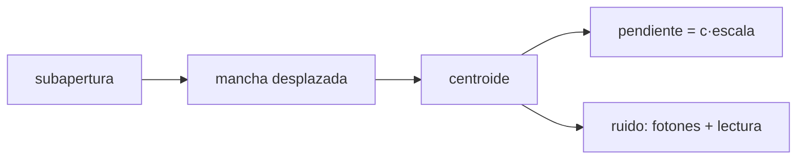

# B42-C14 — Sensores Shack-Hartmann

<!-- nav:top -->
[🏠 Programa](../../../../README.md) · [📚 Bloque B42](../../../tronco-comun/B42-optica-fisica-y-optica-adaptativa.md) · [← Anterior: B42-C13 — Medición de frente de onda](../B42-C13-medicion-de-frente-de-onda/CLASE.md) · [Siguiente: B42-C15 — Espejos deformables →](../B42-C15-espejos-deformables/CLASE.md)
<!-- /nav -->

## 1. Ubicación, nivel y alcance

Clase 14 del bloque B42. Nivel N3. Un sensor **Shack-Hartmann** divide la pupila en subaperturas; cada una forma una mancha cuyo desplazamiento mide la pendiente local del frente. Simulas el **centroide** con ruido de fotones y de lectura. Usas [B42](../../../tronco-comun/B42-optica-fisica-y-optica-adaptativa.md) (C13) y [B12](../../../tronco-comun/B12-probabilidad-estadistica-e-incertidumbre.md).

## 2. Por qué esta clase existe

El Shack-Hartmann es el sensor más usado en óptica adaptativa. La decisión central: **¿cuántos fotones hacen falta por subapertura para que el centroide sea preciso?**

## 3. Lo que podrás hacer al terminar

1. Estimar el centroide `Σ x I/Σ I`.
2. Comprobar la linealidad con el desplazamiento.
3. Predecir `σ_c² = (σ²+1/12)/N + σ_r²Σ(x−c)²/N²`.
4. Contrastarla con Monte Carlo.
5. Convertir píxeles en pendiente y camino óptico.
6. Reconocer la saturación de la ventana.

La evidencia es la **ficha del sensor Shack-Hartmann** del ejercicio 12 (sección 20).

## 4. Con qué llegas y cómo comprobarlo

1. ¿Qué es una incertidumbre?
2. ¿Qué es una simulación Monte Carlo?
3. ¿Qué es una tabla de resultados?
4. ¿Qué es un valor ilustrativo?
5. ¿Qué es una verificación?

<details>
<summary>Ver respuestas</summary>

1. Un intervalo en que se espera el valor verdadero. 2. Repetir con números aleatorios de semilla fija. 3. Un resumen ordenado de cálculos. 4. Un valor propuesto para el ejemplo, no medido. 5. Comparar un cálculo con un caso independiente.
</details>

Con cuatro o cinco aciertos, sigue; si no, repasa los prerrequisitos.

## 5. Un caso de contexto y casos de referencia

Con mancha gaussiana de `σ = 0,85 px`, ventana de 8 × 8 y lectura de 3 e⁻ (ilustrativos) 400 fotones dan un centroide con `0,1461 px` (previsto `0,1446`); un centroide de `0,05 px` es `24,24 nm` de camino óptico en una subapertura de `0,2 m`. Es el **ejemplo conductor**.

## 6. Vocabulario

La **subapertura**. El **centroide**. El **ruido de fotones** y el **de lectura**. La **ventana**. La **ganancia** del centroide. La **cuantización de Sheppard** `1/12` px².

## 7. Modelo mental: una cámara por cada trozo de pupila

Como muchas cámaras pequeñas, cada una mirando un trozo del frente: si el trozo está inclinado, la imagen se corre.



*Descripción textual:* el desplazamiento de la mancha mide la pendiente; los fotones y la lectura fijan su incertidumbre.

Analogía: una cámara por cada trozo de pupila. Límite: mancha gaussiana, sin fondo de cielo.

## 8. La explicación, paso a paso

### 8.1 Linealidad

| desplazamiento (px) | centroide (px) | ganancia |
|---|---|---|
| 0,10 | 0,1002 | 1,0020 |
| 0,50 | 0,5003 | 1,0006 |
| 1,00 | 1,0016 | 1,0016 |
| 2,00 | 1,9792 | 0,9896 |
| 3,00 | 2,7802 | 0,9267 |

La ganancia es 1 hasta 1 px; a 3 px la ventana recorta la mancha y comprime la respuesta.

### 8.2 Ruido

| `N` | `σ_r` | `σ` MC (px) | `σ` teoría (px) | cociente |
|---|---|---|---|---|
| 100 | 0 | 0,0898 | 0,0898 | 1,000 |
| 400 | 0 | 0,0438 | 0,0449 | 0,976 |
| 1600 | 0 | 0,0223 | 0,0224 | 0,992 |
| 400 | 3 | 0,1461 | 0,1446 | 1,011 |
| 1600 | 3 | 0,0405 | 0,0410 | 0,986 |

### 8.3 Lectura

Con `0,5 arcsec/px` un centroide de `0,05 px` es `0,025 arcsec = 1,212 × 10⁻⁷ rad` de pendiente y, sobre `0,2 m`, `24,24 nm` de camino óptico. A 400 fotones el ruido de lectura (`0,1375 px`) domina sobre el de fotones (`0,0449 px`).

## 9. Magnitudes, símbolos y unidades

| Símbolo | Qué es | Unidad | Valor / nota |
|---|---|---|---|
| `σ` | radio de la mancha | px | 0,85 |
| `N` | fotones | — | 100 a 1600 |
| `σ_r` | lectura | e⁻ | 3 |
| `d` | subapertura | m | 0,20 |

## 10. Convenciones y referencias

Ventana de 8 × 8 px; escala 0,5 arcsec/px; centroide sin umbral ni ponderación; 1 arcsec = 1/206 264,806 rad.

## 11. De dónde sale lo que afirmamos

| ID | Fuente | Localizador | Respalda | Estado |
|---|---|---|---|---|
| S1 | Guyon, *Limits of Adaptive Optics for high contrast imaging* | https://arxiv.org/abs/astro-ph/0505086 | el sensor de contraste de fase de Zernike es el más sensible al ruido de fotones y el Shack-Hartmann bastante menos; el contraste límite por escintilación cromática en un telescopio de 8 m es del orden de 1e-4 a 1e-5 (solo del resumen) | Solo resumen, consultado el 2026-11-09 |
| S2 | Principio del sensor Shack-Hartmann | — | formación de manchas y centroide | No consultado |

Límites: de Guyon solo se leyó el resumen (el Shack-Hartmann es menos sensible al ruido de fotones que el sensor de Zernike); no se reproduce esa comparación.

## 12. Cómo ver el ruido del centroide

| Magnitud | Valor |
|---|---|
| σ con 400 fotones, lectura 3 | 0,1461 px |
| teoría | 0,1446 px |
| ganancia a 3 px | 0,9267 |
| camino óptico de 0,05 px | 24,24 nm |

Descripción larga: la teoría de primer orden y el Monte Carlo coinciden a 3 %.

## 13. Ejemplo trabajado: σ del centroide con 400 fotones

**Paso 1 · Fotones.** `(0,85² + 1/12)/400 = 0,8058/400 = 0,002014`.

**Paso 2 · Lectura.** `3² × 336/400² = 0,01890`.

**Paso 3 · Suma.** `0,002014 + 0,01890 = 0,02092`.

**Paso 4 · Raíz.** `0,1446 px`.

## 14. Distintas formas de describir el resultado

**Por simulación:** Monte Carlo. **Por fórmula:** `σ_c`. **Por tabla:** 8.2. **Por código:** `shack_hartmann.py`.

## 15. Práctica guiada

**Ejercicio 1 · con los pasos indicados.** `σ` por fotones con `N = 1600`. *Pasos:* ejemplo 13.

<details><summary>Solución comentada</summary>

`√(0,8058/1600) = 0,0224 px`.
</details>

**Ejercicio 2 · con una pista.** Camino óptico de 0,05 px. *Pista:* ejemplo.

<details><summary>Solución comentada</summary>

24,24 nm.
</details>

**Ejercicio 3 · casi autónomo.** Pendiente en rad de 0,5 px a 0,5 arcsec/px.

<details><summary>Solución comentada</summary>

`1,21 × 10⁻⁶`.
</details>

## 16. Práctica autónoma, transferencia e integrador

**Ejercicio 4.** Fotones para `σ = 0,01 px` sin lectura.

<details><summary>Solución comentada</summary>

`0,8058/10⁻⁴ ≈ 8060`.
</details>

**Ejercicio 5.** Ganancia a 0,25 px.

<details><summary>Solución comentada</summary>

0,9925.
</details>

**Ejercicio 6.** `Σ(x−c)²` en 8 × 8.

<details><summary>Solución comentada</summary>

336.
</details>

**Ejercicio 7.** Ruido de lectura con `N = 1600`.

<details><summary>Solución comentada</summary>

`3 × 18,33/1600 = 0,0344 px`.
</details>

**Ejercicio 8.** ¿Cuál domina a 400 fotones?

<details><summary>Solución comentada</summary>

La lectura.
</details>

**Ejercicio 9 · transferencia.** **Transferencia.** ¿Por qué la ganancia cae a 3 px?

<details><summary>Solución comentada</summary>

Porque la ventana de 8 px recorta la mancha.
</details>

**Ejercicio 10 · transferencia.** **Transferencia.** Un compañero dice que más fotones siempre reducen el ruido como `1/√N`. Responde.

<details><summary>Solución comentada</summary>

El de fotones sí; el de lectura como `1/N`.
</details>

**Ejercicio 11 · transferencia.** **Transferencia.** ¿Qué hace un umbral?

<details><summary>Solución comentada</summary>

Reduce el aporte de píxeles de fondo pero introduce sesgo.
</details>

**Ejercicio 12.** **Integrador.** Elabora tu *ficha del sensor Shack-Hartmann*: linealidad, ruido y conversión.

<details><summary>Solución comentada</summary>

Secciones 8.1–8.3.
</details>

**Ejercicio 12 · integrador.** **Integrador.** Elabora tu *ficha del sensor Shack-Hartmann*: linealidad, ruido y conversión.

<details><summary>Solución modelo</summary>

Secciones 8.1–8.3.
</details>

## 17. Laboratorio: centroide con ruido

El script [shack_hartmann.py](shack_hartmann.py) mide linealidad y dispersión del centroide por Monte Carlo y la contrasta con la fórmula (**comprueba** a 8 % y ganancia a 2 %).

**Datos:** sin datos reales; mancha, lectura y escala ilustrativas. **Predice antes de ejecutar:** ¿cuál es el ruido con 400 fotones y lectura 3? (≈ 0,14 px.) **Ejecución del 2026-11-09 (Python 3.12.9):**

```text
Python 3.12.9 (biblioteca estandar)
 desplazamiento [px]  centroide [px]  ganancia
                0.10          0.1002    1.0020
                0.25          0.2481    0.9925
                0.50          0.5003    1.0006
                1.00          1.0016    1.0016
                2.00          1.9792    0.9896
                3.00          2.7802    0.9267
 N fotones  sigma lectura  sigma MC [px]  sigma teoria [px]  cociente
       100            0.0         0.0898             0.0898     1.000
       400            0.0         0.0438             0.0449     0.976
      1600            0.0         0.0223             0.0224     0.992
       400            3.0         0.1461             0.1446     1.011
      1600            3.0         0.0405             0.0410     0.986
un centroide de 0.05 px = 0.025 arcsec = 1.212e-07 rad de pendiente ; sobre 0.2 m eso es 24.24 nm de diferencia de camino entre bordes de la subapertura
Pruebas superadas.
```

```bash
python programa/clases/B42/B42-C14-sensores-shack-hartmann/shack_hartmann.py
```

**Límites:** mancha gaussiana, sin fondo.

## 18. Errores frecuentes y cómo corregirlos

**Olvidar el 1/12.** Ver el ejemplo 13.

**Sumar desviaciones en vez de varianzas.** Se suman varianzas.

**Creer que la ganancia es 1 siempre.** Ver 8.1.

**Confundir px con arcsec.** Se corrige con la escala.

## 19. Cómo sabrás que vas bien

Tras la sección 8: ¿qué resultado esperabas y cuál obtuviste? Si dudas, repasa el ejemplo 13. Tras el laboratorio: ¿qué comprueba? (ver la sección 17).

## 20. Qué entregas y cómo se evalúa

El producto es tu **ficha del sensor Shack-Hartmann** (ejercicio 12).

| Criterio | Inicial | En desarrollo | Logrado | Destacado |
|---|---|---|---|---|
| Conceptos | Los confunde | Parciales | conceptos de la clase | Explica los límites |
| Cálculo | Sin unidades | Con errores | Tablas completas | Calcula casos nuevos |
| Numérico | Sin comprobar | Un caso | Contraste con el análisis | Interpreta las diferencias |
| Fuentes | Sin fuente | Sin fecha | fuentes con fecha | Declara lo ilustrativo |
| Límites | No los nombra | Uno | Tres | Discute qué falta del modelo |

**Condiciones críticas (no se compensan con promedio):** rotular valores ilustrativos; no atribuir la comparación entre sensores a otra fuente que el resumen.

## 21. Ética, seguridad y límites

Clase educativa: los modelos son simplificados. Accesibilidad: tablas equivalentes a las gráficas, fórmulas en texto, ejercicios sin conexión.

## 22. Para cerrar y seguir

El centroide es lineal hasta 1 px y su ruido sigue la fórmula de primer orden; 0,05 px son 24 nm de camino. Falta el elemento que corrige.

**Glosario español–inglés.** sensor Shack-Hartmann · *Shack-Hartmann sensor*; subapertura · *subaperture*; centroide · *centroid*; ruido de lectura · *read noise*; ruido de fotones · *photon noise*.

**Continuidad.** [B42-C15](../B42-C15-espejos-deformables/CLASE.md) estudia los espejos deformables.

**Referencias:** ver sección 11.

<!-- nav:bottom -->
---

[← Anterior: B42-C13 — Medición de frente de onda](../B42-C13-medicion-de-frente-de-onda/CLASE.md) · [📚 Bloque B42](../../../tronco-comun/B42-optica-fisica-y-optica-adaptativa.md) · [Siguiente: B42-C15 — Espejos deformables →](../B42-C15-espejos-deformables/CLASE.md)
<!-- /nav -->
