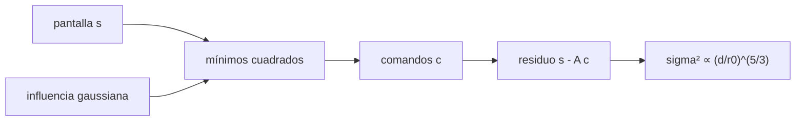

# B42-C15 — Espejos deformables

<!-- nav:top -->
[🏠 Programa](../../../../README.md) · [📚 Bloque B42](../../../tronco-comun/B42-optica-fisica-y-optica-adaptativa.md) · [← Anterior: B42-C14 — Sensores Shack-Hartmann](../B42-C14-sensores-shack-hartmann/CLASE.md) · [Siguiente: B42-C16 — Lazo de control de óptica adaptativa →](../B42-C16-lazo-de-control-de-optica-adaptativa/CLASE.md)
<!-- /nav -->

## 1. Ubicación, nivel y alcance

Clase 15 del bloque B42. Nivel N3. Un **espejo deformable** corrige el frente de onda con actuadores cuya forma de respuesta es la **función de influencia**. Ajustas pantallas de Kolmogorov con actuadores gaussianos y mides el **error de ajuste**. Usas [B42](../../../tronco-comun/B42-optica-fisica-y-optica-adaptativa.md) (C11, C12) y [B10](../../../tronco-comun/B10-algebra-lineal-y-matematicas-geometricas.md) (mínimos cuadrados).

## 2. Por qué esta clase existe

El número de actuadores fija el error de ajuste que ninguna medición mejora. La decisión central: **¿cuántos actuadores se necesitan para un `r₀` dado?**

## 3. Lo que podrás hacer al terminar

1. Construir el espejo como suma de influencias gaussianas.
2. Resolver el ajuste por mínimos cuadrados (FFT en red periódica).
3. Medir el residuo `σ²`.
4. Comprobar la ley `σ² ∝ (d/r₀)^{5/3}`.
5. Obtener el coeficiente `μ = σ²/(d/r₀)^{5/3}`.
6. Reconocer los límites de un modelo periódico.

La evidencia es la **ficha del espejo deformable** del ejercicio 12 (sección 20).

## 4. Con qué llegas y cómo comprobarlo

1. ¿Qué es una incertidumbre?
2. ¿Qué es una simulación Monte Carlo?
3. ¿Qué es una tabla de resultados?
4. ¿Qué es un valor ilustrativo?
5. ¿Qué es una verificación?

<details>
<summary>Ver respuestas</summary>

1. Un intervalo en que se espera el valor verdadero. 2. Repetir con números aleatorios de semilla fija. 3. Un resumen ordenado de cálculos. 4. Un valor propuesto para el ejemplo, no medido. 5. Comparar un cálculo con un caso independiente.
</details>

Con cuatro o cinco aciertos, sigue; si no, repasa los prerrequisitos.

## 5. Un caso de contexto y casos de referencia

Con `r₀ = 0,16 m` y pasos de 8, 16 y 32 cm (ilustrativos) el error de ajuste es `0,0747`, `0,2525` y `0,8356 rad²` (256, 64 y 16 actuadores); el cociente entre pasos consecutivos es `3,38` y `3,31` frente a `2^{5/3} = 3,17`. Es el **ejemplo conductor**.

## 6. Vocabulario

El **espejo deformable**. La **función de influencia**. El **paso** entre actuadores `d`. El **acoplamiento** (15 %). El **error de ajuste** `σ²_fit = μ (d/r₀)^{5/3}`. El **residuo normal** `Aᵀ(s−Ac) = 0`.

## 7. Modelo mental: una sábana sostenida por postes

Como una sábana sostenida por postes: con pocos postes no sigue los pliegues finos; con más, los sigue.



*Descripción textual:* se proyecta cada pantalla sobre las influencias de los actuadores; el residuo escala con el paso.

Analogía: una sábana sostenida por postes. Límite: red cuadrada periódica sin carrera limitada.

## 8. La explicación, paso a paso

### 8.1 Error de ajuste

La varianza de las 20 pantallas (sin piston) es `4,869 rad²`.

| paso (px) | paso (cm) | `d/r₀` | actuadores | `σ²` residual (rad²) | `μ` |
|---|---|---|---|---|---|
| 4 | 8 | 0,50 | 256 | 0,0747 | 0,2372 |
| 8 | 16 | 1,00 | 64 | 0,2525 | 0,2525 |
| 16 | 32 | 2,00 | 16 | 0,8356 | 0,2632 |

### 8.2 Escala

El cociente `σ²(16)/σ²(8)` es `3,310` y `σ²(8)/σ²(4)` es `3,379`; la ley predice `2^{5/3} = 3,175`. La condición `Aᵀ(s−Ac) = 0` se cumple a menos de `10⁻⁹` relativo.

### 8.3 Lectura

Doblar el paso (la mitad de actuadores por lado) multiplica el error de ajuste por 3,2–3,4. Con `d/r₀ = 0,5` el residuo es 1,5 % de la varianza de la pantalla (0,0747/4,869).

## 9. Magnitudes, símbolos y unidades

| Símbolo | Qué es | Unidad | Valor / nota |
|---|---|---|---|
| `d` | paso de actuadores | m | 0,08, 0,16, 0,32 |
| `r₀` | parámetro de Fried | m | 0,16 |
| `μ` | coeficiente de ajuste | — | 0,24 a 0,26 |
| `σ²` | varianza residual | rad² | ver 8.1 |

## 10. Convenciones y referencias

Influencia gaussiana con 15 % de acoplamiento; red periódica 64 × 64; piston descartado.

## 11. De dónde sale lo que afirmamos

| ID | Fuente | Localizador | Respalda | Estado |
|---|---|---|---|---|
| — | Error de ajuste de espejos deformables (libros y revisiones) | — | la ley `σ² ∝ (d/r₀)^{5/3}` | No consultado |

Límites: no se consultó una fuente; la ley se verifica por simulación con pantallas sintéticas.

## 12. Cómo ver el error de ajuste

| Magnitud | Valor |
|---|---|
| `σ²` (8 cm) | 0,0747 rad² |
| `σ²` (16 cm) | 0,2525 rad² |
| `σ²` (32 cm) | 0,8356 rad² |
| cociente | 3,31–3,38 |

Descripción larga: el error crece con una potencia 5/3 del paso, con un coeficiente aproximado `μ ≈ 0,25`.

## 13. Ejemplo trabajado: el error con d = 16 cm

**Paso 1 · Razón.** `d/r₀ = 0,16/0,16 = 1`.

**Paso 2 · Ley.** `σ² = μ (d/r₀)^{5/3} = μ`.

**Paso 3 · Valor.** `μ = 0,2525` (simulación).

**Paso 4 · Lectura.** `σ = 0,50 rad`: Strehl `exp(−0,2525) = 0,777`.

## 14. Distintas formas de describir el resultado

**Por simulación:** residuo. **Por ley:** `(d/r₀)^{5/3}`. **Por tabla:** 8.1. **Por código:** `espejo_deformable.py`.

## 15. Práctica guiada

**Ejercicio 1 · con los pasos indicados.** `σ²` a `d/r₀ = 0,5`. *Pasos:* `0,2525 × 0,5^{5/3}`.

<details><summary>Solución comentada</summary>

0,0795 (simulación 0,0747).
</details>

**Ejercicio 2 · con una pista.** Strehl con `σ² = 0,0747`.

<details><summary>Solución comentada</summary>

0,928.
</details>

**Ejercicio 3 · casi autónomo.** Cociente esperado al duplicar el paso.

<details><summary>Solución comentada</summary>

3,175.
</details>

## 16. Práctica autónoma, transferencia e integrador

**Ejercicio 4.** Actuadores de 64 × 64 con paso 8.

<details><summary>Solución comentada</summary>

64.
</details>

**Ejercicio 5.** Número de actuadores para paso de 4 px.

<details><summary>Solución comentada</summary>

256.
</details>

**Ejercicio 6.** `μ` medio.

<details><summary>Solución comentada</summary>

~0,25.
</details>

**Ejercicio 7.** `σ` en nm a 500 nm con `σ² = 0,2525`.

<details><summary>Solución comentada</summary>

`0,5025 × 500/(2π) = 40 nm`.
</details>

**Ejercicio 8.** ¿Por qué el error de ajuste no depende del sensor?

<details><summary>Solución comentada</summary>

Es la parte de la fase que el espejo no puede representar.
</details>

**Ejercicio 9 · transferencia.** **Transferencia.** ¿Cuántos actuadores necesita un espejo de 8 m para `d = r₀` con `r₀ = 0,8 m`?

<details><summary>Solución comentada</summary>

10 por lado (≈ 100).
</details>

**Ejercicio 10 · transferencia.** **Transferencia.** Un compañero dice que más actuadores siempre mejoran. Responde.

<details><summary>Solución comentada</summary>

También aumentan el ruido y el costo; hay un óptimo.
</details>

**Ejercicio 11 · transferencia.** **Transferencia.** ¿Qué cambia con 30 % de acoplamiento?

<details><summary>Solución comentada</summary>

Cambia la forma de la influencia y el ajuste.
</details>

**Ejercicio 12.** **Integrador.** Elabora tu *ficha del espejo deformable*: paso, error de ajuste y escala.

<details><summary>Solución comentada</summary>

Secciones 8.1–8.3.
</details>

**Ejercicio 12 · integrador.** **Integrador.** Elabora tu *ficha del espejo deformable*: paso, error de ajuste y escala.

<details><summary>Solución modelo</summary>

Secciones 8.1–8.3.
</details>

## 17. Laboratorio: ajuste de pantallas por actuadores gaussianos

El script [espejo_deformable.py](espejo_deformable.py) ajusta pantallas a 3 pasos y compara los cocientes con `2^{5/3}` (**comprueba** el residuo normal a `10⁻⁹` y los cocientes a 25 %).

**Datos:** sin datos reales; `r₀`, pasos y acoplamiento ilustrativos. **Predice antes de ejecutar:** ¿cómo escala el error con el paso? (≈ ×3,2 al duplicar.) **Ejecución del 2026-11-09 (Python 3.12.9):**

```text
Python 3.12.9 (biblioteca estandar)
pantallas = 20 ; r0 = 0.16 m = 8.0 px
varianza de la pantalla (sin piston, malla periodica) = 4.869 rad^2
paso [px] paso [cm]   d/r0 actuadores  sigma^2 residual   mu = s2/(d/r0)^(5/3)
        4         8   0.50        256            0.0747                 0.2372
        8        16   1.00         64            0.2525                 0.2525
       16        32   2.00         16            0.8356                 0.2632
cociente de varianzas residuales paso 8/paso 4 = 3.379 ; 2^(5/3) = 3.175
cociente de varianzas residuales paso 16/paso 8 = 3.310 ; 2^(5/3) = 3.175
Pruebas superadas.
```

```bash
python programa/clases/B42/B42-C15-espejos-deformables/espejo_deformable.py
```

**Límites:** red periódica, sin carrera limitada.

## 18. Errores frecuentes y cómo corregirlos

**Confundir paso con número de actuadores.** Ver 8.1.

**Olvidar el piston.** No se corrige.

**Aplicar la ley a pasos mayores que `L`.** Fuera de rango.

**Atribuir `μ` a un espejo real.** Es de este modelo.

## 19. Cómo sabrás que vas bien

Tras la sección 8: ¿qué resultado esperabas y cuál obtuviste? Si dudas, repasa el ejemplo 13. Tras el laboratorio: ¿qué comprueba? (ver la sección 17).

## 20. Qué entregas y cómo se evalúa

El producto es tu **ficha del espejo deformable** (ejercicio 12).

| Criterio | Inicial | En desarrollo | Logrado | Destacado |
|---|---|---|---|---|
| Conceptos | Los confunde | Parciales | conceptos de la clase | Explica los límites |
| Cálculo | Sin unidades | Con errores | Tablas completas | Calcula casos nuevos |
| Numérico | Sin comprobar | Un caso | Contraste con el análisis | Interpreta las diferencias |
| Fuentes | Sin fuente | Sin fecha | fuentes con fecha | Declara lo ilustrativo |
| Límites | No los nombra | Uno | Tres | Discute qué falta del modelo |

**Condiciones críticas (no se compensan con promedio):** rotular el modelo como sintético; no atribuir `μ` a ningún espejo.

## 21. Ética, seguridad y límites

Clase educativa: los modelos son simplificados. Accesibilidad: tablas equivalentes a las gráficas, fórmulas en texto, ejercicios sin conexión.

## 22. Para cerrar y seguir

El error de ajuste escala como `(d/r₀)^{5/3}` con `μ ≈ 0,25`. Falta cerrar el lazo en el tiempo.

**Glosario español–inglés.** espejo deformable · *deformable mirror*; función de influencia · *influence function*; actuador · *actuator*; error de ajuste · *fitting error*; acoplamiento · *coupling*.

**Continuidad.** [B42-C16](../B42-C16-lazo-de-control-de-optica-adaptativa/CLASE.md) estudia el lazo de control.

**Referencias:** ver sección 11.

<!-- nav:bottom -->
---

[← Anterior: B42-C14 — Sensores Shack-Hartmann](../B42-C14-sensores-shack-hartmann/CLASE.md) · [📚 Bloque B42](../../../tronco-comun/B42-optica-fisica-y-optica-adaptativa.md) · [Siguiente: B42-C16 — Lazo de control de óptica adaptativa →](../B42-C16-lazo-de-control-de-optica-adaptativa/CLASE.md)
<!-- /nav -->
