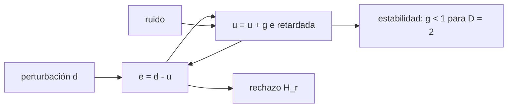

# B42-C16 — Lazo de control de óptica adaptativa

<!-- nav:top -->
[🏠 Programa](../../../../README.md) · [📚 Bloque B42](../../../tronco-comun/B42-optica-fisica-y-optica-adaptativa.md) · [← Anterior: B42-C15 — Espejos deformables](../B42-C15-espejos-deformables/CLASE.md) · [Siguiente: B42-C17 — Estrellas guía artificiales →](../B42-C17-estrellas-guia-artificiales/CLASE.md)
<!-- /nav -->

## 1. Ubicación, nivel y alcance

Clase 16 del bloque B42. Nivel N3. El lazo de óptica adaptativa mide, calcula y corrige con retardo. Modelas un **integrador discreto con retardo de 2 tramas**, calculas el rechazo de perturbaciones, la propagación de ruido y la estabilidad. Usas [B42](../../../tronco-comun/B42-optica-fisica-y-optica-adaptativa.md) (C15) y [B15](../../../tronco-comun/B15-senales-imagenes-y-estimacion-cientifica.md) (señales discretas).

## 2. Por qué esta clase existe

El lazo decide qué tan rápido es el rechazo y cuánto ruido se amplifica. La decisión central: **¿qué ganancia da el mejor compromiso entre rechazo, ruido y estabilidad con retardo?**

## 3. Lo que podrás hacer al terminar

1. Escribir `H_r(z) = (1−z⁻¹)/(1−z⁻¹+g z⁻ᴰ)`.
2. Medir el rechazo senoidal por simulación.
3. Hallar el ancho de banda de 0 dB.
4. Calcular la propagación de ruido por integral y por simulación.
5. Verificar `g/(2−g)` para `D = 1`.
6. Determinar el límite de estabilidad de `D = 2`.

La evidencia es la **ficha del lazo de control** del ejercicio 12 (sección 20).

## 4. Con qué llegas y cómo comprobarlo

1. ¿Qué es una incertidumbre?
2. ¿Qué es una simulación Monte Carlo?
3. ¿Qué es una tabla de resultados?
4. ¿Qué es un valor ilustrativo?
5. ¿Qué es una verificación?

<details>
<summary>Ver respuestas</summary>

1. Un intervalo en que se espera el valor verdadero. 2. Repetir con números aleatorios de semilla fija. 3. Un resumen ordenado de cálculos. 4. Un valor propuesto para el ejemplo, no medido. 5. Comparar un cálculo con un caso independiente.
</details>

Con cuatro o cinco aciertos, sigue; si no, repasa los prerrequisitos.

## 5. Un caso de contexto y casos de referencia

Con 1 kHz, retardo de 2 tramas y `g = 0,5` (ilustrativos) el rechazo a 5 Hz es `0,06289`, el ancho de banda de 0 dB es `67,5 Hz` con pico `2,197` y el ruido de medición sale con varianza `0,60019` (`0,60000` por integral). Es el **ejemplo conductor**.

## 6. Vocabulario

El **integrador** `u[n] = u[n−1] + g e[n−D]`. El **retardo** `D`. La **función de rechazo** `H_r` y la de **ruido** `H_n`. El **ancho de banda de rechazo** (0 dB). La **ganancia de lazo** `g`. El **margen de estabilidad**.

## 7. Modelo mental: regular la ducha con retardo

Como regular una ducha con agua que tarda en llegar: si giras la llave muy rápido, oscilas; muy lento, no sigues la temperatura.



*Descripción textual:* un integrador con retardo rechaza perturbaciones lentas, amplifica las rápidas y es estable solo bajo cierta ganancia.

Analogía: regular la ducha con retardo. Límite: un modo, sistema lineal.

## 8. La explicación, paso a paso

### 8.1 Rechazo

Amplitud residual simulada (igual a `|H_r|` analítico a `10⁻⁵`):

| `g` | 5 Hz | 20 Hz | 50 Hz | 100 Hz |
|---|---|---|---|---|
| 0,3 | 0,10466 | 0,41481 | 0,97646 | 1,49036 |
| 0,5 | 0,06289 | 0,25515 | 0,68959 | 1,70130 |
| 0,9 | 0,03494 | 0,14188 | 0,38741 | 1,14379 |

| `g` | ancho de banda 0 dB (Hz) | pico de la función de rechazo |
|---|---|---|
| 0,3 | 51,5 | 1,527 |
| 0,5 | 67,5 | 2,197 |
| 0,9 | 93,9 | 11,448 |

### 8.2 Ruido y estabilidad

La varianza de salida por simulación frente a `(1/π)∫|H_n|²`: `g = 0,3`: `0,24034` / `0,24224`; `g = 0,5`: `0,60019` / `0,60000`; `g = 0,9`: `5,86925` / `5,89655`. Para `D = 1` y `g = 0,5` la integral es `0,333333 = g/(2−g)`. Estabilidad con `D = 2`: polos de módulo `0,9487` (`g = 0,9`), `0,9950` (`0,99`), `1,0247` (`1,05`) y `1,1402` (`1,3`); la simulación decae a `10⁻⁵⁵` para 0,9 y diverge a `10³⁰` para 1,05.

### 8.3 Lectura

Subir `g` rechaza mejor y amplía el ancho de banda, pero amplifica ruido (`0,24 → 5,87`) y el pico de sobreganancia (`1,5 → 11,4`). Con retardo de 2 tramas el límite es `g < 1`. Las revisiones de óptica adaptativa discuten estos compromisos; aquí solo se leyó el resumen de una de ellas.

## 9. Magnitudes, símbolos y unidades

| Símbolo | Qué es | Unidad | Valor / nota |
|---|---|---|---|
| `g` | ganancia | — | 0,3 / 0,5 / 0,9 |
| `D` | retardo | tramas | 2 |
| `f_s` | tasa | Hz | 1000 |
| `H_r` | función de rechazo | — | ver 8.1 |

## 10. Convenciones y referencias

Convenio `u[n] = u[n−1] + g e[n−D]`, `e = d − u`; el ruido entra en la medición; frecuencias de 5 a 100 Hz.

## 11. De dónde sale lo que afirmamos

| ID | Fuente | Localizador | Respalda | Estado |
|---|---|---|---|---|
| S1 | Davies y Kasper, *Adaptive Optics for Astronomy* | https://arxiv.org/abs/1201.5741 | la óptica adaptativa permite a telescopios en tierra alcanzar el límite de difracción (resumen; no se leyeron las cifras del cuerpo) | Solo resumen, consultado el 2026-11-09 |

Límites: de Davies y Kasper solo se leyó el resumen; las gráficas y cifras de la revisión no se consultaron.

## 12. Cómo ver el rechazo y el ruido

| Magnitud | Valor |
|---|---|
| rechazo a 5 Hz (g=0,5) | 0,06289 |
| ancho de banda 0 dB (g=0,5) | 67,5 Hz |
| varianza de ruido (g=0,5) | 0,60019 |
| límite de estabilidad (D=2) | g < 1 |

Descripción larga: el rechazo mejora con la ganancia, pero el pico de sobreganancia y el ruido empeoran.

## 13. Ejemplo trabajado: el límite de estabilidad

**Paso 1 · Polos.** `z² − z + g = 0`.

**Paso 2 · Con `g = 0,9`.** `z = (1 ± j√2,6)/2`; `|z|² = g = 0,9`.

**Paso 3 · Módulo.** `√0,9 = 0,9487`.

**Paso 4 · Lectura.** Estable si `g < 1` (`|z|² = g`).

## 14. Distintas formas de describir el resultado

**Por simulación:** `u[n]`. **Por transformada:** `H_r(z)`. **Por tabla:** 8.1. **Por código:** `lazo.py`.

## 15. Práctica guiada

**Ejercicio 1 · con los pasos indicados.** Módulo de los polos con `g = 0,5`. *Pasos:* ejemplo 13.

<details><summary>Solución comentada</summary>

`0,7071`.
</details>

**Ejercicio 2 · con una pista.** Ruido para `D=1`, `g = 0,3`.

<details><summary>Solución comentada</summary>

`0,3/1,7 = 0,1765`.
</details>

**Ejercicio 3 · casi autónomo.** `|H_r|` a 20 Hz y `g = 0,5`.

<details><summary>Solución comentada</summary>

0,25515.
</details>

## 16. Práctica autónoma, transferencia e integrador

**Ejercicio 4.** Ancho de banda aproximado con `g = 0,9`.

<details><summary>Solución comentada</summary>

93,9 Hz.
</details>

**Ejercicio 5.** Pico para `g = 0,3`.

<details><summary>Solución comentada</summary>

1,527.
</details>

**Ejercicio 6.** ¿Estable con `g = 0,99`?

<details><summary>Solución comentada</summary>

Sí: módulo 0,9950.
</details>

**Ejercicio 7.** ¿Estable con `g = 1,05`?

<details><summary>Solución comentada</summary>

No: módulo 1,0247.
</details>

**Ejercicio 8.** Relación entre `g` y ruido.

<details><summary>Solución comentada</summary>

Crece: 0,24 → 5,87.
</details>

**Ejercicio 9 · transferencia.** **Transferencia.** ¿Por qué un lazo más rápido tolera más ganancia?

<details><summary>Solución comentada</summary>

Porque el retardo en segundos es menor.
</details>

**Ejercicio 10 · transferencia.** **Transferencia.** Un compañero dice que subir `g` siempre mejora. Responde.

<details><summary>Solución comentada</summary>

Mejora el rechazo, pero aumenta el ruido y acerca la inestabilidad.
</details>

**Ejercicio 11 · transferencia.** **Transferencia.** ¿Qué hace un integrador con fugas?

<details><summary>Solución comentada</summary>

Limita el rechazo a baja frecuencia pero mejora la robustez.
</details>

**Ejercicio 12.** **Integrador.** Elabora tu *ficha del lazo de control*: `H_r`, ancho de banda, ruido y estabilidad.

<details><summary>Solución comentada</summary>

Secciones 8.1–8.3.
</details>

**Ejercicio 12 · integrador.** **Integrador.** Elabora tu *ficha del lazo de control*: `H_r`, ancho de banda, ruido y estabilidad.

<details><summary>Solución modelo</summary>

Secciones 8.1–8.3.
</details>

## 17. Laboratorio: integrador con retardo

El script [lazo.py](lazo.py) simula un integrador con retardo, mide rechazo y ruido y verifica estabilidad (**comprueba** a 1 % y 3 %).

**Datos:** sin datos reales; tasa, retardo y ganancias ilustrativos. **Predice antes de ejecutar:** ¿qué ganancia es estable con retardo 2? (g < 1.) **Ejecución del 2026-11-09 (Python 3.12.9):**

```text
Python 3.12.9 (biblioteca estandar)
   g  f [Hz]  |H_r| simulado  |H_r| analitico
 0.3     5.0         0.10466          0.10466
 0.3    20.0         0.41481          0.41481
 0.3    50.0         0.97646          0.97646
 0.3   100.0         1.49036          1.49036
 0.5     5.0         0.06289          0.06289
 0.5    20.0         0.25515          0.25515
 0.5    50.0         0.68959          0.68959
 0.5   100.0         1.70130          1.70130
 0.9     5.0         0.03494          0.03494
 0.9    20.0         0.14188          0.14188
 0.9    50.0         0.38741          0.38741
 0.9   100.0         1.14379          1.14379
   g  f_0dB [Hz]  ganancia de pico |H_r|
 0.3        51.5                   1.527
 0.5        67.5                   2.197
 0.9        93.9                  11.448
   g  var u simulada   (1/pi) int |H_n|^2
 0.3         0.24034              0.24224
 0.5         0.60019              0.60000
 0.9         5.86925              5.89655
D = 1, g = 0,5: integral = 0.333333 ; forma cerrada g/(2-g) = 0.333333
    g  max |z| polos  crecimiento simulado
 0.90         0.9487             1.386e-55
 0.99         0.9950             6.586e-06
 1.05         1.0247             5.705e+30
 1.30         1.1402            1.235e+165
Pruebas superadas.
```

```bash
python programa/clases/B42/B42-C16-lazo-de-control-de-optica-adaptativa/lazo.py
```

**Límites:** sistema lineal de un modo.

## 18. Errores frecuentes y cómo corregirlos

**Ignorar el retardo.** Cambia el límite a `g<1`.

**Confundir rechazo con ganancia.** Rechazo = 1/(1+ganancia de lazo).

**Olvidar el pico de sobreganancia.** Ver 8.1.

**Aplicar el resultado a un lazo real.** Aquí es un modelo.

## 19. Cómo sabrás que vas bien

Tras la sección 8: ¿qué resultado esperabas y cuál obtuviste? Si dudas, repasa el ejemplo 13. Tras el laboratorio: ¿qué comprueba? (ver la sección 17).

## 20. Qué entregas y cómo se evalúa

El producto es tu **ficha del lazo de control** (ejercicio 12).

| Criterio | Inicial | En desarrollo | Logrado | Destacado |
|---|---|---|---|---|
| Conceptos | Los confunde | Parciales | conceptos de la clase | Explica los límites |
| Cálculo | Sin unidades | Con errores | Tablas completas | Calcula casos nuevos |
| Numérico | Sin comprobar | Un caso | Contraste con el análisis | Interpreta las diferencias |
| Fuentes | Sin fuente | Sin fecha | fuentes con fecha | Declara lo ilustrativo |
| Límites | No los nombra | Uno | Tres | Discute qué falta del modelo |

**Condiciones críticas (no se compensan con promedio):** rotular el lazo como modelo; no atribuir cifras a ningún sistema.

## 21. Ética, seguridad y límites

Clase educativa: los modelos son simplificados. Accesibilidad: tablas equivalentes a las gráficas, fórmulas en texto, ejercicios sin conexión.

## 22. Para cerrar y seguir

Un integrador con retardo 2 es estable para `g < 1`; con `g = 0,5` el ancho de banda de rechazo es 67,5 Hz. Falta una referencia del frente de onda en el cielo.

**Glosario español–inglés.** lazo de control · *control loop*; integrador · *integrator*; ancho de banda de rechazo · *rejection bandwidth*; retardo · *latency*; ganancia · *gain*.

**Continuidad.** [B42-C17](../B42-C17-estrellas-guia-artificiales/CLASE.md) estudia las estrellas guía artificiales.

**Referencias:** ver sección 11.

<!-- nav:bottom -->
---

[← Anterior: B42-C15 — Espejos deformables](../B42-C15-espejos-deformables/CLASE.md) · [📚 Bloque B42](../../../tronco-comun/B42-optica-fisica-y-optica-adaptativa.md) · [Siguiente: B42-C17 — Estrellas guía artificiales →](../B42-C17-estrellas-guia-artificiales/CLASE.md)
<!-- /nav -->
