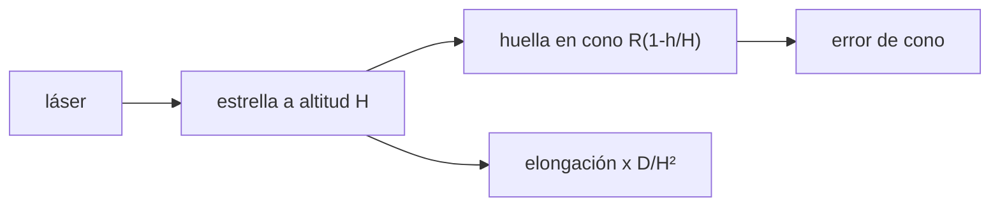

# B42-C17 — Estrellas guía artificiales

<!-- nav:top -->
[🏠 Programa](../../../../README.md) · [📚 Bloque B42](../../../tronco-comun/B42-optica-fisica-y-optica-adaptativa.md) · [← Anterior: B42-C16 — Lazo de control de óptica adaptativa](../B42-C16-lazo-de-control-de-optica-adaptativa/CLASE.md) · [Siguiente: B42-C18 — Óptica adaptativa multiconjugada →](../B42-C18-optica-adaptativa-multiconjugada/CLASE.md)
<!-- /nav -->

## 1. Ubicación, nivel y alcance

Clase 17 del bloque B42. Nivel N3. Una **estrella guía láser** crea una fuente puntual en la atmósfera cuando no hay una estrella natural. Calculas el **efecto cono** (error de anisoplanatismo focal) y la **elongación** de la mancha. Usas [B42](../../../tronco-comun/B42-optica-fisica-y-optica-adaptativa.md) (C12, C14). Esta clase trata solo la física; no es un procedimiento de operación láser.

## 2. Por qué esta clase existe

Sin estrella guía no hay corrección en casi todo el cielo. La decisión central: **¿a qué altitud conviene crear la estrella y qué error de cono y qué elongación trae?**

## 3. Lo que podrás hacer al terminar

1. Calcular el promedio sobre el disco `⟨ρ^{5/3}⟩ = 6/11`.
2. Calcular el error de cono para una capa y un perfil.
3. Comparar Rayleigh (10 km) y sodio (90 km).
4. Verificar el escalado con la apertura `R^{5/3}`.
5. Calcular la elongación `xΔ/H²`.
6. Reconocer los límites de un modelo sin quitar piston ni inclinación.

La evidencia es la **ficha de la estrella guía artificial** del ejercicio 12 (sección 20).

## 4. Con qué llegas y cómo comprobarlo

1. ¿Qué es una incertidumbre?
2. ¿Qué es una simulación Monte Carlo?
3. ¿Qué es una tabla de resultados?
4. ¿Qué es un valor ilustrativo?
5. ¿Qué es una verificación?

<details>
<summary>Ver respuestas</summary>

1. Un intervalo en que se espera el valor verdadero. 2. Repetir con números aleatorios de semilla fija. 3. Un resumen ordenado de cálculos. 4. Un valor propuesto para el ejemplo, no medido. 5. Comparar un cálculo con un caso independiente.
</details>

Con cuatro o cinco aciertos, sigue; si no, repasa los prerrequisitos.

## 5. Un caso de contexto y casos de referencia

Con apertura de 8 m y el perfil de la clase C12 (ilustrativo), el error de cono sin quitar piston ni inclinación es `77,34 rad²` para una Rayleigh a 10 km y `2,04 rad²` para sodio a 90 km; una subapertura a 8 m del lanzador ve la mancha alargada `2,04 arcsec`. Es el **ejemplo conductor**.

## 6. Vocabulario

La **estrella guía láser**. El **efecto cono**: la luz de la estrella a altura finita no atraviesa la misma turbulencia que la de una estrella lejana. La **altitud** `H`. La capa de **sodio** y la **retrodispersión Rayleigh**. La **elongación**. La **huella** en la capa.

## 7. Modelo mental: una linterna que ilumina un cono

Como una linterna que ilumina un cono: lo que ve el sensor es el cilindro de luz de una estrella lejana, pero solo recibe un cono desde una fuente cercana.



*Descripción textual:* la estrella a altitud finita muestrea una huella menor que la de una estrella lejana; la diferencia de fase crece con la turbulencia alta.

Analogía: una linterna que ilumina un cono. Límite: capas finas sin quitar piston ni inclinación (cota superior).

## 8. La explicación, paso a paso

### 8.1 Error de cono

El promedio `⟨ρ^{5/3}⟩` sobre el disco unidad es `0,54554` por Monte Carlo (2 × 10⁶ puntos) frente a `6/11 = 0,54545`.

| estrella | `H` (km) | `σ²` (rad²) | `σ` (nm a 500 nm) |
|---|---|---|---|
| Rayleigh | 10 | 77,3382 | 699,8 |
| sodio | 90 | 2,0422 | 113,7 |
| natural | ∞ | 0,0000 | 0,0 |

Con `R = 2 m` el error es `0,6433` y con `R = 4 m` `2,0422`: cociente `3,1748 = 2^{5/3}`. El cociente Rayleigh/sodio es `37,87` (límite `9^{5/3} = 38,9`; menor porque parte de la turbulencia está sobre 10 km y se trunca).

### 8.2 Elongación

Con capa de sodio de `10 km` a `90 km`:

| `x` (m) | exacta (arcsec) | `xΔ/H²` (arcsec) |
|---|---|---|
| 2 | 0,5109 | 0,5093 |
| 4 | 1,0217 | 1,0186 |
| 8 | 2,0435 | 2,0372 |
| 12 | 3,0652 | 3,0558 |

### 8.3 Lectura

El efecto cono domina cuando la estrella es baja. La retrodispersión Rayleigh a 10 km tiene densidad relativa `0,2865` (altura de escala 8 km, ilustrativa) y el ultravioleta (355 nm) dispersa `5,04` veces más que 532 nm (`λ⁻⁴`).

## 9. Magnitudes, símbolos y unidades

| Símbolo | Qué es | Unidad | Valor / nota |
|---|---|---|---|
| `H` | altitud de la estrella | m | 10 km / 90 km |
| `R` | radio de la pupila | m | 4 |
| `x` | distancia al lanzador | m | 8 |
| `Δ` | espesor de la capa | m | 10 km |

## 10. Convenciones y referencias

Perfil `C_n²` de la clase C12; coeficientes 6,88 y 0,423 de libro (no consultados); no se quita piston ni inclinación.

## 11. De dónde sale lo que afirmamos

| ID | Fuente | Localizador | Respalda | Estado |
|---|---|---|---|---|
| — | Efecto cono y estrellas guía láser (libros y revisiones) | — | fórmulas verificadas numéricamente | No consultado |

Límites: no se consultó una fuente; las altitudes de sodio y Rayleigh y el espesor de la capa son órdenes de magnitud de memoria, no consultados.

## 12. Cómo ver el error de cono

| Magnitud | Valor |
|---|---|
| `σ²` Rayleigh (10 km) | 77,3382 rad² |
| `σ²` sodio (90 km) | 2,0422 rad² |
| cociente de aperturas | 3,1748 |
| elongación a 8 m | 2,04 arcsec |

Descripción larga: la estrella baja da un error 38 veces mayor.

## 13. Ejemplo trabajado: la elongación a 8 m

**Paso 1 · Fórmula.** `ε = x Δ/H²`.

**Paso 2 · Valores.** `8 × 10⁴/(9 × 10⁴)² = 8 × 10⁴/8,1 × 10⁹`.

**Paso 3 · Cuenta.** `9,88 × 10⁻⁶ rad`.

**Paso 4 · Lectura.** `2,04 arcsec`.

## 14. Distintas formas de describir el resultado

**Por geometría:** `atan`. **Por aproximación:** `xΔ/H²`. **Por tabla:** 8.2. **Por código:** `estrella_guia.py`.

## 15. Práctica guiada

**Ejercicio 1 · con los pasos indicados.** Elongación a 4 m. *Pasos:* ejemplo 13.

<details><summary>Solución comentada</summary>

1,02 arcsec.
</details>

**Ejercicio 2 · con una pista.** Cociente Rayleigh/sodio máximo.

<details><summary>Solución comentada</summary>

38,9.
</details>

**Ejercicio 3 · casi autónomo.** `σ²` con `R = 2 m` y sodio.

<details><summary>Solución comentada</summary>

0,6433.
</details>

## 16. Práctica autónoma, transferencia e integrador

**Ejercicio 4.** `6/11`.

<details><summary>Solución comentada</summary>

0,5455.
</details>

**Ejercicio 5.** Ratio de densidad Rayleigh a 10 km.

<details><summary>Solución comentada</summary>

0,2865.
</details>

**Ejercicio 6.** Factor de sección eficaz 532/355.

<details><summary>Solución comentada</summary>

0,1983 (5,04 veces menos).
</details>

**Ejercicio 7.** Elongación sin lanzador desplazado.

<details><summary>Solución comentada</summary>

0.
</details>

**Ejercicio 8.** ¿Por qué la elongación crece con `x`?

<details><summary>Solución comentada</summary>

Se ve la capa más inclinada.
</details>

**Ejercicio 9 · transferencia.** **Transferencia.** ¿Por qué se usa sodio y no Rayleigh?

<details><summary>Solución comentada</summary>

Porque es más alta y reduce el efecto cono.
</details>

**Ejercicio 10 · transferencia.** **Transferencia.** Un compañero dice que el láser puede apuntarse sin restricción. Responde.

<details><summary>Solución comentada</summary>

Falso: exige coordinación aeronáutica y seguridad láser, fuera de esta clase.
</details>

**Ejercicio 11 · transferencia.** **Transferencia.** ¿Qué mide el modelo realmente?

<details><summary>Solución comentada</summary>

Una cota superior sin quitar piston ni inclinación.
</details>

**Ejercicio 12.** **Integrador.** Elabora tu *ficha de la estrella guía artificial*: efecto cono, elongación y límites.

<details><summary>Solución comentada</summary>

Secciones 8.1–8.3.
</details>

**Ejercicio 12 · integrador.** **Integrador.** Elabora tu *ficha de la estrella guía artificial*: efecto cono, elongación y límites.

<details><summary>Solución modelo</summary>

Secciones 8.1–8.3.
</details>

## 17. Laboratorio: efecto cono y elongación

El script [estrella_guia.py](estrella_guia.py) calcula el error de cono con el perfil de la clase C12 y la elongación geométrica (**comprueba** la media a `2 × 10⁻³` y la elongación a 1 %).

**Datos:** sin datos reales; altitudes y perfil ilustrativos (no consultados). **Predice antes de ejecutar:** ¿cuál tiene más error de cono, la estrella baja o la alta? (la baja.) **Ejecución del 2026-11-09 (Python 3.12.9):**

```text
Python 3.12.9 (biblioteca estandar)
<rho^(5/3)> sobre el disco unidad: Monte Carlo = 0.54554 ; 6/11 = 0.54545
estrella guia           H [km]  sigma^2 [rad^2]  sigma [rad]  sigma/lambda*500nm [nm]
Rayleigh                    10          77.3382       8.7942                    699.8
sodio                       90           2.0422       1.4291                    113.7
estrella natural       1000000000           0.0000       0.0000                      0.0
R = 2 m -> 0.6433 rad^2 ; R = 4 m -> 2.0422 rad^2 ; cociente = 3.1748 (2^(5/3) = 3.1748)
cociente Rayleigh(10 km)/sodio(90 km) = 37.87 (limite (90/10)^(5/3) = 38.9 para turbulencia muy baja ; menor porque parte de la turbulencia esta sobre 10 km y se trunca)
 x [m]  elongacion exacta [arcsec]   x Delta/H^2 [arcsec]
   0.0                      0.0000                 0.0000
   2.0                      0.5109                 0.5093
   4.0                      1.0217                 1.0186
   8.0                      2.0435                 2.0372
  12.0                      3.0652                 3.0558
densidad relativa a 10 km con altura de escala 8 km = 0.2865 ; factor de seccion eficaz (532/355)^-4 = 0.1983 (el ultravioleta dispersa 5.04 veces mas)
Pruebas superadas.
```

```bash
python programa/clases/B42/B42-C17-estrellas-guia-artificiales/estrella_guia.py
```

**Límites:** capas finas, sin piston ni inclinación.

## 18. Errores frecuentes y cómo corregirlos

**Usar el resultado como medido.** Es ilustrativo.

**Olvidar que la turbulencia sobre `H` no se mide.** Ver 8.1.

**Confundir elongación con tamaño de la mancha.** Ver 8.2.

**Tratar el láser como inocuo.** Ver sección 21.

## 19. Cómo sabrás que vas bien

Tras la sección 8: ¿qué resultado esperabas y cuál obtuviste? Si dudas, repasa el ejemplo 13. Tras el laboratorio: ¿qué comprueba? (ver la sección 17).

## 20. Qué entregas y cómo se evalúa

El producto es tu **ficha de la estrella guía artificial** (ejercicio 12).

| Criterio | Inicial | En desarrollo | Logrado | Destacado |
|---|---|---|---|---|
| Conceptos | Los confunde | Parciales | conceptos de la clase | Explica los límites |
| Cálculo | Sin unidades | Con errores | Tablas completas | Calcula casos nuevos |
| Numérico | Sin comprobar | Un caso | Contraste con el análisis | Interpreta las diferencias |
| Fuentes | Sin fuente | Sin fecha | fuentes con fecha | Declara lo ilustrativo |
| Límites | No los nombra | Uno | Tres | Discute qué falta del modelo |

**Condiciones críticas (no se compensan con promedio):** tratar solo la física; no ofrecer procedimientos de operación láser; rotular altitudes como ilustrativas.

## 21. Ética, seguridad y límites

Clase educativa: los modelos son simplificados. Accesibilidad: tablas equivalentes a las gráficas, fórmulas en texto, ejercicios sin conexión.

## 22. Para cerrar y seguir

Una estrella de sodio a 90 km reduce el error de cono unas 38 veces respecto de Rayleigh a 10 km y se alarga 2 arcsec a 8 m. Falta ampliar el campo.

**Glosario español–inglés.** estrella guía láser · *laser guide star*; efecto cono · *cone effect*; elongación · *elongation*; capa de sodio · *sodium layer*; retrodispersión · *backscatter*.

**Continuidad.** [B42-C18](../B42-C18-optica-adaptativa-multiconjugada/CLASE.md) estudia la óptica adaptativa multiconjugada.

**Referencias:** ver sección 11.

<!-- nav:bottom -->
---

[← Anterior: B42-C16 — Lazo de control de óptica adaptativa](../B42-C16-lazo-de-control-de-optica-adaptativa/CLASE.md) · [📚 Bloque B42](../../../tronco-comun/B42-optica-fisica-y-optica-adaptativa.md) · [Siguiente: B42-C18 — Óptica adaptativa multiconjugada →](../B42-C18-optica-adaptativa-multiconjugada/CLASE.md)
<!-- /nav -->
