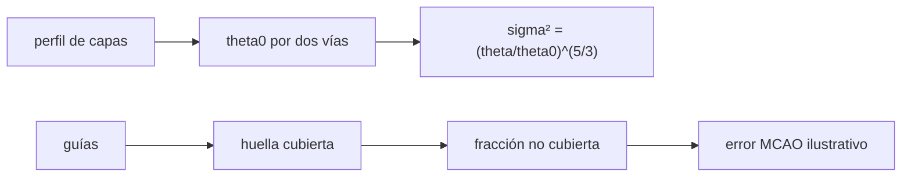

# B42-C18 — Óptica adaptativa multiconjugada

<!-- nav:top -->
[🏠 Programa](../../../../README.md) · [📚 Bloque B42](../../../tronco-comun/B42-optica-fisica-y-optica-adaptativa.md) · [← Anterior: B42-C17 — Estrellas guía artificiales](../B42-C17-estrellas-guia-artificiales/CLASE.md) · [Siguiente: B42-C19 — Reconstrucción de imágenes →](../B42-C19-reconstruccion-de-imagenes/CLASE.md)
<!-- /nav -->

## 1. Ubicación, nivel y alcance

Clase 18 del bloque B42. Nivel N3. La **óptica adaptativa multiconjugada** (MCAO) usa varios espejos conjugados a distintas altitudes y varias estrellas guía para ampliar el campo corregido. Calculas el **ángulo isoplanático**, la fracción de **huella cubierta** por las guías y un error residual **ilustrativo**. Usas [B42](../../../tronco-comun/B42-optica-fisica-y-optica-adaptativa.md) (C12, C17).

## 2. Por qué esta clase existe

Una sola corrección solo vale dentro del ángulo isoplanático (unos segundos de arco). La decisión central: **¿cómo se amplía el campo y qué parte de la turbulencia queda sin restricción?**

## 3. Lo que podrás hacer al terminar

1. Calcular `θ₀ = [2,914 k² ∫C_n² h^{5/3} dh]^{−3/5}`.
2. Contrastarlo con `0,314 r₀/h̄`.
3. Evaluar `σ² = (θ/θ₀)^{5/3}`.
4. Calcular la intersección de dos huellas.
5. Estimar la fracción no cubierta por cuatro guías.
6. Reconocer que el modelo es ilustrativo.

La evidencia es la **ficha de la MCAO** del ejercicio 12 (sección 20).

## 4. Con qué llegas y cómo comprobarlo

1. ¿Qué es una incertidumbre?
2. ¿Qué es una simulación Monte Carlo?
3. ¿Qué es una tabla de resultados?
4. ¿Qué es un valor ilustrativo?
5. ¿Qué es una verificación?

<details>
<summary>Ver respuestas</summary>

1. Un intervalo en que se espera el valor verdadero. 2. Repetir con números aleatorios de semilla fija. 3. Un resumen ordenado de cálculos. 4. Un valor propuesto para el ejemplo, no medido. 5. Comparar un cálculo con un caso independiente.
</details>

Con cuatro o cinco aciertos, sigue; si no, repasa los prerrequisitos.

## 5. Un caso de contexto y casos de referencia

Con dos capas (suelo 60 % y 8 km 40 %), `r₀ = 0,13 m` a 500 nm (ilustrativos) `θ₀ = 1,825 arcsec`; con cuatro guías a ±30 arcsec la fracción no cubierta es `0` hasta 20 arcsec, `0,0021` a 30 y `0,1667` en la diagonal de 50 arcsec. Es el **ejemplo conductor**.

## 6. Vocabulario

El **anisoplanatismo**. El **ángulo isoplanático** `θ₀`. La **altura efectiva** `h̄`. La **MCAO**. La **huella** de la pupila en una capa. La **fracción no cubierta**. La **tomografía**.

## 7. Modelo mental: iluminar un escenario con varios focos

Como iluminar un escenario con varios focos: cada uno cubre una zona; donde ninguno llega, queda en sombra.



*Descripción textual:* el anisoplanatismo crece como `(θ/θ₀)^{5/3}`; la MCAO lo reduce hasta que la huella queda fuera de las guías.

Analogía: iluminar un escenario con varios focos. Límite: capas finas, medidas sin ruido.

## 8. La explicación, paso a paso

### 8.1 Ángulo isoplanático

`∫C_n² dh = 4,4875 × 10⁻¹³ m^{1/3}`; `r₀` por capa: `0,177 m` (suelo) y `0,225 m` (8 km). Altura efectiva `h̄ = 4,617 km`. Por la integral `θ₀ = 1,825 arcsec`; por `0,314 r₀/h̄`, `1,824 arcsec` (diferencia `0,04 %`).

| `θ` (arcsec) | `σ² = (θ/θ₀)^{5/3}` | Strehl `exp(−σ²)` |
|---|---|---|
| 2 | 1,1654 | 0,3118 |
| 5 | 5,3665 | 0,0047 |
| 10 | 17,0377 | 0,0000 |

### 8.2 Huellas

Intersección de dos discos (capa a 8 km, `R = 4 m`) por Monte Carlo frente a la fórmula analítica:

| `θ` (arcsec) | desplazamiento (m) | MC | analítica |
|---|---|---|---|
| 10 | 0,388 | 0,9385 | 0,9383 |
| 30 | 1,164 | 0,8157 | 0,8155 |
| 60 | 2,327 | 0,6329 | 0,6349 |
| 120 | 4,654 | 0,3036 | 0,3035 |

### 8.3 Cobertura con cuatro guías

Varianza de la capa alta en el modelo: `395,19 rad²`.

| `θ` (arcsec) | no cubierta | `σ²` MCAO | `σ²` un espejo |
|---|---|---|---|
| (0, 0) | 0,0000 | 0,000 | 0,000 |
| (30, 0) | 0,0021 | 0,818 | 106,320 |
| (40, 0) | 0,0209 | 8,269 | 171,730 |
| (50, 50) | 0,1667 | 65,861 | 443,833 |

El modelo es solo una ilustración; un resumen de Rigaut y Neichel (solo resumen) indica que la MCAO busca campos 10 a 20 veces mayores en área que la óptica adaptativa clásica.

## 9. Magnitudes, símbolos y unidades

| Símbolo | Qué es | Unidad | Valor / nota |
|---|---|---|---|
| `θ₀` | ángulo isoplanático | arcsec | 1,825 (500 nm) |
| `h̄` | altura efectiva | km | 4,617 |
| `R` | radio de la pupila | m | 4 |
| `f_nc` | fracción no cubierta | — | ver 8.3 |

## 10. Convenciones y referencias

Dos capas ilustrativas; coeficientes 0,423, 2,914, 0,314, 6,88 y 1,03 de libro (no consultados).

## 11. De dónde sale lo que afirmamos

| ID | Fuente | Localizador | Respalda | Estado |
|---|---|---|---|---|
| S1 | Rigaut y Neichel, *Multiconjugate Adaptive Optics for Astronomy* | https://arxiv.org/abs/2003.03097 | la MCAO usa varios sensores y reconstrucción tomográfica y busca campos 10 a 20 veces mayores en área que la óptica adaptativa clásica (solo del resumen) | Solo resumen, consultado el 2026-11-09 |

Límites: de Rigaut y Neichel solo se leyó el resumen; el modelo de error es propio e ilustrativo y no reproduce ningún sistema.

## 12. Cómo ver θ₀ y la cobertura

| Magnitud | Valor |
|---|---|
| `θ₀` por integral | 1,825 arcsec |
| `θ₀` por `0,314 r₀/h̄` | 1,824 arcsec |
| huella común a 30 arcsec | 0,8157 |
| `σ²` un espejo a 10 arcsec | 17,04 rad² |

Descripción larga: las dos formas de `θ₀` coinciden a 0,04 %.

## 13. Ejemplo trabajado: θ₀ por la segunda vía

**Paso 1 · `h̄`.** `(0,4 × 8000^{5/3})^{3/5} = 4,617 km`.

**Paso 2 · Fórmula.** `θ₀ = 0,314 r₀/h̄`.

**Paso 3 · Cuenta.** `0,314 × 0,13/4617 = 8,84 × 10⁻⁶ rad`.

**Paso 4 · Lectura.** `1,824 arcsec`.

## 14. Distintas formas de describir el resultado

**Por integral:** `θ₀`. **Por fórmula:** `0,314 r₀/h̄`. **Por geometría:** huellas. **Por código:** `mcao.py`.

## 15. Práctica guiada

**Ejercicio 1 · con los pasos indicados.** `θ₀` en rad. *Pasos:* ejemplo 13.

<details><summary>Solución comentada</summary>

`8,84 × 10⁻⁶`.
</details>

**Ejercicio 2 · con una pista.** `σ²` a `θ = θ₀`.

<details><summary>Solución comentada</summary>

1.
</details>

**Ejercicio 3 · casi autónomo.** `σ²` a 5 arcsec.

<details><summary>Solución comentada</summary>

5,37.
</details>

## 16. Práctica autónoma, transferencia e integrador

**Ejercicio 4.** Fracción común a 30 arcsec.

<details><summary>Solución comentada</summary>

0,8157.
</details>

**Ejercicio 5.** Desplazamiento a 8 km y 30 arcsec.

<details><summary>Solución comentada</summary>

1,164 m.
</details>

**Ejercicio 6.** Fracción no cubierta a 40 arcsec.

<details><summary>Solución comentada</summary>

0,0209.
</details>

**Ejercicio 7.** Strehl a 2 arcsec con un espejo.

<details><summary>Solución comentada</summary>

0,3118.
</details>

**Ejercicio 8.** ¿Por qué crece `f_nc`?

<details><summary>Solución comentada</summary>

Las guías ven una región más pequeña.
</details>

**Ejercicio 9 · transferencia.** **Transferencia.** ¿Por qué el campo MCAO tiene bordes?

<details><summary>Solución comentada</summary>

Fuera de las huellas de las guías no hay restricción.
</details>

**Ejercicio 10 · transferencia.** **Transferencia.** Un compañero dice que el modelo predice un sistema real. Responde.

<details><summary>Solución comentada</summary>

No: es ilustrativo.
</details>

**Ejercicio 11 · transferencia.** **Transferencia.** ¿Qué pasa en el infrarrojo con `θ₀`?

<details><summary>Solución comentada</summary>

Crece como `λ^{6/5}`.
</details>

**Ejercicio 12.** **Integrador.** Elabora tu *ficha de la MCAO*: `θ₀`, huella y fracción no cubierta.

<details><summary>Solución comentada</summary>

Secciones 8.1–8.3.
</details>

**Ejercicio 12 · integrador.** **Integrador.** Elabora tu *ficha de la MCAO*: `θ₀`, huella y fracción no cubierta.

<details><summary>Solución modelo</summary>

Secciones 8.1–8.3.
</details>

## 17. Laboratorio: anisoplanatismo y cobertura multiconjugada

El script [mcao.py](mcao.py) calcula `θ₀` por dos vías, la intersección de huellas y la fracción no cubierta de cuatro guías (**comprueba** `θ₀` a 0,5 % y la intersección a `3 × 10⁻³`).

**Datos:** sin datos reales; capas, `r₀` y guías ilustrativos. **Predice antes de ejecutar:** ¿cuánto vale `θ₀`? (≈ 1,8 arcsec.) **Ejecución del 2026-11-09 (Python 3.12.9):**

```text
Python 3.12.9 (biblioteca estandar)
integral de Cn^2 dh = 4.4875e-13 m^(1/3) ; r0 = 0.13 m ; r0 por capa: h = 0 km -> 0.177 m, h = 8 km -> 0.225 m
h_bar = 4.617 km ; theta0 (via integral) = 1.825 arcsec ; theta0 = 0,314 r0 / h_bar = 1.824 arcsec ; diferencia = 0.04%
theta [arcsec]  sigma^2 = (theta/theta0)^5/3  Strehl exp(-s2)
             2                        1.1654           0.3118
             5                        5.3665           0.0047
            10                       17.0377           0.0000
            20                       54.0914           0.0000
            40                      171.7295           0.0000
theta [arcsec]  desplazamiento [m]  fraccion comun MC  analitica
            10               0.388             0.9385     0.9383
            30               1.164             0.8157     0.8155
            60               2.327             0.6329     0.6349
           120               4.654             0.3036     0.3035
capa de 8 km: r0,h = 0.225 m ; varianza de fase sobre la pupila (modelo) = 395.19 rad^2
  theta (x,y) arcsec  f no cubierta  sigma^2 MCAO  sigma^2 un espejo
              (0, 0)         0.0000         0.000              0.000
             (10, 0)         0.0000         0.000             17.038
             (20, 0)         0.0000         0.000             54.091
             (30, 0)         0.0021         0.818            106.320
             (40, 0)         0.0209         8.269            171.730
            (50, 50)         0.1667        65.861            443.833
Pruebas superadas.
```

```bash
python programa/clases/B42/B42-C18-optica-adaptativa-multiconjugada/mcao.py
```

**Límites:** capas finas, medidas sin ruido, reconstrucción ideal.

## 18. Errores frecuentes y cómo corregirlos

**Confundir `θ₀` con el campo MCAO.** Son conceptos distintos.

**Ignorar la escala con `λ`.** `θ₀` crece con `λ^{6/5}`.

**Tratar `f_nc` como error.** Es solo la fracción no restringida.

**Presentar el modelo como resultado de un sistema.** No lo es.

## 19. Cómo sabrás que vas bien

Tras la sección 8: ¿qué resultado esperabas y cuál obtuviste? Si dudas, repasa el ejemplo 13. Tras el laboratorio: ¿qué comprueba? (ver la sección 17).

## 20. Qué entregas y cómo se evalúa

El producto es tu **ficha de la MCAO** (ejercicio 12).

| Criterio | Inicial | En desarrollo | Logrado | Destacado |
|---|---|---|---|---|
| Conceptos | Los confunde | Parciales | conceptos de la clase | Explica los límites |
| Cálculo | Sin unidades | Con errores | Tablas completas | Calcula casos nuevos |
| Numérico | Sin comprobar | Un caso | Contraste con el análisis | Interpreta las diferencias |
| Fuentes | Sin fuente | Sin fecha | fuentes con fecha | Declara lo ilustrativo |
| Límites | No los nombra | Uno | Tres | Discute qué falta del modelo |

**Condiciones críticas (no se compensan con promedio):** rotular el modelo como ilustrativo; citar solo el resumen de Rigaut y Neichel.

## 21. Ética, seguridad y límites

Clase educativa: los modelos son simplificados. Accesibilidad: tablas equivalentes a las gráficas, fórmulas en texto, ejercicios sin conexión.

## 22. Para cerrar y seguir

El ángulo isoplanático del perfil es 1,8 arcsec; cuatro guías a ±30 arcsec cubren la huella hasta unos 30 arcsec. Falta procesar la imagen final.

**Glosario español–inglés.** óptica adaptativa multiconjugada · *multiconjugate adaptive optics*; anisoplanatismo · *anisoplanatism*; ángulo isoplanático · *isoplanatic angle*; tomografía · *tomography*; huella · *footprint*.

**Continuidad.** [B42-C19](../B42-C19-reconstruccion-de-imagenes/CLASE.md) estudia la reconstrucción de imágenes.

**Referencias:** ver sección 11.

<!-- nav:bottom -->
---

[← Anterior: B42-C17 — Estrellas guía artificiales](../B42-C17-estrellas-guia-artificiales/CLASE.md) · [📚 Bloque B42](../../../tronco-comun/B42-optica-fisica-y-optica-adaptativa.md) · [Siguiente: B42-C19 — Reconstrucción de imágenes →](../B42-C19-reconstruccion-de-imagenes/CLASE.md)
<!-- /nav -->
