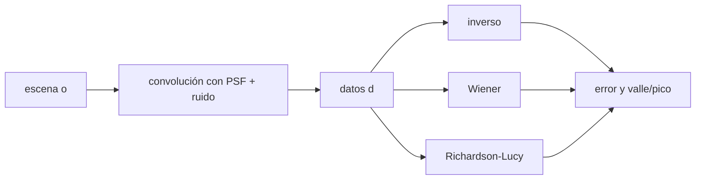

# B42-C19 — Reconstrucción de imágenes

<!-- nav:top -->
[🏠 Programa](../../../../README.md) · [📚 Bloque B42](../../../tronco-comun/B42-optica-fisica-y-optica-adaptativa.md) · [← Anterior: B42-C18 — Óptica adaptativa multiconjugada](../B42-C18-optica-adaptativa-multiconjugada/CLASE.md) · [Siguiente: B42-C20 — Laboratorio de corrección óptica simulada →](../B42-C20-laboratorio-de-correccion-optica-simulada/CLASE.md)
<!-- /nav -->

## 1. Ubicación, nivel y alcance

Clase 19 del bloque B42. Nivel N3. Después de la corrección queda una PSF residual: la imagen es la escena convolucionada con ella más ruido. Comparas tres reconstrucciones sobre una escena **sintética**: **filtro inverso**, **Wiener** y **Richardson-Lucy**. Usas [B42](../../../tronco-comun/B42-optica-fisica-y-optica-adaptativa.md) (C06, C07) y [B15](../../../tronco-comun/B15-senales-imagenes-y-estimacion-cientifica.md) (deconvolución).

## 2. Por qué esta clase existe

Deconvolucionar recupera detalle bajo el límite de difracción pero amplifica el ruido. La decisión central: **¿qué método usar y qué se gana y se pierde con cada uno?**

## 3. Lo que podrás hacer al terminar

1. Escribir `d = h ∗ o + n`.
2. Aplicar el filtro inverso con truncado.
3. Aplicar Wiener con regularización `K`.
4. Aplicar Richardson-Lucy con positividad.
5. Medir error relativo y el cociente valle/pico de un par cercano.
6. Reconocer que la PSF debe conocerse.

La evidencia es la **ficha de la reconstrucción de imágenes** del ejercicio 12 (sección 20).

## 4. Con qué llegas y cómo comprobarlo

1. ¿Qué es una incertidumbre?
2. ¿Qué es una simulación Monte Carlo?
3. ¿Qué es una tabla de resultados?
4. ¿Qué es un valor ilustrativo?
5. ¿Qué es una verificación?

<details>
<summary>Ver respuestas</summary>

1. Un intervalo en que se espera el valor verdadero. 2. Repetir con números aleatorios de semilla fija. 3. Un resumen ordenado de cálculos. 4. Un valor propuesto para el ejemplo, no medido. 5. Comparar un cálculo con un caso independiente.
</details>

Con cuatro o cinco aciertos, sigue; si no, repasa los prerrequisitos.

## 5. Un caso de contexto y casos de referencia

Con una escena de tres estrellas y un disco débil, un par separado `3 px = 0,75 λ/D` y ruido tipo Poisson (sintético), la imagen sin procesar da valle/pico `1,227` (no se resuelve); Richardson-Lucy con 40 iteraciones da `0,702` y el error relativo baja de `0,9567` a `0,6749`. Es el **ejemplo conductor**.

## 6. Vocabulario

La **convolución** `h ∗ o`. El **filtro inverso**. El **filtro de Wiener**. **Richardson-Lucy**: iteración que conserva flujo y positividad. La **regularización** `K`. El **cociente valle/pico**. La **PSF conocida**.

## 7. Modelo mental: enfocar una foto movida

Como arreglar una foto movida: si conoces el movimiento puedes deshacerlo, pero también realzas el ruido.



*Descripción textual:* la imagen es una convolución ruidosa; los métodos invierten con distintas regularizaciones.

Analogía: enfocar una foto movida. Límite: PSF conocida y estacionaria.

## 8. La explicación, paso a paso

### 8.1 Comprobaciones

El flujo de la escena es `15 240` cuentas; el pico de la PSF `0,05078`; `|H| > 10⁻³` en `793` de `4096` frecuencias. Sin ruido el filtro inverso recupera el espectro en banda con error `2,4 × 10⁻¹⁰`. Con ruido, el flujo de los datos es `17 856,544` (el recorte a cero introduce sesgo positivo) y el de RL es el mismo, con diferencia relativa `0`.

### 8.2 Métodos

| método | error relativo | mínimo | valle/pico |
|---|---|---|---|
| datos (borrosos) | 0,9567 | 0,0 | 1,227 |
| filtro inverso | 0,9645 | −336,1 | 1,182 |
| Wiener `K = 10⁻³` | 0,9169 | −212,6 | 1,182 |
| Richardson-Lucy 40 | 0,6749 | 0,0 | 0,702 |

### 8.3 Lectura

El filtro inverso y Wiener generan valores negativos (−336 y −213 cuentas) y no resuelven el par; RL mantiene positividad, conserva el flujo y baja el cociente valle/pico a `0,702`. El error relativo grande (0,67) es normal en escenas dispersas con ruido y no mide la calidad visual.

## 9. Magnitudes, símbolos y unidades

| Símbolo | Qué es | Unidad | Valor / nota |
|---|---|---|---|
| `h` | PSF | — | pico 0,05078 |
| `K` | regularización de Wiener | — | 10⁻³ (no optimizado) |
| iteraciones | RL | — | 40 |
| valle/pico | resolución del par | — | ver 8.2 |

## 10. Convenciones y referencias

Convolución periódica por FFT; ruido gaussiano con varianza `I+1` más lectura de 2 e⁻, recortado a cero; PSF de pupila ideal 16 px en malla de 64.

## 11. De dónde sale lo que afirmamos

| ID | Fuente | Localizador | Respalda | Estado |
|---|---|---|---|---|
| — | Deconvolución de Wiener y de Richardson-Lucy (libros) | — | fórmulas | No consultado |

Límites: no se consultó una fuente; el resultado depende de la semilla y de `K` y las 40 iteraciones, elegidos sin optimización.

## 12. Cómo ver el par cercano

| Magnitud | Valor |
|---|---|
| valle/pico de los datos | 1,227 |
| valle/pico de RL | 0,702 |
| error relativo RL | 0,6749 |
| flujo conservado por RL | sí (0) |

Descripción larga: solo RL separa el par de estrellas.

## 13. Ejemplo trabajado: valle/pico

**Paso 1 · Perfil.** Fila del par: píxeles 28, 29, 30, 31.

**Paso 2 · Definición.** `valle/pico = min(p₂₉,p₃₀)/min(p₂₈,p₃₁)`.

**Paso 3 · Lectura.** Valor `> 1`: no hay valle (datos); `< 1`: hay un valle (RL).

**Paso 4 · Cifras.** 1,227 y 0,702.

## 14. Distintas formas de describir el resultado

**Por ecuación:** `d = h∗o + n`. **Por método:** inverso, Wiener, RL. **Por tabla:** 8.2. **Por código:** `reconstruccion.py`.

## 15. Práctica guiada

**Ejercicio 1 · con los pasos indicados.** Distancia del par en `λ/D`. *Pasos:* `3/4`.

<details><summary>Solución comentada</summary>

0,75.
</details>

**Ejercicio 2 · con una pista.** Fracción de frecuencias con `|H| > 10⁻³`.

<details><summary>Solución comentada</summary>

`793/4096 = 19,4 %`.
</details>

**Ejercicio 3 · casi autónomo.** Flujo escena.

<details><summary>Solución comentada</summary>

15 240.
</details>

## 16. Práctica autónoma, transferencia e integrador

**Ejercicio 4.** Diferencia de flujo datos − escena.

<details><summary>Solución comentada</summary>

`2616,5`: sesgo por recorte.
</details>

**Ejercicio 5.** ¿Por qué falla el inverso?

<details><summary>Solución comentada</summary>

Amplifica el ruido donde `H` es pequeña.
</details>

**Ejercicio 6.** Reducción del error con RL.

<details><summary>Solución comentada</summary>

`0,9567 → 0,6749 (−29 %)`.
</details>

**Ejercicio 7.** Mínimo de Wiener.

<details><summary>Solución comentada</summary>

−212,6.
</details>

**Ejercicio 8.** ¿RL conserva el flujo?

<details><summary>Solución comentada</summary>

Sí: diferencia 0.
</details>

**Ejercicio 9 · transferencia.** **Transferencia.** ¿Por qué se necesita conocer la PSF?

<details><summary>Solución comentada</summary>

La deconvolución la invierte; una PSF errónea produce artefactos.
</details>

**Ejercicio 10 · transferencia.** **Transferencia.** Un compañero dice que RL siempre converge a la verdad. Responde.

<details><summary>Solución comentada</summary>

No: con ruido las iteraciones excesivas amplifican el ruido.
</details>

**Ejercicio 11 · transferencia.** **Transferencia.** ¿Qué métrica elegirías para un cúmulo de estrellas?

<details><summary>Solución comentada</summary>

Fotometría y astrometría de las fuentes, no solo error de píxel.
</details>

**Ejercicio 12.** **Integrador.** Elabora tu *ficha de la reconstrucción de imágenes*: método, métrica y límites.

<details><summary>Solución comentada</summary>

Secciones 8.1–8.3.
</details>

**Ejercicio 12 · integrador.** **Integrador.** Elabora tu *ficha de la reconstrucción de imágenes*: método, métrica y límites.

<details><summary>Solución modelo</summary>

Secciones 8.1–8.3.
</details>

## 17. Laboratorio: tres reconstrucciones

El script [reconstruccion.py](reconstruccion.py) aplica inverso, Wiener y RL a una escena sintética y compara error y resolución del par (**comprueba** el flujo de RL a `10⁻⁹` y el orden de errores).

**Datos:** sin datos reales; escena, ruido y PSF sintéticos. **Predice antes de ejecutar:** ¿qué método separa el par? (Richardson-Lucy.) **Ejecución del 2026-11-09 (Python 3.12.9):**

```text
Python 3.12.9 (biblioteca estandar)
flujo de la escena = 15240 cuentas ; pico de la PSF = 0.05078 ; |H| > 1e-3 en 793 de 4096 frecuencias
filtro inverso sin ruido: error maximo en la banda = 2.36e-10 (por unidad de espectro de la escena)
flujo: datos = 17856.544 ; RL = 17856.544 ; diferencia relativa = 0.00e+00
metodo                   error relativo vs escena    minimo  valle/pico (par)
datos (borrosos)                           0.9567       0.0             1.227
filtro inverso                             0.9645    -336.1             1.182
Wiener K=1e-3                              0.9169    -212.6             1.182
Richardson-Lucy 40                         0.6749       0.0             0.702
Pruebas superadas.
```

```bash
python programa/clases/B42/B42-C19-reconstruccion-de-imagenes/reconstruccion.py
```

**Límites:** PSF conocida; ruido gaussiano aproximado.

## 18. Errores frecuentes y cómo corregirlos

**Usar un PSF distinto del real.** Ver ejercicio 9.

**Iterar sin criterio de parada.** Ver ejercicio 10.

**Evaluar solo por error de píxel.** Ver ejercicio 11.

**Ignorar el sesgo del recorte.** Ver ejercicio 4.

## 19. Cómo sabrás que vas bien

Tras la sección 8: ¿qué resultado esperabas y cuál obtuviste? Si dudas, repasa el ejemplo 13. Tras el laboratorio: ¿qué comprueba? (ver la sección 17).

## 20. Qué entregas y cómo se evalúa

El producto es tu **ficha de la reconstrucción de imágenes** (ejercicio 12).

| Criterio | Inicial | En desarrollo | Logrado | Destacado |
|---|---|---|---|---|
| Conceptos | Los confunde | Parciales | conceptos de la clase | Explica los límites |
| Cálculo | Sin unidades | Con errores | Tablas completas | Calcula casos nuevos |
| Numérico | Sin comprobar | Un caso | Contraste con el análisis | Interpreta las diferencias |
| Fuentes | Sin fuente | Sin fecha | fuentes con fecha | Declara lo ilustrativo |
| Límites | No los nombra | Uno | Tres | Discute qué falta del modelo |

**Condiciones críticas (no se compensan con promedio):** rotular la escena como sintética; no extraer conclusiones astronómicas.

## 21. Ética, seguridad y límites

Clase educativa: los modelos son simplificados. Accesibilidad: tablas equivalentes a las gráficas, fórmulas en texto, ejercicios sin conexión.

## 22. Para cerrar y seguir

El filtro inverso y Wiener no resuelven el par a 0,75 λ/D; RL lo resuelve (valle/pico 0,70) conservando el flujo. Falta integrar todo en un lazo.

**Glosario español–inglés.** reconstrucción · *reconstruction*; deconvolución · *deconvolution*; filtro de Wiener · *Wiener filter*; Richardson-Lucy · *Richardson-Lucy*; regularización · *regularization*.

**Continuidad.** [B42-C20](../B42-C20-laboratorio-de-correccion-optica-simulada/CLASE.md) estudia el laboratorio de corrección simulada.

**Referencias:** ver sección 11.

<!-- nav:bottom -->
---

[← Anterior: B42-C18 — Óptica adaptativa multiconjugada](../B42-C18-optica-adaptativa-multiconjugada/CLASE.md) · [📚 Bloque B42](../../../tronco-comun/B42-optica-fisica-y-optica-adaptativa.md) · [Siguiente: B42-C20 — Laboratorio de corrección óptica simulada →](../B42-C20-laboratorio-de-correccion-optica-simulada/CLASE.md)
<!-- /nav -->
