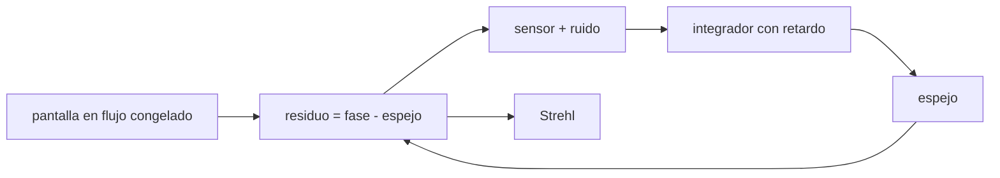

# B42-C20 — Laboratorio de corrección óptica simulada

<!-- nav:top -->
[🏠 Programa](../../../../README.md) · [📚 Bloque B42](../../../tronco-comun/B42-optica-fisica-y-optica-adaptativa.md) · [← Anterior: B42-C19 — Reconstrucción de imágenes](../B42-C19-reconstruccion-de-imagenes/CLASE.md) · [Siguiente: B42-C21 — Estrellas guía naturales y cobertura de cielo →](../B42-C21-estrellas-guia-naturales-y-cobertura-de-cielo/CLASE.md)
<!-- /nav -->

## 1. Ubicación, nivel y alcance

Clase 20 del bloque B42. Nivel N3. Esta clase integra el bloque en un **lazo cerrado simulado**: una pantalla de Kolmogorov en flujo congelado, un espejo de 8 × 8 actuadores, un sensor ideal con ruido y un integrador con retardo. Medirás el Strehl con y sin corrección. Usas [B42](../../../tronco-comun/B42-optica-fisica-y-optica-adaptativa.md) (C06, C11, C15, C16).

## 2. Por qué esta clase existe

El producto es un informe con evidencia numérica de cuánto corrige un lazo dado, con sus límites. La decisión central: **¿qué ganancia y qué ruido dan el Strehl más alto y cómo se comprueba?**

## 3. Lo que podrás hacer al terminar

1. Ensamblar pantalla, espejo, sensor e integrador.
2. Medir el Strehl instantáneo por la identidad `|⟨e^{iφ}⟩|²`.
3. Medir el pico de la PSF de larga exposición.
4. Comparar con la aproximación de Maréchal.
5. Comparar ganancias y ruido.
6. Redactar el informe con las limitaciones.

La evidencia es la **informe del laboratorio de corrección** del ejercicio 12 (sección 20).

## 4. Con qué llegas y cómo comprobarlo

1. ¿Qué es una incertidumbre?
2. ¿Qué es una simulación Monte Carlo?
3. ¿Qué es una tabla de resultados?
4. ¿Qué es un valor ilustrativo?
5. ¿Qué es una verificación?

<details>
<summary>Ver respuestas</summary>

1. Un intervalo en que se espera el valor verdadero. 2. Repetir con números aleatorios de semilla fija. 3. Un resumen ordenado de cálculos. 4. Un valor propuesto para el ejemplo, no medido. 5. Comparar un cálculo con un caso independiente.
</details>

Con cuatro o cinco aciertos, sigue; si no, repasa los prerrequisitos.

## 5. Un caso de contexto y casos de referencia

Con `D/r₀ = 4`, actuadores a `d/r₀ = 0,5`, viento 20 m/s, 500 Hz y retardo de 2 tramas (ilustrativos), el Strehl de larga exposición pasa de `0,1144` (lazo abierto) a `0,7578` con `g = 0,6` y la varianza residual baja `16,2` veces. Es el **ejemplo conductor**.

## 6. Vocabulario

El **lazo cerrado**. El **flujo congelado**. El **sensor ideal**. El **Strehl instantáneo** y el de **larga exposición**. La **varianza residual**. La **ganancia**. El **ruido de medición**.

## 7. Modelo mental: un conductor que corrige el volante

Como un conductor que corrige el volante mirando la carretera con un poco de retraso: reduce el error pero no lo elimina.



*Descripción textual:* el lazo cierra la medida sobre el espejo y el Strehl resume el resultado; se contrastan dos formas de medirlo.

Analogía: un conductor que corrige el volante. Límite: sensor ideal y lazo lineal.

## 8. La explicación, paso a paso

### 8.1 Resultados

Hay `812` puntos de pupila, `64` actuadores, `D/r₀ = 4,0`, `d/r₀ = 0,50` y la pantalla se desplaza `12,0 m` en 300 tramas (se descartan las 50 primeras).

| caso | Strehl inst. medio | Maréchal | pico larga exp. | varianza (rad²) |
|---|---|---|---|---|
| lazo abierto | 0,0436 | 0,0033 | 0,1144 | 5,7150 |
| cerrado `g = 0,3` | 0,6870 | 0,6372 | 0,6870 | 0,4507 |
| cerrado `g = 0,6` | 0,7578 | 0,7026 | 0,7578 | 0,3530 |
| cerrado `g = 0,6`, ruido 0,05 rad | 0,7563 | 0,7012 | 0,7563 | 0,3550 |

### 8.2 Mejora

La varianza residual baja `12,68`, `16,19` y `16,10` veces. El pico de larga exposición dividido por el Strehl instantáneo medio es `2,63` en lazo abierto (la imagen se mueve: el pico no cae siempre en el origen) y `1,00` con el lazo cerrado.

### 8.3 Lectura

Con ganancia 0,6 el residuo es 0,353 rad², dominado por el error de ajuste del espejo y el retardo; el ruido de 0,05 rad casi no cambia el resultado. El Maréchal subestima el Strehl (0,70 frente a 0,76); la causa no se analizó en este laboratorio. Es una simulación; los números no predicen ningún telescopio.

## 9. Magnitudes, símbolos y unidades

| Símbolo | Qué es | Unidad | Valor / nota |
|---|---|---|---|
| `D/r₀` | apertura relativa | — | 4,0 |
| `d/r₀` | paso relativo | — | 0,50 |
| `g` | ganancia | — | 0,3 / 0,6 |
| `S` | Strehl | — | ver 8.1 |

## 10. Convenciones y referencias

Pantalla de 256 × 256 (paso 0,1 m); influencia gaussiana con 15 % de acoplamiento; reconstructor por mínimos cuadrados regularizados (`10⁻³`); lazo `c[n] = c[n−1] + g m[n−2]`.

## 11. De dónde sale lo que afirmamos

| ID | Fuente | Localizador | Respalda | Estado |
|---|---|---|---|---|
| S1 | Davies y Kasper, *Adaptive Optics for Astronomy* | https://arxiv.org/abs/1201.5741 | la óptica adaptativa permite a telescopios en tierra alcanzar el límite de difracción (resumen; no se leyeron las cifras del cuerpo) | Solo resumen, consultado el 2026-11-09 |
| S2 | Espectro de Kolmogorov (coeficiente 0,023) | — | generación de la pantalla | No consultado |

Límites: de Davies y Kasper solo se leyó el resumen; todo lo demás es simulación sintética.

## 12. Cómo ver el Strehl con y sin lazo

| Magnitud | Valor |
|---|---|
| pico lazo abierto | 0,1144 |
| pico cerrado g=0,6 | 0,7578 |
| mejora de la varianza | 16,19 |
| residuo con ruido | 0,3550 rad² |

Descripción larga: cerrar el lazo multiplica el Strehl por 6,6 y reduce la varianza 16 veces.

## 13. Ejemplo trabajado: la mejora de g = 0,6

**Paso 1 · Cociente.** `5,7150/0,3530`.

**Paso 2 · Valor.** `16,19`.

**Paso 3 · Strehl.** `0,7578/0,1144 = 6,62`.

**Paso 4 · Lectura.** El lazo reduce la varianza 16 veces y multiplica el pico por 6,6.

## 14. Distintas formas de describir el resultado

**Por simulación:** lazo. **Por identidad:** `|⟨e^{iφ}⟩|²`. **Por aproximación:** Maréchal. **Por código:** `correccion_simulada.py`.

## 15. Práctica guiada

**Ejercicio 1 · con los pasos indicados.** Mejora de varianza con `g=0,3`. *Pasos:* `5,7150/0,4507`.

<details><summary>Solución comentada</summary>

12,68.
</details>

**Ejercicio 2 · con una pista.** Strehl con ruido 0,05 y g=0,6.

<details><summary>Solución comentada</summary>

0,7563.
</details>

**Ejercicio 3 · casi autónomo.** Desplazamiento total de la pantalla.

<details><summary>Solución comentada</summary>

`20 × 0,002 × 300 = 12 m`.
</details>

## 16. Práctica autónoma, transferencia e integrador

**Ejercicio 4.** Maréchal con 0,353 rad².

<details><summary>Solución comentada</summary>

`exp(−0,353) = 0,7026`.
</details>

**Ejercicio 5.** Relación pico/Strehl en lazo abierto.

<details><summary>Solución comentada</summary>

2,63.
</details>

**Ejercicio 6.** `D` en m.

<details><summary>Solución comentada</summary>

3,2.
</details>

**Ejercicio 7.** `d` en m.

<details><summary>Solución comentada</summary>

0,4.
</details>

**Ejercicio 8.** ¿Por qué se descartan 50 tramas?

<details><summary>Solución comentada</summary>

El lazo arranca desde cero.
</details>

**Ejercicio 9 · transferencia.** **Transferencia.** ¿Por qué el ruido casi no cambia el resultado?

<details><summary>Solución comentada</summary>

El ruido de 0,05 rad es pequeño frente al residuo.
</details>

**Ejercicio 10 · transferencia.** **Transferencia.** Un compañero dice que el Strehl de 0,76 describe un telescopio. Responde.

<details><summary>Solución comentada</summary>

No: es una simulación ilustrativa.
</details>

**Ejercicio 11 · transferencia.** **Transferencia.** ¿Qué empeoraría el desempeño en un caso real?

<details><summary>Solución comentada</summary>

Mayor retardo, ruido de fotones, escintilación y errores de calibración.
</details>

**Ejercicio 12.** **Integrador.** Elabora tu *informe del laboratorio de corrección*: configuración, tabla de Strehl, comparación de ganancias y limitaciones.

<details><summary>Solución comentada</summary>

Secciones 8.1–8.3.
</details>

**Ejercicio 12 · integrador.** **Integrador.** Elabora tu *informe del laboratorio de corrección*: configuración, tabla de Strehl, comparación de ganancias y limitaciones.

<details><summary>Solución modelo</summary>

Secciones 8.1–8.3.
</details>

## 17. Laboratorio: lazo cerrado simulado

El script [correccion_simulada.py](correccion_simulada.py) cierra un lazo de óptica adaptativa sobre una pantalla de Kolmogorov y mide el Strehl por dos vías (**comprueba** que el lazo cerrado supera al abierto).

**Datos:** todo sintético; sin datos reales. **Predice antes de ejecutar:** ¿cuánto sube el Strehl al cerrar el lazo? (≈ ×6.) **Ejecución del 2026-11-09 (Python 3.12.9):**

```text
Python 3.12.9 (biblioteca estandar)
puntos de pupila = 812 ; actuadores = 64 ; r0 = 0.8 m ; D/r0 = 4.0 ; d/r0 = 0.50 ; desplazamiento total de la pantalla = 12.0 m
caso                          Strehl inst. medio  Marechal exp(-var)  pico larga exp.  var res [rad2]
lazo abierto                              0.0436              0.0033           0.1144          5.7150
cerrado g=0,3 sin ruido                   0.6870              0.6372           0.6870          0.4507
cerrado g=0,6 sin ruido                   0.7578              0.7026           0.7578          0.3530
cerrado g=0,6 ruido 0,05                  0.7563              0.7012           0.7563          0.3550
relaciones pico larga exposicion / Strehl instantaneo medio: abierto 2.63 ; g=0,3 1.00 ; g=0,6 1.00
mejora de la varianza residual respecto del lazo abierto: g=0,3 -> x12.68 ; g=0,6 -> x16.19 ; con ruido 0,05 rad -> x16.10
Pruebas superadas.
```

```bash
python programa/clases/B42/B42-C20-laboratorio-de-correccion-optica-simulada/correccion_simulada.py
```

**Límites:** sensor ideal con ruido añadido, un solo conjunto de capas.

## 18. Errores frecuentes y cómo corregirlos

**Medir el Strehl sin descartar el arranque.** Se descartan 50 tramas.

**Presentar los números como de un telescopio.** No lo son.

**Confundir pico con Strehl instantáneo.** En lazo abierto difieren.

**Ignorar el retardo.** Ver C16.

## 19. Cómo sabrás que vas bien

Tras la sección 8: ¿qué resultado esperabas y cuál obtuviste? Si dudas, repasa el ejemplo 13. Tras el laboratorio: ¿qué comprueba? (ver la sección 17).

## 20. Qué entregas y cómo se evalúa

El producto es tu **informe del laboratorio de corrección** (ejercicio 12).

| Criterio | Inicial | En desarrollo | Logrado | Destacado |
|---|---|---|---|---|
| Conceptos | Los confunde | Parciales | conceptos de la clase | Explica los límites |
| Cálculo | Sin unidades | Con errores | Tablas completas | Calcula casos nuevos |
| Numérico | Sin comprobar | Un caso | Contraste con el análisis | Interpreta las diferencias |
| Fuentes | Sin fuente | Sin fecha | fuentes con fecha | Declara lo ilustrativo |
| Límites | No los nombra | Uno | Tres | Discute qué falta del modelo |

**Condiciones críticas (no se compensan con promedio):** rotular todo como sintético; declarar las limitaciones del modelo; no extrapolar.

## 21. Ética, seguridad y límites

Clase educativa: los modelos son simplificados. Accesibilidad: tablas equivalentes a las gráficas, fórmulas en texto, ejercicios sin conexión.

## 22. Para cerrar y seguir

Un lazo simulado de 8 × 8 actuadores sube el pico de la PSF de 0,11 a 0,76 y baja la varianza 16 veces. Faltan clases que completen el sensado, la calibración y las métricas.

**Glosario español–inglés.** lazo cerrado · *closed loop*; flujo congelado · *frozen flow*; Strehl de larga exposición · *long-exposure Strehl*; ganancia · *gain*; residuo · *residual*.

**Continuidad.** [B42-C21](../B42-C21-estrellas-guia-naturales-y-cobertura-de-cielo/CLASE.md) estudia las estrellas guía naturales.

**Referencias:** ver sección 11.

<!-- nav:bottom -->
---

[← Anterior: B42-C19 — Reconstrucción de imágenes](../B42-C19-reconstruccion-de-imagenes/CLASE.md) · [📚 Bloque B42](../../../tronco-comun/B42-optica-fisica-y-optica-adaptativa.md) · [Siguiente: B42-C21 — Estrellas guía naturales y cobertura de cielo →](../B42-C21-estrellas-guia-naturales-y-cobertura-de-cielo/CLASE.md)
<!-- /nav -->
