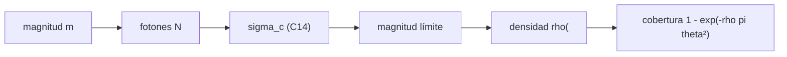

# B42-C21 — Estrellas guía naturales y cobertura de cielo

<!-- nav:top -->
[🏠 Programa](../../../../README.md) · [📚 Bloque B42](../../../tronco-comun/B42-optica-fisica-y-optica-adaptativa.md) · [← Anterior: B42-C20 — Laboratorio de corrección óptica simulada](../B42-C20-laboratorio-de-correccion-optica-simulada/CLASE.md) · [Siguiente: B42-C22 — Reconstructores de frente de onda: zonal y modal →](../B42-C22-reconstructores-de-frente-de-onda-zonal-y-modal/CLASE.md)
<!-- /nav -->

## 1. Ubicación, nivel y alcance

Clase 21 del bloque B42. Nivel N3. Una **estrella guía natural** aporta los fotones al sensor. Calculas el presupuesto de fotones por subapertura, la **magnitud límite** a partir del ruido del centroide y la **cobertura de cielo** con una ley de cuentas **ilustrativa**. Usas [B42](../../../tronco-comun/B42-optica-fisica-y-optica-adaptativa.md) (C14, C17) y [B12](../../../tronco-comun/B12-probabilidad-estadistica-e-incertidumbre.md) (Poisson).

## 2. Por qué esta clase existe

La mayoría del cielo no tiene una estrella brillante cerca: la cobertura limita a la óptica adaptativa natural. La decisión central: **¿hasta qué magnitud corrige el lazo y qué fracción del cielo queda cubierta?**

## 3. Lo que podrás hacer al terminar

1. Calcular `N = F₀ 10^{−0,4m} d² T η`.
2. Obtener el ruido del centroide con la fórmula de C14.
3. Hallar la magnitud límite por bisección.
4. Verificarla con Monte Carlo.
5. Calcular la cobertura `1 − exp(−ρπθ²)`.
6. Reconocer que el normalizador ruidoso falla a pocos fotones.

La evidencia es la **ficha de estrellas guía naturales** del ejercicio 12 (sección 20).

## 4. Con qué llegas y cómo comprobarlo

1. ¿Qué es una incertidumbre?
2. ¿Qué es una simulación Monte Carlo?
3. ¿Qué es una tabla de resultados?
4. ¿Qué es un valor ilustrativo?
5. ¿Qué es una verificación?

<details>
<summary>Ver respuestas</summary>

1. Un intervalo en que se espera el valor verdadero. 2. Repetir con números aleatorios de semilla fija. 3. Un resumen ordenado de cálculos. 4. Un valor propuesto para el ejemplo, no medido. 5. Comparar un cálculo con un caso independiente.
</details>

Con cuatro o cinco aciertos, sigue; si no, repasa los prerrequisitos.

## 5. Un caso de contexto y casos de referencia

Con un punto cero de `10¹⁰ fotones/s/m²`, eficiencia `0,30`, subapertura de `0,2 m` y trama de `2 ms` (ilustrativos) la magnitud límite es `9,555` con `36,2` fotones por subapertura, y con una densidad ilustrativa de `0,0116 estrellas/arcmin²` la cobertura de un disco de 30 arcsec es `0,0091`. Es el **ejemplo conductor**.

## 6. Vocabulario

El **presupuesto de fotones**. El **punto cero**. La **magnitud límite**. La **ley de cuentas** `ρ(<m)`. La **cobertura de cielo**. El **proceso de Poisson**. El **campo de búsqueda** `θ`.

## 7. Modelo mental: encontrar una farola en la niebla

Como buscar una farola en la niebla: solo las más brillantes guían, y hay pocas.



*Descripción textual:* los fotones fijan el ruido del centroide, éste la magnitud límite y la densidad de estrellas la cobertura.

Analogía: encontrar una farola en la niebla. Límite: estrella puntual sin fondo.

## 8. La explicación, paso a paso

### 8.1 Presupuesto

| `m` | fotones/subap./trama | `σ_c` (px) | `σ_c/FWHM` |
|---|---|---|---|
| 8 | 151,4 | 0,1148 | 0,0574 |
| 10 | 24,0 | 0,5883 | 0,2941 |
| 12 | 3,8 | 3,5571 | 1,7785 |
| 14 | 0,6 | 22,2849 | 11,1424 |

La magnitud límite (criterio `σ_c = 0,2 FWHM = 0,40 px`) es `9,555` con `36,2` fotones. El Monte Carlo (4000 repeticiones, flujo conocido) da `0,4130 px` frente a `0,4016` de la fórmula; con el denominador ruidoso `ΣI` la dispersión sube a `6,427 px`: a pocos fotones el cociente tiene valores atípicos y la fórmula de primer orden no vale.

### 8.2 Cobertura

Con `ρ(<9,555) = 0,0116 /arcmin²`:

| `θ` (arcsec) | media | `P` analítica | `P` Monte Carlo |
|---|---|---|---|
| 15 | 0,0023 | 0,0023 | 0,0022 |
| 30 | 0,0091 | 0,0091 | 0,0077 |
| 60 | 0,0365 | 0,0359 | 0,0368 |

Cobertura para `θ = 30 arcsec` en función de la magnitud límite: `0,0123` (10), `0,0482` (12), `0,1787` (14), `0,5432` (16), `0,9558` (18).

### 8.3 Lectura

Una magnitud límite de 9,6 deja menos del 1 % del cielo cubierto por una sola guía natural en 30 arcsec; por eso se usan estrellas láser (C17) y lazos con pocos fotones, sensores de baja lectura y subaperturas mayores. La densidad es ilustrativa y no corresponde a ninguna latitud galáctica.

## 9. Magnitudes, símbolos y unidades

| Símbolo | Qué es | Unidad | Valor / nota |
|---|---|---|---|
| `F₀` | flujo de punto cero | fotones/s/m² | 10¹⁰ (ilustrativo) |
| `η` | eficiencia | — | 0,30 |
| `m_lim` | magnitud límite | mag | 9,555 |
| `ρ` | densidad | arcmin⁻² | 0,0116 (ilustrativa) |

## 10. Convenciones y referencias

Ventana de 4 × 4 px (`Σ(x−c)² = 20`); criterio de magnitud límite elegido (`σ_c = 0,2 FWHM`).

## 11. De dónde sale lo que afirmamos

| ID | Fuente | Localizador | Respalda | Estado |
|---|---|---|---|---|
| — | Punto cero fotométrico y cuentas de estrellas | — | valores ilustrativos, no consultados | No consultado |

Límites: no se consultó ninguna fuente; todos los números astrofotométricos son ilustrativos y no deben usarse para planificar observaciones.

## 12. Cómo ver la magnitud límite

| Magnitud | Valor |
|---|---|
| magnitud límite | 9,555 |
| fotones | 36,2 |
| cobertura (30 arcsec) | 0,0091 |
| cobertura con m=18 | 0,9558 |

Descripción larga: la cobertura crece rápido con la magnitud límite.

## 13. Ejemplo trabajado: fotones a m = 10

**Paso 1 · Flujo.** `10¹⁰ × 10^{−4} = 10⁶`.

**Paso 2 · Área y tiempo.** `10⁶ × 0,04 × 0,002 = 80`.

**Paso 3 · Eficiencia.** `80 × 0,30 = 24`.

**Paso 4 · Lectura.** 24 fotones por subapertura y trama.

## 14. Distintas formas de describir el resultado

**Por presupuesto:** `N`. **Por ruido:** `σ_c`. **Por conteo:** Poisson. **Por código:** `estrellas_guia_naturales.py`.

## 15. Práctica guiada

**Ejercicio 1 · con los pasos indicados.** Fotones a `m = 12`. *Pasos:* ejemplo 13.

<details><summary>Solución comentada</summary>

3,8.
</details>

**Ejercicio 2 · con una pista.** Cociente de fotones entre m=10 y m=11.

<details><summary>Solución comentada</summary>

`10^{0,4} = 2,512`.
</details>

**Ejercicio 3 · casi autónomo.** Cobertura con media 0,0091.

<details><summary>Solución comentada</summary>

`1 − e^{−0,0091} = 0,0091`.
</details>

## 16. Práctica autónoma, transferencia e integrador

**Ejercicio 4.** `σ_c` a m=8.

<details><summary>Solución comentada</summary>

0,1148 px.
</details>

**Ejercicio 5.** `σ_c/FWHM` a m=10.

<details><summary>Solución comentada</summary>

0,294.
</details>

**Ejercicio 6.** Densidad a m=14 con la ley ilustrativa.

<details><summary>Solución comentada</summary>

`0,5 × 10^{−0,3} = 0,251 /arcmin²`.
</details>

**Ejercicio 7.** Cobertura a m=18, 30 arcsec.

<details><summary>Solución comentada</summary>

0,9558.
</details>

**Ejercicio 8.** ¿Por qué falla el denominador ruidoso?

<details><summary>Solución comentada</summary>

A pocos fotones `ΣI` puede acercarse a cero.
</details>

**Ejercicio 9 · transferencia.** **Transferencia.** ¿Cómo mejorarías la magnitud límite?

<details><summary>Solución comentada</summary>

Menos ruido de lectura, trama más larga, subapertura mayor.
</details>

**Ejercicio 10 · transferencia.** **Transferencia.** Un compañero dice que la ley de cuentas es del cielo real. Responde.

<details><summary>Solución comentada</summary>

Es una ley ilustrativa.
</details>

**Ejercicio 11 · transferencia.** **Transferencia.** ¿Qué pasa con la cobertura al ampliar el campo?

<details><summary>Solución comentada</summary>

Crece con `θ²`.
</details>

**Ejercicio 12.** **Integrador.** Elabora tu *ficha de estrellas guía naturales*: presupuesto, magnitud límite y cobertura.

<details><summary>Solución comentada</summary>

Secciones 8.1–8.3.
</details>

**Ejercicio 12 · integrador.** **Integrador.** Elabora tu *ficha de estrellas guía naturales*: presupuesto, magnitud límite y cobertura.

<details><summary>Solución modelo</summary>

Secciones 8.1–8.3.
</details>

## 17. Laboratorio: presupuesto de fotones y cobertura

El script [estrellas_guia_naturales.py](estrellas_guia_naturales.py) calcula fotones, ruido, magnitud límite y cobertura y las verifica con Monte Carlo (**comprueba** a 8 % y 0,01).

**Datos:** todo ilustrativo; sin catálogos reales. **Predice antes de ejecutar:** ¿cuántos fotones hay a m=10? (≈ 24.) **Ejecución del 2026-11-09 (Python 3.12.9):**

```text
Python 3.12.9 (biblioteca estandar)
    m  fotones/subap./trama  sigma_c [px]  sigma_c/FWHM
  8.0                 151.4        0.1148        0.0574
 10.0                  24.0        0.5883        0.2941
 11.0                   9.6        1.4339        0.7170
 12.0                   3.8        3.5571        1.7785
 13.0                   1.5        8.8898        4.4449
 14.0                   0.6       22.2849       11.1424
magnitud limite (sigma_c = 0,2 FWHM = 0.40 px) = 9.555 ; fotones por subapertura y trama = 36.2
Monte Carlo en la magnitud limite (flujo conocido): sigma_c = 0.4130 px ; formula con N = 36: 0.4016 px
con el denominador ruidoso sum(I) (flujo desconocido) la dispersion sube a 6.427 px: a pocos fotones el cociente tiene valores atipicos y la formula de primer orden no vale
densidad acumulada en la magnitud limite: 0.0116 estrellas/arcmin^2
theta [arcsec]    media  P analitica  P Monte Carlo
            15   0.0023       0.0023         0.0022
            30   0.0091       0.0091         0.0077
            60   0.0365       0.0359         0.0368
m limite  cobertura (theta=30 arcsec)
      10                       0.0123
      12                       0.0482
      14                       0.1787
      16                       0.5432
      18                       0.9558
Pruebas superadas.
```

```bash
python programa/clases/B42/B42-C21-estrellas-guia-naturales-y-cobertura-de-cielo/estrellas_guia_naturales.py
```

**Límites:** estrella puntual, densidad uniforme, sin fondo.

## 18. Errores frecuentes y cómo corregirlos

**Usar los números como reales.** Son ilustrativos.

**Sumar desviaciones.** Se suman varianzas.

**Confundir cobertura con probabilidad por estrella.** Es la probabilidad de al menos una.

**Olvidar el denominador.** Ver 8.1.

## 19. Cómo sabrás que vas bien

Tras la sección 8: ¿qué resultado esperabas y cuál obtuviste? Si dudas, repasa el ejemplo 13. Tras el laboratorio: ¿qué comprueba? (ver la sección 17).

## 20. Qué entregas y cómo se evalúa

El producto es tu **ficha de estrellas guía naturales** (ejercicio 12).

| Criterio | Inicial | En desarrollo | Logrado | Destacado |
|---|---|---|---|---|
| Conceptos | Los confunde | Parciales | conceptos de la clase | Explica los límites |
| Cálculo | Sin unidades | Con errores | Tablas completas | Calcula casos nuevos |
| Numérico | Sin comprobar | Un caso | Contraste con el análisis | Interpreta las diferencias |
| Fuentes | Sin fuente | Sin fecha | fuentes con fecha | Declara lo ilustrativo |
| Límites | No los nombra | Uno | Tres | Discute qué falta del modelo |

**Condiciones críticas (no se compensan con promedio):** rotular todos los números como ilustrativos; no usarlos para planificar observaciones.

## 21. Ética, seguridad y límites

Clase educativa: los modelos son simplificados. Accesibilidad: tablas equivalentes a las gráficas, fórmulas en texto, ejercicios sin conexión.

## 22. Para cerrar y seguir

Con los supuestos ilustrativos la magnitud límite es 9,6 y la cobertura de 30 arcsec cerca del 1 %. Falta ver cómo se reconstruye la fase.

**Glosario español–inglés.** estrella guía natural · *natural guide star*; magnitud límite · *limiting magnitude*; cobertura de cielo · *sky coverage*; punto cero · *zero point*; presupuesto de fotones · *photon budget*.

**Continuidad.** [B42-C22](../B42-C22-reconstructores-de-frente-de-onda-zonal-y-modal/CLASE.md) estudia los reconstructores de frente de onda.

**Referencias:** ver sección 11.

<!-- nav:bottom -->
---

[← Anterior: B42-C20 — Laboratorio de corrección óptica simulada](../B42-C20-laboratorio-de-correccion-optica-simulada/CLASE.md) · [📚 Bloque B42](../../../tronco-comun/B42-optica-fisica-y-optica-adaptativa.md) · [Siguiente: B42-C22 — Reconstructores de frente de onda: zonal y modal →](../B42-C22-reconstructores-de-frente-de-onda-zonal-y-modal/CLASE.md)
<!-- /nav -->
