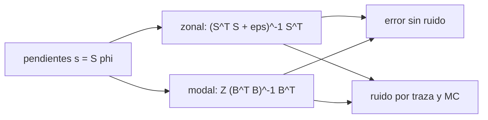

# B42-C22 — Reconstructores de frente de onda: zonal y modal

<!-- nav:top -->
[🏠 Programa](../../../../README.md) · [📚 Bloque B42](../../../tronco-comun/B42-optica-fisica-y-optica-adaptativa.md) · [← Anterior: B42-C21 — Estrellas guía naturales y cobertura de cielo](../B42-C21-estrellas-guia-naturales-y-cobertura-de-cielo/CLASE.md) · [Siguiente: B42-C23 — Calibración de la matriz de interacción y aberraciones no comunes →](../B42-C23-calibracion-de-la-matriz-de-interaccion-y-aberraciones-no-comunes/CLASE.md)
<!-- /nav -->

## 1. Ubicación, nivel y alcance

Clase 22 del bloque B42. Nivel N3. El sensor entrega pendientes; hay que obtener la fase. Comparas un reconstructor **zonal** (mínimos cuadrados regularizados sobre 121 nodos) y uno **modal** (14 modos de Zernike) en geometría de Fried, con y sin ruido. Usas [B42](../../../tronco-comun/B42-optica-fisica-y-optica-adaptativa.md) (C13, C14) y [B10](../../../tronco-comun/B10-algebra-lineal-y-matematicas-geometricas.md).

## 2. Por qué esta clase existe

El reconstructor decide qué parte del frente se recupera y cuánto ruido se propaga. La decisión central: **¿zonal o modal, y con cuántos modos?**

## 3. Lo que podrás hacer al terminar

1. Construir el operador de pendientes de Fried.
2. Resolver el problema zonal con regularización.
3. Resolver el modal con 14 modos.
4. Medir el error sin ruido.
5. Calcular la propagación de ruido por traza y por Monte Carlo.
6. Reconocer el error de truncado del modal.

La evidencia es la **ficha de reconstructores** del ejercicio 12 (sección 20).

## 4. Con qué llegas y cómo comprobarlo

1. ¿Qué es una incertidumbre?
2. ¿Qué es una simulación Monte Carlo?
3. ¿Qué es una tabla de resultados?
4. ¿Qué es un valor ilustrativo?
5. ¿Qué es una verificación?

<details>
<summary>Ver respuestas</summary>

1. Un intervalo en que se espera el valor verdadero. 2. Repetir con números aleatorios de semilla fija. 3. Un resumen ordenado de cálculos. 4. Un valor propuesto para el ejemplo, no medido. 5. Comparar un cálculo con un caso independiente.
</details>

Con cuatro o cinco aciertos, sigue; si no, repasa los prerrequisitos.

## 5. Un caso de contexto y casos de referencia

Con un frente sintético de 1 rad rms, 121 nodos, 200 pendientes y 14 modos (ilustrativos), el error sin ruido es `0,0011` (zonal) y `0,1049` (modal); con ruido de pendiente `0,05` el zonal propaga `0,0605` y el modal `0,0345`. Es el **ejemplo conductor**.

## 6. Vocabulario

El **reconstructor zonal** (un valor por nodo). El **reconstructor modal**. La **geometría de Fried**. El **operador de pendientes** `S`. La **regularización** `ε`. El **modo invisible** (piston y tablero). La **propagación de ruido**.

## 7. Modelo mental: armar un rompecabezas con ruido

Como armar un rompecabezas con piezas ruidosas: el método zonal usa todas las piezas, el modal fuerza un dibujo simple.



*Descripción textual:* ambos reconstructores invierten el mismo operador de pendientes; el modal restringe la solución y propaga menos ruido pero trunca.

Analogía: armar un rompecabezas con ruido. Límite: red cuadrada completa, ruido blanco.

## 8. La explicación, paso a paso

### 8.1 Sin ruido

El frente sintético tiene `1,000 rad` rms, `200` pendientes y `121` nodos (`1,65` pendientes por nodo; `14,3` por modo).

| reconstructor | error relativo |
|---|---|
| zonal | 0,0011 |
| modal (14 modos) | 0,1049 |

### 8.2 Con ruido

Ruido de pendiente `0,05 rad`:

| reconstructor | ruido rms Monte Carlo (rad) | por traza (rad) |
|---|---|---|
| zonal | 0,0605 | 0,0601 |
| modal | 0,0345 | 0,0343 |

### 8.3 Lectura

El zonal reproduce el frente casi sin error pero propaga 1,75 veces más ruido; el modal propaga menos ruido pero deja `10,5 %` de truncado. El error total esperado es `0,0601` (zonal) y `0,1104` (modal) en unidades de 1 rad rms: con este ruido gana el zonal; con ruido mayor ganaría el modal.

## 9. Magnitudes, símbolos y unidades

| Símbolo | Qué es | Unidad | Valor / nota |
|---|---|---|---|
| `S` | operador de pendientes | — | 200 × 121 |
| `ε` | regularización | — | 10⁻⁶ |
| modos | Zernike | — | 14 |
| `σ` | ruido de pendiente | rad | 0,05 |

## 10. Convenciones y referencias

Geometría de Fried; frente sintético de 40 ondas planas; nodos inscritos en el disco unidad; fórmulas de Zernike de Noll de memoria.

## 11. De dónde sale lo que afirmamos

| ID | Fuente | Localizador | Respalda | Estado |
|---|---|---|---|---|
| — | Reconstrucción zonal y modal de frentes de onda (libros) | — | operador de Fried y mínimos cuadrados | No consultado |

Límites: no se consultó una fuente; el frente sintético no es una pantalla de Kolmogorov exacta.

## 12. Cómo ver el error y el ruido

| Magnitud | Valor |
|---|---|
| error zonal | 0,0011 |
| error modal | 0,1049 |
| ruido zonal | 0,0605 rad |
| ruido modal | 0,0345 rad |

Descripción larga: el zonal gana sin ruido; el modal propaga menos ruido.

## 13. Ejemplo trabajado: el error total esperado

**Paso 1 · Fórmula.** `e_total = √(e_ajuste² + e_ruido²)`.

**Paso 2 · Zonal.** `√(0,0011² + 0,0601²) = 0,0601`.

**Paso 3 · Modal.** `√(0,1049² + 0,0343²) = 0,1104`.

**Paso 4 · Lectura.** Con este ruido gana el zonal.

## 14. Distintas formas de describir el resultado

**Por ecuación:** `s = Sφ`. **Por método:** zonal, modal. **Por tabla:** 8.1–8.2. **Por código:** `reconstructores.py`.

## 15. Práctica guiada

**Ejercicio 1 · con los pasos indicados.** Error total modal. *Pasos:* ejemplo 13.

<details><summary>Solución comentada</summary>

0,1104.
</details>

**Ejercicio 2 · con una pista.** Pendientes por nodo.

<details><summary>Solución comentada</summary>

1,65.
</details>

**Ejercicio 3 · casi autónomo.** Pendientes por modo.

<details><summary>Solución comentada</summary>

14,3.
</details>

## 16. Práctica autónoma, transferencia e integrador

**Ejercicio 4.** Cociente de ruido zonal/modal.

<details><summary>Solución comentada</summary>

`0,0605/0,0345 = 1,75`.
</details>

**Ejercicio 5.** Truncado del modal.

<details><summary>Solución comentada</summary>

10,5 %.
</details>

**Ejercicio 6.** ¿Por qué `ε` es necesario?

<details><summary>Solución comentada</summary>

Para fijar piston y tablero.
</details>

**Ejercicio 7.** Ruido zonal si `σ` se duplica.

<details><summary>Solución comentada</summary>

0,121.
</details>

**Ejercicio 8.** Error total zonal con `σ = 0,2`.

<details><summary>Solución comentada</summary>

`≈ 0,24`.
</details>

**Ejercicio 9 · transferencia.** **Transferencia.** ¿Cuándo conviene el modal?

<details><summary>Solución comentada</summary>

Con ruido grande o pocas pendientes.
</details>

**Ejercicio 10 · transferencia.** **Transferencia.** Un compañero dice que el zonal es siempre mejor. Responde.

<details><summary>Solución comentada</summary>

Con ruido alto el modal gana.
</details>

**Ejercicio 11 · transferencia.** **Transferencia.** ¿Qué es un modo invisible?

<details><summary>Solución comentada</summary>

Uno al que el sensor es ciego: el tablero en Fried.
</details>

**Ejercicio 12.** **Integrador.** Elabora tu *ficha de reconstructores*: error, ruido y elección.

<details><summary>Solución comentada</summary>

Secciones 8.1–8.3.
</details>

**Ejercicio 12 · integrador.** **Integrador.** Elabora tu *ficha de reconstructores*: error, ruido y elección.

<details><summary>Solución modelo</summary>

Secciones 8.1–8.3.
</details>

## 17. Laboratorio: zonal frente a modal

El script [reconstructores.py](reconstructores.py) reconstruye un frente de pendientes por dos métodos y mide el ruido por traza y por Monte Carlo (**comprueba** a 5 % y 10 %).

**Datos:** sin datos reales; frente y ruido sintéticos. **Predice antes de ejecutar:** ¿cuál propaga más ruido? (el zonal.) **Ejecución del 2026-11-09 (Python 3.12.9):**

```text
Python 3.12.9 (biblioteca estandar)
frente de onda sintetico: rms = 1.000 rad ; pendientes = 200 ; nodos = 121
sin ruido: error relativo zonal = 0.0011 ; modal (14 modos) = 0.1049
pendientes / modos = 200/14 = 14.3 ; pendientes / nodos = 200/121 = 1.65
reconstructor   ruido rms Monte Carlo [rad]   ruido rms por traza [rad]
zonal                                0.0605                      0.0601
modal                                0.0345                      0.0343
error total esperado (raiz de ajuste^2 + ruido^2): zonal = 0.0601 ; modal = 0.1104 (relativo a 1 rad rms)
Pruebas superadas.
```

```bash
python programa/clases/B42/B42-C22-reconstructores-de-frente-de-onda-zonal-y-modal/reconstructores.py
```

**Límites:** red completa, ruido blanco.

## 18. Errores frecuentes y cómo corregirlos

**Olvidar la regularización.** Matriz singular.

**Elegir modos sin comprobar truncado.** Ver 8.1.

**Comparar errores de nodos con errores de modos.** Ambos relativos al rms.

**Ignorar piston.** Se resta antes de medir.

## 19. Cómo sabrás que vas bien

Tras la sección 8: ¿qué resultado esperabas y cuál obtuviste? Si dudas, repasa el ejemplo 13. Tras el laboratorio: ¿qué comprueba? (ver la sección 17).

## 20. Qué entregas y cómo se evalúa

El producto es tu **ficha de reconstructores** (ejercicio 12).

| Criterio | Inicial | En desarrollo | Logrado | Destacado |
|---|---|---|---|---|
| Conceptos | Los confunde | Parciales | conceptos de la clase | Explica los límites |
| Cálculo | Sin unidades | Con errores | Tablas completas | Calcula casos nuevos |
| Numérico | Sin comprobar | Un caso | Contraste con el análisis | Interpreta las diferencias |
| Fuentes | Sin fuente | Sin fecha | fuentes con fecha | Declara lo ilustrativo |
| Límites | No los nombra | Uno | Tres | Discute qué falta del modelo |

**Condiciones críticas (no se compensan con promedio):** rotular el frente como sintético; no concluir que un método gana en general.

## 21. Ética, seguridad y límites

Clase educativa: los modelos son simplificados. Accesibilidad: tablas equivalentes a las gráficas, fórmulas en texto, ejercicios sin conexión.

## 22. Para cerrar y seguir

El reconstructor zonal da error 0,001 y propaga 0,06 rad de ruido; el modal truncado 0,105 y propaga 0,034. Falta calibrarlos.

**Glosario español–inglés.** reconstructor · *reconstructor*; zonal · *zonal*; modal · *modal*; geometría de Fried · *Fried geometry*; propagación de ruido · *noise propagation*.

**Continuidad.** [B42-C23](../B42-C23-calibracion-de-la-matriz-de-interaccion-y-aberraciones-no-comunes/CLASE.md) estudia la calibración de la matriz de interacción.

**Referencias:** ver sección 11.

<!-- nav:bottom -->
---

[← Anterior: B42-C21 — Estrellas guía naturales y cobertura de cielo](../B42-C21-estrellas-guia-naturales-y-cobertura-de-cielo/CLASE.md) · [📚 Bloque B42](../../../tronco-comun/B42-optica-fisica-y-optica-adaptativa.md) · [Siguiente: B42-C23 — Calibración de la matriz de interacción y aberraciones no comunes →](../B42-C23-calibracion-de-la-matriz-de-interaccion-y-aberraciones-no-comunes/CLASE.md)
<!-- /nav -->
