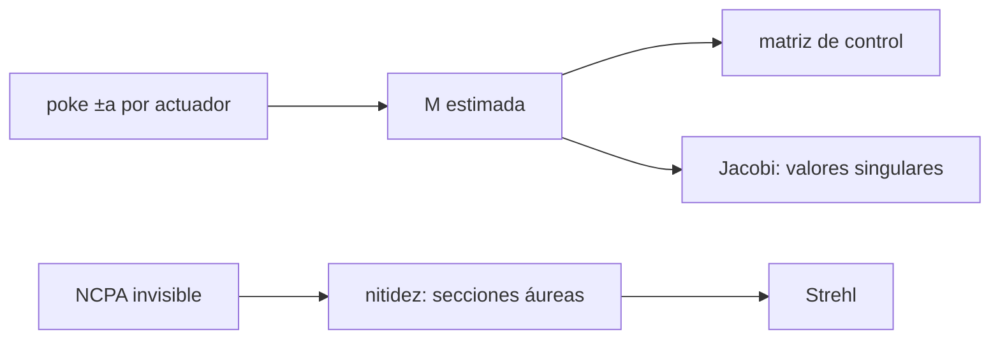

# B42-C23 — Calibración de la matriz de interacción y aberraciones no comunes

<!-- nav:top -->
[🏠 Programa](../../../../README.md) · [📚 Bloque B42](../../../tronco-comun/B42-optica-fisica-y-optica-adaptativa.md) · [← Anterior: B42-C22 — Reconstructores de frente de onda: zonal y modal](../B42-C22-reconstructores-de-frente-de-onda-zonal-y-modal/CLASE.md) · [Siguiente: B42-C24 — Métricas de desempeño de óptica adaptativa: Strehl y energía encerrada →](../B42-C24-metricas-de-desempeno-de-optica-adaptativa-strehl-y-energia-encerrada/CLASE.md)
<!-- /nav -->

## 1. Ubicación, nivel y alcance

Clase 23 del bloque B42. Nivel N3. Para controlar el espejo hay que conocer cómo responde el sensor a cada actuador: la **matriz de interacción**. La calibras por **empuje y tirón** con ruido, analizas sus valores singulares y corriges **aberraciones no comunes** (NCPA) por nitidez. Usas [B42](../../../tronco-comun/B42-optica-fisica-y-optica-adaptativa.md) (C15, C22) y [B10](../../../tronco-comun/B10-algebra-lineal-y-matematicas-geometricas.md).

## 2. Por qué esta clase existe

Una matriz mal calibrada degrada el lazo y las aberraciones del camino de ciencia no las ve el sensor. La decisión central: **¿con qué amplitud calibrar y cómo corregir lo que el sensor no ve?**

## 3. Lo que podrás hacer al terminar

1. Construir `M = S A` para un espejo de 6 × 6.
2. Calcular valores singulares con Jacobi.
3. Calibrar por empuje-tirón y medir el error.
4. Verificar la escala `σ/a`.
5. Corregir 3 modos NCPA por sección áurea.
6. Reconocer la limitación de la métrica ruidosa.

La evidencia es la **ficha de calibración** del ejercicio 12 (sección 20).

## 4. Con qué llegas y cómo comprobarlo

1. ¿Qué es una incertidumbre?
2. ¿Qué es una simulación Monte Carlo?
3. ¿Qué es una tabla de resultados?
4. ¿Qué es un valor ilustrativo?
5. ¿Qué es una verificación?

<details>
<summary>Ver respuestas</summary>

1. Un intervalo en que se espera el valor verdadero. 2. Repetir con números aleatorios de semilla fija. 3. Un resumen ordenado de cálculos. 4. Un valor propuesto para el ejemplo, no medido. 5. Comparar un cálculo con un caso independiente.
</details>

Con cuatro o cinco aciertos, sigue; si no, repasa los prerrequisitos.

## 5. Un caso de contexto y casos de referencia

Con 36 actuadores y 200 pendientes (ilustrativos) los valores singulares van de `1,8429` a `0,101` (cociente `18,2`), el error del comando cae de `0,91` (a `0,05 rad`) a `0,029` (a `6,4 rad`) con pendiente `−0,885`, y la nitidez recupera una NCPA de `0,1526 rad` hasta Strehl `1,000000`. Es el **ejemplo conductor**.

## 6. Vocabulario

La **matriz de interacción** `M`. El **empuje-tirón**. La **matriz de control** `C = (MᵀM+εI)⁻¹Mᵀ`. Los **valores singulares**. Las **NCPA**: aberraciones fuera del camino común. La **nitidez**: maximizar el pico de la PSF.

## 7. Modelo mental: afinar un instrumento tocando cada tecla

Como afinar un piano tocando cada tecla: se aprende la respuesta de cada una, pero hay notas que el oído no distingue.



*Descripción textual:* la calibración da la respuesta del sensor al espejo con ruido que escala como `σ/a`; lo que el sensor no ve se corrige midiendo la imagen.

Analogía: afinar un instrumento tocando cada tecla. Límite: respuesta lineal.

## 8. La explicación, paso a paso

### 8.1 Matriz de interacción

`M` tiene `200 × 36` elementos; la suma de autovalores de `MᵀM` es `61,862181`, igual a su traza, y la ortogonalidad de Jacobi `2,0 × 10⁻¹⁵`. Valores singulares: máximo `1,8429`, mínimo `0,101`, los tres menores `0,634`, `0,613` y `0,101`; cociente `18,2`; ningún modo tiene valor singular `< 10⁻³` del máximo.

| amplitud `a` (rad) | error relativo del comando | `σ_E` por elemento |
|---|---|---|
| 0,05 | 0,91207 | 0,2828 |
| 0,40 | 0,26337 | 0,0354 |
| 1,60 | 0,10023 | 0,0088 |
| 3,20 | 0,04807 | 0,0044 |
| 6,40 | 0,02938 | 0,0022 |

La pendiente log-log entre 1,6 y 6,4 rad es `−0,885` (esperada `−1`; a amplitudes pequeñas el error satura en 1).

### 8.2 NCPA

La NCPA tiene `0,1526 rad` rms (desenfoque `0,12`, astigmatismos `0,08` y `−0,05`); el Strehl sin corregir es `0,97732` (Maréchal `0,97697`). La nitidez recupera `(−0,12000; −0,08000; +0,05000)` y el Strehl `1,000000`. Con ruido de `0,003` en la métrica y 14 iteraciones, el error de los coeficientes es `0,0548 rad` y el Strehl `0,99700`.

### 8.3 Lectura

El empuje debe ser grande frente al ruido (error `∝ σ/a`) pero dentro de la zona lineal. La NCPA de este tamaño cuesta 2,3 % de Strehl y no la ve el sensor: se mide en la imagen.

## 9. Magnitudes, símbolos y unidades

| Símbolo | Qué es | Unidad | Valor / nota |
|---|---|---|---|
| `a` | amplitud de empuje | rad | 0,05 a 6,4 |
| `σ` | ruido de pendiente | rad | 0,02 |
| `ε` | regularización | — | 10⁻³ |
| NCPA | aberración no común | rad rms | 0,1526 |

## 10. Convenciones y referencias

Espejo 6 × 6 con 15 % de acoplamiento sobre 11 × 11 nodos; operador de Fried de la clase C22; NCPA en desenfoque y astigmatismo.

## 11. De dónde sale lo que afirmamos

| ID | Fuente | Localizador | Respalda | Estado |
|---|---|---|---|---|
| — | Calibración de matrices de interacción y NCPA (revisiones y tesis) | — | método | No consultado |

Límites: no se consultó una fuente; el modelo es lineal e ilustrativo.

## 12. Cómo ver el error de la calibración

| Magnitud | Valor |
|---|---|
| cociente de valores singulares | 18,2 |
| error a 0,05 rad | 0,91207 |
| error a 6,4 rad | 0,02938 |
| Strehl tras nitidez | 1,000000 |

Descripción larga: el error de calibración baja con la amplitud de empuje.

## 13. Ejemplo trabajado: σ_E con a = 1,6 rad

**Paso 1 · Fórmula.** `σ_E = √2 σ/(2a)`.

**Paso 2 · Valores.** `σ = 0,02`; `a = 1,6`.

**Paso 3 · Cuenta.** `1,414 × 0,02/3,2 = 0,00884`.

**Paso 4 · Lectura.** `0,0088` por elemento.

## 14. Distintas formas de describir el resultado

**Por empuje:** `(s⁺−s⁻)/2a`. **Por valores singulares:** Jacobi. **Por imagen:** nitidez. **Por código:** `calibracion.py`.

## 15. Práctica guiada

**Ejercicio 1 · con los pasos indicados.** `σ_E` con `a = 0,4`. *Pasos:* ejemplo 13.

<details><summary>Solución comentada</summary>

0,0354.
</details>

**Ejercicio 2 · con una pista.** Strehl de NCPA de 0,1526 rad.

<details><summary>Solución comentada</summary>

0,977.
</details>

**Ejercicio 3 · casi autónomo.** Cociente de valores singulares.

<details><summary>Solución comentada</summary>

18,2.
</details>

## 16. Práctica autónoma, transferencia e integrador

**Ejercicio 4.** Mejor amplitud entre las probadas.

<details><summary>Solución comentada</summary>

6,4 rad (0,029).
</details>

**Ejercicio 5.** Error del comando a 3,2 rad.

<details><summary>Solución comentada</summary>

0,04807.
</details>

**Ejercicio 6.** Coeficientes de NCPA a corregir.

<details><summary>Solución comentada</summary>

`(−0,12; −0,08; +0,05)`.
</details>

**Ejercicio 7.** ¿Por qué no lo ve el sensor?

<details><summary>Solución comentada</summary>

Está fuera del camino común.
</details>

**Ejercicio 8.** Pendiente esperada.

<details><summary>Solución comentada</summary>

−1.
</details>

**Ejercicio 9 · transferencia.** **Transferencia.** ¿Por qué no usar la amplitud más grande posible?

<details><summary>Solución comentada</summary>

Se sale de la zona lineal.
</details>

**Ejercicio 10 · transferencia.** **Transferencia.** Un compañero dice que NCPA se corrige con el sensor. Responde.

<details><summary>Solución comentada</summary>

No: el sensor no las ve.
</details>

**Ejercicio 11 · transferencia.** **Transferencia.** ¿Qué hace un valor singular pequeño?

<details><summary>Solución comentada</summary>

Hace ruidoso el modo de control correspondiente.
</details>

**Ejercicio 12.** **Integrador.** Elabora tu *ficha de calibración*: matriz, amplitud y NCPA.

<details><summary>Solución comentada</summary>

Secciones 8.1–8.2.
</details>

**Ejercicio 12 · integrador.** **Integrador.** Elabora tu *ficha de calibración*: matriz, amplitud y NCPA.

<details><summary>Solución modelo</summary>

Secciones 8.1–8.2.
</details>

## 17. Laboratorio: calibración y nitidez

El script [calibracion.py](calibracion.py) calibra la matriz con ruido, analiza sus valores singulares y corrige NCPA por nitidez (**comprueba** la pendiente a 0,25 y los coeficientes a `10⁻³`).

**Datos:** todo sintético; sin datos reales. **Predice antes de ejecutar:** ¿cómo escala el error con la amplitud? (como 1/a.) **Ejecución del 2026-11-09 (Python 3.12.9):**

```text
Python 3.12.9 (biblioteca estandar)
matriz de interaccion 200 x 36 ; suma de autovalores = 61.862181 ; traza de M^T M = 61.862181 ; ortogonalidad de Jacobi = 2.0e-15
valores singulares: maximo = 1.8429 ; minimo = 1.01e-01 ; los 3 menores = 6.34e-01, 6.13e-01, 1.01e-01 ; cociente = 1.82e+01
modos de control con valor singular < 1e-3 del maximo = 0 (en este modelo ninguno es exactamente invisible: el piston y el tablero se ven poco, no nada)
 amplitud a [rad]  error rel. del comando (MC 30)  sigma_E por elemento
             0.05                         0.91207                0.2828
             0.10                         0.74358                0.1414
             0.20                         0.47129                0.0707
             0.40                         0.26337                0.0354
             0.80                         0.15311                0.0177
             1.60                         0.10023                0.0088
             3.20                         0.04807                0.0044
             6.40                         0.02938                0.0022
pendiente log-log error vs amplitud = -0.885 (esperada -1: el error del empuje-tiron escala como sigma / a)
NCPA: rms total = 0.1526 rad ; Strehl sin corregir = 0.97732 ; Marechal exp(-sigma^2) = 0.97697
coeficientes recuperados (nitidez) = (-0.12000, -0.08000, +0.05000) ; verdaderos con signo cambiado = (-0.12000, -0.08000, +0.05000)
Strehl tras la nitidez = 1.000000
con ruido de 0,003 en la metrica y 14 iteraciones: error de los coeficientes = 0.0548 rad ; Strehl residual = 0.99700
Pruebas superadas.
```

```bash
python programa/clases/B42/B42-C23-calibracion-de-la-matriz-de-interaccion-y-aberraciones-no-comunes/calibracion.py
```

**Límites:** respuesta lineal, sin histéresis.

## 18. Errores frecuentes y cómo corregirlos

**Usar `a` demasiado pequeño.** El error satura.

**Ignorar valores singulares pequeños.** Ver 8.1.

**Confundir NCPA con aberración atmosférica.** Ver sección 7.

**Optimizar la métrica ruidosa sin parada.** Ver 8.2.

## 19. Cómo sabrás que vas bien

Tras la sección 8: ¿qué resultado esperabas y cuál obtuviste? Si dudas, repasa el ejemplo 13. Tras el laboratorio: ¿qué comprueba? (ver la sección 17).

## 20. Qué entregas y cómo se evalúa

El producto es tu **ficha de calibración** (ejercicio 12).

| Criterio | Inicial | En desarrollo | Logrado | Destacado |
|---|---|---|---|---|
| Conceptos | Los confunde | Parciales | conceptos de la clase | Explica los límites |
| Cálculo | Sin unidades | Con errores | Tablas completas | Calcula casos nuevos |
| Numérico | Sin comprobar | Un caso | Contraste con el análisis | Interpreta las diferencias |
| Fuentes | Sin fuente | Sin fecha | fuentes con fecha | Declara lo ilustrativo |
| Límites | No los nombra | Uno | Tres | Discute qué falta del modelo |

**Condiciones críticas (no se compensan con promedio):** rotular como sintético; no atribuir a ningún sistema.

## 21. Ética, seguridad y límites

Clase educativa: los modelos son simplificados. Accesibilidad: tablas equivalentes a las gráficas, fórmulas en texto, ejercicios sin conexión.

## 22. Para cerrar y seguir

El error de calibración cae como `σ/a` y la nitidez recupera la NCPA de 0,15 rad. Falta cuantificar el resultado con métricas estándar.

**Glosario español–inglés.** matriz de interacción · *interaction matrix*; empuje-tirón · *push-pull*; valores singulares · *singular values*; aberraciones no comunes · *non-common-path aberrations*; nitidez · *sharpening*.

**Continuidad.** [B42-C24](../B42-C24-metricas-de-desempeno-de-optica-adaptativa-strehl-y-energia-encerrada/CLASE.md) estudia las métricas de desempeño.

**Referencias:** ver sección 11.

<!-- nav:bottom -->
---

[← Anterior: B42-C22 — Reconstructores de frente de onda: zonal y modal](../B42-C22-reconstructores-de-frente-de-onda-zonal-y-modal/CLASE.md) · [📚 Bloque B42](../../../tronco-comun/B42-optica-fisica-y-optica-adaptativa.md) · [Siguiente: B42-C24 — Métricas de desempeño de óptica adaptativa: Strehl y energía encerrada →](../B42-C24-metricas-de-desempeno-de-optica-adaptativa-strehl-y-energia-encerrada/CLASE.md)
<!-- /nav -->
