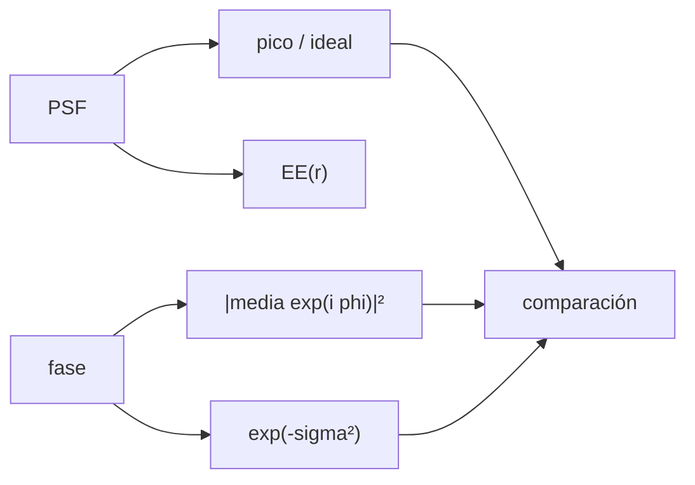

# B42-C24 — Métricas de desempeño de óptica adaptativa: Strehl y energía encerrada

<!-- nav:top -->
[🏠 Programa](../../../../README.md) · [📚 Bloque B42](../../../tronco-comun/B42-optica-fisica-y-optica-adaptativa.md) · [← Anterior: B42-C23 — Calibración de la matriz de interacción y aberraciones no comunes](../B42-C23-calibracion-de-la-matriz-de-interaccion-y-aberraciones-no-comunes/CLASE.md) · [Siguiente: B43-C01 — Requisitos ópticos y mecánicos →](../../B43/B43-C01-requisitos-opticos-y-mecanicos/CLASE.md)
<!-- /nav -->

## 1. Ubicación, nivel y alcance

Clase 24 del bloque B42. Nivel N3. La corrección se cuantifica con el **cociente de Strehl** y la **energía encerrada**. Calculas el Strehl por tres vías, comparas con Maréchal y mides la energía encerrada de PSF ideales y aberradas. Usas [B42](../../../tronco-comun/B42-optica-fisica-y-optica-adaptativa.md) (C05, C06) y [B15](../../../tronco-comun/B15-senales-imagenes-y-estimacion-cientifica.md).

## 2. Por qué esta clase existe

Sin una métrica estandarizada no se pueden comparar sistemas ni lazos. La decisión central: **¿qué métrica usar para cada pregunta y qué dice cada una?**

## 3. Lo que podrás hacer al terminar

1. Calcular el Strehl como pico, como `|⟨e^{iφ}⟩|²` y como Maréchal.
2. Reconocer cuándo falla `1 − σ²`.
3. Calcular la energía encerrada por radio.
4. Contrastarla con `1 − J₀² − J₁²`.
5. Relacionar Strehl y energía encerrada.
6. Reconocer los límites de una malla finita.

La evidencia es la **ficha de métricas de desempeño** del ejercicio 12 (sección 20).

## 4. Con qué llegas y cómo comprobarlo

1. ¿Qué es una incertidumbre?
2. ¿Qué es una simulación Monte Carlo?
3. ¿Qué es una tabla de resultados?
4. ¿Qué es un valor ilustrativo?
5. ¿Qué es una verificación?

<details>
<summary>Ver respuestas</summary>

1. Un intervalo en que se espera el valor verdadero. 2. Repetir con números aleatorios de semilla fija. 3. Un resumen ordenado de cálculos. 4. Un valor propuesto para el ejemplo, no medido. 5. Comparar un cálculo con un caso independiente.
</details>

Con cuatro o cinco aciertos, sigue; si no, repasa los prerrequisitos.

## 5. Un caso de contexto y casos de referencia

Con aberraciones sintéticas de `0,05` a `1,0 rad` rms, el Strehl por pico y la identidad coinciden a `10⁻¹⁵`; a `1,0 rad` Maréchal da `0,36788` frente a `0,37486` y `1−σ²` da `0`; la energía encerrada en `1 λ/D` baja de `0,8233` a `0,4268`. Es el **ejemplo conductor**.

## 6. Vocabulario

El **cociente de Strehl**. La **aproximación de Maréchal** `exp(−σ²)`. La **energía encerrada** `EE(r)`. El **FWHM**. El **contraste**. La **identidad exacta** `|⟨e^{iφ}⟩|²`.

## 7. Modelo mental: medir la nitidez de una foto

Como medir una foto con dos reglas: el Strehl mira el pico, la energía encerrada mira cuánta luz queda cerca del pico.



*Descripción textual:* tres formas de calcular el pico y una curva de energía caracterizan la calidad de la imagen.

Analogía: medir la nitidez de una foto. Límite: monocromático, pupila sin obstrucción.

## 8. La explicación, paso a paso

### 8.1 Strehl

| `σ` (rad) | pico/ideal | Strehl exacto (identidad) | Maréchal | `1−σ²` |
|---|---|---|---|---|
| 0,05 | 0,99750 | 0,99750 | 0,99750 | 0,99750 |
| 0,10 | 0,99005 | 0,99005 | 0,99005 | 0,99000 |
| 0,30 | 0,91399 | 0,91399 | 0,91393 | 0,91000 |
| 0,60 | 0,69863 | 0,69863 | 0,69768 | 0,64000 |
| 1,00 | 0,37486 | 0,37486 | 0,36788 | 0,00000 |

El pixel central cumple la identidad a `5 × 10⁻¹⁵`. A `1 rad` Maréchal difiere `−0,0070` de la exacta; la expansión `1−σ²` falla.

### 8.2 Energía encerrada

PSF ideal frente a la forma cerrada:

| `r` (λ/D) | EE malla | EE cerrada | dif |
|---|---|---|---|
| 0,50 | 0,46545 | 0,45593 | +0,00953 |
| 1,00 | 0,82480 | 0,82643 | −0,00163 |
| 1,22 | 0,83825 | 0,83778 | +0,00047 |
| 2,00 | 0,90606 | 0,90637 | −0,00031 |
| 3,00 | 0,93597 | 0,93593 | +0,00004 |

### 8.3 PSF aberradas

| `σ` (rad) | EE(1 λ/D) | EE(2 λ/D) | EE(3 λ/D) | Strehl |
|---|---|---|---|---|
| 0,05 | 0,8233 | 0,9058 | 0,9358 | 0,9975 |
| 0,30 | 0,7732 | 0,8966 | 0,9315 | 0,9140 |
| 0,60 | 0,6406 | 0,8608 | 0,9172 | 0,6986 |
| 1,00 | 0,4268 | 0,7527 | 0,8774 | 0,3749 |

La energía encerrada a 3 λ/D cae menos que la a 1 λ/D: la luz se desplaza a los anillos, no se pierde. Un resumen de arXiv sobre alto contraste indica que la escintilación cromática limita el contraste a `10⁻⁴`–`10⁻⁵` en un telescopio de 8 m (solo resumen); este laboratorio no calcula contraste.

## 9. Magnitudes, símbolos y unidades

| Símbolo | Qué es | Unidad | Valor / nota |
|---|---|---|---|
| `S` | Strehl | — | ver 8.1 |
| `σ` | fase rms | rad | 0,05 a 1,0 |
| `EE(r)` | energía encerrada | — | ver 8.2 |
| `r` | radio | λ/D | 0,5 a 3 |

## 10. Convenciones y referencias

PSF por FFT en malla de 128 con pupila de 32 px (4 px por λ/D); EE en un radio de píxeles; aberración sintética de 11 modos de Zernike sin inclinación.

## 11. De dónde sale lo que afirmamos

| ID | Fuente | Localizador | Respalda | Estado |
|---|---|---|---|---|
| S1 | Guyon, *Limits of Adaptive Optics for high contrast imaging* | https://arxiv.org/abs/astro-ph/0505086 | el sensor de contraste de fase de Zernike es el más sensible al ruido de fotones y el Shack-Hartmann bastante menos; el contraste límite por escintilación cromática en un telescopio de 8 m es del orden de 1e-4 a 1e-5 (solo del resumen) | Solo resumen, consultado el 2026-11-09 |
| S2 | Aproximación de Maréchal | — | relación entre Strehl y varianza de fase | No consultado |

Límites: de Guyon solo se leyó el resumen; las demás relaciones se verifican numéricamente.

## 12. Cómo ver Strehl y energía encerrada

| Magnitud | Valor |
|---|---|
| Strehl a 0,6 rad | 0,69863 |
| Maréchal a 0,6 rad | 0,69768 |
| EE(1 λ/D) a 1 rad | 0,4268 |
| EE(1,22 λ/D) ideal | 0,83825 |

Descripción larga: el Strehl y la EE caen juntos pero no con la misma ley.

## 13. Ejemplo trabajado: Strehl con 0,6 rad

**Paso 1 · Fórmula.** `S = exp(−σ²)`.

**Paso 2 · Valor.** `σ² = 0,36`.

**Paso 3 · Cuenta.** `exp(−0,36) = 0,6977`.

**Paso 4 · Lectura.** El resultado exacto es 0,6986: diferencia de 0,0010.

## 14. Distintas formas de describir el resultado

**Por pico:** PSF. **Por identidad:** `|⟨e^{iφ}⟩|²`. **Por aproximación:** Maréchal. **Por código:** `metricas.py`.

## 15. Práctica guiada

**Ejercicio 1 · con los pasos indicados.** Maréchal a 0,3 rad. *Pasos:* `exp(−0,09)`.

<details><summary>Solución comentada</summary>

0,9139.
</details>

**Ejercicio 2 · con una pista.** `1−σ²` a 0,6 rad.

<details><summary>Solución comentada</summary>

0,64.
</details>

**Ejercicio 3 · casi autónomo.** Diferencia exacta − Maréchal a 1 rad.

<details><summary>Solución comentada</summary>

`+0,0070`.
</details>

## 16. Práctica autónoma, transferencia e integrador

**Ejercicio 4.** EE ideal a 1,22 λ/D.

<details><summary>Solución comentada</summary>

0,83825.
</details>

**Ejercicio 5.** Caída de EE(1 λ/D) de 0,05 a 1,0 rad.

<details><summary>Solución comentada</summary>

`0,8233 → 0,4268`.
</details>

**Ejercicio 6.** Strehl a 0,1 rad.

<details><summary>Solución comentada</summary>

0,99005.
</details>

**Ejercicio 7.** EE ideal a 3 λ/D.

<details><summary>Solución comentada</summary>

0,93597.
</details>

**Ejercicio 8.** ¿Dónde difiere más EE malla y cerrada?

<details><summary>Solución comentada</summary>

En 0,5 λ/D (0,0095).
</details>

**Ejercicio 9 · transferencia.** **Transferencia.** ¿Qué métrica elegirías para un exoplaneta?

<details><summary>Solución comentada</summary>

El contraste, no solo el Strehl.
</details>

**Ejercicio 10 · transferencia.** **Transferencia.** Un compañero dice que Strehl 0,7 es «70 % de la luz». Responde.

<details><summary>Solución comentada</summary>

Es el pico relativo, no una fracción de luz.
</details>

**Ejercicio 11 · transferencia.** **Transferencia.** ¿Por qué un Strehl alto puede ocultar halos?

<details><summary>Solución comentada</summary>

Porque no mide el contraste lejos del pico.
</details>

**Ejercicio 12.** **Integrador.** Elabora tu *ficha de métricas de desempeño*: Strehl, EE y qué métrica usarías.

<details><summary>Solución comentada</summary>

Secciones 8.1–8.3.
</details>

**Ejercicio 12 · integrador.** **Integrador.** Elabora tu *ficha de métricas de desempeño*: Strehl, EE y qué métrica usarías.

<details><summary>Solución modelo</summary>

Secciones 8.1–8.3.
</details>

## 17. Laboratorio: Strehl y energía encerrada

El script [metricas.py](metricas.py) calcula el Strehl por tres vías y la energía encerrada de PSF ideales y aberradas (**comprueba** la identidad a `10⁻⁹`, Maréchal a `3 × 10⁻²` y EE a `1,5 × 10⁻²`).

**Datos:** sin datos reales; aberración y malla sintéticas. **Predice antes de ejecutar:** ¿cuánto vale el Strehl a 0,6 rad? (≈ 0,70.) **Ejecución del 2026-11-09 (Python 3.12.9):**

```text
Python 3.12.9 (biblioteca estandar)
sigma [rad]  pico/ideal (a)  |<e^i phi>|^2 (b)  Marechal (c)  1 - sigma^2 (d)     |a-b|
       0.05         0.99750            0.99750       0.99750          0.99750   1.3e-15
       0.10         0.99005            0.99005       0.99005          0.99000   1.1e-15
       0.30         0.91399            0.91399       0.91393          0.91000   3.9e-15
       0.60         0.69863            0.69863       0.69768          0.64000   5.6e-16
       1.00         0.37486            0.37486       0.36788          0.00000   5.6e-17
a 1,0 rad: Marechal - exacta = -0.0070 (con esta aberracion de muchos modos casi gaussiana sigue siendo buena) ; 1 - sigma^2 = 0.00 frente a 0.375 exacta: la expansion de primer orden falla
r [lambda/D]   EE malla   EE cerrada 1-J0^2-J1^2       dif
        0.50    0.46545                  0.45593  +0.00953
        1.00    0.82480                  0.82643  -0.00163
        1.22    0.83825                  0.83778  +0.00047
        2.00    0.90606                  0.90637  -0.00031
        3.00    0.93597                  0.93593  +0.00004
sigma [rad]  EE(1 lambda/D)  EE(2 lambda/D)  EE(3 lambda/D)  Strehl (a)
       0.05          0.8233          0.9058          0.9358      0.9975
       0.30          0.7732          0.8966          0.9315      0.9140
       0.60          0.6406          0.8608          0.9172      0.6986
       1.00          0.4268          0.7527          0.8774      0.3749
Pruebas superadas.
```

```bash
python programa/clases/B42/B42-C24-metricas-de-desempeno-de-optica-adaptativa-strehl-y-energia-encerrada/metricas.py
```

**Límites:** monocromático, pupila ideal, malla finita.

## 18. Errores frecuentes y cómo corregirlos

**Dar solo el Strehl.** Ver ejercicio 11.

**Usar `1−σ²` a gran σ.** Ver 8.1.

**Ignorar el muestreo en la EE.** Ver 8.2.

**Comparar Strehl entre λ distintas.** Depende de la longitud de onda.

## 19. Cómo sabrás que vas bien

Tras la sección 8: ¿qué resultado esperabas y cuál obtuviste? Si dudas, repasa el ejemplo 13. Tras el laboratorio: ¿qué comprueba? (ver la sección 17).

## 20. Qué entregas y cómo se evalúa

El producto es tu **ficha de métricas de desempeño** (ejercicio 12).

| Criterio | Inicial | En desarrollo | Logrado | Destacado |
|---|---|---|---|---|
| Conceptos | Los confunde | Parciales | conceptos de la clase | Explica los límites |
| Cálculo | Sin unidades | Con errores | Tablas completas | Calcula casos nuevos |
| Numérico | Sin comprobar | Un caso | Contraste con el análisis | Interpreta las diferencias |
| Fuentes | Sin fuente | Sin fecha | fuentes con fecha | Declara lo ilustrativo |
| Límites | No los nombra | Uno | Tres | Discute qué falta del modelo |

**Condiciones críticas (no se compensan con promedio):** rotular la aberración como sintética; no atribuir las cifras a ningún instrumento.

## 21. Ética, seguridad y límites

Clase educativa: los modelos son simplificados. Accesibilidad: tablas equivalentes a las gráficas, fórmulas en texto, ejercicios sin conexión.

## 22. Para cerrar y seguir

El Strehl se calcula por pico, por identidad y por Maréchal y la energía encerrada mide la concentración; con 0,6 rad rms el Strehl es 0,70 y EE(1 λ/D) 0,64. Con esto el bloque queda cerrado: del frente de onda a la imagen corregida.

**Glosario español–inglés.** cociente de Strehl · *Strehl ratio*; energía encerrada · *encircled energy*; aproximación de Maréchal · *Maréchal approximation*; contraste · *contrast*; métrica · *metric*.

**Continuidad.** completa el bloque y enlaza con el siguiente del área.

**Referencias:** ver sección 11.

<!-- nav:bottom -->
---

[← Anterior: B42-C23 — Calibración de la matriz de interacción y aberraciones no comunes](../B42-C23-calibracion-de-la-matriz-de-interaccion-y-aberraciones-no-comunes/CLASE.md) · [📚 Bloque B42](../../../tronco-comun/B42-optica-fisica-y-optica-adaptativa.md) · [Siguiente: B43-C01 — Requisitos ópticos y mecánicos →](../../B43/B43-C01-requisitos-opticos-y-mecanicos/CLASE.md)
<!-- /nav -->
