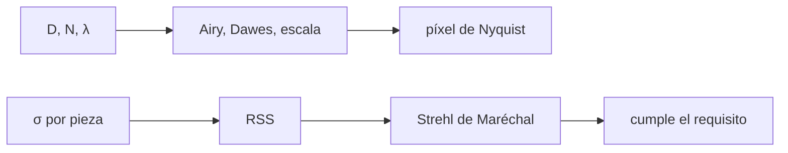

# B43-C01 — Requisitos ópticos y mecánicos

<!-- nav:top -->
[🏠 Programa](../../../../README.md) · [📚 Bloque B43](../../../tronco-comun/B43-construccion-y-mecanica-de-telescopios.md) · [← Anterior: B42-C24 — Métricas de desempeño de óptica adaptativa: Strehl y energía encerrada](../../B42/B42-C24-metricas-de-desempeno-de-optica-adaptativa-strehl-y-energia-encerrada/CLASE.md) · [Siguiente: B43-C02 — Selección de geometría instrumental →](../B43-C02-seleccion-de-geometria-instrumental/CLASE.md)
<!-- /nav -->

## 1. Ubicación, nivel y alcance

Clase 1 del bloque B43. Nivel N3. Un telescopio se compra, se construye o se diseña a partir de unos pocos números: la apertura, la razón focal, el muestreo del detector y cuánto error de frente de onda se tolera. Aquí conviertes esas decisiones en un cuaderno de requisitos ópticos y mecánicos con un telescopio ilustrativo. Usas [B41](../../../tronco-comun/B41-optica-geometrica-y-diseno-de-telescopios.md), [B42](../../../tronco-comun/B42-optica-fisica-y-optica-adaptativa.md) y [B12](../../../tronco-comun/B12-probabilidad-estadistica-e-incertidumbre.md).

## 2. Por qué esta clase existe

Sin requisitos escritos, cada pieza del telescopio se fabrica «lo mejor posible» y no se sabe cuándo basta. La decisión central: **¿qué error de frente de onda, qué escala de imagen y qué tolerancia mecánica hay que pedir, y cómo se reparte el error entre las piezas?**

## 3. Lo que podrás hacer al terminar

1. Calcular el radio de Airy, el límite de Dawes y la escala de placa de un telescopio.
2. Decidir el tamaño de píxel por muestreo de Nyquist.
3. Aplicar la aproximación de Maréchal `S = exp(−(2πσ/λ)²)`.
4. Traducir un error de superficie en error de frente de onda (factor 2 en reflexión).
5. Sumar contribuciones independientes en cuadratura (RSS).
6. Reconocer que lo medido, lo ilustrativo y lo exigido son cosas distintas.

La evidencia es la **ficha de requisitos** del ejercicio 12 (sección 20).

## 4. Con qué llegas y cómo comprobarlo

1. ¿Qué es la difracción de una apertura circular?
2. ¿Qué es una razón focal f/N?
3. ¿Qué es una desviación estándar?
4. ¿Qué es un segundo de arco?
5. ¿Qué es un píxel de un detector?

<details>
<summary>Ver respuestas</summary>

1. El patrón de Airy que forma una apertura circular, de radio angular `1,22 λ/D`. 2. El cociente entre distancia focal y diámetro. 3. Una medida de dispersión, raíz cuadrada de la varianza. 4. 1/3600 de grado. 5. El elemento mínimo de muestreo de la imagen.
</details>

Con cuatro o cinco aciertos, sigue; si no, repasa los prerrequisitos.

## 5. Un caso de contexto y casos de referencia

Telescopio **ilustrativo** de `D = 200 mm`, `f/5` (`F = 1000 mm`), `λ = 550 nm` y píxel de `3,76 µm`. El radio de Airy es `0,6920"`, la escala de placa `206,265"/mm` y el píxel abarca `0,7756"`. Con un frente de onda de `λ/14` RMS el Strehl de Maréchal es `0,8176`; el presupuesto de cinco errores suma `30,55 nm` RMS. Es el **ejemplo conductor**.

## 6. Vocabulario

La **apertura** `D` fija la resolución y la luz recogida. La **razón focal** `N = F/D`. La **escala de placa** convierte milímetros del plano focal en segundos de arco. El **muestreo de Nyquist** pide al menos dos píxeles por elemento resoluble. El **error de frente de onda** `σ` (RMS) mide cuánto se aparta la onda de una esfera ideal. El **Strehl** `S` es el cociente entre la intensidad central real y la ideal. El **presupuesto de error** reparte `σ` entre las fuentes.

## 7. Modelo mental: un presupuesto familiar

Como un presupuesto familiar: se fija el gasto total que se tolera (el error de frente de onda) y se reparte entre rubros; los errores independientes no se suman en bloque sino en cuadratura, igual que la dispersión de varias fuentes de ruido.



*Descripción textual:* la apertura y la razón focal fijan la escala y el muestreo; los errores por pieza se suman en cuadratura y fijan el Strehl.

Analogía: un presupuesto familiar. Límite: aberración pequeña, pupila sin obstrucción, luz monocromática.

## 8. La explicación, paso a paso

### 8.1 Escala y muestreo

| Magnitud | Fórmula | Valor |
|---|---|---|
| Distancia focal | `N D` | 1000 mm |
| Radio de Airy | `1,22 λ/D` | 0,6920" |
| Límite de Dawes | `116/D(mm)` | 0,58" |
| Escala de placa | `206 264,806/F` | 206,265"/mm |
| Píxel de 3,76 µm | escala × píxel | 0,7756" |
| Píxel de Nyquist (difracción) | `λN/2` | 1,375 µm |
| Píxel de Nyquist (seeing de 2") | `(2"/2) F` | 4,848 µm |

### 8.2 Maréchal frente al cálculo numérico

Para un frente de onda con aberración esférica primaria de `σ = λ/14`: Maréchal da `S = 0,8176` y la suma numérica sobre la pupila `0,8153`. El RMS medido sobre la malla es `0,0714 λ` y la razón `PV/RMS = 3,355`; por eso un error de `λ/4` PV de esta forma equivale a unos `λ/13,4` RMS.

### 8.3 Del frente de onda a la superficie

Un espejo refleja: el error de frente de onda es el doble del error de superficie. Para `λ/14` de frente de onda se pide una superficie de `λ/28 = 19,64 nm` RMS.

### 8.4 Presupuesto (nm RMS de frente de onda)

| Fuente | σ (nm) |
|---|---|
| figura | 20 |
| soporte | 15 |
| térmico | 10 |
| colimación | 12 |
| montaje | 8 |

La suma en cuadratura da `30,545 nm`; una simulación Monte Carlo de 200 000 muestras da `30,519 nm`. El Strehl resultante es `0,8854`. Los valores son ilustrativos.

## 9. Magnitudes, símbolos y unidades

| Símbolo | Qué es | Unidad | Valor / nota |
|---|---|---|---|
| `D` | apertura | m | 0,200 (ilustrativo) |
| `N` | razón focal | — | 5 |
| `σ` | error de frente de onda RMS | nm | 30,55 (presupuesto) |
| `S` | razón de Strehl | — | 0,8854 |
| `p` | píxel | µm | 3,76 (ilustrativo) |

## 10. Convenciones y referencias

Unidades del SI; coma decimal en el texto y punto decimal en las salidas del laboratorio; los ángulos están en radianes salvo que se indique y las longitudes de onda en nanómetros. Los telescopios y materiales de los ejemplos son ilustrativos.

## 11. De dónde sale lo que afirmamos

| ID | Fuente | Localizador | Respalda | Estado |
|---|---|---|---|---|
| S1 | Sin fuente externa | — | fórmulas estándar (Airy, Dawes, Nyquist, Maréchal) que verifica el laboratorio | No se consultó una fuente para esta clase |

Límites: La aproximación de Maréchal y la regla de Dawes se citan como relaciones estándar sin haber consultado un texto; el laboratorio solo contrasta Maréchal con el cálculo numérico de una forma de aberración. Todos los parámetros del telescopio son ilustrativos.

## 12. Cómo ver el presupuesto

| Fuente | σ (nm) | cuota de varianza |
|---|---|---|
| figura | 20 | 42,9 % |
| soporte | 15 | 24,1 % |
| termico | 10 | 10,7 % |
| colimacion | 12 | 15,4 % |
| montaje | 8 | 6,9 % |

Descripción larga: la figura aporta la mayor cuota de varianza (42,9 %).

## 13. Ejemplo trabajado: el Strehl de un presupuesto

**Paso 1 · Varianzas.** `20² + 15² + 10² + 12² + 8² = 933`.

**Paso 2 · RSS.** `σ = √933 = 30,545 nm`.

**Paso 3 · Maréchal.** `S = exp(−(2π · 30,545/550)²) = 0,8854`.

## 14. Distintas formas de describir el requisito

**En palabras:** el error se reparte y se suma en cuadratura. **En fórmulas:** `S = exp(−(2πσ/λ)²)`. **En tabla:** cuotas de varianza. **En código:** `requisitos.py`.

## 15. Práctica guiada

**Ejercicio 1 · con los pasos indicados.** Radio de Airy en segundos de arco para `D = 200 mm`, `λ = 550 nm`. *Pasos:* `1,22 λ/D × 206 264,806`.

<details><summary>Solución comentada</summary>

`0,6920"`.
</details>

**Ejercicio 2 · con una pista.** Escala de placa de un telescopio de 1000 mm. *Pasos:* ejemplo 8.1.

<details><summary>Solución comentada</summary>

`206,265"/mm`.
</details>

**Ejercicio 3 · casi autónomo.** ¿Cumple Nyquist de difracción un píxel de 3,76 µm a f/5? *Pista:* compáralo con `λN/2`.

<details><summary>Solución comentada</summary>

No: `1,375 µm` es el máximo; el píxel lo supera en un factor `2,73`. Con seeing de 2" basta `4,85 µm`.
</details>

## 16. Práctica autónoma, transferencia e integrador

**Ejercicio 4.** Strehl de Maréchal para `σ = λ/14`.

<details><summary>Solución comentada</summary>

`0,8176`.
</details>

**Ejercicio 5.** Error de superficie RMS que da `λ/14` de frente de onda.

<details><summary>Solución comentada</summary>

`19,64 nm`.
</details>

**Ejercicio 6.** Suma en cuadratura de 20 nm y 15 nm.

<details><summary>Solución comentada</summary>

`25 nm`.
</details>

**Ejercicio 7.** `σ` en unidades de `λ` que corresponde a `λ/4` PV si `PV/RMS = 3,355`.

<details><summary>Solución comentada</summary>

`0,25/3,355 = 0,0745 λ`, es decir `λ/13,4`.
</details>

**Ejercicio 8.** Strehl del presupuesto de la sección 8.4.

<details><summary>Solución comentada</summary>

`0,8854`.
</details>

**Ejercicio 9 · transferencia.** **Transferencia.** Un cliente pide «λ/4» sin decir si es PV, RMS, superficie o frente de onda. ¿Qué haces?

<details><summary>Solución comentada</summary>

Pregunta cada una de esas cuatro cosas: difieren en factores 2 y 3,4, es decir hasta un factor ~7 en el RMS de superficie.
</details>

**Ejercicio 10 · transferencia.** **Transferencia.** ¿Por qué el seeing cambia el píxel recomendado?

<details><summary>Solución comentada</summary>

Porque el elemento resoluble pasa de `λ/D` a unos 2"; el muestreo se elige para el elemento más grande.
</details>

**Ejercicio 11 · transferencia.** **Transferencia.** Un compañero afirma que el telescopio del ejemplo existe. Responde.

<details><summary>Solución comentada</summary>

Es ilustrativo: ninguna cifra procede de un instrumento real.
</details>

**Ejercicio 12.** **Integrador.** Elabora tu *ficha de requisitos*: apertura, razón focal, escala, píxel, σ máximo y presupuesto.

<details><summary>Solución comentada</summary>

Secciones 8.1–8.4 con tus propios números.
</details>

**Ejercicio 12 · integrador.** **Integrador.** Elabora tu *ficha de requisitos*: apertura, razón focal, escala, píxel, σ máximo y presupuesto.

<details><summary>Solución modelo</summary>

Secciones 8.1–8.4 con tus propios números.
</details>

## 17. Laboratorio: requisitos y presupuesto

El script [requisitos.py](requisitos.py) calcula escala, muestreo y Strehl y contrasta Maréchal con una suma numérica sobre la pupila (**comprueba** `0,02` de diferencia en el Strehl y `0,5 %` entre RSS y Monte Carlo).

**Datos:** parámetros **ilustrativos**; semilla `20261109`. **Predice antes de ejecutar:** ¿qué Strehl espera el presupuesto? (≈ 0,89.) **Ejecución del 2026-11-09 (Python 3.12.9):**

```text
Python 3.12.9 (biblioteca estandar)
F_mm = 1000
airy_arcsec = 0.692018
dawes_arcsec = 0.58
escala_arcsec_mm = 206.265
pix_arcsec = 0.775556
nyq_um = 1.375
pix_seeing_um = 4.84814
strehl_marechal = 0.817569
strehl_num = 0.815318
rms_waves = 0.0714039
pv_waves = 0.239579
pv_sobre_rms = 3.35526
sup_rms_nm = 19.6429
rss_nm = 30.545
mc_nm = 30.5193
strehl_presupuesto = 0.885358
Pruebas superadas.
```

```bash
python programa/clases/B43/B43-C01-requisitos-opticos-y-mecanicos/requisitos.py
```

**Límites:** solo aberración esférica en la comparación numérica; errores independientes y gaussianos.

## 18. Errores frecuentes y cómo corregirlos

**Sumar errores en lugar de combinarlos en cuadratura.** Se corrige con 8.4.

**Olvidar el factor 2 de la reflexión.** Se corrige con 8.3.

**Confundir PV con RMS.** Se corrige con 8.2.

**Usar el píxel de Nyquist de difracción con seeing grande.** Se corrige con 8.1.

## 19. Cómo sabrás que vas bien

Tras la sección 8: ¿qué resultado esperabas y cuál obtuviste? Si dudas, repasa el ejemplo 13. Tras el laboratorio: ¿qué comprueba? (ver la sección 17).

## 20. Qué entregas y cómo se evalúa

El producto es tu **ficha de requisitos** (ejercicio 12).

| Criterio | Inicial | En desarrollo | Logrado | Destacado |
|---|---|---|---|---|
| Conceptos | Los confunde | Parciales | conceptos de la clase | Explica los límites |
| Cálculo | Sin unidades | Con errores | Tablas completas | Calcula casos nuevos |
| Numérico | Sin comprobar | Un caso | Contraste con el análisis | Interpreta las diferencias |
| Fuentes | Sin fuente | Sin fecha | fuentes con fecha | Declara lo ilustrativo |
| Límites | No los nombra | Uno | Tres | Discute qué falta del modelo |

**Condiciones críticas (no se compensan con promedio):** rotular el telescopio y los errores como ilustrativos; no confundir PV con RMS; no atribuir Maréchal a una fuente no consultada.

## 21. Ética, seguridad y límites

Clase educativa: los modelos son simplificados. Accesibilidad: tablas equivalentes a las gráficas, fórmulas en texto, ejercicios sin conexión.

## 22. Para cerrar y seguir

Un telescopio de 200 mm f/5 tiene Airy de `0,692"` y un presupuesto de `30,5 nm` da Strehl `0,89`. Queda una pregunta: ¿qué geometría de espejos conviene?

**Glosario español–inglés.** apertura · *aperture*; razón focal · *focal ratio*; escala de placa · *plate scale*; razón de Strehl · *Strehl ratio*; error de frente de onda · *wavefront error*.

**Continuidad.** [B43-C02](../B43-C02-seleccion-de-geometria-instrumental/CLASE.md) elige la geometría instrumental.

**Referencias:** ver sección 11.

<!-- nav:bottom -->
---

[← Anterior: B42-C24 — Métricas de desempeño de óptica adaptativa: Strehl y energía encerrada](../../B42/B42-C24-metricas-de-desempeno-de-optica-adaptativa-strehl-y-energia-encerrada/CLASE.md) · [📚 Bloque B43](../../../tronco-comun/B43-construccion-y-mecanica-de-telescopios.md) · [Siguiente: B43-C02 — Selección de geometría instrumental →](../B43-C02-seleccion-de-geometria-instrumental/CLASE.md)
<!-- /nav -->
