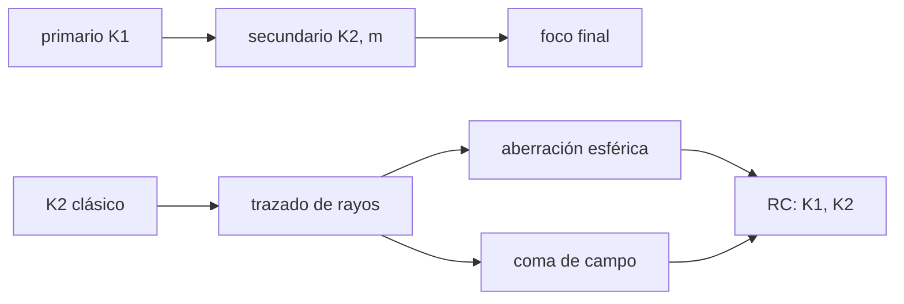

# B43-C02 — Selección de geometría instrumental

<!-- nav:top -->
[🏠 Programa](../../../../README.md) · [📚 Bloque B43](../../../tronco-comun/B43-construccion-y-mecanica-de-telescopios.md) · [← Anterior: B43-C01 — Requisitos ópticos y mecánicos](../B43-C01-requisitos-opticos-y-mecanicos/CLASE.md) · [Siguiente: B43-C03 — Materiales para espejos →](../B43-C03-materiales-para-espejos/CLASE.md)
<!-- /nav -->

## 1. Ubicación, nivel y alcance

Clase 2 del bloque B43. Nivel N3. Con la apertura y la razón focal fijadas, hay que escoger cómo plegar el haz: un newtoniano, un Cassegrain clásico o un Ritchey-Chrétien. Cada uno cambia el largo del tubo, la obstrucción y el coma. Aquí lo calculas con un trazado exacto de rayos de un telescopio ilustrativo. Usas [B41](../../../tronco-comun/B41-optica-geometrica-y-diseno-de-telescopios.md), [B10](../../../tronco-comun/B10-algebra-lineal-y-matematicas-geometricas.md) y [B42](../../../tronco-comun/B42-optica-fisica-y-optica-adaptativa.md).

## 2. Por qué esta clase existe

La geometría decide qué aberraciones quedan y cuánto mide el tubo. La decisión central: **¿qué conicidades de primario y secundario anulan la aberración esférica y el coma, y qué se paga en largo y obstrucción?**

## 3. Lo que podrás hacer al terminar

1. Escribir una superficie cónica con su constante `K`.
2. Hallar la forma del secundario hiperbólico de un Cassegrain clásico.
3. Medir la dispersión del foco por trazado exacto de rayos.
4. Calcular el coma tangencial de un paraboloide y contrastarlo con `3θ/(16N²)`.
5. Obtener las conicidades de un Ritchey-Chrétien resolviendo dos condiciones.
6. Comparar tubos y obstrucciones.

La evidencia es la **ficha de geometría instrumental** del ejercicio 12 (sección 20).

## 4. Con qué llegas y cómo comprobarlo

1. ¿Qué es una cónica?
2. ¿Qué es la aberración esférica?
3. ¿Qué es el coma?
4. ¿Qué es una reflexión especular?
5. ¿Qué es la distancia focal de un espejo esférico?

<details>
<summary>Ver respuestas</summary>

1. Elipse, parábola o hipérbola; en óptica, superficies `z(y)` con constante de conicidad `K`. 2. La falta de enfoque común de los rayos según su altura. 3. La asimetría que crece con el ángulo de campo. 4. Reflexión con ángulo igual al de incidencia. 5. La mitad del radio de curvatura.
</details>

Con cuatro o cinco aciertos, sigue; si no, repasa los prerrequisitos.

## 5. Un caso de contexto y casos de referencia

Primario parabólico ilustrativo de `D = 200 mm` y `F₁ = 1000 mm`; secundario a `700 mm` con aumento `m = 4`: `f = 4000 mm` (`f/20`), radio del secundario `800 mm` y foco `500 mm` detrás del vértice del primario. Es el **ejemplo conductor**.

## 6. Vocabulario

Una **cónica** `z = (R − √(R² − (1+K)y²))/(1+K)` con `K = −1` es un paraboloide. El **Cassegrain clásico** tiene primario parabólico y secundario hiperbólico convexo. El **Ritchey-Chrétien (RC)** usa dos hiperboloides. El **aumento** `m` del secundario multiplica la distancia focal. El **coma** es la aberración de campo del paraboloide. La **obstrucción** es la fracción de diámetro tapada por el secundario.

## 7. Modelo mental: un espejo de feria que se pliega

Como un telescopio de mano plegado con espejos: el haz recorre tres veces el tubo, de modo que la distancia focal larga cabe en un tubo corto; lo que se paga es la obstrucción del secundario.



*Descripción textual:* las conicidades se eligen para anular la aberración esférica y, en el RC, también el coma; el trazado de rayos lo verifica.

Analogía: un espejo de feria que se pliega. Límite: meridional (2D), monocromático, sin obstrucción.

## 8. La explicación, paso a paso

### 8.1 El secundario del Cassegrain clásico

Con el aumento `m = 4`, `s₁ = 300 mm`, `s₂ = 1200 mm` y radio `R₂ = 800 mm`. La constante cónica `K₂ = −((m+1)/(m−1))² = -2,77778`, idéntica a la del hiperboloide con focos en las dos imágenes (`-2,77778`). El trazado de cinco alturas (20 a 100 mm) da una dispersión del foco axial de `1,44 × 10⁻¹¹ mm`: la aberración esférica es nula. Si el secundario fuera esférico (`K₂ = 0`) la diferencia de foco entre el borde y el centro sería de `-6,786 mm`.

### 8.2 Coma

Para `θ = 0,1°`, el paraboloide solo (newtoniano f/5) da un coma de `13,135 µm`; la fórmula `3θ/(16N²) F` da `13,090 µm`. El Cassegrain clásico f/20 queda en `3,275 µm`.

### 8.3 Ritchey-Chrétien

Resolviendo aberración esférica y coma cero con Newton 2×2 se obtiene `K₁ = -1,05371` y `K₂ = -3,20217`; residuos `-1 × 10⁻¹² mm` de esférica y `0 µm` de coma. El primario deja de ser parabólico.

### 8.4 Tubo y obstrucción

| Esquema | Longitud del tubo (mm) | Diámetro del secundario (mm) |
|---|---|---|
| Newtoniano f/5 | 1000 | plano elíptico |
| Cassegrain f/20 | 700 | 60 (aprox. `D s₁/F₁`) |

## 9. Magnitudes, símbolos y unidades

| Símbolo | Qué es | Unidad | Valor / nota |
|---|---|---|---|
| `K` | constante de conicidad | — | RC: -1,0537 y -3,2022 |
| `R₂` | radio del secundario | mm | 800 |
| `m` | aumento del secundario | — | 4 |
| `θ` | ángulo de campo | rad | 1,745 × 10⁻³ (0,1°) |

## 10. Convenciones y referencias

Unidades del SI; coma decimal en el texto y punto decimal en las salidas del laboratorio; los ángulos están en radianes salvo que se indique y las longitudes de onda en nanómetros. Los telescopios y materiales de los ejemplos son ilustrativos.

## 11. De dónde sale lo que afirmamos

| ID | Fuente | Localizador | Respalda | Estado |
|---|---|---|---|---|
| S1 | Sin fuente externa | — | geometría de cónicas y fórmula de coma de tercer orden, verificadas por trazado | No se consultó una fuente para esta clase |

Límites: No se contrastó con los textos de Schroeder ni de Rutten y van Venrooij (no consultados); el RC se obtiene numéricamente y no se comparó con su forma cerrada. Los parámetros son ilustrativos.

## 12. Cómo ver las configuraciones

| Esquema | f/ | Coma a 0,1° (µm) | Aberración esférica |
|---|---|---|---|
| Newtoniano | 5 | 13,14 | nula (paraboloide) |
| Cassegrain clásico | 20 | 3,27 | nula |
| Ritchey-Chrétien | 20 | 0,00 | nula |

Descripción larga: solo el RC anula también el coma.

## 13. Ejemplo trabajado: el secundario clásico

**Paso 1 · Distancias.** `s₁ = F₁ − 700 = 300 mm`, `s₂ = m s₁ = 1200 mm`.

**Paso 2 · Radio.** `R₂ = 2 s₁ s₂/(s₂ − s₁) = 800 mm`.

**Paso 3 · Cónica.** `K₂ = −(5/3)² = -2,7778`.

## 14. Distintas formas de describir la geometría

**En palabras:** el secundario hiperbólico devuelve todos los rayos al mismo foco. **En fórmulas:** `K₂ = −((m+1)/(m−1))²`. **En tabla:** configuraciones. **En código:** `geometria.py`.

## 15. Práctica guiada

**Ejercicio 1 · con los pasos indicados.** Calcula `s₂` si `s₁ = 300 mm` y `m = 4`. *Pasos:* `s₂ = m s₁`.

<details><summary>Solución comentada</summary>

`1200 mm`.
</details>

**Ejercicio 2 · con una pista.** `R₂` con `s₁ = 300` y `s₂ = 1200`. *Pasos:* `2 s₁ s₂/(s₂−s₁)`.

<details><summary>Solución comentada</summary>

`800 mm`.
</details>

**Ejercicio 3 · casi autónomo.** `K₂` clásica para `m = 4`.

<details><summary>Solución comentada</summary>

`-2,7778`.
</details>

## 16. Práctica autónoma, transferencia e integrador

**Ejercicio 4.** Distancia focal y razón focal del Cassegrain.

<details><summary>Solución comentada</summary>

`4000 mm`, `f/20`.
</details>

**Ejercicio 5.** Coma de un paraboloide f/5 de 1000 mm a `θ = 1,745 × 10⁻³ rad`.

<details><summary>Solución comentada</summary>

`3θF/(16N²) = 13,09 µm`.
</details>

**Ejercicio 6.** ¿Cuánto mide el foco detrás del primario?

<details><summary>Solución comentada</summary>

`500 mm`.
</details>

**Ejercicio 7.** Obstrucción lineal aproximada `s₁/F₁`.

<details><summary>Solución comentada</summary>

`300/1000 = 30 %` del diámetro del primario.
</details>

**Ejercicio 8.** ¿Cuál es `K₁` del RC?

<details><summary>Solución comentada</summary>

`-1,0537`, algo menor que −1.
</details>

**Ejercicio 9 · transferencia.** **Transferencia.** ¿Por qué el RC es popular en los telescopios grandes?

<details><summary>Solución comentada</summary>

Porque no tiene aberración esférica ni coma, de modo que el campo útil es mayor.
</details>

**Ejercicio 10 · transferencia.** **Transferencia.** Un newtoniano de 200 mm f/5 y un Cassegrain de igual apertura: ¿qué se gana y qué se pierde?

<details><summary>Solución comentada</summary>

Se gana largo focal en un tubo corto; se pierde por la obstrucción del secundario.
</details>

**Ejercicio 11 · transferencia.** **Transferencia.** ¿Es el RC de la sección 8.3 el diseño de algún telescopio real?

<details><summary>Solución comentada</summary>

No: es ilustrativo, con parámetros inventados.
</details>

**Ejercicio 12.** **Integrador.** Elabora tu *ficha de geometría instrumental*: esquema, conicidades, largo y coma.

<details><summary>Solución comentada</summary>

Secciones 8.1–8.4.
</details>

**Ejercicio 12 · integrador.** **Integrador.** Elabora tu *ficha de geometría instrumental*: esquema, conicidades, largo y coma.

<details><summary>Solución modelo</summary>

Secciones 8.1–8.4.
</details>

## 17. Laboratorio: trazado exacto de rayos

El script [geometria.py](geometria.py) traza rayos meridionales por conicas, resuelve el RC y compara con la formula del coma (**comprueba** `1e-6 mm` de dispersion en el clasico y `2 %` en el coma).

**Datos:** geometría **ilustrativa**. **Predice antes de ejecutar:** ¿qué esquema anula el coma? (El RC.) **Ejecución del 2026-11-09 (Python 3.12.9):**

```text
Python 3.12.9 (biblioteca estandar)
R2_mm = 800
foco_final_z_mm = -500
f_efectiva_mm = 4000
N_efectiva = 20
K2_clasico = -2.77778
K2_hiperbola = -2.77778
dispersion_foco_clasico_mm = 1.44382e-11
esferica_sec_esferico_mm = -6.78608
coma_clasico_um = 3.27451
K1_RC = -1.05371
K2_RC = -3.20217
sa_RC_mm = -1.02318e-12
coma_RC_um = 0
coma_newton_um = 13.1354
coma_formula_um = 13.09
tubo_newton_mm = 1000
tubo_cassegrain_mm = 700
obstruccion_sec_mm = 60
Pruebas superadas.
```

```bash
python programa/clases/B43/B43-C02-seleccion-de-geometria-instrumental/geometria.py
```

**Límites:** solo meridional; no incluye difracción ni obstrucción.

## 18. Errores frecuentes y cómo corregirlos

**Creer que el Cassegrain clásico no tiene coma.** Se corrige con 8.2.

**Usar la `K` del clásico para el RC.** Se corrige con 8.3.

**Olvidar que el trazado es meridional.** Se corrige con los límites.

**Confundir el foco virtual con el final.** Se corrige con 8.1.

## 19. Cómo sabrás que vas bien

Tras la sección 8: ¿qué resultado esperabas y cuál obtuviste? Si dudas, repasa el ejemplo 13. Tras el laboratorio: ¿qué comprueba? (ver la sección 17).

## 20. Qué entregas y cómo se evalúa

El producto es tu **ficha de geometría instrumental** (ejercicio 12).

| Criterio | Inicial | En desarrollo | Logrado | Destacado |
|---|---|---|---|---|
| Conceptos | Los confunde | Parciales | conceptos de la clase | Explica los límites |
| Cálculo | Sin unidades | Con errores | Tablas completas | Calcula casos nuevos |
| Numérico | Sin comprobar | Un caso | Contraste con el análisis | Interpreta las diferencias |
| Fuentes | Sin fuente | Sin fecha | fuentes con fecha | Declara lo ilustrativo |
| Límites | No los nombra | Uno | Tres | Discute qué falta del modelo |

**Condiciones críticas (no se compensan con promedio):** rotular la geometría como ilustrativa; no presentar el RC como un diseño real; no atribuir resultados a textos no consultados.

## 21. Ética, seguridad y límites

Clase educativa: los modelos son simplificados. Accesibilidad: tablas equivalentes a las gráficas, fórmulas en texto, ejercicios sin conexión.

## 22. Para cerrar y seguir

El secundario clásico de `K₂ = -2,778` anula la esférica; solo el RC (`K₁ = -1,054`) anula también el coma. Queda una pregunta: ¿de qué se hacen los espejos?

**Glosario español–inglés.** cónica · *conic*; secundario · *secondary mirror*; coma · *coma*; aumento · *magnification*; Ritchey-Chrétien · *Ritchey-Chrétien*.

**Continuidad.** [B43-C03](../B43-C03-materiales-para-espejos/CLASE.md) estudia los materiales de los espejos.

**Referencias:** ver sección 11.

<!-- nav:bottom -->
---

[← Anterior: B43-C01 — Requisitos ópticos y mecánicos](../B43-C01-requisitos-opticos-y-mecanicos/CLASE.md) · [📚 Bloque B43](../../../tronco-comun/B43-construccion-y-mecanica-de-telescopios.md) · [Siguiente: B43-C03 — Materiales para espejos →](../B43-C03-materiales-para-espejos/CLASE.md)
<!-- /nav -->
