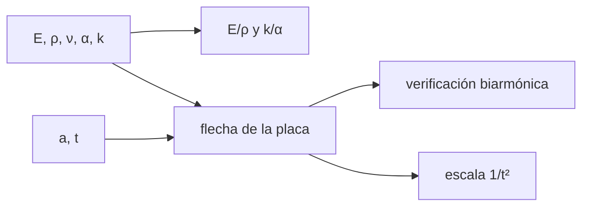

# B43-C03 — Materiales para espejos

<!-- nav:top -->
[🏠 Programa](../../../../README.md) · [📚 Bloque B43](../../../tronco-comun/B43-construccion-y-mecanica-de-telescopios.md) · [← Anterior: B43-C02 — Selección de geometría instrumental](../B43-C02-seleccion-de-geometria-instrumental/CLASE.md) · [Siguiente: B43-C04 — Fabricación y desbaste de espejos →](../B43-C04-fabricacion-y-desbaste-de-espejos/CLASE.md)
<!-- /nav -->

## 1. Ubicación, nivel y alcance

Clase 3 del bloque B43. Nivel N3. Un espejo se deforma bajo su propio peso, se dilata con la temperatura y se calienta o enfría con lentitud. Cada material equilibra esas tres propiedades. Aquí comparas siete materiales ilustrativos y calculas la flexión de un disco con la teoría de placas. Usas [B05](../../../tronco-comun/B05-fisica-fundamental-para-el-espacio.md), [B11](../../../tronco-comun/B11-ecuaciones-diferenciales-y-simulacion-numerica.md) y [B42](../../../tronco-comun/B42-optica-fisica-y-optica-adaptativa.md).

## 2. Por qué esta clase existe

Un buen material no es el más duro ni el más estable: es el que deja el menor error de forma para una masa y un presupuesto. La decisión central: **¿qué material y qué espesor mantienen la flexión y la deriva térmica por debajo de la tolerancia?**

## 3. Lo que podrás hacer al terminar

1. Calcular la rigidez específica `E/ρ` y la figura de mérito térmica `k/α`.
2. Estimar la flecha de un disco apoyado en el borde bajo su peso.
3. Verificar una solución de placa sustituyéndola en la ecuación biarmónica.
4. Ver cómo la flecha escala con `1/t²`.
5. Comparar siete materiales con valores de orden de magnitud.
6. Reconocer que las propiedades usadas no vienen de una hoja de fabricante.

La evidencia es la **ficha de materiales** del ejercicio 12 (sección 20).

## 4. Con qué llegas y cómo comprobarlo

1. ¿Qué es el módulo de Young?
2. ¿Qué es el coeficiente de dilatación térmica?
3. ¿Qué es la conductividad térmica?
4. ¿Qué es una derivada parcial?
5. ¿Qué es una flecha?

<details>
<summary>Ver respuestas</summary>

1. La rigidez de un material, esfuerzo/deformación. 2. El cambio relativo de longitud por kelvin. 3. El flujo de calor por unidad de gradiente. 4. La derivada respecto a una variable con las demás fijas. 5. El desplazamiento transversal máximo de una viga o placa.
</details>

Con cuatro o cinco aciertos, sigue; si no, repasa los prerrequisitos.

## 5. Un caso de contexto y casos de referencia

Disco ilustrativo de `a = 100 mm` y `t = 33,3 mm` apoyado en el borde. En borosilicato la flecha central bajo su peso es de `24,37 nm`; con la mitad del espesor sería `4,0` veces mayor. Es el **ejemplo conductor**.

## 6. Vocabulario

El **módulo de Young** `E`. La **rigidez específica** `E/ρ` compara materiales de igual masa. La **figura de mérito térmica** `k/α` indica cuánto se deforma por un flujo de calor dado. La **placa de Kirchhoff** es un disco delgado. La **ecuación biarmónica** `∇⁴w = q/D` gobierna su flexión. La **flecha** es el desplazamiento del centro respecto del borde.

## 7. Modelo mental: una tabla de cocina que se comba

Como una tabla de cocina apoyada en dos bordes que se comba por su propio peso: al duplicar el espesor la flecha cae a la cuarta parte; el material solo fija la constante.



*Descripción textual:* las propiedades del material y la geometría dan la flecha; se verifica sustituyendo la solución en la ecuación diferencial.

Analogía: una tabla de cocina que se comba. Límite: placa delgada, material homogéneo, apoyo perimetral simple.

## 8. La explicación, paso a paso

### 8.1 Siete materiales (valores ILUSTRATIVOS)

| Material | E/ρ (MN m/kg) | k/α (W/m por 10⁻⁶/K) | Flecha central (nm) |
|---|---|---|---|
| borosilicato | 28,251 | 0,4 | 24,37 |
| silice fundida | 33,182 | 2,5 | 21,40 |
| vitroceramica | 35,573 | 29,2 | 18,53 |
| ULE (tipo) | 30,769 | 43,7 | 23,08 |
| SiC | 125,000 | 60,0 | 5,57 |
| aluminio | 25,556 | 7,1 | 23,12 |
| berilio | 155,135 | 18,9 | 4,99 |

### 8.2 La flecha

`w(0) = (5+ν)/(1+ν) · q a⁴/(64 D_f)` con `D_f = E t³/(12(1−ν²))` y `q = ρ g t`; para el borosilicato `24,37 nm`, igual al valor de la solución evaluada en el centro (`24,37 nm`).

### 8.3 Verificación de la solución

Se sustituye `w(r)` en la ecuación biarmónica axisimétrica con diferencias finitas: el residuo relativo es `3,67 × 10⁻⁹`; la flecha en el borde es `0` y el momento radial en el borde, en unidades de `q a²`, `3,79 × 10⁻⁵`: se cumplen las condiciones de apoyo simple.

### 8.4 Escala con el espesor

Con `t/2` la flecha es `4,000` veces la original: `w ∝ 1/t²` a igual `q/t`.

## 9. Magnitudes, símbolos y unidades

| Símbolo | Qué es | Unidad | Valor / nota |
|---|---|---|---|
| `E/ρ` | rigidez específica | MN m/kg | 125,0 (SiC ilustrativo) |
| `k/α` | mérito térmico | W/m por 10⁻⁶/K | ver 8.1 |
| `D_f` | rigidez a flexión | N m | — |
| `g` | gravedad estándar | m/s² | 9,80665 (NIST) |

## 10. Convenciones y referencias

Unidades del SI; coma decimal en el texto y punto decimal en las salidas del laboratorio; los ángulos están en radianes salvo que se indique y las longitudes de onda en nanómetros. Los telescopios y materiales de los ejemplos son ilustrativos.

## 11. De dónde sale lo que afirmamos

| ID | Fuente | Localizador | Respalda | Estado |
|---|---|---|---|---|
| S1 | NIST, *Fundamental Physical Constants* (CODATA 2022) | https://physics.nist.gov/cuu/Constants/Table/allascii.txt | constantes citadas en la sección 9 | Consultada el 2026-11-09 |
| S2 | Propiedades de los materiales | — | módulos, densidades, dilataciones y conductividades de la tabla 8.1 | Ilustrativas, valores típicos de orden de magnitud NO consultados en hojas de fabricante |

Límites: La fórmula de la flecha del disco se verifica numéricamente contra la ecuación diferencial, pero no se contrastó con un texto de placas. Las propiedades de los materiales no sirven para diseñar.

## 12. Cómo ver los materiales

| Material | Flecha central (nm) |
|---|---|
| borosilicato | 24,37 |
| silice fundida | 21,40 |
| vitroceramica | 18,53 |
| ULE (tipo) | 23,08 |
| SiC | 5,57 |
| aluminio | 23,12 |
| berilio | 4,99 |

Descripción larga: el SiC y el berilio flectan cuatro a cinco veces menos que el vidrio.

## 13. Ejemplo trabajado: la flecha del borosilicato

**Paso 1 · Rigidez.** `D_f = E t³/(12(1−ν²))`.

**Paso 2 · Carga.** `q = ρ g t`.

**Paso 3 · Flecha.** `w(0) = (5+0,2)/(1+0,2) · q a⁴/(64 D_f) = 24,37 nm`.

## 14. Distintas formas de describir el material

**En palabras:** el material fija la constante y el espesor fija la potencia. **En fórmulas:** `w ∝ ρ g a⁴/(E t²)`. **En tabla:** siete materiales. **En código:** `materiales.py`.

## 15. Práctica guiada

**Ejercicio 1 · con los pasos indicados.** `E/ρ` del SiC ilustrativo. *Pasos:* `400 GPa / 3200 kg/m³`.

<details><summary>Solución comentada</summary>

`125,0 MN m/kg`.
</details>

**Ejercicio 2 · con una pista.** `k/α` de la vitrocerámica ilustrativa.

<details><summary>Solución comentada</summary>

`29,2`.
</details>

**Ejercicio 3 · casi autónomo.** Flecha del borosilicato.

<details><summary>Solución comentada</summary>

`24,37 nm`.
</details>

## 16. Práctica autónoma, transferencia e integrador

**Ejercicio 4.** Flecha del berilio.

<details><summary>Solución comentada</summary>

`4,99 nm`.
</details>

**Ejercicio 5.** Razón de flechas aluminio/berilio.

<details><summary>Solución comentada</summary>

`4,64`.
</details>

**Ejercicio 6.** Factor de la flecha si se duplica `t` con `q/t` constante.

<details><summary>Solución comentada</summary>

`1/4`.
</details>

**Ejercicio 7.** Factor si el diámetro se duplica con el mismo espesor y `q` proporcional a `t`.

<details><summary>Solución comentada</summary>

`16` (porque `w ∝ a⁴`).
</details>

**Ejercicio 8.** ¿Por qué se sustituye la solución en la ecuación biarmónica?

<details><summary>Solución comentada</summary>

Es una segunda vía independiente de la fórmula.
</details>

**Ejercicio 9 · transferencia.** **Transferencia.** ¿Por qué un espejo lleva más cuidado en su apoyo que en su espesor?

<details><summary>Solución comentada</summary>

Porque la flecha crece con `a⁴` y el apoyo reparte la carga.
</details>

**Ejercicio 10 · transferencia.** **Transferencia.** Un compañero elige el material solo por `E/ρ`. Responde.

<details><summary>Solución comentada</summary>

Falta la térmica: `k/α` y la dilatación pesan igual.
</details>

**Ejercicio 11 · transferencia.** **Transferencia.** ¿Son estos valores los de una hoja de datos?

<details><summary>Solución comentada</summary>

No: son típicos de orden de magnitud.
</details>

**Ejercicio 12.** **Integrador.** Elabora tu *ficha de materiales*: tabla, flecha y escala.

<details><summary>Solución comentada</summary>

Secciones 8.1–8.4.
</details>

**Ejercicio 12 · integrador.** **Integrador.** Elabora tu *ficha de materiales*: tabla, flecha y escala.

<details><summary>Solución modelo</summary>

Secciones 8.1–8.4.
</details>

## 17. Laboratorio: flexión de un disco

El script [materiales.py](materiales.py) calcula `E/ρ`, `k/α` y la flecha de siete materiales y verifica la solución en la ecuación biarmónica (**comprueba** residuo menor que `1e-3` y borde nulo).

**Datos:** `g` de NIST; materiales **ilustrativos**. **Predice antes de ejecutar:** ¿qué material flecta menos? (Berilio y SiC.) **Ejecución del 2026-11-09 (Python 3.12.9):**

```text
Python 3.12.9 (biblioteca estandar)
material | E/rho (MN m/kg) | k/alpha (W/m por 1e-6/K) | flecha central (nm)
borosilicato | 28.251 | 0.4 | 24.37
silice fundida | 33.182 | 2.5 | 21.40
vitroceramica | 35.573 | 29.2 | 18.53
ULE (tipo) | 30.769 | 43.7 | 23.08
SiC | 125.000 | 60.0 | 5.57
aluminio | 25.556 | 7.1 | 23.12
berilio | 155.135 | 18.9 | 4.99
razon_t_mitad = 4
residuo_biarmonico = 3.67145e-09
w_borde = 0
Mr_borde_rel = 3.79154e-05
flecha_centro_nm = 24.3681
flecha_formula_nm = 24.3681
Pruebas superadas.
```

```bash
python programa/clases/B43/B43-C03-materiales-para-espejos/materiales.py
```

**Límites:** placa delgada; `t/a = 1/3` es gruesa para Kirchhoff.

## 18. Errores frecuentes y cómo corregirlos

**Tomar las propiedades como datos de fabricante.** Se corrige con la sección 11.

**Olvidar que `w ∝ 1/t²`.** Se corrige con 8.4.

**Comparar solo `E/ρ`.** Se corrige con 8.1.

**Confundir flecha con deformación.** Se corrige con la sección 6.

## 19. Cómo sabrás que vas bien

Tras la sección 8: ¿qué resultado esperabas y cuál obtuviste? Si dudas, repasa el ejemplo 13. Tras el laboratorio: ¿qué comprueba? (ver la sección 17).

## 20. Qué entregas y cómo se evalúa

El producto es tu **ficha de materiales** (ejercicio 12).

| Criterio | Inicial | En desarrollo | Logrado | Destacado |
|---|---|---|---|---|
| Conceptos | Los confunde | Parciales | conceptos de la clase | Explica los límites |
| Cálculo | Sin unidades | Con errores | Tablas completas | Calcula casos nuevos |
| Numérico | Sin comprobar | Un caso | Contraste con el análisis | Interpreta las diferencias |
| Fuentes | Sin fuente | Sin fecha | fuentes con fecha | Declara lo ilustrativo |
| Límites | No los nombra | Uno | Tres | Discute qué falta del modelo |

**Condiciones críticas (no se compensan con promedio):** rotular las propiedades como ilustrativas; no usarlas para diseñar; citar NIST solo para `g`.

## 21. Ética, seguridad y límites

Clase educativa: los modelos son simplificados. Accesibilidad: tablas equivalentes a las gráficas, fórmulas en texto, ejercicios sin conexión.

## 22. Para cerrar y seguir

El borosilicato ilustrativo flecta `24,4 nm` bajo su peso y la flecha escala con `1/t²`. Queda una pregunta: ¿cómo se da forma al vidrio?

**Glosario español–inglés.** módulo de Young · *Young's modulus*; rigidez específica · *specific stiffness*; flecha · *deflection*; placa · *plate*; conductividad térmica · *thermal conductivity*.

**Continuidad.** [B43-C04](../B43-C04-fabricacion-y-desbaste-de-espejos/CLASE.md) estudia el desbaste del espejo.

**Referencias:** ver sección 11.

<!-- nav:bottom -->
---

[← Anterior: B43-C02 — Selección de geometría instrumental](../B43-C02-seleccion-de-geometria-instrumental/CLASE.md) · [📚 Bloque B43](../../../tronco-comun/B43-construccion-y-mecanica-de-telescopios.md) · [Siguiente: B43-C04 — Fabricación y desbaste de espejos →](../B43-C04-fabricacion-y-desbaste-de-espejos/CLASE.md)
<!-- /nav -->
