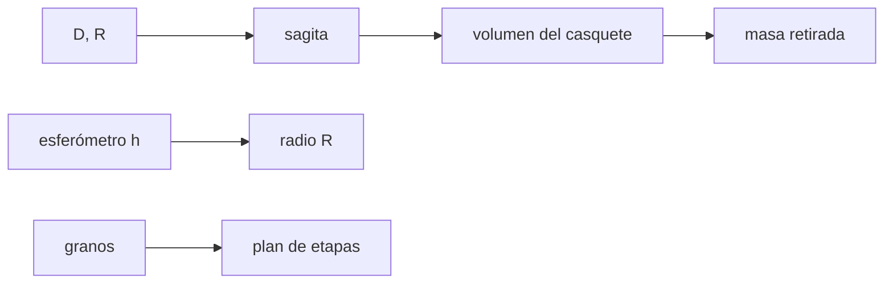

# B43-C04 — Fabricación y desbaste de espejos

<!-- nav:top -->
[🏠 Programa](../../../../README.md) · [📚 Bloque B43](../../../tronco-comun/B43-construccion-y-mecanica-de-telescopios.md) · [← Anterior: B43-C03 — Materiales para espejos](../B43-C03-materiales-para-espejos/CLASE.md) · [Siguiente: B43-C05 — Pulido óptico →](../B43-C05-pulido-optico/CLASE.md)
<!-- /nav -->

## 1. Ubicación, nivel y alcance

Clase 4 del bloque B43. Nivel N3. Antes de pulir, el vidrio plano se desbasta hasta la curvatura correcta. Se mide con un esferómetro y se retira volumen con abrasivos cada vez más finos. Aquí calculas sagita, volumen, masa retirada y un plan de etapas con un espejo ilustrativo. Usas [B05](../../../tronco-comun/B05-fisica-fundamental-para-el-espacio.md) y [B13](../../../tronco-comun/B13-metrologia-tiempo-y-mediciones-cientificas.md).

## 2. Por qué esta clase existe

El desbaste fija el radio de curvatura; los errores de esta etapa se pagan en horas de pulido. La decisión central: **¿cuánta profundidad hay que excavar, cómo se mide el radio y cuánto abrasivo se necesita en cada etapa?**

## 3. Lo que podrás hacer al terminar

1. Calcular la sagita de un espejo a partir de `D` y `R`.
2. Medir el radio con un esferómetro y verificarlo por dos vías.
3. Calcular el volumen del casquete y comprobarlo con una integral numérica.
4. Estimar la masa de vidrio retirada.
5. Armar un plan de etapas donde cada grano elimina el daño del anterior.
6. Reconocer que las tasas y la regla del daño son ilustrativas.

La evidencia es la **ficha de desbaste** del ejercicio 12 (sección 20).

## 4. Con qué llegas y cómo comprobarlo

1. ¿Qué es la sagita?
2. ¿Qué es el radio de curvatura?
3. ¿Qué es un volumen de revolución?
4. ¿Qué es un abrasivo?
5. ¿Qué es una regla de Simpson?

<details>
<summary>Ver respuestas</summary>

1. La profundidad del arco entre el vértice y el plano del borde. 2. El radio de la esfera que mejor aproxima la superficie. 3. El volumen que se obtiene al girar una curva alrededor de un eje. 4. Un polvo duro que arranca material. 5. Un método numérico de integración.
</details>

Con cuatro o cinco aciertos, sigue; si no, repasa los prerrequisitos.

## 5. Un caso de contexto y casos de referencia

Espejo ilustrativo de `D = 200 mm` y `f/6` (`R = 2400 mm`). La sagita exacta es `2,0842 mm`, el volumen retirado `32,744 cm³` (`73,0 g` de un blanco de `2312 g`) y el plan de cinco etapas dura `45,7 min`. Es el **ejemplo conductor**.

## 6. Vocabulario

La **sagita** `s = R − √(R² − a²)`. El **esferómetro** de tres patas mide una pequeña sagita `h`. El **casquete esférico** es el volumen entre el plano y la esfera. El **grano** es el tamaño del abrasivo. El **daño subsuperficial** es la capa fracturada que deja cada etapa y que la siguiente debe quitar.

## 7. Modelo mental: cavar un cuenco con cucharas cada vez más pequeñas

Como cavar un cuenco: primero con una pala grande, luego con cucharas finas que borran las marcas de la anterior; el volumen total se calcula una sola vez y el tiempo es la suma de las etapas.



*Descripción textual:* el radio fija la sagita y el volumen; el esferómetro devuelve el radio; los granos fijan el plan.

Analogía: cavar un cuenco con cucharas cada vez más pequeñas. Límite: esfera ideal, sin bisel; plan de balance, no de taller.

## 8. La explicación, paso a paso

### 8.1 Sagita

| Cálculo | Valor |
|---|---|
| Exacta `R − √(R² − a²)` | 2,0842 mm |
| Aproximada `a²/(2R)` | 2,0833 mm |
| Paraboloide `D²/(16 F)` | 2,0833 mm |

### 8.2 Esferómetro

Con patas sobre un círculo de radio `ℓ = 50 mm`, la sagita medida es `h = 0,52089 mm`. El radio resulta `2400,0000 mm` por `(ℓ²+h²)/(2h)`, `2400,0000 mm` por bisección numérica y `2400,0000 mm` por `L²/(6h) + h/2` con `L = ℓ√3`.

### 8.3 Volumen

El casquete `V = π s (3a² + s²)/6` vale `32,74388 cm³` y la integral numérica `32,74388 cm³`. Con `ρ = 2230 kg/m³` son `73,02 g` retirados.

### 8.4 Plan de etapas (ILUSTRATIVO)

| Etapa | Grano (µm) | Retiro (µm) | Tiempo (min) |
|---|---|---|---|
| grano 1 | 150 | 300 | 5,00 |
| grano 2 | 80 | 300 | 10,00 |
| grano 3 | 40 | 160 | 10,67 |
| grano 4 | 20 | 80 | 10,00 |
| grano 5 | 9 | 40 | 10,00 |

Tiempo total `45,67 min`.

## 9. Magnitudes, símbolos y unidades

| Símbolo | Qué es | Unidad | Valor / nota |
|---|---|---|---|
| `s` | sagita | mm | 2,0842 |
| `R` | radio de curvatura | mm | 2400 (ilustrativo) |
| `V` | volumen retirado | cm³ | 32,744 |
| `h` | sagita del esferómetro | mm | 0,5209 |

## 10. Convenciones y referencias

Unidades del SI; coma decimal en el texto y punto decimal en las salidas del laboratorio; los ángulos están en radianes salvo que se indique y las longitudes de onda en nanómetros. Los telescopios y materiales de los ejemplos son ilustrativos.

## 11. De dónde sale lo que afirmamos

| ID | Fuente | Localizador | Respalda | Estado |
|---|---|---|---|---|
| S1 | Manual de fabricación de espejos | — | tamaños de grano, tasas y regla del daño subsuperficial (ilustrativos) | No consultado |

Límites: Los granos, las tasas de arranque y la regla del daño de 2 × grano son órdenes de magnitud que no se consultaron en ningún manual; el plan es un balance, no un procedimiento. La geometría (sagita, esferómetro, casquete) sí se verifica por dos vías.

## 12. Cómo ver las etapas

| Etapa | Retiro (µm) | Tiempo (min) |
|---|---|---|
| grano 1 | 300 | 5,00 |
| grano 2 | 300 | 10,00 |
| grano 3 | 160 | 10,67 |
| grano 4 | 80 | 10,00 |
| grano 5 | 40 | 10,00 |

Descripción larga: la etapa más gruesa y la más fina duran poco; las intermedias, más.

## 13. Ejemplo trabajado: el volumen del casquete

**Paso 1 · Sagita.** `s = 2,0842 mm`.

**Paso 2 · Volumen.** `V = π s (3 · 100² + s²)/6 = 32,744 cm³`.

**Paso 3 · Masa.** `ρ V = 73,0 g`.

## 14. Distintas formas de describir el desbaste

**En palabras:** se cava una profundidad `s` con volumen de casquete. **En fórmulas:** `V = π s (3a²+s²)/6`. **En tabla:** etapas. **En código:** `desbaste.py`.

## 15. Práctica guiada

**Ejercicio 1 · con los pasos indicados.** Sagita aproximada de un espejo con `a = 100 mm` y `R = 2400 mm`.

<details><summary>Solución comentada</summary>

`2,0833 mm`.
</details>

**Ejercicio 2 · con una pista.** Sagita de un paraboloide de `D = 200 mm` y `F = 1200 mm`.

<details><summary>Solución comentada</summary>

`D²/(16F) = 2,0833 mm`.
</details>

**Ejercicio 3 · casi autónomo.** Radio por esferómetro con `ℓ = 50 mm` y `h = 0,52089 mm`.

<details><summary>Solución comentada</summary>

`(ℓ²+h²)/(2h) = 2400 mm`.
</details>

## 16. Práctica autónoma, transferencia e integrador

**Ejercicio 4.** Volumen del casquete con `s = 2,0842 mm`.

<details><summary>Solución comentada</summary>

`32,74 cm³`.
</details>

**Ejercicio 5.** Masa retirada.

<details><summary>Solución comentada</summary>

`73,0 g`.
</details>

**Ejercicio 6.** Fracción de la masa del blanco.

<details><summary>Solución comentada</summary>

`3,16 %`.
</details>

**Ejercicio 7.** Retiro de la etapa 3.

<details><summary>Solución comentada</summary>

`2 × 80 µm = 160 µm`.
</details>

**Ejercicio 8.** Tiempo total del plan.

<details><summary>Solución comentada</summary>

`45,67 min`.
</details>

**Ejercicio 9 · transferencia.** **Transferencia.** ¿Por qué la sagita exacta y la aproximada casi coinciden?

<details><summary>Solución comentada</summary>

Porque `a/R` es pequeño (~0,04).
</details>

**Ejercicio 10 · transferencia.** **Transferencia.** ¿Por qué cada etapa debe quitar el doble del grano anterior?

<details><summary>Solución comentada</summary>

Para borrar la capa fracturada; la regla es ilustrativa.
</details>

**Ejercicio 11 · transferencia.** **Transferencia.** ¿Puedo usar este plan en el taller?

<details><summary>Solución comentada</summary>

No: es un balance de orden de magnitud.
</details>

**Ejercicio 12.** **Integrador.** Elabora tu *ficha de desbaste*: sagita, radio, volumen y plan.

<details><summary>Solución comentada</summary>

Secciones 8.1–8.4.
</details>

**Ejercicio 12 · integrador.** **Integrador.** Elabora tu *ficha de desbaste*: sagita, radio, volumen y plan.

<details><summary>Solución modelo</summary>

Secciones 8.1–8.4.
</details>

## 17. Laboratorio: geometría del desbaste

El script [desbaste.py](desbaste.py) calcula sagita, radio por tres vías, volumen por dos vías y el plan de etapas (**comprueba** `1e-9` en el volumen y `1e-6 mm` en el radio).

**Datos:** geometría **ilustrativa**; tasas **ilustrativas**. **Predice antes de ejecutar:** ¿cuánto dura el plan? (≈ 46 min.) **Ejecución del 2026-11-09 (Python 3.12.9):**

```text
Python 3.12.9 (biblioteca estandar)
sagita_exacta_mm = 2.0842383
sagita_aprox_mm = 2.0833333
sagita_parabola_mm = 2.0833333
h_esferometro_mm = 0.52088986
R_esferometro_mm = 2400
R_biseccion_mm = 2400
R_lado_mm = 2400
V_analitico_cm3 = 32.74388
V_numerico_cm3 = 32.74388
masa_retirada_g = 73.018852
masa_blanco_g = 2311.898
t_total_min = 45.666667
etapa | grano (um) | retiro (um) | tiempo (min)
grano 1 | 150 | 300 | 5.00
grano 2 | 80 | 300 | 10.00
grano 3 | 40 | 160 | 10.67
grano 4 | 20 | 80 | 10.00
grano 5 | 9 | 40 | 10.00
Pruebas superadas.
```

```bash
python programa/clases/B43/B43-C04-fabricacion-y-desbaste-de-espejos/desbaste.py
```

**Límites:** esfera ideal; el plan no es un procedimiento.

## 18. Errores frecuentes y cómo corregirlos

**Confundir radio de curvatura con distancia focal.** Se corrige con la sección 6.

**Medir `h` con patas en otro círculo sin cambiar `ℓ`.** Se corrige con 8.2.

**Tomar las tasas como medidas.** Se corrige con la sección 11.

**Olvidar el daño subsuperficial.** Se corrige con 8.4.

## 19. Cómo sabrás que vas bien

Tras la sección 8: ¿qué resultado esperabas y cuál obtuviste? Si dudas, repasa el ejemplo 13. Tras el laboratorio: ¿qué comprueba? (ver la sección 17).

## 20. Qué entregas y cómo se evalúa

El producto es tu **ficha de desbaste** (ejercicio 12).

| Criterio | Inicial | En desarrollo | Logrado | Destacado |
|---|---|---|---|---|
| Conceptos | Los confunde | Parciales | conceptos de la clase | Explica los límites |
| Cálculo | Sin unidades | Con errores | Tablas completas | Calcula casos nuevos |
| Numérico | Sin comprobar | Un caso | Contraste con el análisis | Interpreta las diferencias |
| Fuentes | Sin fuente | Sin fecha | fuentes con fecha | Declara lo ilustrativo |
| Límites | No los nombra | Uno | Tres | Discute qué falta del modelo |

**Condiciones críticas (no se compensan con promedio):** rotular tasas y granos como ilustrativos; no presentar el plan como procedimiento; verificar la geometría por dos vías.

## 21. Ética, seguridad y límites

Clase educativa: los modelos son simplificados. Accesibilidad: tablas equivalentes a las gráficas, fórmulas en texto, ejercicios sin conexión.

## 22. Para cerrar y seguir

La sagita es `2,084 mm`, el volumen `32,7 cm³` y el plan de cinco etapas `46 min` (ilustrativo). Queda una pregunta: ¿cómo se pule?

**Glosario español–inglés.** sagita · *sagitta*; esferómetro · *spherometer*; grano · *grit*; desbaste · *grinding*; casquete · *spherical cap*.

**Continuidad.** [B43-C05](../B43-C05-pulido-optico/CLASE.md) estudia el pulido óptico.

**Referencias:** ver sección 11.

<!-- nav:bottom -->
---

[← Anterior: B43-C03 — Materiales para espejos](../B43-C03-materiales-para-espejos/CLASE.md) · [📚 Bloque B43](../../../tronco-comun/B43-construccion-y-mecanica-de-telescopios.md) · [Siguiente: B43-C05 — Pulido óptico →](../B43-C05-pulido-optico/CLASE.md)
<!-- /nav -->
