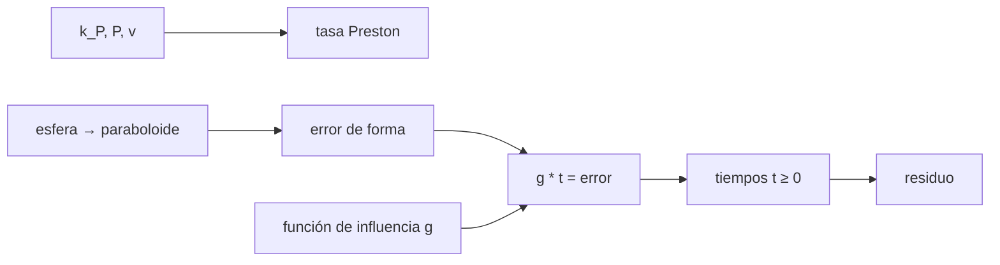

# B43-C05 — Pulido óptico

<!-- nav:top -->
[🏠 Programa](../../../../README.md) · [📚 Bloque B43](../../../tronco-comun/B43-construccion-y-mecanica-de-telescopios.md) · [← Anterior: B43-C04 — Fabricación y desbaste de espejos](../B43-C04-fabricacion-y-desbaste-de-espejos/CLASE.md) · [Siguiente: B43-C06 — Pruebas de Ronchi y Foucault →](../B43-C06-pruebas-de-ronchi-y-foucault/CLASE.md)
<!-- /nav -->

## 1. Ubicación, nivel y alcance

Clase 5 del bloque B43. Nivel N3. El pulido elimina nanómetros con una herramienta blanda y un abrasivo fino. La ley de Preston dice cuánto sale por unidad de tiempo, y la corrección determinista usa tiempos de permanencia. Aquí calculas la tasa, la diferencia entre esfera y paraboloide y una corrección 1D con un espejo ilustrativo. Usas [B05](../../../tronco-comun/B05-fisica-fundamental-para-el-espacio.md), [B11](../../../tronco-comun/B11-ecuaciones-diferenciales-y-simulacion-numerica.md) y [B15](../../../tronco-comun/B15-senales-imagenes-y-estimacion-cientifica.md).

## 2. Por qué esta clase existe

Pulir es controlar un retiro de décimas de micrón: sin un modelo se oscila entre sobrecorregir y subcorregir. La decisión central: **¿cuánto hay que retirar de la mejor esfera para obtener un paraboloide y cuánto tiempo debe permanecer la herramienta en cada zona?**

## 3. Lo que podrás hacer al terminar

1. Aplicar la ley de Preston `dZ/dt = k_P P v`.
2. Calcular la diferencia entre esfera y paraboloide.
3. Hallar la menor desviación respecto de la mejor esfera.
4. Plantear la corrección como una convolución con una función de influencia.
5. Resolver tiempos de permanencia no negativos por descenso proyectado.
6. Verificar con un caso exacto construido a propósito.

La evidencia es la **ficha de pulido** del ejercicio 12 (sección 20).

## 4. Con qué llegas y cómo comprobarlo

1. ¿Qué es una convolución?
2. ¿Qué es un paraboloide?
3. ¿Qué es una función de influencia?
4. ¿Qué es un gradiente?
5. ¿Qué es la raíz cuadrática media?

<details>
<summary>Ver respuestas</summary>

1. Un promedio ponderado deslizante de una función con otra. 2. La superficie de revolución de una parábola. 3. El perfil de retiro de la herramienta en un punto durante un tiempo unidad. 4. El vector de derivadas parciales. 5. La raíz de la media de los cuadrados.
</details>

Con cuatro o cinco aciertos, sigue; si no, repasa los prerrequisitos.

## 5. Un caso de contexto y casos de referencia

Espejo ilustrativo de `R = 2400 mm`, `D = 200 mm`: la desviación entre el paraboloide y la esfera en el borde es `905,0 nm`, y respecto de la mejor esfera `226,1 nm` (`0,411` ondas a 550 nm). La tasa de Preston ilustrativa es `1,8 µm/h`. Es el **ejemplo conductor**.

## 6. Vocabulario

La **ley de Preston** `dZ/dt = k_P P v`. La **desviación esfera-paraboloide** `y⁴/(8R³)`. La **mejor esfera** minimiza el PV (se cambia el enfoque). La **función de influencia** `g`. El **tiempo de permanencia** `t(x) ≥ 0`. La **corrección determinista** busca `g * t ≈ error`.

## 7. Modelo mental: una brocha que alisa la pared

Como una brocha: cada pasada retira una cantidad que depende de cuánto tiempo se detiene en cada zona; para igualar la pared se calcula cuánto detenerse, no se pasa al azar.



*Descripción textual:* la tasa de Preston y la función de influencia convierten un mapa de error en tiempos de permanencia no negativos.

Analogía: una brocha que alisa la pared. Límite: perfil 1D, función de influencia invariante.

## 8. La explicación, paso a paso

### 8.1 Tasa y desviación

`k_P P v = 10⁻¹² · 5000 · 0,1 = 0,50 nm/s = 1,8 µm/h`. La diferencia exacta de sagitas en el borde (`a = 100 mm`) es `905,01 nm` y la aproximación `a⁴/(8R³) = 904,22 nm`.

### 8.2 Mejor esfera

Se busca `c` que minimiza el PV de `ρ⁴ − c ρ²`: `c = 1,0000` y PV relativo `0,2500`, es decir `226,1 nm` PV (`0,411 λ`). A la tasa de 8.1 el borde necesita `0,126 h` de retiro puro.

### 8.3 Permanencia

Caso exacto: un objetivo `g * t_verdadero` con tres montículos se recupera con un residuo relativo de `0,63 %`. Caso de forma sintética (semilla 20261109): RMS inicial `6,794 nm`, final `1,309 nm` (`19,3 %` del inicial).

## 9. Magnitudes, símbolos y unidades

| Símbolo | Qué es | Unidad | Valor / nota |
|---|---|---|---|
| `k_P` | coeficiente de Preston | Pa⁻¹ | 10⁻¹² (ilustrativo) |
| `P` | presión | Pa | 5000 |
| `v` | velocidad relativa | m/s | 0,1 |
| `g` | función de influencia | — | gaussiana, σ = 8 mm |

## 10. Convenciones y referencias

Unidades del SI; coma decimal en el texto y punto decimal en las salidas del laboratorio; los ángulos están en radianes salvo que se indique y las longitudes de onda en nanómetros. Los telescopios y materiales de los ejemplos son ilustrativos.

## 11. De dónde sale lo que afirmamos

| ID | Fuente | Localizador | Respalda | Estado |
|---|---|---|---|---|
| S1 | Preston, *The structure and abrasion of glass* | — | ley de Preston citada de memoria | No consultado |

Límites: La ley de Preston se cita sin haber leído el artículo; el coeficiente y las presiones son ilustrativos; el algoritmo es un descenso proyectado sencillo, no un proceso de taller.

## 12. Cómo ver la corrección

| Caso | RMS inicial (nm) | RMS final (nm) |
|---|---|---|
| Forma sintética | 6,794 | 1,309 |

Descripción larga: el residuo baja a un 19,3 % del inicial.

## 13. Ejemplo trabajado: la tasa de Preston

**Paso 1 · Producto.** `10⁻¹² Pa⁻¹ × 5000 Pa × 0,1 m/s = 5 × 10⁻¹⁰ m/s`.

**Paso 2 · Unidades.** `= 0,50 nm/s`.

**Paso 3 · Hora.** `× 3600 = 1,8 µm/h`.

## 14. Distintas formas de describir el pulido

**En palabras:** cuánto retira la herramienta según cuánto se detiene. **En fórmulas:** `Δz = k_P P v t`. **En tabla:** residuos. **En código:** `pulido.py`.

## 15. Práctica guiada

**Ejercicio 1 · con los pasos indicados.** Tasa de Preston con `k_P = 10⁻¹²`, `P = 5000`, `v = 0,1`.

<details><summary>Solución comentada</summary>

`0,50 nm/s`.
</details>

**Ejercicio 2 · con una pista.** Conviértela a µm/h.

<details><summary>Solución comentada</summary>

`1,8 µm/h`.
</details>

**Ejercicio 3 · casi autónomo.** Diferencia esfera-paraboloide con `a = 100 mm`, `R = 2400 mm`.

<details><summary>Solución comentada</summary>

`a⁴/(8R³) = 904,2 nm`.
</details>

## 16. Práctica autónoma, transferencia e integrador

**Ejercicio 4.** PV respecto de la mejor esfera.

<details><summary>Solución comentada</summary>

`226,1 nm`.
</details>

**Ejercicio 5.** Exprésalo en ondas a 550 nm.

<details><summary>Solución comentada</summary>

`0,411`.
</details>

**Ejercicio 6.** Tiempo para retirar ese PV con la tasa de 8.1.

<details><summary>Solución comentada</summary>

`0,126 h`.
</details>

**Ejercicio 7.** Si `P` se duplica, ¿cuánto sube la tasa?

<details><summary>Solución comentada</summary>

El doble (la ley es lineal).
</details>

**Ejercicio 8.** Residuo de la corrección sintética, en % del inicial.

<details><summary>Solución comentada</summary>

`19,3 %`.
</details>

**Ejercicio 9 · transferencia.** **Transferencia.** ¿Por qué `t ≥ 0`?

<details><summary>Solución comentada</summary>

Porque la herramienta solo retira; no puede devolver material.
</details>

**Ejercicio 10 · transferencia.** **Transferencia.** ¿Cuándo falla el modelo lineal de Preston?

<details><summary>Solución comentada</summary>

Con presiones o velocidades muy distintas, o desgaste de la herramienta.
</details>

**Ejercicio 11 · transferencia.** **Transferencia.** ¿Es la tasa de 8.1 una medida?

<details><summary>Solución comentada</summary>

No: es ilustrativa.
</details>

**Ejercicio 12.** **Integrador.** Elabora tu *ficha de pulido*: tasa, desviación, mejor esfera y corrección.

<details><summary>Solución comentada</summary>

Secciones 8.1–8.3.
</details>

**Ejercicio 12 · integrador.** **Integrador.** Elabora tu *ficha de pulido*: tasa, desviación, mejor esfera y corrección.

<details><summary>Solución modelo</summary>

Secciones 8.1–8.3.
</details>

## 17. Laboratorio: Preston y permanencia

El script [pulido.py](pulido.py) calcula la tasa, la desviación esfera-paraboloide y resuelve tiempos de permanencia (**comprueba** `1 %` en la desviación y residuo menor que `25 %`).

**Datos:** parámetros **ilustrativos**; semilla `20261109`. **Predice antes de ejecutar:** ¿cuánto baja el RMS? (≈ 80 %.) **Ejecución del 2026-11-09 (Python 3.12.9):**

```text
Python 3.12.9 (biblioteca estandar)
tasa_nm_s = 0.5
tasa_um_h = 1.8
dif_borde_nm = 905.01
dif_aprox_nm = 904.225
c_optimo = 1
pv_rel = 0.25
pv_mejor_esfera_nm = 226.056
ondas_pv_550 = 0.411011
tiempo_borde_h = 0.125587
caso_exacto_residuo_rel = 0.00632665
rms_inicial_nm = 6.7937
rms_final_nm = 1.30855
reduccion = 0.192612
tiempo_total_rel = 14.6777
Pruebas superadas.
```

```bash
python programa/clases/B43/B43-C05-pulido-optico/pulido.py
```

**Límites:** 1D, función de influencia fija, sin bordes.

## 18. Errores frecuentes y cómo corregirlos

**Creer que se puede retirar menos de cero.** Se corrige con 8.3.

**Confundir la desviación al borde con el PV tras refocalizar.** Se corrige con 8.2.

**Tomar `k_P` como medido.** Se corrige con la sección 11.

**Olvidar la función de influencia.** Se corrige con la sección 6.

## 19. Cómo sabrás que vas bien

Tras la sección 8: ¿qué resultado esperabas y cuál obtuviste? Si dudas, repasa el ejemplo 13. Tras el laboratorio: ¿qué comprueba? (ver la sección 17).

## 20. Qué entregas y cómo se evalúa

El producto es tu **ficha de pulido** (ejercicio 12).

| Criterio | Inicial | En desarrollo | Logrado | Destacado |
|---|---|---|---|---|
| Conceptos | Los confunde | Parciales | conceptos de la clase | Explica los límites |
| Cálculo | Sin unidades | Con errores | Tablas completas | Calcula casos nuevos |
| Numérico | Sin comprobar | Un caso | Contraste con el análisis | Interpreta las diferencias |
| Fuentes | Sin fuente | Sin fecha | fuentes con fecha | Declara lo ilustrativo |
| Límites | No los nombra | Uno | Tres | Discute qué falta del modelo |

**Condiciones críticas (no se compensan con promedio):** rotular parámetros como ilustrativos; no atribuir la ley a un texto no leído; no presentar el algoritmo como proceso real.

## 21. Ética, seguridad y límites

Clase educativa: los modelos son simplificados. Accesibilidad: tablas equivalentes a las gráficas, fórmulas en texto, ejercicios sin conexión.

## 22. Para cerrar y seguir

La tasa ilustrativa es `1,8 µm/h`, la parabolización exige `226 nm` PV y la corrección de permanencia deja el `19 %`. Queda una pregunta: ¿cómo se mide la forma?

**Glosario español–inglés.** pulido · *polishing*; función de influencia · *influence function*; tiempo de permanencia · *dwell time*; parabolización · *parabolizing*; mejor esfera · *best-fit sphere*.

**Continuidad.** [B43-C06](../B43-C06-pruebas-de-ronchi-y-foucault/CLASE.md) estudia las pruebas de Foucault y Ronchi.

**Referencias:** ver sección 11.

<!-- nav:bottom -->
---

[← Anterior: B43-C04 — Fabricación y desbaste de espejos](../B43-C04-fabricacion-y-desbaste-de-espejos/CLASE.md) · [📚 Bloque B43](../../../tronco-comun/B43-construccion-y-mecanica-de-telescopios.md) · [Siguiente: B43-C06 — Pruebas de Ronchi y Foucault →](../B43-C06-pruebas-de-ronchi-y-foucault/CLASE.md)
<!-- /nav -->
