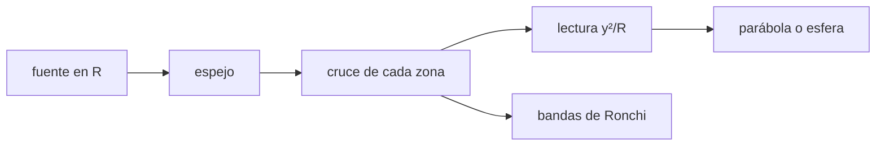

# B43-C06 — Pruebas de Ronchi y Foucault

<!-- nav:top -->
[🏠 Programa](../../../../README.md) · [📚 Bloque B43](../../../tronco-comun/B43-construccion-y-mecanica-de-telescopios.md) · [← Anterior: B43-C05 — Pulido óptico](../B43-C05-pulido-optico/CLASE.md) · [Siguiente: B43-C07 — Aluminizado y recubrimientos →](../B43-C07-aluminizado-y-recubrimientos/CLASE.md)
<!-- /nav -->

## 1. Ubicación, nivel y alcance

Clase 6 del bloque B43. Nivel N3. Las pruebas de Foucault y de Ronchi miden la forma de un espejo sin interferómetro: una cuchilla o una rejilla cerca del centro de curvatura revelan, zona por zona, si la superficie es una esfera o un paraboloide. Aquí trazas rayos exactos desde una fuente puntual y comparas con las fórmulas de la prueba, con un espejo ilustrativo. Usas [B41](../../../tronco-comun/B41-optica-geometrica-y-diseno-de-telescopios.md), [B42](../../../tronco-comun/B42-optica-fisica-y-optica-adaptativa.md) y [B05](../../../tronco-comun/B05-fisica-fundamental-para-el-espacio.md).

## 2. Por qué esta clase existe

La prueba convierte una desviación de nanómetros en un desplazamiento de milímetros de la cuchilla. La decisión central: **¿en cuánto debe desplazarse la cuchilla para cada zona del paraboloide y cuántas bandas de Ronchi se esperan?**

## 3. Lo que podrás hacer al terminar

1. Reconocer la geometría de la prueba desde el centro de curvatura.
2. Predecir la lectura de Foucault `y²/R` de cada zona de un paraboloide.
3. Comprobar por trazado exacto que una esfera da lectura nula.
4. Calcular el número de bandas de Ronchi `D d/(R p)`.
5. Distinguir lo geométrico de lo difractivo.
6. Reconocer los límites de la prueba.

La evidencia es la **ficha de pruebas de Foucault y Ronchi** del ejercicio 12 (sección 20).

## 4. Con qué llegas y cómo comprobarlo

1. ¿Qué es el centro de curvatura?
2. ¿Qué es un paraboloide?
3. ¿Qué es una reflexión especular?
4. ¿Qué es una rejilla de Ronchi?
5. ¿Qué es una aberración longitudinal?

<details>
<summary>Ver respuestas</summary>

1. El centro de la esfera que mejor aproxima la superficie. 2. La superficie `z = y²/(2R)` (sagita parabólica). 3. Reflexión con ángulo igual al de incidencia. 4. Una rejilla de líneas opacas paralelas. 5. El corrimiento a lo largo del eje de donde cruzan los rayos.
</details>

Con cuatro o cinco aciertos, sigue; si no, repasa los prerrequisitos.

## 5. Un caso de contexto y casos de referencia

Espejo ilustrativo de `R = 2400 mm`, `D = 200 mm`. Para un paraboloide, el rayo de la zona `y = 100 mm` cruza el eje a `4,170 mm` del centro de curvatura (fórmula `y²/R = 4,167 mm`); para una esfera, a `0`. Con la rejilla a `5 mm` del foco se esperan `1,64` bandas con una rejilla de 100 líneas por pulgada. Es el **ejemplo conductor**.

## 6. Vocabulario

La **prueba de Foucault** coloca una cuchilla en el foco. La **lectura de zona** es la posición de la cuchilla para oscurecer una zona. La **aberración longitudinal** `y²/R` de un paraboloide. La **prueba de Ronchi** coloca una rejilla y se cuentan las bandas. El **periodo** `p` de la rejilla.

## 7. Modelo mental: un faro que revisa una pared

Como un faro que barre una pared curva: si la pared es esférica todas las zonas se enfocan en un punto; si es parabólica cada zona se enfoca más lejos, y esa diferencia es lo que se lee.



*Descripción textual:* una fuente en el centro de curvatura y una cuchilla o rejilla recogen cada zona; la diferencia con la esfera revela el paraboloide.

Analogía: un faro que revisa una pared. Límite: geometría de rayos, sin difracción, fuente puntual.

## 8. La explicación, paso a paso

### 8.1 Lectura de Foucault

| Zona y (mm) | Lectura paraboloide (mm) | y²/R (mm) | Lectura esfera (mm) |
|---|---|---|---|
| 20 | 0,16667 | 0,16667 | 0 |
| 40 | 0,66676 | 0,66667 | -4,5 × 10⁻¹³ |
| 60 | 1,50047 | 1,50000 | 4,5 × 10⁻¹³ |
| 80 | 2,66815 | 2,66667 | 0 |
| 100 | 4,17028 | 4,16667 | 0 |

La desviación de la zona de 100 mm respecto de la fórmula es de `0,09 %` (efecto de orden superior).

### 8.2 Bandas de Ronchi

Con la rejilla a `d = 5 mm` del foco, el haz de borde mide `0,4170 mm` en el plano (fórmula `D d/R = 0,4167 mm`). Con el periodo `p = 0,254 mm` hay `1,642` bandas por trazado y `1,640` por la fórmula.

### 8.3 Lectura

Los espejos esféricos dan un patrón de bandas rectas y paralelas; los paraboloides, bandas curvas. La prueba es **geométrica**: no incluye difracción, que limita la sensibilidad cuando el error es de décimas de longitud de onda.

## 9. Magnitudes, símbolos y unidades

| Símbolo | Qué es | Unidad | Valor / nota |
|---|---|---|---|
| `y` | altura de la zona | mm | 20 a 100 |
| `R` | radio de curvatura | mm | 2400 (ilustrativo) |
| `d` | desplazamiento de la rejilla | mm | 5 |
| `p` | periodo de la rejilla | mm | 0,254 (100 líneas por pulgada) |

## 10. Convenciones y referencias

Unidades del SI; coma decimal en el texto y punto decimal en las salidas del laboratorio; los ángulos están en radianes salvo que se indique y las longitudes de onda en nanómetros. Los telescopios y materiales de los ejemplos son ilustrativos.

## 11. De dónde sale lo que afirmamos

| ID | Fuente | Localizador | Respalda | Estado |
|---|---|---|---|---|
| S1 | Texereau, *How to Make a Telescope* | — | fórmulas de Foucault y Ronchi (verificadas por trazado, texto no consultado) | No consultado |

Límites: Las fórmulas se verifican por trazado de rayos, pero no se contrastaron con el texto de Texereau ni con ninguna otra fuente (no consultados). La difracción no se modela.

## 12. Cómo ver las lecturas

| Zona (mm) | Lectura (mm) |
|---|---|
| 20 | 0,1667 |
| 40 | 0,6668 |
| 60 | 1,5005 |
| 80 | 2,6681 |
| 100 | 4,1703 |

Descripción larga: la lectura crece con el cuadrado de la altura de zona.

## 13. Ejemplo trabajado: la zona del borde

**Paso 1 · Fórmula.** `y²/R = 100²/2400 = 4,167 mm`.

**Paso 2 · Trazado.** El rayo exacto cruza a `4,170 mm`.

**Paso 3 · Diferencia.** `0,09 %`.

## 14. Distintas formas de describir las pruebas

**En palabras:** cada zona cruza el eje en un punto distinto. **En fórmulas:** `Δ = y²/R`. **En tabla:** lecturas. **En código:** `foucault.py`.

## 15. Práctica guiada

**Ejercicio 1 · con los pasos indicados.** Lectura de la zona de 60 mm. *Pasos:* `y²/R`.

<details><summary>Solución comentada</summary>

`3600/2400 = 1,5 mm` (trazado: `1,5005`).
</details>

**Ejercicio 2 · con una pista.** Lectura de la zona de 100 mm.

<details><summary>Solución comentada</summary>

`4,167 mm`.
</details>

**Ejercicio 3 · casi autónomo.** ¿Qué lectura da una esfera?

<details><summary>Solución comentada</summary>

`0`.
</details>

## 16. Práctica autónoma, transferencia e integrador

**Ejercicio 4.** Ancho del haz con `d = 5 mm`.

<details><summary>Solución comentada</summary>

`D d/R = 0,4167 mm`.
</details>

**Ejercicio 5.** Bandas de Ronchi con `p = 0,254 mm`.

<details><summary>Solución comentada</summary>

`1,640`.
</details>

**Ejercicio 6.** Si `d` se duplica, ¿cuántas bandas?

<details><summary>Solución comentada</summary>

`3,281`.
</details>

**Ejercicio 7.** Lectura de la zona de 20 mm.

<details><summary>Solución comentada</summary>

`0,1667 mm`.
</details>

**Ejercicio 8.** Cociente de lecturas zona 100 / zona 50.

<details><summary>Solución comentada</summary>

`(100/50)² = 4`.
</details>

**Ejercicio 9 · transferencia.** **Transferencia.** ¿Por qué la prueba geométrica deja de ser sensible con errores muy pequeños?

<details><summary>Solución comentada</summary>

Porque la difracción domina cuando el error es una fracción de longitud de onda.
</details>

**Ejercicio 10 · transferencia.** **Transferencia.** ¿Por qué se mide por zonas y no en un punto?

<details><summary>Solución comentada</summary>

Porque la forma se reconstruye de la lectura de varias alturas.
</details>

**Ejercicio 11 · transferencia.** **Transferencia.** ¿Son estas cifras de un espejo real?

<details><summary>Solución comentada</summary>

No: son un modelo ilustrativo.
</details>

**Ejercicio 12.** **Integrador.** Elabora tu *ficha de pruebas de Foucault y Ronchi*: lecturas y bandas.

<details><summary>Solución comentada</summary>

Secciones 8.1–8.3.
</details>

**Ejercicio 12 · integrador.** **Integrador.** Elabora tu *ficha de pruebas de Foucault y Ronchi*: lecturas y bandas.

<details><summary>Solución modelo</summary>

Secciones 8.1–8.3.
</details>

## 17. Laboratorio: trazado de la prueba

El script [foucault.py](foucault.py) traza rayos exactos desde el centro de curvatura y compara con `y²/R` y con el recuento de Ronchi (**comprueba** `2 %`).

**Datos:** geometría **ilustrativa**. **Predice antes de ejecutar:** ¿qué lectura da el borde? (≈ 4,17 mm.) **Ejecución del 2026-11-09 (Python 3.12.9):**

```text
Python 3.12.9 (biblioteca estandar)
zona y (mm) | lectura paraboloide (mm) | y^2/R (mm) | lectura esfera (mm)
20 | 0.16667 | 0.16667 | 0.00e+00
40 | 0.66676 | 0.66667 | -4.55e-13
60 | 1.50047 | 1.50000 | 4.55e-13
80 | 2.66815 | 2.66667 | 0.00e+00
100 | 4.17028 | 4.16667 | 0.00e+00
ancho_haz_mm = 0.417029
ancho_formula_mm = 0.416667
bandas_ronchi = 1.64185
bandas_formula = 1.64042
Pruebas superadas.
```

```bash
python programa/clases/B43/B43-C06-pruebas-de-ronchi-y-foucault/foucault.py
```

**Límites:** geométrico; no modela difracción.

## 18. Errores frecuentes y cómo corregirlos

**Confundir la lectura con la desviación de la superficie.** Se corrige con la sección 6.

**Olvidar que la esfera da cero.** Se corrige con 8.1.

**Aplicar la fórmula a ángulos grandes.** Se corrige con la diferencia en 8.1.

**Mezclar `R` y `f`.** Se corrige con la sección 9.

## 19. Cómo sabrás que vas bien

Tras la sección 8: ¿qué resultado esperabas y cuál obtuviste? Si dudas, repasa el ejemplo 13. Tras el laboratorio: ¿qué comprueba? (ver la sección 17).

## 20. Qué entregas y cómo se evalúa

El producto es tu **ficha de pruebas de Foucault y Ronchi** (ejercicio 12).

| Criterio | Inicial | En desarrollo | Logrado | Destacado |
|---|---|---|---|---|
| Conceptos | Los confunde | Parciales | conceptos de la clase | Explica los límites |
| Cálculo | Sin unidades | Con errores | Tablas completas | Calcula casos nuevos |
| Numérico | Sin comprobar | Un caso | Contraste con el análisis | Interpreta las diferencias |
| Fuentes | Sin fuente | Sin fecha | fuentes con fecha | Declara lo ilustrativo |
| Límites | No los nombra | Uno | Tres | Discute qué falta del modelo |

**Condiciones críticas (no se compensan con promedio):** rotular el espejo como ilustrativo; no citar textos no consultados; no presentar el modelo como medición.

## 21. Ética, seguridad y límites

Clase educativa: los modelos son simplificados. Accesibilidad: tablas equivalentes a las gráficas, fórmulas en texto, ejercicios sin conexión.

## 22. Para cerrar y seguir

La zona de 100 mm de un paraboloide cruza `4,17 mm` más lejos y la rejilla produce `1,6` bandas. Queda una pregunta: ¿qué recubrimiento refleja la luz?

**Glosario español–inglés.** prueba de Foucault · *Foucault test*; cuchilla · *knife edge*; banda de Ronchi · *Ronchi band*; rejilla · *grating*; zona · *zone*.

**Continuidad.** [B43-C07](../B43-C07-aluminizado-y-recubrimientos/CLASE.md) estudia el aluminizado y los recubrimientos.

**Referencias:** ver sección 11.

<!-- nav:bottom -->
---

[← Anterior: B43-C05 — Pulido óptico](../B43-C05-pulido-optico/CLASE.md) · [📚 Bloque B43](../../../tronco-comun/B43-construccion-y-mecanica-de-telescopios.md) · [Siguiente: B43-C07 — Aluminizado y recubrimientos →](../B43-C07-aluminizado-y-recubrimientos/CLASE.md)
<!-- /nav -->
