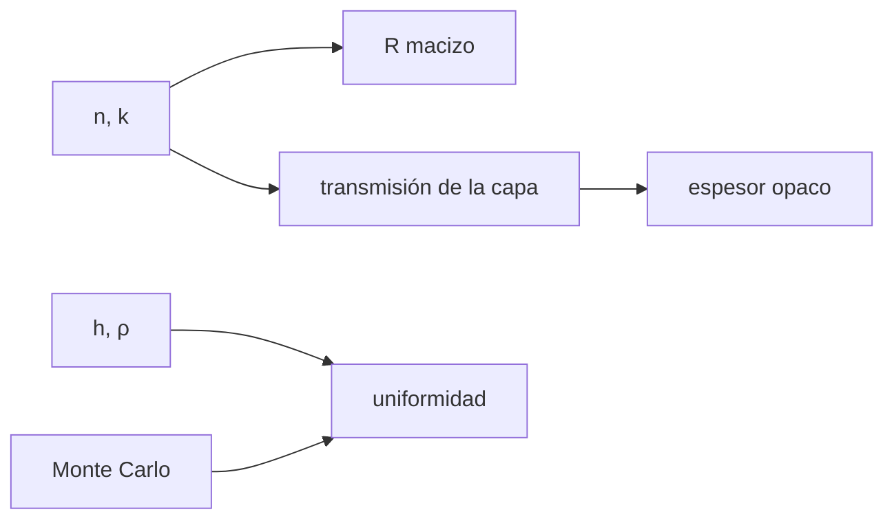

# B43-C07 — Aluminizado y recubrimientos

<!-- nav:top -->
[🏠 Programa](../../../../README.md) · [📚 Bloque B43](../../../tronco-comun/B43-construccion-y-mecanica-de-telescopios.md) · [← Anterior: B43-C06 — Pruebas de Ronchi y Foucault](../B43-C06-pruebas-de-ronchi-y-foucault/CLASE.md) · [Siguiente: B43-C08 — Montaje de espejo primario →](../B43-C08-montaje-de-espejo-primario/CLASE.md)
<!-- /nav -->

## 1. Ubicación, nivel y alcance

Clase 7 del bloque B43. Nivel N3. Un espejo de vidrio refleja solo cuando lleva una película metálica, casi siempre aluminio evaporado en vacío. Aquí calculas la reflectancia del metal, el espesor mínimo opaco y la uniformidad de la película con un evaporador puntual ilustrativo. Usas [B05](../../../tronco-comun/B05-fisica-fundamental-para-el-espacio.md), [B42](../../../tronco-comun/B42-optica-fisica-y-optica-adaptativa.md) y [B12](../../../tronco-comun/B12-probabilidad-estadistica-e-incertidumbre.md).

## 2. Por qué esta clase existe

Una película delgada deja pasar luz; una gruesa refleja pero no se adhiere ni es uniforme. La decisión central: **¿qué espesor es opaco, qué reflectancia da y cuánto varía de centro a borde por la geometría del evaporador?**

## 3. Lo que podrás hacer al terminar

1. Calcular la reflectancia de un metal con su índice complejo.
2. Calcular la transmisión de una película con matrices de transferencia.
3. Contrastar con la atenuación exponencial.
4. Hallar el espesor opaco.
5. Predecir la uniformidad de una fuente puntual `h/(h²+ρ²)^(3/2)`.
6. Confirmar la uniformidad con una simulación de Monte Carlo.

La evidencia es la **ficha de aluminizado** del ejercicio 12 (sección 20).

## 4. Con qué llegas y cómo comprobarlo

1. ¿Qué es un índice de refracción complejo?
2. ¿Qué es la reflectancia?
3. ¿Qué es una película delgada?
4. ¿Qué es el vacío?
5. ¿Qué es una simulación Monte Carlo?

<details>
<summary>Ver respuestas</summary>

1. `n − i k`, donde `k` mide la absorción. 2. La fracción de potencia reflejada. 3. Una capa de espesor comparable a la longitud de onda. 4. Una presión muy baja. 5. Repetir con números aleatorios de semilla fija.
</details>

Con cuatro o cinco aciertos, sigue; si no, repasa los prerrequisitos.

## 5. Un caso de contexto y casos de referencia

Aluminio ilustrativo de `N = 0,96 − 6,69 i` a 550 nm sobre vidrio de índice 1,52. La reflectancia del metal macizo es `0,9210`; una película de `40 nm` ya transmite menos del 0,1 %; con el evaporador a `400 mm` el borde de un espejo de 200 mm recibe `91,3 %` del espesor del centro. Es el **ejemplo conductor**.

## 6. Vocabulario

El **índice complejo** `N = n − i k`. La **reflectancia** `R = ((n−1)²+k²)/((n+1)²+k²)`. La **profundidad de penetración** `λ/(4πk)`. El **espesor opaco** deja pasar menos de un umbral. La **matriz de transferencia** relaciona los campos en la película. La **uniformidad** compara espesores de centro y borde.

## 7. Modelo mental: pintar con un aerosol desde lejos

Como pintar con un aerosol: la pintura llega más gruesa al punto más cercano y más delgada hacia los bordes; alejar el aerosol uniformiza.



*Descripción textual:* el índice complejo da la reflectancia y la transmisión de la película; la geometría del evaporador da la uniformidad.

Analogía: pintar con un aerosol desde lejos. Límite: película homogénea y lisa, incidencia normal, un solo evaporador puntual.

## 8. La explicación, paso a paso

### 8.1 Película sobre vidrio (ILUSTRATIVO)

| Espesor (nm) | R de la capa | T de la capa | `exp(−4πkd/λ)` |
|---|---|---|---|
| 10 | 0,7369 | 0,12 | 0,217 |
| 20 | 0,8799 | 0,0218 | 0,047 |
| 40 | 0,9188 | 0,000993 | 0,00221 |
| 60 | 0,9209 | 4,67 × 10⁻⁵ | 0,000104 |
| 80 | 0,9210 | 2,2 × 10⁻⁶ | 4,89 × 10⁻⁶ |
| 100 | 0,9210 | 1,03 × 10⁻⁷ | 2,3 × 10⁻⁷ |
| 150 | 0,9210 | 4,95 × 10⁻¹¹ | 1,1 × 10⁻¹⁰ |

El metal macizo da `R = 0,920984` y la capa de 1000 nm `0,920984`. La profundidad `λ/(4πk)` es `6,54 nm`. Para `d ≥ 40 nm` la transmisión de la matriz es entre 0,4 y 0,5 veces la atenuación exponencial (el factor refleja las interfaces).

### 8.2 Espesor opaco

El primer espesor entero con `T ≤ 10⁻³` es **40 nm**.

### 8.3 Uniformidad

Para un evaporador puntual a `h = 400 mm` el espesor es proporcional a `h/(h²+ρ²)^(3/2)`; el cociente borde/centro (`ρ = 100 mm`) es `0,9131`. Un Monte Carlo de 400 000 direcciones (semilla 20261109) da el cociente de densidad entre la corona `50–100 mm` y el círculo `0–50 mm` de `0,9547`, frente a `0,9555` de la integral.

## 9. Magnitudes, símbolos y unidades

| Símbolo | Qué es | Unidad | Valor / nota |
|---|---|---|---|
| `N` | índice complejo del Al | — | 0,96 − 6,69 i (ilustrativo) |
| `R` | reflectancia | — | 0,9210 |
| `d` | espesor de la película | nm | 40 (opaco) |
| `h` | altura del evaporador | mm | 400 |

## 10. Convenciones y referencias

Unidades del SI; coma decimal en el texto y punto decimal en las salidas del laboratorio; los ángulos están en radianes salvo que se indique y las longitudes de onda en nanómetros. Los telescopios y materiales de los ejemplos son ilustrativos.

## 11. De dónde sale lo que afirmamos

| ID | Fuente | Localizador | Respalda | Estado |
|---|---|---|---|---|
| S1 | Índice del aluminio (literatura) | — | N = 0,96 − 6,69 i a 550 nm, valor típico de la literatura NO consultado aquí | No consultado |

Límites: El índice del aluminio es un valor típico recordado y no se consultó; la reflectancia real depende de la calidad de la película y de la oxidación.

## 12. Cómo ver la película

| Espesor (nm) | T de la capa |
|---|---|
| 10 | 0,12 |
| 20 | 0,0218 |
| 40 | 0,000993 |
| 60 | 4,67 × 10⁻⁵ |
| 80 | 2,2 × 10⁻⁶ |
| 100 | 1,03 × 10⁻⁷ |
| 150 | 4,95 × 10⁻¹¹ |

Descripción larga: la transmisión cae de un 12 % a casi cero entre 10 y 100 nm.

## 13. Ejemplo trabajado: el espesor opaco

**Paso 1 · `k`.** `k = 6,69`.

**Paso 2 · Atenuación.** `exp(−4π k d/λ)` a `d = 40 nm` es `0,00221`.

**Paso 3 · Matriz.** `T = 0,000993`.

## 14. Distintas formas de describir la película

**En palabras:** la película se vuelve opaca en decenas de nanómetros. **En fórmulas:** `T ≈ T₀ e^(−4πkd/λ)`. **En tabla:** espesores. **En código:** `aluminizado.py`.

## 15. Práctica guiada

**Ejercicio 1 · con los pasos indicados.** Reflectancia del metal con `n = 0,96`, `k = 6,69`.

<details><summary>Solución comentada</summary>

`0,9210`.
</details>

**Ejercicio 2 · con una pista.** Profundidad de penetración `λ/(4πk)`.

<details><summary>Solución comentada</summary>

`6,54 nm`.
</details>

**Ejercicio 3 · casi autónomo.** Atenuación `exp(−4πkd/λ)` a 40 nm.

<details><summary>Solución comentada</summary>

`0,00221`.
</details>

## 16. Práctica autónoma, transferencia e integrador

**Ejercicio 4.** Transmisión de la matriz a 40 nm.

<details><summary>Solución comentada</summary>

`0,000993`.
</details>

**Ejercicio 5.** Espesor opaco para `T ≤ 10⁻³`.

<details><summary>Solución comentada</summary>

`40 nm`.
</details>

**Ejercicio 6.** Razón borde/centro con `h = 400 mm`, `ρ = 100 mm`.

<details><summary>Solución comentada</summary>

`(1+0,0625)^(−3/2) = 0,9131`.
</details>

**Ejercicio 7.** Si `h` sube a 800 mm, ¿qué razón?

<details><summary>Solución comentada</summary>

`(1+(100/800)²)^(−3/2) = 0,9770`.
</details>

**Ejercicio 8.** Pérdida de reflectancia respecto de la del metal si la película solo mide 20 nm.

<details><summary>Solución comentada</summary>

`4,11 puntos`.
</details>

**Ejercicio 9 · transferencia.** **Transferencia.** ¿Por qué se rota el sustrato?

<details><summary>Solución comentada</summary>

Para promediar la geometría y uniformizar el espesor.
</details>

**Ejercicio 10 · transferencia.** **Transferencia.** ¿Por qué el aluminio protegido tiene menos reflectancia que el desnudo?

<details><summary>Solución comentada</summary>

La capa protectora añade absorción e interfaz; el valor depende del diseño.
</details>

**Ejercicio 11 · transferencia.** **Transferencia.** ¿Es `N` una medida?

<details><summary>Solución comentada</summary>

No: es un valor típico ilustrativo.
</details>

**Ejercicio 12.** **Integrador.** Elabora tu *ficha de aluminizado*: reflectancia, espesor opaco y uniformidad.

<details><summary>Solución comentada</summary>

Secciones 8.1–8.3.
</details>

**Ejercicio 12 · integrador.** **Integrador.** Elabora tu *ficha de aluminizado*: reflectancia, espesor opaco y uniformidad.

<details><summary>Solución modelo</summary>

Secciones 8.1–8.3.
</details>

## 17. Laboratorio: reflectancia y uniformidad

El script [aluminizado.py](aluminizado.py) calcula `R`, la transmisión por matriz de transferencia y la uniformidad con Monte Carlo (**comprueba** `1e-4` y `4 %`).

**Datos:** índice **ilustrativo**; semilla `20261109`. **Predice antes de ejecutar:** ¿qué espesor es opaco? (≈ 40 nm.) **Ejecución del 2026-11-09 (Python 3.12.9):**

```text
Python 3.12.9 (biblioteca estandar)
d (nm) | R capa | T capa | exp(-4 pi k d/lambda)
10 | 0.7369 | 1.202e-01 | 2.169e-01
20 | 0.8799 | 2.180e-02 | 4.703e-02
40 | 0.9188 | 9.929e-04 | 2.211e-03
60 | 0.9209 | 4.669e-05 | 1.040e-04
80 | 0.9210 | 2.196e-06 | 4.890e-06
100 | 0.9210 | 1.033e-07 | 2.300e-07
150 | 0.9210 | 4.952e-11 | 1.103e-10
R_macizo = 0.920984
profundidad_nm = 6.54224
R_grueso = 0.920984
d_opaco_nm = 40
borde_sobre_centro = 0.913075
mc_cociente = 0.954712
analitico_cociente = 0.955496
Pruebas superadas.
```

```bash
python programa/clases/B43/B43-C07-aluminizado-y-recubrimientos/aluminizado.py
```

**Límites:** incidencia normal; película lisa; una fuente puntual.

## 18. Errores frecuentes y cómo corregirlos

**Tomar `N` como dato medido.** Se corrige con la sección 11.

**Olvidar la oxidación.** Se corrige con los límites.

**Creer que más espesor siempre mejora.** Se corrige con 8.1.

**Confundir transmisión con atenuación.** Se corrige con 8.1.

## 19. Cómo sabrás que vas bien

Tras la sección 8: ¿qué resultado esperabas y cuál obtuviste? Si dudas, repasa el ejemplo 13. Tras el laboratorio: ¿qué comprueba? (ver la sección 17).

## 20. Qué entregas y cómo se evalúa

El producto es tu **ficha de aluminizado** (ejercicio 12).

| Criterio | Inicial | En desarrollo | Logrado | Destacado |
|---|---|---|---|---|
| Conceptos | Los confunde | Parciales | conceptos de la clase | Explica los límites |
| Cálculo | Sin unidades | Con errores | Tablas completas | Calcula casos nuevos |
| Numérico | Sin comprobar | Un caso | Contraste con el análisis | Interpreta las diferencias |
| Fuentes | Sin fuente | Sin fecha | fuentes con fecha | Declara lo ilustrativo |
| Límites | No los nombra | Uno | Tres | Discute qué falta del modelo |

**Condiciones críticas (no se compensan con promedio):** rotular el índice como ilustrativo; no dar la reflectancia real; la evaporación al vacío es un riesgo real y se trata solo físicamente.

## 21. Ética, seguridad y límites

Clase educativa: los modelos son simplificados. Accesibilidad: tablas equivalentes a las gráficas, fórmulas en texto, ejercicios sin conexión.

## 22. Para cerrar y seguir

El aluminio ilustrativo refleja `92,1 %`, es opaco desde unos `40 nm` y el borde queda al `91 %` del espesor central. Queda una pregunta: ¿cómo se monta el espejo?

**Glosario español–inglés.** aluminizado · *aluminizing*; reflectancia · *reflectance*; película delgada · *thin film*; evaporación · *evaporation*; uniformidad · *uniformity*.

**Continuidad.** [B43-C08](../B43-C08-montaje-de-espejo-primario/CLASE.md) estudia el montaje del espejo primario.

**Referencias:** ver sección 11.

<!-- nav:bottom -->
---

[← Anterior: B43-C06 — Pruebas de Ronchi y Foucault](../B43-C06-pruebas-de-ronchi-y-foucault/CLASE.md) · [📚 Bloque B43](../../../tronco-comun/B43-construccion-y-mecanica-de-telescopios.md) · [Siguiente: B43-C08 — Montaje de espejo primario →](../B43-C08-montaje-de-espejo-primario/CLASE.md)
<!-- /nav -->
