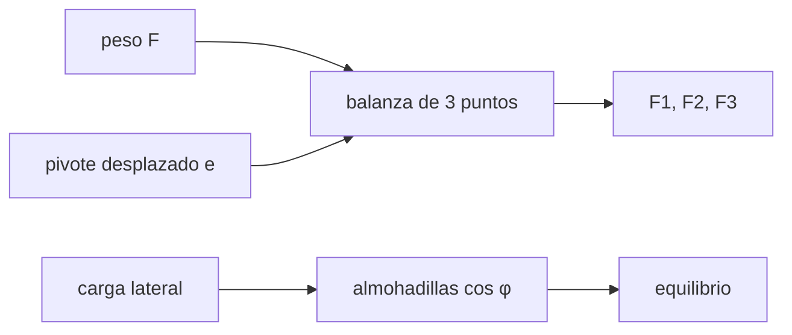

# B43-C09 — Celdas y soporte de espejos

<!-- nav:top -->
[🏠 Programa](../../../../README.md) · [📚 Bloque B43](../../../tronco-comun/B43-construccion-y-mecanica-de-telescopios.md) · [← Anterior: B43-C08 — Montaje de espejo primario](../B43-C08-montaje-de-espejo-primario/CLASE.md) · [Siguiente: B43-C10 — Estructura de tubo óptico →](../B43-C10-estructura-de-tubo-optico/CLASE.md)
<!-- /nav -->

## 1. Ubicación, nivel y alcance

Clase 9 del bloque B43. Nivel N3. La celda reparte el peso del espejo entre muchos puntos con balanzas triangulares (whiffletree) y lo sostiene lateralmente con almohadillas. Aquí calculas el equilibrio estático de una balanza, el efecto de un pivote desplazado y el reparto lateral con distribución de coseno, con un espejo ilustrativo de 4 kg. Usas [B05](../../../tronco-comun/B05-fisica-fundamental-para-el-espacio.md), [B10](../../../tronco-comun/B10-algebra-lineal-y-matematicas-geometricas.md) y [B15](../../../tronco-comun/B15-senales-imagenes-y-estimacion-cientifica.md).

## 2. Por qué esta clase existe

Una celda que no reparte la carga como se diseñó deforma el espejo. La decisión central: **¿cómo se reparte el peso entre los puntos de apoyo y cuánto cambia si el pivote se desplaza unos milímetros?**

## 3. Lo que podrás hacer al terminar

1. Plantear el equilibrio de fuerzas y momentos de una balanza de tres puntos.
2. Resolver las fuerzas por la regla de Cramer.
3. Predecir el efecto de un pivote desplazado `2Fe/(3ρ)`.
4. Calcular el reparto lateral `cos φ`.
5. Comprobar el equilibrio por dos vías.
6. Distinguir apoyos que solo empujan.

La evidencia es la **ficha de celda y soporte** del ejercicio 12 (sección 20).

## 4. Con qué llegas y cómo comprobarlo

1. ¿Qué es el equilibrio estático?
2. ¿Qué es un momento de fuerza?
3. ¿Qué es un determinante?
4. ¿Qué es el centroide?
5. ¿Qué es la gravedad estándar?

<details>
<summary>Ver respuestas</summary>

1. Suma de fuerzas y momentos nula. 2. El producto de una fuerza por su brazo. 3. Un número asociado a una matriz cuadrada. 4. El punto medio geométrico. 5. 9,80665 m/s².
</details>

Con cuatro o cinco aciertos, sigue; si no, repasa los prerrequisitos.

## 5. Un caso de contexto y casos de referencia

Espejo ilustrativo de 4,0 kg (`F = 39,227 N`) sobre una balanza de tres puntos a `60 mm` del centro. Centrada, cada punto lleva `13,0755 N`. Si el pivote se desplaza `3 mm` hacia un vértice, ese punto lleva `14,3831 N` (`+10,0 %`). Con el eje a 60° del cenit la carga lateral es `33,971 N`. Es el **ejemplo conductor**.

## 6. Vocabulario

La **balanza triangular** reparte una fuerza entre tres puntos. El **pivote** es el apoyo único de la balanza. El **desbalance** `ΔF/F`. El **soporte lateral** sostiene la componente del peso perpendicular al eje. La **distribución de coseno** `F ∝ cos φ`. Las almohadillas **solo empujan**.

## 7. Modelo mental: una balanza de mercado

Como una balanza de mercado de tres platos: si el punto de apoyo no está en el centro, un plato carga más que los otros, en proporción directa al desplazamiento.



*Descripción textual:* el pivote y la geometría fijan las tres fuerzas; la carga lateral se reparte con coseno entre almohadillas que empujan.

Analogía: una balanza de mercado. Límite: cuerpo rígido, sin fricción.

## 8. La explicación, paso a paso

### 8.1 Balanza de tres puntos

Resolviendo `ΣF_i = F` y `ΣF_i (Q_i − P) = 0` (3 ecuaciones) por Cramer:

| Pivote | F₁ (N) | F₂ (N) | F₃ (N) |
|---|---|---|---|
| Centrado | 13,0755 | 13,0755 | 13,0755 |
| Desplazado 3 mm hacia el vértice 1 | 14,3831 | 12,4218 | 12,4218 |

La fórmula `F₁ = F/3 + 2Fe/(3ρ)` da `14,3831 N` y `F₂ = F/3 − Fe/(3ρ)` da `12,4218 N`. Los residuos de fuerza y momento son `0` y `2,2 × 10⁻¹⁷`.

### 8.2 Soporte lateral

Con `N` almohadillas en el semicírculo inferior, `F_j ∝ cos φ_j` y `Σ F_j cos φ_j = W`:

| N | F máx. exacta (N) | F máx. continua (N) | Σ F cos (N) |
|---|---|---|---|
| 3 | 22,6475 | 22,6475 | 33,9712 |
| 5 | 13,5885 | 13,5885 | 33,9712 |
| 7 | 9,7061 | 9,7061 | 33,9712 |
| 9 | 7,5492 | 7,5492 | 33,9712 |
| 13 | 5,2263 | 5,2263 | 33,9712 |

Con los puntos en el centro de cada sector de ángulo, `Σ cos² = N/2` exactamente, por eso la distribución exacta coincide con la continua; la fuerza máxima baja como `1/N`.

## 9. Magnitudes, símbolos y unidades

| Símbolo | Qué es | Unidad | Valor / nota |
|---|---|---|---|
| `F` | peso del espejo | N | 39,227 |
| `e` | desplazamiento del pivote | m | 0,003 |
| `ρ` | circunradio de la balanza | m | 0,060 |
| `W_lat` | carga lateral | N | 33,971 |

## 10. Convenciones y referencias

Unidades del SI; coma decimal en el texto y punto decimal en las salidas del laboratorio; los ángulos están en radianes salvo que se indique y las longitudes de onda en nanómetros. Los telescopios y materiales de los ejemplos son ilustrativos.

## 11. De dónde sale lo que afirmamos

| ID | Fuente | Localizador | Respalda | Estado |
|---|---|---|---|---|
| S1 | NIST, *Fundamental Physical Constants* (CODATA 2022) | https://physics.nist.gov/cuu/Constants/Table/allascii.txt | constantes citadas en la sección 9 | Consultada el 2026-11-09 |
| S2 | Masa y geometría del espejo | — | 4 kg, 60 mm y 3 mm | Ilustrativas |

Límites: La estática se verifica por dos vías, pero no se consideraron holguras, fricción ni la flexibilidad de la celda.

## 12. Cómo ver el reparto

| Pivote | F₁ (N) |
|---|---|
| Centrado | 13,076 |
| Desplazado | 14,383 |

Descripción larga: un desplazamiento de 3 mm sube un punto un 10 %.

## 13. Ejemplo trabajado: el pivote desplazado

**Paso 1 · Reparto base.** `F/3 = 13,0755 N`.

**Paso 2 · Corrección.** `2 F e/(3ρ) = 1,3076 N`.

**Paso 3 · Suma.** `F₁ = 14,3831 N`.

## 14. Distintas formas de describir el soporte

**En palabras:** el pivote desplazado carga más al punto más cercano. **En fórmulas:** `δ_i = 2F (Q_i·P)/(3ρ²)`. **En tabla:** fuerzas. **En código:** `celda.py`.

## 15. Práctica guiada

**Ejercicio 1 · con los pasos indicados.** `F = m g` con `m = 4 kg`.

<details><summary>Solución comentada</summary>

`39,227 N`.
</details>

**Ejercicio 2 · con una pista.** Fuerza por punto con pivote centrado.

<details><summary>Solución comentada</summary>

`13,076 N`.
</details>

**Ejercicio 3 · casi autónomo.** Aumento de `F₁` con `e = 3 mm` y `ρ = 60 mm`.

<details><summary>Solución comentada</summary>

`2Fe/(3ρ) = 1,308 N`.
</details>

## 16. Práctica autónoma, transferencia e integrador

**Ejercicio 4.** Disminución de `F₂`.

<details><summary>Solución comentada</summary>

`0,654 N`.
</details>

**Ejercicio 5.** Carga lateral con 60° del cenit.

<details><summary>Solución comentada</summary>

`F sen 60° = 33,971 N`.
</details>

**Ejercicio 6.** Fuerza máxima con 5 almohadillas.

<details><summary>Solución comentada</summary>

`13,588 N`.
</details>

**Ejercicio 7.** Fuerza máxima con 13 almohadillas.

<details><summary>Solución comentada</summary>

`5,226 N`.
</details>

**Ejercicio 8.** Cociente entre las máximas de N = 5 y N = 13.

<details><summary>Solución comentada</summary>

`2,600` ≈ 13/5.
</details>

**Ejercicio 9 · transferencia.** **Transferencia.** ¿Por qué el pivote debe estar en el centroide?

<details><summary>Solución comentada</summary>

Para que los momentos se anulen con fuerzas iguales.
</details>

**Ejercicio 10 · transferencia.** **Transferencia.** ¿Por qué las almohadillas laterales solo cubren el semicírculo inferior?

<details><summary>Solución comentada</summary>

Porque solo pueden empujar; el semicírculo opuesto no recibe carga.
</details>

**Ejercicio 11 · transferencia.** **Transferencia.** ¿Es esta una celda real?

<details><summary>Solución comentada</summary>

No: es una estática ilustrativa.
</details>

**Ejercicio 12.** **Integrador.** Elabora tu *ficha de celda y soporte*: balanza, desplazamiento y soporte lateral.

<details><summary>Solución comentada</summary>

Secciones 8.1–8.2.
</details>

**Ejercicio 12 · integrador.** **Integrador.** Elabora tu *ficha de celda y soporte*: balanza, desplazamiento y soporte lateral.

<details><summary>Solución modelo</summary>

Secciones 8.1–8.2.
</details>

## 17. Laboratorio: estática de la celda

El script [celda.py](celda.py) resuelve la balanza por Cramer y compara con la fórmula, y reparte la carga lateral (**comprueba** `1e-12` en fuerzas y momentos).

**Datos:** `g` de NIST; masa y geometría **ilustrativas**. **Predice antes de ejecutar:** ¿cuánto sube F₁? (≈ 10 %.) **Ejecución del 2026-11-09 (Python 3.12.9):**

```text
Python 3.12.9 (biblioteca estandar)
F_total_N = 39.2266
centrado: 13.075533 13.075533 13.075533
desplazado: 14.383087 12.421757 12.421757
F1_formula = 14.3831
F2_formula = 12.4218
residuo_fuerza = 0
residuo_momento = 2.24519e-17
desbalance_pct = 10
W_lateral_N = 33.9712
N | F max exacta (N) | F max continua (N) | suma F cos (N) | suma F sin (N)
3 | 22.6475 | 22.6475 | 33.9712 | 0.00e+00
5 | 13.5885 | 13.5885 | 33.9712 | 0.00e+00
7 | 9.7061 | 9.7061 | 33.9712 | -3.11e-15
9 | 7.5492 | 7.5492 | 33.9712 | -4.44e-16
13 | 5.2263 | 5.2263 | 33.9712 | -1.06e-15
Pruebas superadas.
```

```bash
python programa/clases/B43/B43-C09-celdas-y-soporte-de-espejos/celda.py
```

**Límites:** cuerpo rígido; sin holguras ni flexibilidad.

## 18. Errores frecuentes y cómo corregirlos

**Pivote fuera del centroide.** Se corrige con 8.1.

**Almohadillas que tiran.** Se corrige con 8.2.

**Ignorar la carga lateral.** Se corrige con 8.2.

**Mezclar newton y kilogramo.** Se corrige con la sección 9.

## 19. Cómo sabrás que vas bien

Tras la sección 8: ¿qué resultado esperabas y cuál obtuviste? Si dudas, repasa el ejemplo 13. Tras el laboratorio: ¿qué comprueba? (ver la sección 17).

## 20. Qué entregas y cómo se evalúa

El producto es tu **ficha de celda y soporte** (ejercicio 12).

| Criterio | Inicial | En desarrollo | Logrado | Destacado |
|---|---|---|---|---|
| Conceptos | Los confunde | Parciales | conceptos de la clase | Explica los límites |
| Cálculo | Sin unidades | Con errores | Tablas completas | Calcula casos nuevos |
| Numérico | Sin comprobar | Un caso | Contraste con el análisis | Interpreta las diferencias |
| Fuentes | Sin fuente | Sin fecha | fuentes con fecha | Declara lo ilustrativo |
| Límites | No los nombra | Uno | Tres | Discute qué falta del modelo |

**Condiciones críticas (no se compensan con promedio):** rotular masa y geometría como ilustrativas; no omitir la carga lateral; no presentar la celda como real.

## 21. Ética, seguridad y límites

Clase educativa: los modelos son simplificados. Accesibilidad: tablas equivalentes a las gráficas, fórmulas en texto, ejercicios sin conexión.

## 22. Para cerrar y seguir

El pivote desplazado `3 mm` carga `10 %` más a un punto y las almohadillas laterales reparten `34,0 N`. Queda una pregunta: ¿cómo es el tubo?

**Glosario español–inglés.** celda · *mirror cell*; balanza triangular · *whiffletree*; pivote · *pivot*; almohadilla · *pad*; equilibrio · *equilibrium*.

**Continuidad.** [B43-C10](../B43-C10-estructura-de-tubo-optico/CLASE.md) estudia la estructura del tubo óptico.

**Referencias:** ver sección 11.

<!-- nav:bottom -->
---

[← Anterior: B43-C08 — Montaje de espejo primario](../B43-C08-montaje-de-espejo-primario/CLASE.md) · [📚 Bloque B43](../../../tronco-comun/B43-construccion-y-mecanica-de-telescopios.md) · [Siguiente: B43-C10 — Estructura de tubo óptico →](../B43-C10-estructura-de-tubo-optico/CLASE.md)
<!-- /nav -->
