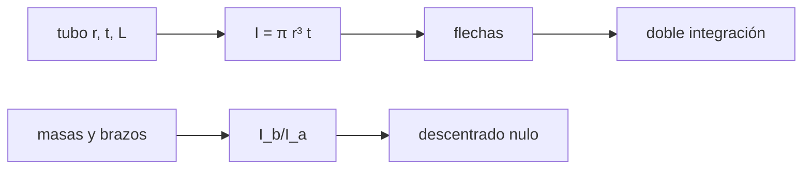

# B43-C10 — Estructura de tubo óptico

<!-- nav:top -->
[🏠 Programa](../../../../README.md) · [📚 Bloque B43](../../../tronco-comun/B43-construccion-y-mecanica-de-telescopios.md) · [← Anterior: B43-C09 — Celdas y soporte de espejos](../B43-C09-celdas-y-soporte-de-espejos/CLASE.md) · [Siguiente: B43-C11 — Dilatación térmica y estabilidad →](../B43-C11-dilatacion-termica-y-estabilidad/CLASE.md)
<!-- /nav -->

## 1. Ubicación, nivel y alcance

Clase 10 del bloque B43. Nivel N3. El tubo mantiene alineados espejo y secundario. Se flexiona por su propio peso y el de los extremos, y una cercha Serrurier hace que ambos extremos se flexionen igual. Aquí calculas flechas de viga por fórmula y por integración numérica, y diseñas una cercha de flechas iguales con un tubo ilustrativo. Usas [B05](../../../tronco-comun/B05-fisica-fundamental-para-el-espacio.md), [B11](../../../tronco-comun/B11-ecuaciones-diferenciales-y-simulacion-numerica.md) y [B50](../../../tronco-comun/B50-diseno-optico-computacional-y-tolerancias.md).

## 2. Por qué esta clase existe

Lo que decolima no es la flexión sino la flexión diferencial entre primario y secundario. La decisión central: **¿qué rigideces hacen que los dos extremos se muevan lo mismo, de modo que el eje óptico solo se desplace en paralelo?**

## 3. Lo que podrás hacer al terminar

1. Calcular el momento de inercia de un tubo delgado `π r³ t`.
2. Obtener flechas de voladizo con carga puntual y uniforme.
3. Contrastar con una doble integración numérica de la curvatura.
4. Hallar la relación de inercias de una cercha Serrurier.
5. Medir el descentrado antes y después.
6. Reconocer los límites de un modelo de viga.

La evidencia es la **ficha del tubo óptico** del ejercicio 12 (sección 20).

## 4. Con qué llegas y cómo comprobarlo

1. ¿Qué es un voladizo?
2. ¿Qué es el momento de inercia de área?
3. ¿Qué es la curvatura de una viga?
4. ¿Qué es una integral numérica?
5. ¿Qué es un momento flector?

<details>
<summary>Ver respuestas</summary>

1. Una viga empotrada en un extremo. 2. Una propiedad de la sección que mide su resistencia a la flexión. 3. La derivada segunda `y'' = M/(EI)`. 4. Una suma aproximada del área bajo una curva. 5. El momento interno que flexiona la viga.
</details>

Con cuatro o cinco aciertos, sigue; si no, repasa los prerrequisitos.

## 5. Un caso de contexto y casos de referencia

Tubo ilustrativo de aluminio de `125 mm` de radio, `2 mm` de pared y `1 m`. La flecha en voladizo bajo su peso uniforme es de `11,58 µm`. Con extremos de 6 kg y 1 kg a 0,5 m y la misma inercia, la flexión diferencial es `59,2 µm`; con la inercia del brazo ligero en `0,1667` de la del pesado, es `0`. Es el **ejemplo conductor**.

## 6. Vocabulario

La **cercha Serrurier** son dos brazos que soportan los extremos. La **rigidez a flexión** `E I`. La **flecha de voladizo** `P L³/(3EI)` o `w L⁴/(8EI)`. El **descentrado diferencial** entre primario y secundario. El **tubo delgado** `I = π r³ t`.

## 7. Modelo mental: dos niños en un balancín

Como dos niños en un balancín que bajan lo mismo aunque pesen distinto porque el brazo del liviano es más flexible: ambos bajan juntos y el eje se mantiene paralelo.



*Descripción textual:* la flecha de cada brazo depende de masa, brazo e inercia; igualarlas deja solo un desplazamiento paralelo.

Analogía: dos niños en un balancín. Límite: pequeñas deflexiones, material lineal.

## 8. La explicación, paso a paso

### 8.1 Tubo

`I = π r³ t = 1,2272 × 10⁻⁵ m⁴`. Con carga uniforme (8 kg en 1 m) la flecha es `11,581 µm` por fórmula y `11,581 µm` por doble integración; la rigidez de punta `3EI/L³ = 2,540 N/µm`.

### 8.2 Cercha Serrurier

| Caso | Flecha del brazo del primario (µm) | Flecha del brazo del secundario (µm) | Descentrado (µm) |
|---|---|---|---|
| Misma inercia (5 × 10⁻⁷ m⁴) | 71,063 | 11,844 | 59,219 |
| `I_b/I_a = 0,1667` | 71,063 | 71,063 | 1,4 × 10⁻¹⁴ |

El brazo del primario (6 kg a 0,5 m) se flexiona `71,063 µm` por fórmula y `71,063 µm` por integración.

### 8.3 Regla

`I_b/I_a = (m_b/m_a)(L_b/L_a)³ = (1/6)·1 = 0,1667`: el brazo ligero debe ser seis veces menos rígido.

## 9. Magnitudes, símbolos y unidades

| Símbolo | Qué es | Unidad | Valor / nota |
|---|---|---|---|
| `E` | módulo del aluminio | Pa | 6,9 × 10¹⁰ (ilustrativo) |
| `I` | momento de inercia de área | m⁴ | 1,227 × 10⁻⁵ |
| `g` | gravedad estándar | m/s² | 9,80665 (NIST) |
| `δ` | flecha | µm | ver 8.1 |

## 10. Convenciones y referencias

Unidades del SI; coma decimal en el texto y punto decimal en las salidas del laboratorio; los ángulos están en radianes salvo que se indique y las longitudes de onda en nanómetros. Los telescopios y materiales de los ejemplos son ilustrativos.

## 11. De dónde sale lo que afirmamos

| ID | Fuente | Localizador | Respalda | Estado |
|---|---|---|---|---|
| S1 | NIST, *Fundamental Physical Constants* (CODATA 2022) | https://physics.nist.gov/cuu/Constants/Table/allascii.txt | constantes citadas en la sección 9 | Consultada el 2026-11-09 |
| S2 | Módulo del aluminio | — | E = 69 GPa | Ilustrativo, NO consultado en una hoja de fabricante |

Límites: El modelo de viga no incluye cortante, uniones ni cercha real; no se contrastó con elementos finitos. La regla de Serrurier se cita de memoria y se comprueba solo con el modelo simplificado.

## 12. Cómo ver la cercha

| Caso | Descentrado (µm) |
|---|---|
| Misma inercia | 59,22 |
| Serrurier | 1,4 × 10⁻¹⁴ |

Descripción larga: igualar las flechas anula el descentrado.

## 13. Ejemplo trabajado: el descentrado

**Paso 1 · Brazo del primario.** `6 g · 0,5³/(3 E I_a) = 71,063 µm`.

**Paso 2 · Brazo del secundario con la misma inercia.** `11,844 µm`.

**Paso 3 · Diferencia.** `59,219 µm`.

## 14. Distintas formas de describir la cercha

**En palabras:** se iguala la flexión de ambos extremos. **En fórmulas:** `I_b/I_a = (m_b/m_a)(L_b/L_a)³`. **En tabla:** casos. **En código:** `tubo.py`.

## 15. Práctica guiada

**Ejercicio 1 · con los pasos indicados.** `I` de un tubo de `r = 125 mm`, `t = 2 mm`. *Pasos:* `π r³ t`.

<details><summary>Solución comentada</summary>

`1,227 × 10⁻⁵ m⁴`.
</details>

**Ejercicio 2 · con una pista.** Flecha de voladizo uniforme con 78,5 N/m y 1 m.

<details><summary>Solución comentada</summary>

`11,58 µm`.
</details>

**Ejercicio 3 · casi autónomo.** Flecha de un brazo con 6 kg a 0,5 m e `I_a = 5 × 10⁻⁷`.

<details><summary>Solución comentada</summary>

`71,06 µm`.
</details>

## 16. Práctica autónoma, transferencia e integrador

**Ejercicio 4.** Flecha del brazo ligero (1 kg) con la misma inercia.

<details><summary>Solución comentada</summary>

`11,84 µm`.
</details>

**Ejercicio 5.** Descentrado en ese caso.

<details><summary>Solución comentada</summary>

`59,22 µm`.
</details>

**Ejercicio 6.** Relación de inercias para anular el descentrado.

<details><summary>Solución comentada</summary>

`0,1667`.
</details>

**Ejercicio 7.** Rigidez de punta del tubo.

<details><summary>Solución comentada</summary>

`2,54 N/µm`.
</details>

**Ejercicio 8.** Si el brazo del secundario se alarga al doble, ¿qué `I_b/I_a`?

<details><summary>Solución comentada</summary>

`8/6 = 1,33`, es decir `(1/6)·2³`.
</details>

**Ejercicio 9 · transferencia.** **Transferencia.** ¿Por qué no basta un tubo muy rígido?

<details><summary>Solución comentada</summary>

Pesa más y flexiona los soportes; importa la flexión diferencial.
</details>

**Ejercicio 10 · transferencia.** **Transferencia.** ¿Qué efecto óptico queda con flechas iguales?

<details><summary>Solución comentada</summary>

Un desplazamiento paralelo del eje, sin decolimación.
</details>

**Ejercicio 11 · transferencia.** **Transferencia.** ¿Es esta cercha un diseño real?

<details><summary>Solución comentada</summary>

No: es un modelo de viga ilustrativo.
</details>

**Ejercicio 12.** **Integrador.** Elabora tu *ficha del tubo óptico*: inercia, flechas y relación Serrurier.

<details><summary>Solución comentada</summary>

Secciones 8.1–8.3.
</details>

**Ejercicio 12 · integrador.** **Integrador.** Elabora tu *ficha del tubo óptico*: inercia, flechas y relación Serrurier.

<details><summary>Solución modelo</summary>

Secciones 8.1–8.3.
</details>

## 17. Laboratorio: vigas y Serrurier

El script [tubo.py](tubo.py) calcula flechas por fórmula y por doble integración y diseña la cercha (**comprueba** `1e-3` y descentrado nulo).

**Datos:** `g` de NIST; resto **ilustrativo**. **Predice antes de ejecutar:** ¿qué inercia debe tener el brazo ligero? (1/6.) **Ejecución del 2026-11-09 (Python 3.12.9):**

```text
Python 3.12.9 (biblioteca estandar)
I_tubo_m4 = 1.22718e-05
flecha_uniforme_um = 11.5814
flecha_uniforme_num_um = 11.5814
flecha_a_um = 71.0627
flecha_a_num_um = 71.0627
flecha_b_mismo_I_um = 11.8438
descentrado_mismo_I_um = 59.2189
Ib_sobre_Ia = 0.166667
flecha_b_serrurier_um = 71.0627
descentrado_serrurier_um = 1.35525e-14
rigidez_tubo_N_por_um = 2.54027
Pruebas superadas.
```

```bash
python programa/clases/B43/B43-C10-estructura-de-tubo-optico/tubo.py
```

**Límites:** pequeñas deflexiones; viga equivalente.

## 18. Errores frecuentes y cómo corregirlos

**Medir la flecha total en lugar de la diferencial.** Se corrige con 8.2.

**Olvidar los brazos distintos.** Se corrige con 8.3.

**Usar `I` de sección llena.** Se corrige con 8.1.

**Aplicar la regla sin masas.** Se corrige con 8.3.

## 19. Cómo sabrás que vas bien

Tras la sección 8: ¿qué resultado esperabas y cuál obtuviste? Si dudas, repasa el ejemplo 13. Tras el laboratorio: ¿qué comprueba? (ver la sección 17).

## 20. Qué entregas y cómo se evalúa

El producto es tu **ficha del tubo óptico** (ejercicio 12).

| Criterio | Inicial | En desarrollo | Logrado | Destacado |
|---|---|---|---|---|
| Conceptos | Los confunde | Parciales | conceptos de la clase | Explica los límites |
| Cálculo | Sin unidades | Con errores | Tablas completas | Calcula casos nuevos |
| Numérico | Sin comprobar | Un caso | Contraste con el análisis | Interpreta las diferencias |
| Fuentes | Sin fuente | Sin fecha | fuentes con fecha | Declara lo ilustrativo |
| Límites | No los nombra | Uno | Tres | Discute qué falta del modelo |

**Condiciones críticas (no se compensan con promedio):** rotular materiales y masas como ilustrativos; no presentar la regla como verificada con una fuente; no confundir flexión con descentrado.

## 21. Ética, seguridad y límites

Clase educativa: los modelos son simplificados. Accesibilidad: tablas equivalentes a las gráficas, fórmulas en texto, ejercicios sin conexión.

## 22. Para cerrar y seguir

El tubo ilustrativo flecta `11,6 µm` y una cercha con `I_b/I_a = 1/6` anula el descentrado entre los dos extremos. Queda una pregunta: ¿cómo cambia todo con la temperatura?

**Glosario español–inglés.** tubo · *tube*; cercha Serrurier · *Serrurier truss*; voladizo · *cantilever*; momento de inercia · *area moment of inertia*; flexión · *bending*.

**Continuidad.** [B43-C11](../B43-C11-dilatacion-termica-y-estabilidad/CLASE.md) estudia la dilatación térmica y la estabilidad.

**Referencias:** ver sección 11.

<!-- nav:bottom -->
---

[← Anterior: B43-C09 — Celdas y soporte de espejos](../B43-C09-celdas-y-soporte-de-espejos/CLASE.md) · [📚 Bloque B43](../../../tronco-comun/B43-construccion-y-mecanica-de-telescopios.md) · [Siguiente: B43-C11 — Dilatación térmica y estabilidad →](../B43-C11-dilatacion-termica-y-estabilidad/CLASE.md)
<!-- /nav -->
