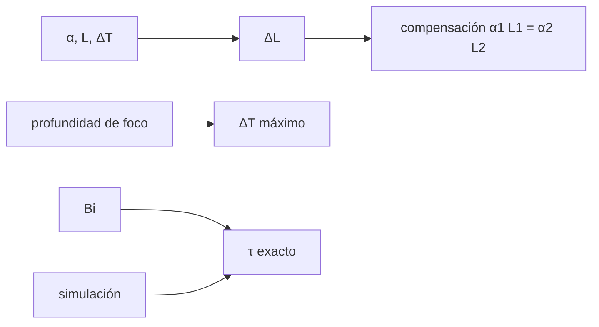

# B43-C11 — Dilatación térmica y estabilidad

<!-- nav:top -->
[🏠 Programa](../../../../README.md) · [📚 Bloque B43](../../../tronco-comun/B43-construccion-y-mecanica-de-telescopios.md) · [← Anterior: B43-C10 — Estructura de tubo óptico](../B43-C10-estructura-de-tubo-optico/CLASE.md) · [Siguiente: B43-C12 — Montura ecuatorial →](../B43-C12-montura-ecuatorial/CLASE.md)
<!-- /nav -->

## 1. Ubicación, nivel y alcance

Clase 11 del bloque B43. Nivel N3. Un tubo se alarga con el calor y el foco se mueve; un espejo grueso tarda horas en igualar su temperatura con el aire. Aquí calculas la deriva de foco, una compensación con dos materiales y la constante de tiempo de un espejo, con valores ilustrativos. Usas [B05](../../../tronco-comun/B05-fisica-fundamental-para-el-espacio.md), [B11](../../../tronco-comun/B11-ecuaciones-diferenciales-y-simulacion-numerica.md) y [B13](../../../tronco-comun/B13-metrologia-tiempo-y-mediciones-cientificas.md).

## 2. Por qué esta clase existe

La estabilidad térmica fija cuándo se puede observar y cada cuánto hay que reenfocar. La decisión central: **¿cuánto se mueve el foco por kelvin, cómo se compensa y cuánto tarda el espejo en igualarse al aire?**

## 3. Lo que podrás hacer al terminar

1. Calcular `ΔL = α L ΔT` para tres materiales.
2. Comparar la deriva con la profundidad de foco `±2λN²`.
3. Compensar con dos materiales `α₁L₁ = α₂L₂`.
4. Hallar la constante de tiempo de una placa con convección (`ζ tan ζ = Bi`).
5. Contrastarla con una simulación de diferencias finitas.
6. Reconocer los límites 1D.

La evidencia es la **ficha de estabilidad térmica** del ejercicio 12 (sección 20).

## 4. Con qué llegas y cómo comprobarlo

1. ¿Qué es la dilatación térmica?
2. ¿Qué es la profundidad de foco?
3. ¿Qué es una ecuación de difusión del calor?
4. ¿Qué es el número de Biot?
5. ¿Qué es una constante de tiempo?

<details>
<summary>Ver respuestas</summary>

1. El cambio de longitud con la temperatura. 2. El intervalo axial en que la imagen sigue nítida, `±2λN²`. 3. `∂T/∂t = κ ∂²T/∂x²`. 4. `h L/k`, la razón entre resistencia interna y externa. 5. El tiempo en que una magnitud cae a `1/e`.
</details>

Con cuatro o cinco aciertos, sigue; si no, repasa los prerrequisitos.

## 5. Un caso de contexto y casos de referencia

Tubo ilustrativo de `1 m` y telescopio f/5: la profundidad de foco es `±27,5 µm`, de modo que `1 m` de aluminio con `ΔT = 1,2 K` ya la agota (`1,17 K`). Un espejo de borosilicato de `33,3 mm` con convección de `5 W/m²/K` tiene `Bi = 0,0730` y una constante de tiempo de `6314 s` (`1,75 h`). Es el **ejemplo conductor**.

## 6. Vocabulario

El **coeficiente de dilatación** `α`. La **deriva de foco** es la variación de distancia espejo-detector. La **compensación** combina dos materiales. El **número de Biot** `Bi = h L/k`. La **constante de tiempo** `τ = L²/(κ ζ²)`. La **difusividad** `κ = k/(ρ c)`.

## 7. Modelo mental: un helado que se derrite

Como un helado que se derrite desde la superficie: la capa externa cambia de inmediato y el centro tarda; cuanto más grueso, más lento, con el aire como aislante.



*Descripción textual:* la dilatación mueve el foco; dos materiales lo compensan; la difusión y la convección fijan el tiempo de igualación.

Analogía: un helado que se derrite. Límite: 1D, propiedades constantes, sin radiación.

## 8. La explicación, paso a paso

### 8.1 Dilatación de 1 m con ΔT = 10 K (ILUSTRATIVO)

| Material | α (10⁻⁶/K) | ΔL (µm) | ΔT máx. para ±27,5 µm (K) |
|---|---|---|---|
| Acero | 12,0 | 120,0 | 2,29 |
| Aluminio | 23,6 | 236,0 | 1,17 |
| Carbono | 0,5 | 5,0 | 55,0 |

### 8.2 Compensación

Para una longitud neta de `1000 mm` con acero y aluminio, `α₁L₁ = α₂L₂` da `L_acero = 2034,48 mm` y `L_aluminio = 1034,48 mm`; el neto es `1000,000 mm` y la deriva compensada `-3,6 × 10⁻¹⁷ mm`.

### 8.3 Constante de tiempo

Con `k = 1,14 W/m/K`, `ρ = 2230 kg/m³`, `c = 830 J/kg/K` y `h = 5 W/m²/K`: `Bi = 0,0730`; la raíz de `ζ tan ζ = Bi` da `τ = 6314,2 s`. La aproximación agrupada `ρ c L/h` da `6163,5 s` y la simulación por diferencias finitas `6314,1 s`.

## 9. Magnitudes, símbolos y unidades

| Símbolo | Qué es | Unidad | Valor / nota |
|---|---|---|---|
| `α` | dilatación térmica | 10⁻⁶/K | 12,0 · 23,6 · 0,5 (ilustrativos) |
| `Bi` | número de Biot | — | 0,0730 |
| `τ` | constante de tiempo | s | 6314 |
| `κ` | difusividad | m²/s | 6,2 × 10⁻⁷ |

## 10. Convenciones y referencias

Unidades del SI; coma decimal en el texto y punto decimal en las salidas del laboratorio; los ángulos están en radianes salvo que se indique y las longitudes de onda en nanómetros. Los telescopios y materiales de los ejemplos son ilustrativos.

## 11. De dónde sale lo que afirmamos

| ID | Fuente | Localizador | Respalda | Estado |
|---|---|---|---|---|
| S1 | Hojas de datos de los materiales | — | α, k, ρ y c (ilustrativos de orden de magnitud) | No consultado |

Límites: No se consultó ninguna hoja de datos; el modelo es 1D sin radiación. La simulación y la raíz trascendente se contrastan entre sí, no con una medición.

## 12. Cómo ver la deriva

| Material | ΔL (µm) |
|---|---|
| Acero | 120,0 |
| Aluminio | 236,0 |
| Carbono | 5,0 |

Descripción larga: el aluminio supera 8 veces la profundidad de foco con 10 K.

## 13. Ejemplo trabajado: la constante de tiempo

**Paso 1 · Biot.** `Bi = 5 × 0,01665/1,14 = 0,0730`.

**Paso 2 · Raíz.** `ζ tan ζ = Bi` da `ζ`.

**Paso 3 · τ.** `L²/(κ ζ²) = 6314,2 s`.

## 14. Distintas formas de describir el equilibrio térmico

**En palabras:** el espejo sigue al aire con un retardo de horas. **En fórmulas:** `τ = L²/(κ ζ²)`. **En tabla:** materiales. **En código:** `termica.py`.

## 15. Práctica guiada

**Ejercicio 1 · con los pasos indicados.** `ΔL` del acero para 1 m y 10 K.

<details><summary>Solución comentada</summary>

`120 µm`.
</details>

**Ejercicio 2 · con una pista.** Profundidad de foco a f/5 y 550 nm.

<details><summary>Solución comentada</summary>

`2λN² = 27,5 µm`.
</details>

**Ejercicio 3 · casi autónomo.** `ΔT` máximo del aluminio.

<details><summary>Solución comentada</summary>

`1,17 K`.
</details>

## 16. Práctica autónoma, transferencia e integrador

**Ejercicio 4.** `L_acero` para neto 1000 mm.

<details><summary>Solución comentada</summary>

`2034,48 mm`.
</details>

**Ejercicio 5.** `L_aluminio`.

<details><summary>Solución comentada</summary>

`1034,48 mm`.
</details>

**Ejercicio 6.** `Bi` del espejo.

<details><summary>Solución comentada</summary>

`0,0730`.
</details>

**Ejercicio 7.** `τ` agrupada.

<details><summary>Solución comentada</summary>

`ρ c L/h = 6163 s`.
</details>

**Ejercicio 8.** `τ` en horas (exacta).

<details><summary>Solución comentada</summary>

`1,75 h`.
</details>

**Ejercicio 9 · transferencia.** **Transferencia.** ¿Por qué el carbono casi no deriva?

<details><summary>Solución comentada</summary>

Por su `α` cercano a cero; aun así su `E` y su humedad importan.
</details>

**Ejercicio 10 · transferencia.** **Transferencia.** ¿Por qué observar con el espejo caliente degrada la imagen?

<details><summary>Solución comentada</summary>

Porque el gradiente térmico deforma la superficie y mueve el foco.
</details>

**Ejercicio 11 · transferencia.** **Transferencia.** ¿Son estos `α` los de una hoja de datos?

<details><summary>Solución comentada</summary>

No: son ilustrativos.
</details>

**Ejercicio 12.** **Integrador.** Elabora tu *ficha de estabilidad térmica*: deriva, compensación y constante de tiempo.

<details><summary>Solución comentada</summary>

Secciones 8.1–8.3.
</details>

**Ejercicio 12 · integrador.** **Integrador.** Elabora tu *ficha de estabilidad térmica*: deriva, compensación y constante de tiempo.

<details><summary>Solución modelo</summary>

Secciones 8.1–8.3.
</details>

## 17. Laboratorio: difusión y compensación

El script [termica.py](termica.py) calcula la deriva, la compensación y la constante de tiempo con una raíz trascendente y una simulación (**comprueba** `2 %` entre ambas).

**Datos:** propiedades **ilustrativas**. **Predice antes de ejecutar:** ¿cuánto tarda el espejo? (≈ 1,75 h.) **Ejecución del 2026-11-09 (Python 3.12.9):**

```text
Python 3.12.9 (biblioteca estandar)
dL_um {'acero': 120.0, 'aluminio': 236.0, 'carbono': 5.0}
dT_max_K {'acero': 2.292, 'aluminio': 1.165, 'carbono': 55.0}
prof_foco_um = 27.5
L_acero_mm = 2034.48
L_aluminio_mm = 1034.48
neto_mm = 1000
deriva_compensada_mm = -3.63798e-17
Bi = 0.0730263
tau_exacto_s = 6314.25
tau_agrupado_s = 6163.5
tau_sim_s = 6314.14
Pruebas superadas.
```

```bash
python programa/clases/B43/B43-C11-dilatacion-termica-y-estabilidad/termica.py
```

**Límites:** 1D, `h` constante, sin radiación.

## 18. Errores frecuentes y cómo corregirlos

**Confundir `τ` con el tiempo total de igualación.** Se corrige con la sección 6.

**Usar `Bi` grande sin cambiar la fórmula.** Se corrige con 8.3.

**Olvidar la profundidad de foco.** Se corrige con 8.1.

**Sumar longitudes sin signo en la compensación.** Se corrige con 8.2.

## 19. Cómo sabrás que vas bien

Tras la sección 8: ¿qué resultado esperabas y cuál obtuviste? Si dudas, repasa el ejemplo 13. Tras el laboratorio: ¿qué comprueba? (ver la sección 17).

## 20. Qué entregas y cómo se evalúa

El producto es tu **ficha de estabilidad térmica** (ejercicio 12).

| Criterio | Inicial | En desarrollo | Logrado | Destacado |
|---|---|---|---|---|
| Conceptos | Los confunde | Parciales | conceptos de la clase | Explica los límites |
| Cálculo | Sin unidades | Con errores | Tablas completas | Calcula casos nuevos |
| Numérico | Sin comprobar | Un caso | Contraste con el análisis | Interpreta las diferencias |
| Fuentes | Sin fuente | Sin fecha | fuentes con fecha | Declara lo ilustrativo |
| Límites | No los nombra | Uno | Tres | Discute qué falta del modelo |

**Condiciones críticas (no se compensan con promedio):** rotular propiedades como ilustrativas; no presentar la compensación como diseño real; citar la simulación como contraste interno.

## 21. Ética, seguridad y límites

Clase educativa: los modelos son simplificados. Accesibilidad: tablas equivalentes a las gráficas, fórmulas en texto, ejercicios sin conexión.

## 22. Para cerrar y seguir

El foco deriva `236 µm` por 10 K en aluminio, se compensa con `L_acero/L_aluminio = 1,967` y el espejo tarda `1,8 h` en igualarse. Queda una pregunta: ¿cómo se apunta el tubo?

**Glosario español–inglés.** dilatación térmica · *thermal expansion*; profundidad de foco · *depth of focus*; número de Biot · *Biot number*; constante de tiempo · *time constant*; difusividad · *diffusivity*.

**Continuidad.** [B43-C12](../B43-C12-montura-ecuatorial/CLASE.md) estudia la montura ecuatorial.

**Referencias:** ver sección 11.

<!-- nav:bottom -->
---

[← Anterior: B43-C10 — Estructura de tubo óptico](../B43-C10-estructura-de-tubo-optico/CLASE.md) · [📚 Bloque B43](../../../tronco-comun/B43-construccion-y-mecanica-de-telescopios.md) · [Siguiente: B43-C12 — Montura ecuatorial →](../B43-C12-montura-ecuatorial/CLASE.md)
<!-- /nav -->
