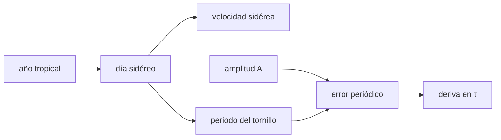

# B43-C12 — Montura ecuatorial

<!-- nav:top -->
[🏠 Programa](../../../../README.md) · [📚 Bloque B43](../../../tronco-comun/B43-construccion-y-mecanica-de-telescopios.md) · [← Anterior: B43-C11 — Dilatación térmica y estabilidad](../B43-C11-dilatacion-termica-y-estabilidad/CLASE.md) · [Siguiente: B43-C13 — Montura altacimutal →](../B43-C13-montura-altacimutal/CLASE.md)
<!-- /nav -->

## 1. Ubicación, nivel y alcance

Clase 12 del bloque B43. Nivel N3. Una montura ecuatorial tiene un eje paralelo al eje de la Tierra y compensa la rotación con un único giro uniforme. Su precisión depende del error periódico del tornillo sin fin. Aquí calculas la velocidad sidérea, el periodo del tornillo y la deriva máxima en una exposición con una montura ilustrativa. Usas [B08](../../../tronco-comun/B08-observacion-del-cielo-y-astronomia-practica.md), [B13](../../../tronco-comun/B13-metrologia-tiempo-y-mediciones-cientificas.md) y [B16](../../../tronco-comun/B16-sistemas-dinamicos-y-control-automatico.md).

## 2. Por qué esta clase existe

Una exposición larga solo es nítida si el error de seguimiento es menor que un píxel. La decisión central: **¿a qué velocidad hay que girar el eje horario y cuánto puede derivar la imagen durante la exposición?**

## 3. Lo que podrás hacer al terminar

1. Calcular el día sidéreo a partir del año tropical.
2. Obtener la velocidad sidérea en segundos de arco por segundo.
3. Calcular el periodo del tornillo sin fin.
4. Modelar el error periódico como una sinusoide.
5. Calcular la deriva máxima en una exposición `2A sen(πτ/T)`.
6. Verificar con un barrido de fases.

La evidencia es la **ficha de la montura ecuatorial** del ejercicio 12 (sección 20).

## 4. Con qué llegas y cómo comprobarlo

1. ¿Qué es un día sidéreo?
2. ¿Qué es el año tropical?
3. ¿Qué es una montura ecuatorial?
4. ¿Qué es un tornillo sin fin?
5. ¿Qué es una sinusoide?

<details>
<summary>Ver respuestas</summary>

1. El periodo de rotación de la Tierra respecto de las estrellas. 2. El tiempo entre dos equinoccios de primavera. 3. Una montura con un eje paralelo al eje terrestre. 4. Un engranaje de un tornillo y una corona. 5. Una función `A sen(ωt + φ)`.
</details>

Con cuatro o cinco aciertos, sigue; si no, repasa los prerrequisitos.

## 5. Un caso de contexto y casos de referencia

Montura ilustrativa con corona de 144 dientes y error periódico de `10"`. El día sidéreo es `86164,09 s`, la velocidad sidérea `15,0411"/s` (la solar, `15"/s`), el periodo del tornillo `598,4 s` y la deriva máxima en 60 s es `6,20"`. Es el **ejemplo conductor**.

## 6. Vocabulario

La **velocidad sidérea** `1 296 000"/día sidéreo`. El **eje horario** gira a esa velocidad. El **tornillo sin fin** mueve la corona; su **periodo** es el día sidéreo dividido por los dientes. El **error periódico** `e(t) = A sen(2πt/T_w + φ)`. La **deriva** en una exposición es `|e(t₀+τ) − e(t₀)|`.

## 7. Modelo mental: un reloj con una pequeña oscilación

Como un reloj cuya aguja avanza a ritmo constante pero con una pequeña oscilación periódica: durante un minuto el desvío máximo depende de la fase en que se empiece.



*Descripción textual:* el eje horario gira a la velocidad sidérea; el tornillo añade un error periódico cuya deriva depende de la exposición.

Analogía: un reloj con una pequeña oscilación. Límite: error periódico sinusoidal puro, alineación perfecta.

## 8. La explicación, paso a paso

### 8.1 Velocidad

`día sidéreo = 86400 T/(T+1) = 86164,091 s` con `T = 365,2422`. Velocidad sidérea `15,04107"/s`; solar `15,00000"/s`; diferencia `0,04107"/s`, es decir `2,464"` en 60 s si se usara el ritmo solar.

### 8.2 Periodo y velocidad del error

Con 144 dientes, `T_w = 598,36 s`. La velocidad máxima del error de amplitud `10"` es `2πA/T_w = 0,1050"/s`.

### 8.3 Deriva máxima en una exposición

| τ (s) | Barrido de fase (") | `2A sen(πτ/T_w)` (") |
|---|---|---|
| 30 | 3,1372 | 3,1372 |
| 60 | 6,1967 | 6,1967 |
| 120 | 11,7835 | 11,7835 |
| 240 | 19,0423 | 19,0423 |

Con 1"/píxel, una exposición de 60 s deriva ~6 píxeles sin autoguiado.

## 9. Magnitudes, símbolos y unidades

| Símbolo | Qué es | Unidad | Valor / nota |
|---|---|---|---|
| `T` | año tropical | d | 365,2422 (uso general) |
| `T_w` | periodo del tornillo | s | 598,36 |
| `A` | amplitud del error periódico | " | 10 (ilustrativo) |
| `τ` | exposición | s | 30 a 240 |

## 10. Convenciones y referencias

Unidades del SI; coma decimal en el texto y punto decimal en las salidas del laboratorio; los ángulos están en radianes salvo que se indique y las longitudes de onda en nanómetros. Los telescopios y materiales de los ejemplos son ilustrativos.

## 11. De dónde sale lo que afirmamos

| ID | Fuente | Localizador | Respalda | Estado |
|---|---|---|---|---|
| S1 | Valor del año tropical | — | 365,2422 d (uso general, no consultado aquí) | No consultado |

Límites: El año tropical es un valor de uso general que no se consultó en esta clase; el error periódico es puramente sinusoidal y el valor de 10" es ilustrativo.

## 12. Cómo ver las derivas

| τ (s) | Deriva (") |
|---|---|
| 30 | 3,14 |
| 60 | 6,20 |
| 120 | 11,78 |
| 240 | 19,04 |

Descripción larga: la deriva crece sublinealmente con la exposición.

## 13. Ejemplo trabajado: la deriva de 60 s

**Paso 1 · Periodo.** `T_w = 598,36 s`.

**Paso 2 · Fórmula.** `2 · 10 · sen(π · 60/598,36) = 6,1967"`.

**Paso 3 · Barrido.** `6,1967"`.

## 14. Distintas formas de describir el seguimiento

**En palabras:** el eje sigue a velocidad constante y el tornillo añade una oscilación. **En fórmulas:** `Δe = 2A sen(πτ/T_w)`. **En tabla:** derivas. **En código:** `ecuatorial.py`.

## 15. Práctica guiada

**Ejercicio 1 · con los pasos indicados.** Día sidéreo con `T = 365,2422 d`.

<details><summary>Solución comentada</summary>

`86164,09 s`.
</details>

**Ejercicio 2 · con una pista.** Velocidad sidérea.

<details><summary>Solución comentada</summary>

`15,0411"/s`.
</details>

**Ejercicio 3 · casi autónomo.** Periodo del tornillo con 144 dientes.

<details><summary>Solución comentada</summary>

`598,4 s`.
</details>

## 16. Práctica autónoma, transferencia e integrador

**Ejercicio 4.** Velocidad máxima del error con `A = 10"`.

<details><summary>Solución comentada</summary>

`0,1050"/s`.
</details>

**Ejercicio 5.** Deriva en 30 s.

<details><summary>Solución comentada</summary>

`3,137"`.
</details>

**Ejercicio 6.** Deriva en 120 s.

<details><summary>Solución comentada</summary>

`11,784"`.
</details>

**Ejercicio 7.** Deriva si se usa 15"/s y no la sidérea, en 60 s.

<details><summary>Solución comentada</summary>

`2,464"`.
</details>

**Ejercicio 8.** Píxeles de deriva en 60 s con 1"/píxel.

<details><summary>Solución comentada</summary>

`6,2`.
</details>

**Ejercicio 9 · transferencia.** **Transferencia.** ¿Por qué se usa autoguiado?

<details><summary>Solución comentada</summary>

Porque corrige la deriva residual en tiempo real.
</details>

**Ejercicio 10 · transferencia.** **Transferencia.** ¿Por qué la deriva no crece linealmente?

<details><summary>Solución comentada</summary>

Porque el error es periódico: oscila, no deriva sin fin.
</details>

**Ejercicio 11 · transferencia.** **Transferencia.** ¿Es la corona de 144 dientes de una montura real?

<details><summary>Solución comentada</summary>

No: es ilustrativa.
</details>

**Ejercicio 12.** **Integrador.** Elabora tu *ficha de la montura ecuatorial*: velocidad, periodo y derivas.

<details><summary>Solución comentada</summary>

Secciones 8.1–8.3.
</details>

**Ejercicio 12 · integrador.** **Integrador.** Elabora tu *ficha de la montura ecuatorial*: velocidad, periodo y derivas.

<details><summary>Solución modelo</summary>

Secciones 8.1–8.3.
</details>

## 17. Laboratorio: seguimiento y error periódico

El script [ecuatorial.py](ecuatorial.py) calcula la velocidad sidérea, el periodo y barre fases para hallar la deriva máxima (**comprueba** `1e-4` en la deriva).

**Datos:** montura **ilustrativa**. **Predice antes de ejecutar:** ¿cuánto deriva en 60 s? (≈ 6,2".) **Ejecución del 2026-11-09 (Python 3.12.9):**

```text
Python 3.12.9 (biblioteca estandar)
dia_sideral_s = 86164.1
vel_sidera = 15.0411
vel_solar = 15
dif_vel = 0.0410686
deriva_60s_arcsec = 2.46412
T_gusano_s = 598.362
max_vel_pe = 0.105006
exposicion (s) | deriva maxima numerica (arcsec) | formula (arcsec)
30 | 3.1372 | 3.1372
60 | 6.1967 | 6.1967
120 | 11.7835 | 11.7835
240 | 19.0423 | 19.0423
Pruebas superadas.
```

```bash
python programa/clases/B43/B43-C12-montura-ecuatorial/ecuatorial.py
```

**Límites:** sinusoide pura, sin deriva lenta.

## 18. Errores frecuentes y cómo corregirlos

**Usar 15"/s por 15,0411"/s.** Se corrige con 8.1.

**Creer que el error periódico crece con el tiempo.** Se corrige con 8.3.

**Olvidar la fase inicial.** Se corrige con 8.3.

**Confundir dientes con vueltas.** Se corrige con 8.2.

## 19. Cómo sabrás que vas bien

Tras la sección 8: ¿qué resultado esperabas y cuál obtuviste? Si dudas, repasa el ejemplo 13. Tras el laboratorio: ¿qué comprueba? (ver la sección 17).

## 20. Qué entregas y cómo se evalúa

El producto es tu **ficha de la montura ecuatorial** (ejercicio 12).

| Criterio | Inicial | En desarrollo | Logrado | Destacado |
|---|---|---|---|---|
| Conceptos | Los confunde | Parciales | conceptos de la clase | Explica los límites |
| Cálculo | Sin unidades | Con errores | Tablas completas | Calcula casos nuevos |
| Numérico | Sin comprobar | Un caso | Contraste con el análisis | Interpreta las diferencias |
| Fuentes | Sin fuente | Sin fecha | fuentes con fecha | Declara lo ilustrativo |
| Límites | No los nombra | Uno | Tres | Discute qué falta del modelo |

**Condiciones críticas (no se compensan con promedio):** rotular la montura como ilustrativa; no atribuir el valor del año tropical a una fuente; no presentar el error como medición.

## 21. Ética, seguridad y límites

Clase educativa: los modelos son simplificados. Accesibilidad: tablas equivalentes a las gráficas, fórmulas en texto, ejercicios sin conexión.

## 22. Para cerrar y seguir

La velocidad sidérea es `15,0411"/s` y un error periódico de 10" deriva `6,2"` en 60 s. Queda una pregunta: ¿cómo se compara con la montura altacimutal?

**Glosario español–inglés.** montura ecuatorial · *equatorial mount*; velocidad sidérea · *sidereal rate*; error periódico · *periodic error*; tornillo sin fin · *worm gear*; deriva · *drift*.

**Continuidad.** [B43-C13](../B43-C13-montura-altacimutal/CLASE.md) estudia la montura altacimutal.

**Referencias:** ver sección 11.

<!-- nav:bottom -->
---

[← Anterior: B43-C11 — Dilatación térmica y estabilidad](../B43-C11-dilatacion-termica-y-estabilidad/CLASE.md) · [📚 Bloque B43](../../../tronco-comun/B43-construccion-y-mecanica-de-telescopios.md) · [Siguiente: B43-C13 — Montura altacimutal →](../B43-C13-montura-altacimutal/CLASE.md)
<!-- /nav -->
