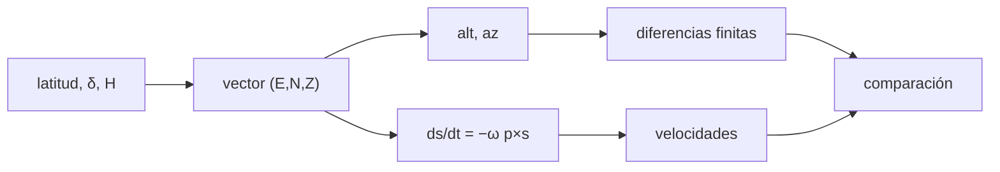

# B43-C13 — Montura altacimutal

<!-- nav:top -->
[🏠 Programa](../../../../README.md) · [📚 Bloque B43](../../../tronco-comun/B43-construccion-y-mecanica-de-telescopios.md) · [← Anterior: B43-C12 — Montura ecuatorial](../B43-C12-montura-ecuatorial/CLASE.md) · [Siguiente: B43-C14 — Reductores y transmisiones →](../B43-C14-reductores-y-transmisiones/CLASE.md)
<!-- /nav -->

## 1. Ubicación, nivel y alcance

Clase 13 del bloque B43. Nivel N3. Una montura altacimutal gira en acimut y en altura y es más sencilla de construir, pero debe mover los dos ejes a velocidades variables y el campo rota. Aquí calculas las velocidades y la rotación de campo por dos vías y la zona ciega del cenit, con latitud ilustrativa. Usas [B08](../../../tronco-comun/B08-observacion-del-cielo-y-astronomia-practica.md), [B16](../../../tronco-comun/B16-sistemas-dinamicos-y-control-automatico.md) y [B10](../../../tronco-comun/B10-algebra-lineal-y-matematicas-geometricas.md).

## 2. Por qué esta clase existe

La altacimutal reemplaza un giro uniforme por dos giros variables y un ángulo de campo que cambia. La decisión central: **¿qué velocidades exigen los motores, cuánto rota el campo y qué región del cielo no se puede seguir?**

## 3. Lo que podrás hacer al terminar

1. Transformar horario y declinación a acimut y altura con vectores.
2. Obtener las velocidades por diferencias finitas y por la derivada vectorial.
3. Calcular la rotación de campo.
4. Estimar el radio de la zona ciega del cenit.
5. Comprobar el radio con una búsqueda numérica.
6. Interpretar los signos.

La evidencia es la **ficha de la montura altacimutal** del ejercicio 12 (sección 20).

## 4. Con qué llegas y cómo comprobarlo

1. ¿Qué es el ángulo horario?
2. ¿Qué es el acimut?
3. ¿Qué es el producto vectorial?
4. ¿Qué es una diferencia finita?
5. ¿Qué es el cenit?

<details>
<summary>Ver respuestas</summary>

1. El ángulo entre el meridiano y el astro, medido hacia el oeste. 2. El ángulo en el horizonte desde el norte. 3. El vector perpendicular a dos vectores. 4. Una derivada aproximada con un paso pequeño. 5. El punto sobre la vertical del observador.
</details>

Con cuatro o cinco aciertos, sigue; si no, repasa los prerrequisitos.

## 5. Un caso de contexto y casos de referencia

Latitud ilustrativa de `−30°` y estrella de declinación `−10°`. A `H = −2 h` la altura es `55,63°`, el acimut `60,72°`, `dAz/dt = -16,835"/s` y `dAlt/dt = 11,362"/s`. Con un máximo de `1°/s` en acimut, la zona ciega del cenit tiene radio `0,207°`. Es el **ejemplo conductor**.

## 6. Vocabulario

El **vector horizontal** `(Este, Norte, Cenit)`. La **rotación de campo** es el giro de la imagen respecto del horizonte; es el **ángulo paraláctico** `q`. La **zona ciega** del cenit es donde la velocidad de acimut supera el máximo del motor. La **derivada vectorial** `ds/dt = −ω p × s`.

## 7. Modelo mental: un girasol visto desde el suelo

Como seguir un avión con la cabeza: cerca de la vertical hay que girar el cuello muy rápido aunque el avión se mueva despacio; el horizonte de la imagen también gira.



*Descripción textual:* el vector de la estrella en el horizonte da alt y az; su derivada vectorial da las velocidades, contrastadas con diferencias finitas.

Analogía: un girasol visto desde el suelo. Límite: sin refracción ni flexión; montura ideal.

## 8. La explicación, paso a paso

### 8.1 Velocidades en una noche (latitud −30°, δ = −10°)

| H (h) | Alt (°) | Az (°) | dAz/dt ("/s) | dAlt/dt ("/s) | dq/dt ("/s) |
|---|---|---|---|---|---|
| -4,0 | 30,881 | 83,590 | -8,390 | 12,945 | -1,695 |
| -2,0 | 55,632 | 60,724 | -16,835 | 11,362 | -11,284 |
| -0,5 | 68,811 | 20,833 | -38,926 | 4,633 | -33,683 |
| 0,5 | 68,811 | 339,167 | -38,926 | -4,633 | -33,683 |
| 2,0 | 55,632 | 299,276 | -16,835 | -11,362 | -11,284 |
| 4,0 | 30,881 | 276,410 | -8,390 | -12,945 | -1,695 |

Las diferencias finitas centrales (paso de 1 s) y la derivada vectorial coinciden en todos los casos con diferencias relativas menores que `10⁻⁸` (el peor valor es `1,5 × 10⁻⁸` en altura). El ángulo paraláctico cumple `dq/dt = −ω cos φ cos A/cos h` con la convención usada aquí (`q = atan2(sen H, tan φ cos δ − sen δ cos H)`).

### 8.2 Zona ciega

El radio `ε = ω cos φ/v_máx = 0,2073°`. La búsqueda numérica de la velocidad de acimut máxima para un tránsito a esa distancia cenital da `1,0021°/s` (esperado `1°/s`). A `1'` del cenit la velocidad máxima numérica es `12,441°/s` frente a `12,439°/s` de la fórmula.

## 9. Magnitudes, símbolos y unidades

| Símbolo | Qué es | Unidad | Valor / nota |
|---|---|---|---|
| `φ` | latitud | ° | −30 (ilustrativa) |
| `ω` | velocidad angular de la Tierra | rad/s | 7,2921 × 10⁻⁵ |
| `ε` | radio de la zona ciega | ° | 0,207 |
| `q` | ángulo paraláctico | rad | — |

## 10. Convenciones y referencias

Unidades del SI; coma decimal en el texto y punto decimal en las salidas del laboratorio; los ángulos están en radianes salvo que se indique y las longitudes de onda en nanómetros. Los telescopios y materiales de los ejemplos son ilustrativos.

## 11. De dónde sale lo que afirmamos

| ID | Fuente | Localizador | Respalda | Estado |
|---|---|---|---|---|
| S1 | Fórmulas de la transformación horizontal | — | relaciones estándar de la astronomía esférica, verificadas por dos vías | No consultado |

Límites: Las relaciones esféricas son estándar y se verifican entre sí; no se consultó ninguna fuente. No se incluyen refracción ni flexión.

## 12. Cómo ver las velocidades

| H (h) | dAz/dt ("/s) |
|---|---|
| -4,0 | -8,39 |
| -2,0 | -16,83 |
| -0,5 | -38,93 |
| 0,5 | -38,93 |
| 2,0 | -16,83 |
| 4,0 | -8,39 |

Descripción larga: el acimut cambia más rápido cerca del meridiano.

## 13. Ejemplo trabajado: la velocidad a H = −2 h

**Paso 1 · Vector.** Se calcula `s` con la latitud y `δ`.

**Paso 2 · Derivada.** `ds/dt = −ω p × s`.

**Paso 3 · Velocidad.** `dAz/dt = -16,835"/s`.

## 14. Distintas formas de describir el seguimiento altacimutal

**En palabras:** dos giros variables y un campo que rota. **En fórmulas:** `ε = ω cos φ/v_máx`. **En tabla:** velocidades. **En código:** `altacimutal.py`.

## 15. Práctica guiada

**Ejercicio 1 · con los pasos indicados.** Altura a `H = −2 h`.

<details><summary>Solución comentada</summary>

`55,63°`.
</details>

**Ejercicio 2 · con una pista.** Acimut a `H = −2 h`.

<details><summary>Solución comentada</summary>

`60,72°`.
</details>

**Ejercicio 3 · casi autónomo.** Velocidad de acimut a `H = −0,5 h`.

<details><summary>Solución comentada</summary>

`-38,93"/s`.
</details>

## 16. Práctica autónoma, transferencia e integrador

**Ejercicio 4.** Velocidad de altura a `H = +2 h`.

<details><summary>Solución comentada</summary>

`-11,36"/s`.
</details>

**Ejercicio 5.** Rotación de campo a `H = −0,5 h`.

<details><summary>Solución comentada</summary>

`-33,68"/s`.
</details>

**Ejercicio 6.** Radio de la zona ciega con `v_máx = 1°/s`.

<details><summary>Solución comentada</summary>

`0,207°`.
</details>

**Ejercicio 7.** Si `v_máx` pasa a 2°/s, ¿qué radio?

<details><summary>Solución comentada</summary>

`0,104°`.
</details>

**Ejercicio 8.** Velocidad máxima de acimut a 1' del cenit.

<details><summary>Solución comentada</summary>

`12,44°/s`.
</details>

**Ejercicio 9 · transferencia.** **Transferencia.** ¿Por qué las grandes observatorios modernos usan altacimutal?

<details><summary>Solución comentada</summary>

Porque la estructura es más simple y rígida; el costo es la rotación de campo.
</details>

**Ejercicio 10 · transferencia.** **Transferencia.** ¿Cómo se compensa la rotación de campo?

<details><summary>Solución comentada</summary>

Con un rotador de instrumento.
</details>

**Ejercicio 11 · transferencia.** **Transferencia.** ¿Es la estrella de este ejemplo real?

<details><summary>Solución comentada</summary>

No: es un punto ilustrativo.
</details>

**Ejercicio 12.** **Integrador.** Elabora tu *ficha de la montura altacimutal*: velocidades, rotación y zona ciega.

<details><summary>Solución comentada</summary>

Secciones 8.1–8.2.
</details>

**Ejercicio 12 · integrador.** **Integrador.** Elabora tu *ficha de la montura altacimutal*: velocidades, rotación y zona ciega.

<details><summary>Solución modelo</summary>

Secciones 8.1–8.2.
</details>

## 17. Laboratorio: velocidades y cenit

El script [altacimutal.py](altacimutal.py) calcula alt, az, velocidades y rotación de campo por dos vías y la zona ciega (**comprueba** `1e-6` y `2 %`).

**Datos:** latitud y estrella **ilustrativas**. **Predice antes de ejecutar:** ¿qué radio tiene la zona ciega? (≈ 0,21°.) **Ejecución del 2026-11-09 (Python 3.12.9):**

```text
Python 3.12.9 (biblioteca estandar)
H (h) | alt (deg) | az (deg) | dAz/dt ("/s) | dAlt/dt ("/s) | dif rel alt | dif rel az | dq/dt ("/s) | dif rel q
-4.0 | 30.881 | 83.590 | -8.390 | 12.945 | -3.1e-10 | 2.3e-09 | -1.695 | 8.5e-09
-2.0 | 55.632 | 60.724 | -16.835 | 11.362 | -2.2e-09 | 5.8e-09 | -11.284 | 8.4e-09
-0.5 | 68.811 | 20.833 | -38.926 | 4.633 | -1.5e-08 | -5.8e-09 | -33.683 | -6.8e-09
+0.5 | 68.811 | 339.167 | -38.926 | -4.633 | -1.5e-08 | -5.8e-09 | -33.683 | -6.8e-09
+2.0 | 55.632 | 299.276 | -16.835 | -11.362 | -2.2e-09 | 5.8e-09 | -11.284 | 8.4e-09
+4.0 | 30.881 | 276.410 | -8.390 | -12.945 | -3.1e-10 | 2.3e-09 | -1.695 | 8.5e-09
eps_formula_deg = 0.207314
vel_az_max_deg_s = 1.00208
vel_az_max_1arcmin_deg_s = 12.441
vel_az_formula_1arcmin_deg_s = 12.4389
Pruebas superadas.
```

```bash
python programa/clases/B43/B43-C13-montura-altacimutal/altacimutal.py
```

**Límites:** sin refracción; montura ideal.

## 18. Errores frecuentes y cómo corregirlos

**Confundir el signo de `q`.** Se corrige con la convención de 8.1.

**Ignorar la zona del cenit.** Se corrige con 8.2.

**Usar un paso de diferencias demasiado grande.** Se corrige con el contraste de 8.1.

**Mezclar grados y radianes.** Se corrige con la sección 9.

## 19. Cómo sabrás que vas bien

Tras la sección 8: ¿qué resultado esperabas y cuál obtuviste? Si dudas, repasa el ejemplo 13. Tras el laboratorio: ¿qué comprueba? (ver la sección 17).

## 20. Qué entregas y cómo se evalúa

El producto es tu **ficha de la montura altacimutal** (ejercicio 12).

| Criterio | Inicial | En desarrollo | Logrado | Destacado |
|---|---|---|---|---|
| Conceptos | Los confunde | Parciales | conceptos de la clase | Explica los límites |
| Cálculo | Sin unidades | Con errores | Tablas completas | Calcula casos nuevos |
| Numérico | Sin comprobar | Un caso | Contraste con el análisis | Interpreta las diferencias |
| Fuentes | Sin fuente | Sin fecha | fuentes con fecha | Declara lo ilustrativo |
| Límites | No los nombra | Uno | Tres | Discute qué falta del modelo |

**Condiciones críticas (no se compensan con promedio):** rotular la latitud y la estrella como ilustrativas; declarar la convención de signos; no presentar las velocidades como las de un instrumento real.

## 21. Ética, seguridad y límites

Clase educativa: los modelos son simplificados. Accesibilidad: tablas equivalentes a las gráficas, fórmulas en texto, ejercicios sin conexión.

## 22. Para cerrar y seguir

A `H = −2 h` el acimut cambia `16,8"/s` y el campo rota `11,3"/s`; la zona ciega mide `0,21°`. Queda una pregunta: ¿cómo se reduce la velocidad del motor?

**Glosario español–inglés.** montura altacimutal · *alt-azimuth mount*; rotación de campo · *field rotation*; ángulo paraláctico · *parallactic angle*; cenit · *zenith*; acimut · *azimuth*.

**Continuidad.** [B43-C14](../B43-C14-reductores-y-transmisiones/CLASE.md) estudia reductores y transmisiones.

**Referencias:** ver sección 11.

<!-- nav:bottom -->
---

[← Anterior: B43-C12 — Montura ecuatorial](../B43-C12-montura-ecuatorial/CLASE.md) · [📚 Bloque B43](../../../tronco-comun/B43-construccion-y-mecanica-de-telescopios.md) · [Siguiente: B43-C14 — Reductores y transmisiones →](../B43-C14-reductores-y-transmisiones/CLASE.md)
<!-- /nav -->
