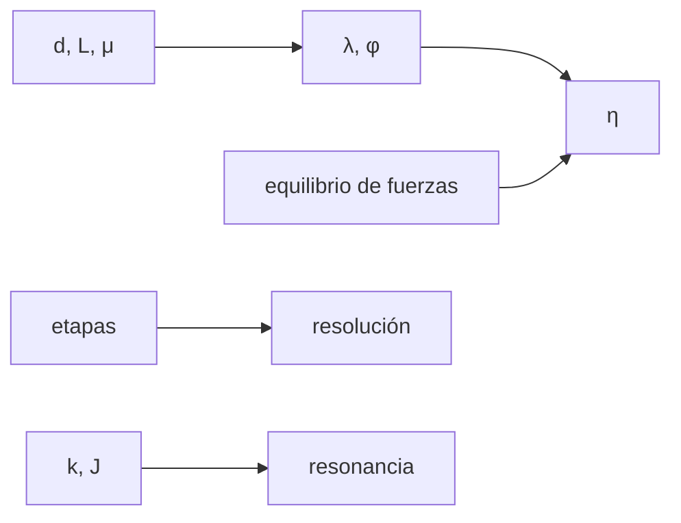

# B43-C14 — Reductores y transmisiones

<!-- nav:top -->
[🏠 Programa](../../../../README.md) · [📚 Bloque B43](../../../tronco-comun/B43-construccion-y-mecanica-de-telescopios.md) · [← Anterior: B43-C13 — Montura altacimutal](../B43-C13-montura-altacimutal/CLASE.md) · [Siguiente: B43-C15 — Motores paso a paso y servomotores →](../B43-C15-motores-paso-a-paso-y-servomotores/CLASE.md)
<!-- /nav -->

## 1. Ubicación, nivel y alcance

Clase 14 del bloque B43. Nivel N3. Un motor gira rápido y poco par; el telescopio necesita giros lentos y mucho par. El reductor, a menudo de tornillo sin fin, adapta ambos, a costa de rendimiento, holgura y resonancias. Aquí calculas la relación total, el rendimiento, la holgura y la frecuencia de resonancia con un reductor ilustrativo. Usas [B05](../../../tronco-comun/B05-fisica-fundamental-para-el-espacio.md), [B16](../../../tronco-comun/B16-sistemas-dinamicos-y-control-automatico.md) y [B11](../../../tronco-comun/B11-ecuaciones-diferenciales-y-simulacion-numerica.md).

## 2. Por qué esta clase existe

El reductor fija la resolución, la fuerza disponible y el comportamiento dinámico. La decisión central: **¿qué relación, qué rendimiento y qué rigidez permiten apuntar con la resolución pedida sin resonancias?**

## 3. Lo que podrás hacer al terminar

1. Calcular el ángulo de avance y el autobloqueo del tornillo.
2. Obtener el rendimiento `tan λ/tan(λ+φ)`.
3. Contrastarlo con un equilibrio de fuerzas en un plano inclinado.
4. Calcular la resolución por micropaso con la relación total.
5. Convertir una holgura lineal en ángulo.
6. Verificar la frecuencia de resonancia con una simulación.

La evidencia es la **ficha del reductor** del ejercicio 12 (sección 20).

## 4. Con qué llegas y cómo comprobarlo

1. ¿Qué es un plano inclinado con fricción?
2. ¿Qué es el rendimiento?
3. ¿Qué es una relación de transmisión?
4. ¿Qué es la rigidez torsional?
5. ¿Qué es una frecuencia natural?

<details>
<summary>Ver respuestas</summary>

1. Un bloque en una rampa con fuerza de rozamiento `μN`. 2. La razón entre potencia de salida y de entrada. 3. El cociente entre giros de entrada y salida. 4. El par necesario por radián de torsión. 5. La frecuencia a la que oscila libremente un sistema.
</details>

Con cuatro o cinco aciertos, sigue; si no, repasa los prerrequisitos.

## 5. Un caso de contexto y casos de referencia

Tornillo de una entrada de `20 mm` y avance `3 mm`, corona de 144 dientes y etapa previa 1:5 (relación `720`). El ángulo de avance es `2,734°` frente a `φ = 5,711°` (`μ = 0,1`): hay autobloqueo y el rendimiento es `0,3216`. Cada micropaso mueve el cielo `0,5625"`. Es el **ejemplo conductor**.

## 6. Vocabulario

El **ángulo de avance** `λ = atan(L/(π d))`. El **ángulo de fricción** `φ = atan μ`. El **autobloqueo** ocurre si `λ < φ`. El **rendimiento** `η`. La **holgura** es el juego entre dientes. La **resonancia torsional** `f = √(k/J)/(2π)`.

## 7. Modelo mental: una rampa con fricción

Como un bloque que sube una rampa empujado por una fuerza: parte del esfuerzo se pierde en rozamiento, y si la rampa es muy suave el bloque no baja solo.



*Descripción textual:* el ángulo de avance y la fricción fijan el rendimiento y el autobloqueo; la relación y la rigidez fijan la resolución y la resonancia.

Analogía: una rampa con fricción. Límite: fricción de Coulomb constante, rigidez global.

## 8. La explicación, paso a paso

### 8.1 Tornillo sin fin

`λ = atan(3/(π · 20)) = 2,7336°`, `φ = atan 0,1 = 5,7106°`: autobloqueo = **sí**. Rendimiento por la fórmula trigonométrica `0,32162194` y por el equilibrio de fuerzas `0,32162194`.

### 8.2 Resolución

La relación total es `5 × 144 = 720`. Con 200 pasos y 16 micropasos son `3200` micropasos por vuelta y cada uno mueve `1 296 000/(3200 × 720) = 0,5625"` el cielo.

### 8.3 Holgura y resonancia

Una holgura de `0,01 mm` sobre un radio primitivo de `72 mm` equivale a `28,65"`. Con `k = 2 × 10⁴ N m/rad` y `J = 0,5 kg m²` la frecuencia de resonancia es `31,8310 Hz`; la simulación (Verlet, `dt = 10⁻⁵ s`) mide `31,8310 Hz`.

## 9. Magnitudes, símbolos y unidades

| Símbolo | Qué es | Unidad | Valor / nota |
|---|---|---|---|
| `λ` | ángulo de avance | ° | 2,734 |
| `η` | rendimiento | — | 0,3216 |
| `f` | frecuencia de resonancia | Hz | 31,83 |
| `μ` | coeficiente de fricción | — | 0,1 (ilustrativo) |

## 10. Convenciones y referencias

Unidades del SI; coma decimal en el texto y punto decimal en las salidas del laboratorio; los ángulos están en radianes salvo que se indique y las longitudes de onda en nanómetros. Los telescopios y materiales de los ejemplos son ilustrativos.

## 11. De dónde sale lo que afirmamos

| ID | Fuente | Localizador | Respalda | Estado |
|---|---|---|---|---|
| S1 | Tratado de engranajes | — | fórmulas del tornillo sin fin y del rendimiento (ilustrativas) | No consultado |

Límites: Las fórmulas se verifican por dos vías, pero ningún texto de engranajes se consultó; los parámetros son ilustrativos y la fricción real varía con lubricante y velocidad.

## 12. Cómo ver el reductor

| Magnitud | Valor |
|---|---|
| Relación total | 720 |
| Rendimiento | 0,3216 |
| " por micropaso | 0,5625 |
| Holgura (") | 28,65 |

Descripción larga: la resolución por micropaso es sub-segundo de arco y la holgura supera ese valor en dos órdenes.

## 13. Ejemplo trabajado: el rendimiento

**Paso 1 · Ángulos.** `λ = 2,734°`, `φ = 5,711°`.

**Paso 2 · Rendimiento.** `tan λ/tan(λ+φ) = 0,3216`.

**Paso 3 · Fuerzas.** El plano inclinado da `0,3216`.

## 14. Distintas formas de describir la transmisión

**En palabras:** más reducción da más par y menos rendimiento. **En fórmulas:** `η = tan λ/tan(λ+φ)`. **En tabla:** magnitudes. **En código:** `reductores.py`.

## 15. Práctica guiada

**Ejercicio 1 · con los pasos indicados.** `λ` con avance 3 mm y diámetro 20 mm.

<details><summary>Solución comentada</summary>

`2,734°`.
</details>

**Ejercicio 2 · con una pista.** `φ` con `μ = 0,1`.

<details><summary>Solución comentada</summary>

`5,711°`.
</details>

**Ejercicio 3 · casi autónomo.** ¿Hay autobloqueo?

<details><summary>Solución comentada</summary>

Sí, porque `λ < φ`.
</details>

## 16. Práctica autónoma, transferencia e integrador

**Ejercicio 4.** Rendimiento.

<details><summary>Solución comentada</summary>

`0,3216`.
</details>

**Ejercicio 5.** Relación total.

<details><summary>Solución comentada</summary>

`720`.
</details>

**Ejercicio 6.** " por micropaso.

<details><summary>Solución comentada</summary>

`0,5625"`.
</details>

**Ejercicio 7.** Holgura angular con 0,01 mm y 72 mm.

<details><summary>Solución comentada</summary>

`28,65"`.
</details>

**Ejercicio 8.** Frecuencia de resonancia.

<details><summary>Solución comentada</summary>

`31,831 Hz`.
</details>

**Ejercicio 9 · transferencia.** **Transferencia.** ¿Por qué un tornillo autobloqueante pierde rendimiento?

<details><summary>Solución comentada</summary>

Porque `λ < φ` implica `η < 0,5`.
</details>

**Ejercicio 10 · transferencia.** **Transferencia.** ¿Por qué la holgura importa más que la resolución del micropaso?

<details><summary>Solución comentada</summary>

Porque supera el micropaso en dos órdenes de magnitud y no se corrige con el motor.
</details>

**Ejercicio 11 · transferencia.** **Transferencia.** ¿Son estos valores de un reductor real?

<details><summary>Solución comentada</summary>

No: son ilustrativos.
</details>

**Ejercicio 12.** **Integrador.** Elabora tu *ficha del reductor*: ángulos, rendimiento, resolución y resonancia.

<details><summary>Solución comentada</summary>

Secciones 8.1–8.3.
</details>

**Ejercicio 12 · integrador.** **Integrador.** Elabora tu *ficha del reductor*: ángulos, rendimiento, resolución y resonancia.

<details><summary>Solución modelo</summary>

Secciones 8.1–8.3.
</details>

## 17. Laboratorio: rendimiento y resonancia

El script [reductores.py](reductores.py) calcula el rendimiento por dos vías, la resolución, la holgura y la resonancia simulada (**comprueba** `1e-12` y `5e-4`).

**Datos:** parámetros **ilustrativos**. **Predice antes de ejecutar:** ¿qué rendimiento tiene el tornillo? (≈ 0,32.) **Ejecución del 2026-11-09 (Python 3.12.9):**

```text
Python 3.12.9 (biblioteca estandar)
lambda_deg = 2.7335959
phi_deg = 5.7105931
autobloqueo = True
eta_trigonometrica = 0.32162194
eta_fuerzas = 0.32162194
ratio_total = 720
micropasos_vuelta = 3200
arcsec_por_micropaso = 0.5625
holgura_arcsec = 28.64789
f_resonancia_hz = 31.830989
f_simulada_hz = 31.830994
Pruebas superadas.
```

```bash
python programa/clases/B43/B43-C14-reductores-y-transmisiones/reductores.py
```

**Límites:** fricción de Coulomb constante; rigidez global.

## 18. Errores frecuentes y cómo corregirlos

**Creer que un reductor mayor siempre mejora.** Se corrige con 8.1.

**Olvidar la holgura.** Se corrige con 8.3.

**Mezclar micropasos y pasos.** Se corrige con 8.2.

**Ignorar la resonancia.** Se corrige con 8.3.

## 19. Cómo sabrás que vas bien

Tras la sección 8: ¿qué resultado esperabas y cuál obtuviste? Si dudas, repasa el ejemplo 13. Tras el laboratorio: ¿qué comprueba? (ver la sección 17).

## 20. Qué entregas y cómo se evalúa

El producto es tu **ficha del reductor** (ejercicio 12).

| Criterio | Inicial | En desarrollo | Logrado | Destacado |
|---|---|---|---|---|
| Conceptos | Los confunde | Parciales | conceptos de la clase | Explica los límites |
| Cálculo | Sin unidades | Con errores | Tablas completas | Calcula casos nuevos |
| Numérico | Sin comprobar | Un caso | Contraste con el análisis | Interpreta las diferencias |
| Fuentes | Sin fuente | Sin fecha | fuentes con fecha | Declara lo ilustrativo |
| Límites | No los nombra | Uno | Tres | Discute qué falta del modelo |

**Condiciones críticas (no se compensan con promedio):** rotular los parámetros como ilustrativos; no atribuir fórmulas a textos no consultados; no presentar el reductor como real.

## 21. Ética, seguridad y límites

Clase educativa: los modelos son simplificados. Accesibilidad: tablas equivalentes a las gráficas, fórmulas en texto, ejercicios sin conexión.

## 22. Para cerrar y seguir

Con relación `720`, rendimiento `0,32` y resonancia en `32 Hz`, la holgura domina la resolución. Queda una pregunta: ¿qué motor mueve el reductor?

**Glosario español–inglés.** tornillo sin fin · *worm gear*; rendimiento · *efficiency*; holgura · *backlash*; autobloqueo · *self-locking*; resonancia · *resonance*.

**Continuidad.** [B43-C15](../B43-C15-motores-paso-a-paso-y-servomotores/CLASE.md) estudia motores paso a paso y servomotores.

**Referencias:** ver sección 11.

<!-- nav:bottom -->
---

[← Anterior: B43-C13 — Montura altacimutal](../B43-C13-montura-altacimutal/CLASE.md) · [📚 Bloque B43](../../../tronco-comun/B43-construccion-y-mecanica-de-telescopios.md) · [Siguiente: B43-C15 — Motores paso a paso y servomotores →](../B43-C15-motores-paso-a-paso-y-servomotores/CLASE.md)
<!-- /nav -->
