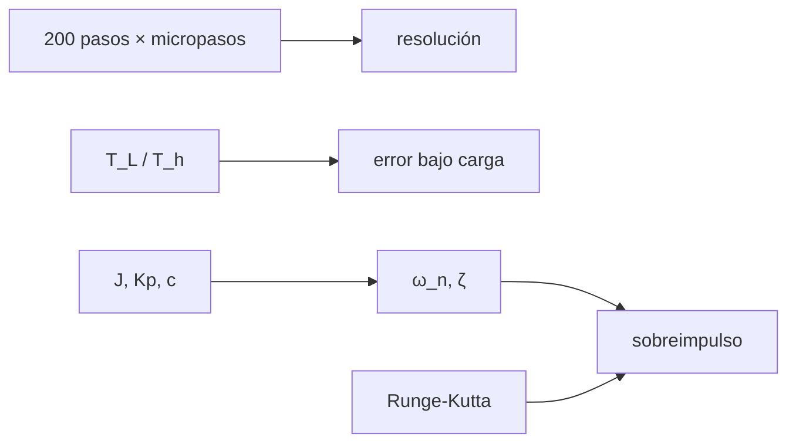

# B43-C15 — Motores paso a paso y servomotores

<!-- nav:top -->
[🏠 Programa](../../../../README.md) · [📚 Bloque B43](../../../tronco-comun/B43-construccion-y-mecanica-de-telescopios.md) · [← Anterior: B43-C14 — Reductores y transmisiones](../B43-C14-reductores-y-transmisiones/CLASE.md) · [Siguiente: B43-C16 — Encoders y medición angular →](../B43-C16-encoders-y-medicion-angular/CLASE.md)
<!-- /nav -->

## 1. Ubicación, nivel y alcance

Clase 15 del bloque B43. Nivel N3. Los motores paso a paso avanzan en pasos discretos y se dividen en micropasos; los servomotores corrigen con realimentación. Aquí calculas la resolución, el error bajo carga de un motor paso a paso y la respuesta de un servo con control proporcional-derivativo, con parámetros ilustrativos. Usas [B16](../../../tronco-comun/B16-sistemas-dinamicos-y-control-automatico.md), [B11](../../../tronco-comun/B11-ecuaciones-diferenciales-y-simulacion-numerica.md) y [B05](../../../tronco-comun/B05-fisica-fundamental-para-el-espacio.md).

## 2. Por qué esta clase existe

El motor fija la resolución, la fuerza útil y la estabilidad del lazo. La decisión central: **¿cuánto se desvía un motor paso a paso bajo carga y qué ganancias dan una respuesta de servo sin sobreimpulso excesivo?**

## 3. Lo que podrás hacer al terminar

1. Calcular los micropasos por vuelta y su ángulo.
2. Calcular el error de un paso a paso bajo carga `arcsin(T_L/T_h)/N_pp`.
3. Contrastarlo con una bisección del equilibrio.
4. Obtener `ω_n` y `ζ` de un servo PD.
5. Predecir el sobreimpulso `exp(−πζ/√(1−ζ²))`.
6. Verificar con una integración Runge-Kutta.

La evidencia es la **ficha del accionamiento** del ejercicio 12 (sección 20).

## 4. Con qué llegas y cómo comprobarlo

1. ¿Qué es un micropaso?
2. ¿Qué es el par de retención?
3. ¿Qué es un controlador PD?
4. ¿Qué es el amortiguamiento?
5. ¿Qué es el sobreimpulso?

<details>
<summary>Ver respuestas</summary>

1. Una fracción de paso obtenida repartiendo las corrientes de las fases. 2. El par máximo con el motor detenido. 3. Un controlador con términos proporcional y derivativo. 4. La razón de disipación de una oscilación. 5. El exceso máximo sobre el valor final.
</details>

Con cuatro o cinco aciertos, sigue; si no, repasa los prerrequisitos.

## 5. Un caso de contexto y casos de referencia

Motor ilustrativo de 200 pasos y 16 micropasos (`3200` por vuelta, `405"` en el eje y `0,5625"` en el cielo con la relación 720). Con una carga del 10 % del par de retención el error es `413,2"` en el motor y `0,5739"` en el cielo. El servo (`ω_n = 10 rad/s`, `ζ = 0,50`) sobrepasa `16,30 %`. Es el **ejemplo conductor**.

## 6. Vocabulario

El **paso** y el **micropaso**. El **par de retención** `T_h`. Los **pares de polos** `N_pp`. El **servo** usa realimentación. El **controlador PD** `τ = K_p e − K_d θ'`. El **sobreimpulso**, el **tiempo de pico** y el **tiempo de asentamiento**.

## 7. Modelo mental: una puerta con un resorte y un amortiguador

Como una puerta con resorte y amortiguador: más amortiguador evita el rebote, pero la hace más lenta; el control PD ajusta ese balance.



*Descripción textual:* las corrientes definen el micropaso; la carga lo desplaza; las ganancias fijan ω_n y ζ y con ellas el sobreimpulso.

Analogía: una puerta con un resorte y un amortiguador. Límite: motor lineal en el par, servo sin saturación.

## 8. La explicación, paso a paso

### 8.1 Resolución

`200 × 16 = 3200` micropasos por vuelta; `405"` en el eje del motor; con relación 720, `0,5625"` en el cielo.

### 8.2 Error bajo carga

| T_L/T_h | Cerrada (" en el motor) | Bisección (") | En el cielo (") |
|---|---|---|---|
| 0,05 | 206,351 | 206,351 | 0,2866 |
| 0,10 | 413,220 | 413,220 | 0,5739 |
| 0,25 | 1042,381 | 1042,381 | 1,4478 |
| 0,50 | 2160,000 | 2160,000 | 3,0000 |

### 8.3 Servo PD

`ω_n = √(K_p/J) = 10,0 rad/s`, `ζ = c/(2√(K_p J)) = 0,50`. Sobreimpulso teórico `0,163034` y simulado `0,163034`; tiempo de pico teórico `0,36276 s` y simulado `0,36280 s`; asentamiento al 2 %: `0,80 s`.

## 9. Magnitudes, símbolos y unidades

| Símbolo | Qué es | Unidad | Valor / nota |
|---|---|---|---|
| `N_pp` | pares de polos | — | 50 |
| `T_L/T_h` | carga relativa | — | 0,05 a 0,50 |
| `ω_n` | frecuencia natural | rad/s | 10,0 |
| `ζ` | amortiguamiento | — | 0,50 |

## 10. Convenciones y referencias

Unidades del SI; coma decimal en el texto y punto decimal en las salidas del laboratorio; los ángulos están en radianes salvo que se indique y las longitudes de onda en nanómetros. Los telescopios y materiales de los ejemplos son ilustrativos.

## 11. De dónde sale lo que afirmamos

| ID | Fuente | Localizador | Respalda | Estado |
|---|---|---|---|---|
| S1 | Hojas de datos de motores | — | par de retención y pares de polos (ilustrativos) | No consultado |

Límites: El par del motor es sinusoidal ideal, sin resonancias de media velocidad ni saturación; los parámetros son ilustrativos y no se consultó ninguna hoja de datos.

## 12. Cómo ver las respuestas

| Magnitud | Teórico | Simulado |
|---|---|---|
| Sobreimpulso | 0,16303 | 0,16303 |
| Tiempo de pico (s) | 0,3628 | 0,3628 |

Descripción larga: teoría y simulación coinciden en cuatro cifras.

## 13. Ejemplo trabajado: el error bajo carga del 10 %

**Paso 1 · Arcoseno.** `arcsin(0,10) = 5,739°` eléctricos.

**Paso 2 · Mecánico.** `5,739°/50 = 0,1148°`.

**Paso 3 · Segundos.** `413,2"`.

## 14. Distintas formas de describir el accionamiento

**En palabras:** la carga desplaza el rotor y el servo amortigua. **En fórmulas:** `Mp = exp(−πζ/√(1−ζ²))`. **En tabla:** errores. **En código:** `motores.py`.

## 15. Práctica guiada

**Ejercicio 1 · con los pasos indicados.** Micropasos por vuelta.

<details><summary>Solución comentada</summary>

`3200`.
</details>

**Ejercicio 2 · con una pista.** Ángulo de un micropaso en el eje.

<details><summary>Solución comentada</summary>

`405"`.
</details>

**Ejercicio 3 · casi autónomo.** Ángulo en el cielo con relación 720.

<details><summary>Solución comentada</summary>

`0,5625"`.
</details>

## 16. Práctica autónoma, transferencia e integrador

**Ejercicio 4.** Error bajo carga del 25 % en el cielo.

<details><summary>Solución comentada</summary>

`1,448"`.
</details>

**Ejercicio 5.** `ω_n` con `K_p = 1`, `J = 0,01`.

<details><summary>Solución comentada</summary>

`10,0 rad/s`.
</details>

**Ejercicio 6.** `ζ` con `c = 0,1`.

<details><summary>Solución comentada</summary>

`0,50`.
</details>

**Ejercicio 7.** Sobreimpulso teórico.

<details><summary>Solución comentada</summary>

`16,30 %`.
</details>

**Ejercicio 8.** Tiempo de pico.

<details><summary>Solución comentada</summary>

`0,3628 s`.
</details>

**Ejercicio 9 · transferencia.** **Transferencia.** ¿Por qué el error bajo carga no es lineal?

<details><summary>Solución comentada</summary>

Porque el par es sinusoidal: `arcsin` crece más rápido al acercarse al máximo.
</details>

**Ejercicio 10 · transferencia.** **Transferencia.** ¿Por qué un servo puede ser más preciso que un paso a paso?

<details><summary>Solución comentada</summary>

Porque corrige con realimentación en vez de contar pasos.
</details>

**Ejercicio 11 · transferencia.** **Transferencia.** ¿Son estas ganancias las de un servo real?

<details><summary>Solución comentada</summary>

No: son ilustrativas.
</details>

**Ejercicio 12.** **Integrador.** Elabora tu *ficha del accionamiento*: resolución, error bajo carga y respuesta PD.

<details><summary>Solución comentada</summary>

Secciones 8.1–8.3.
</details>

**Ejercicio 12 · integrador.** **Integrador.** Elabora tu *ficha del accionamiento*: resolución, error bajo carga y respuesta PD.

<details><summary>Solución modelo</summary>

Secciones 8.1–8.3.
</details>

## 17. Laboratorio: resolución y servo PD

El script [motores.py](motores.py) calcula resolución, error bajo carga por dos vías y simula la respuesta al escalón (**comprueba** `10⁻³` y `2 × 10⁻³`).

**Datos:** parámetros **ilustrativos**. **Predice antes de ejecutar:** ¿cuánto sobrepasa el servo? (≈ 16 %.) **Ejecución del 2026-11-09 (Python 3.12.9):**

```text
Python 3.12.9 (biblioteca estandar)
pasos_vuelta = 3200
arcsec_micropaso_motor = 405
arcsec_micropaso_cielo = 0.5625
omega_n = 10
zeta = 0.5
sobreimpulso_teorico = 0.163034
sobreimpulso_sim = 0.163034
t_pico_teorico = 0.36276
t_pico_sim = 0.3628
t_asentamiento_2pct = 0.8
T_L/T_h | error en el motor (arcsec, cerrado) | (biseccion) | en el cielo (arcsec)
0.05 | 206.351 | 206.351 | 0.2866
0.10 | 413.220 | 413.220 | 0.5739
0.25 | 1042.381 | 1042.381 | 1.4478
0.50 | 2160.000 | 2160.000 | 3.0000
Pruebas superadas.
```

```bash
python programa/clases/B43/B43-C15-motores-paso-a-paso-y-servomotores/motores.py
```

**Límites:** motor lineal en el par; servo ideal.

## 18. Errores frecuentes y cómo corregirlos

**Confundir el paso eléctrico con el mecánico.** Se corrige con 8.2.

**Olvidar la relación de reducción.** Se corrige con 8.1.

**Suponer que más ganancia siempre mejora.** Se corrige con 8.3.

**Medir el sobreimpulso desde cero.** Se corrige con 8.3.

## 19. Cómo sabrás que vas bien

Tras la sección 8: ¿qué resultado esperabas y cuál obtuviste? Si dudas, repasa el ejemplo 13. Tras el laboratorio: ¿qué comprueba? (ver la sección 17).

## 20. Qué entregas y cómo se evalúa

El producto es tu **ficha del accionamiento** (ejercicio 12).

| Criterio | Inicial | En desarrollo | Logrado | Destacado |
|---|---|---|---|---|
| Conceptos | Los confunde | Parciales | conceptos de la clase | Explica los límites |
| Cálculo | Sin unidades | Con errores | Tablas completas | Calcula casos nuevos |
| Numérico | Sin comprobar | Un caso | Contraste con el análisis | Interpreta las diferencias |
| Fuentes | Sin fuente | Sin fecha | fuentes con fecha | Declara lo ilustrativo |
| Límites | No los nombra | Uno | Tres | Discute qué falta del modelo |

**Condiciones críticas (no se compensan con promedio):** rotular parámetros como ilustrativos; no presentar los resultados como de un motor real; separar teoría y simulación.

## 21. Ética, seguridad y límites

Clase educativa: los modelos son simplificados. Accesibilidad: tablas equivalentes a las gráficas, fórmulas en texto, ejercicios sin conexión.

## 22. Para cerrar y seguir

Un micropaso mueve el cielo `0,56"`, una carga del 10 % lo desplaza `0,57"` y el servo sobrepasa `16 %`. Queda una pregunta: ¿cómo se mide el ángulo?

**Glosario español–inglés.** micropaso · *microstep*; par de retención · *holding torque*; servo · *servo*; sobreimpulso · *overshoot*; control PD · *PD control*.

**Continuidad.** [B43-C16](../B43-C16-encoders-y-medicion-angular/CLASE.md) estudia los encoders y la medición angular.

**Referencias:** ver sección 11.

<!-- nav:bottom -->
---

[← Anterior: B43-C14 — Reductores y transmisiones](../B43-C14-reductores-y-transmisiones/CLASE.md) · [📚 Bloque B43](../../../tronco-comun/B43-construccion-y-mecanica-de-telescopios.md) · [Siguiente: B43-C16 — Encoders y medición angular →](../B43-C16-encoders-y-medicion-angular/CLASE.md)
<!-- /nav -->
