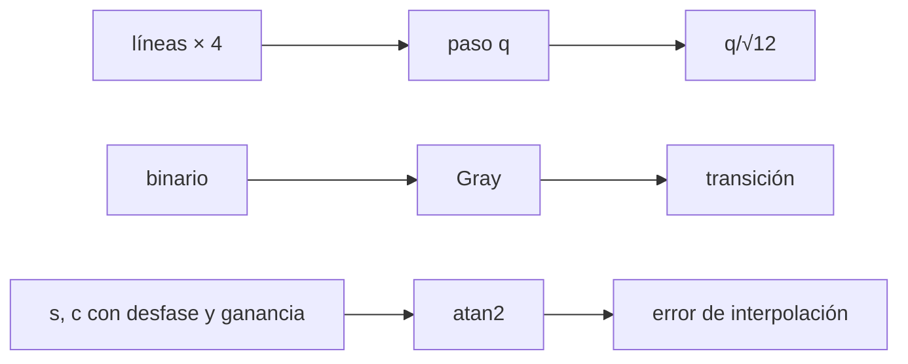

# B43-C16 — Encoders y medición angular

<!-- nav:top -->
[🏠 Programa](../../../../README.md) · [📚 Bloque B43](../../../tronco-comun/B43-construccion-y-mecanica-de-telescopios.md) · [← Anterior: B43-C15 — Motores paso a paso y servomotores](../B43-C15-motores-paso-a-paso-y-servomotores/CLASE.md) · [Siguiente: B43-C17 — Alineación polar →](../B43-C17-alineacion-polar/CLASE.md)
<!-- /nav -->

## 1. Ubicación, nivel y alcance

Clase 16 del bloque B43. Nivel N3. Un codificador convierte un ángulo en números. Su resolución, su código y la calidad de sus señales fijan el error de apuntado. Aquí calculas la cuantización de un codificador incremental, el comportamiento del código Gray y el error de interpolación seno-coseno con parámetros ilustrativos. Usas [B13](../../../tronco-comun/B13-metrologia-tiempo-y-mediciones-cientificas.md), [B15](../../../tronco-comun/B15-senales-imagenes-y-estimacion-cientifica.md) y [B12](../../../tronco-comun/B12-probabilidad-estadistica-e-incertidumbre.md).

## 2. Por qué esta clase existe

El codificador es el ojo de la montura: lo que no mide, no lo corrige. La decisión central: **¿qué resolución, qué código y qué calidad de señal dan un error angular menor que el presupuesto?**

## 3. Lo que podrás hacer al terminar

1. Calcular las cuentas por vuelta con decodificación en cuadratura.
2. Calcular el error de cuantización `q/√12` y verificarlo con Monte Carlo.
3. Construir el código Gray y comprobar que cambia un bit por paso.
4. Medir el peor error de una lectura en transición, en binario y en Gray.
5. Calcular el error de interpolación por desfase y por ganancia.
6. Reconocer las perturbaciones no modeladas.

La evidencia es la **ficha del codificador** del ejercicio 12 (sección 20).

## 4. Con qué llegas y cómo comprobarlo

1. ¿Qué es un código binario?
2. ¿Qué es la cuadratura?
3. ¿Qué es la cuantización?
4. ¿Qué es una arcotangente de dos argumentos?
5. ¿Qué es un desfase (offset)?

<details>
<summary>Ver respuestas</summary>

1. La representación de un número con bits. 2. Dos señales desfasadas 90°. 3. El redondeo a múltiplos de un paso. 4. La función `atan2(y, x)` que da el ángulo del vector. 5. Un valor constante que se suma a una señal.
</details>

Con cuatro o cinco aciertos, sigue; si no, repasa los prerrequisitos.

## 5. Un caso de contexto y casos de referencia

Codificador incremental ilustrativo de `10 000` líneas: `40000` cuentas por vuelta y `32,4"` por cuenta. El error de cuantización RMS es `9,353"` (Monte Carlo: `9,359"`). En un código de 12 bits, leer durante una transición puede dar hasta `2047` cuentas de error en binario y `0` en Gray. Es el **ejemplo conductor**.

## 6. Vocabulario

La **línea** del disco y las **cuentas** `4 × líneas`. El **paso** `q = 1 296 000"/cuentas`. El **error de cuantización** `q/√12`. El **código Gray** `b xor (b >> 1)`. La **interpolación** `atan2(s, c)`. El **desfase** `o_s` y la **diferencia de ganancia** `g`.

## 7. Modelo mental: un reloj de pared con marcas

Como un reloj de pared con marcas cada minuto: la aguja se redondea a la marca más cercana; el Gray evita que, al pasar de una marca a la siguiente, se lea una hora inventada.



*Descripción textual:* la cuadratura fija el paso; la cuantización fija el error mínimo; el Gray protege las transiciones; la interpolación añade un error según las señales.

Analogía: un reloj de pared con marcas. Límite: señales ideales salvo las perturbaciones, sin ruido electrónico.

## 8. La explicación, paso a paso

### 8.1 Resolución y cuantización

`4 × 10 000 = 40000` cuentas por vuelta; `q = 32,40"`; `q/√12 = 9,3531"`. Un Monte Carlo de 200 000 ángulos (semilla 20261109) da `9,3591"`.

### 8.2 Código Gray

Las 4095 transiciones de un código de 12 bits cambian exactamente un bit en Gray: **sí**. Se barren todos los órdenes en que los bits pueden cambiar durante una transición: el peor error en binario es `2047` cuentas y en Gray `0` (la lectura es siempre una de las dos cuentas vecinas).

### 8.3 Interpolación seno-coseno

El periodo de señal es `129,6"`. Con desfase `o_s = 0,01` el error máximo es `0,2063"` (teoría `0,2063"`); con diferencia de ganancia `g = 0,02` es `0,2042"` (teoría `0,2063"`).

## 9. Magnitudes, símbolos y unidades

| Símbolo | Qué es | Unidad | Valor / nota |
|---|---|---|---|
| `q` | paso | " | 32,4 |
| `σ_q` | cuantización RMS | " | 9,353 |
| `o_s` | desfase | — | 0,01 (ilustrativo) |
| `g` | diferencia de ganancia | — | 0,02 (ilustrativo) |

## 10. Convenciones y referencias

Unidades del SI; coma decimal en el texto y punto decimal en las salidas del laboratorio; los ángulos están en radianes salvo que se indique y las longitudes de onda en nanómetros. Los telescopios y materiales de los ejemplos son ilustrativos.

## 11. De dónde sale lo que afirmamos

| ID | Fuente | Localizador | Respalda | Estado |
|---|---|---|---|---|
| S1 | Hojas de datos de codificadores | — | líneas, bits y perturbaciones (ilustrativos) | No consultado |

Límites: Los codificadores y las perturbaciones son ilustrativos; no se modelan ruido electrónico, armónicos ni excentricidad del disco, y no se consultó ninguna hoja de datos.

## 12. Cómo ver los errores

| Fuente | Error (") |
|---|---|
| Cuantización RMS | 9,35 |
| Desfase 0,01 | 0,206 |
| Ganancia 0,02 | 0,204 |

Descripción larga: la cuantización domina y la interpolación aporta décimas de segundo de arco.

## 13. Ejemplo trabajado: el error de cuantización

**Paso 1 · Paso.** `q = 1 296 000/40000 = 32,4"`.

**Paso 2 · RMS.** `q/√12 = 9,353"`.

**Paso 3 · Monte Carlo.** `9,359"`.

## 14. Distintas formas de describir la medición angular

**En palabras:** cuantiza el paso y añade errores de señal. **En fórmulas:** `σ = q/√12`. **En tabla:** errores. **En código:** `codificador.py`.

## 15. Práctica guiada

**Ejercicio 1 · con los pasos indicados.** Cuentas por vuelta con 10 000 líneas y cuadratura x4.

<details><summary>Solución comentada</summary>

`40000`.
</details>

**Ejercicio 2 · con una pista.** Paso en segundos de arco.

<details><summary>Solución comentada</summary>

`32,4"`.
</details>

**Ejercicio 3 · casi autónomo.** Error de cuantización RMS.

<details><summary>Solución comentada</summary>

`9,353"`.
</details>

## 16. Práctica autónoma, transferencia e integrador

**Ejercicio 4.** Código Gray del número binario 6 (`110`).

<details><summary>Solución comentada</summary>

`110 xor 011 = 101`.
</details>

**Ejercicio 5.** ¿Cuántos bits cambian entre Gray(7) y Gray(8)?

<details><summary>Solución comentada</summary>

Uno.
</details>

**Ejercicio 6.** Error por desfase 0,01 en segundos de arco.

<details><summary>Solución comentada</summary>

`0,206"`.
</details>

**Ejercicio 7.** Error por ganancia 0,02.

<details><summary>Solución comentada</summary>

`0,206"`.
</details>

**Ejercicio 8.** Periodo de señal.

<details><summary>Solución comentada</summary>

`129,6"`.
</details>

**Ejercicio 9 · transferencia.** **Transferencia.** ¿Por qué el binario puro es peligroso en un codificador absoluto?

<details><summary>Solución comentada</summary>

Porque varios bits cambian a la vez y una lectura intermedia puede estar muy lejos.
</details>

**Ejercicio 10 · transferencia.** **Transferencia.** ¿Se puede mejorar la cuantización interpolando?

<details><summary>Solución comentada</summary>

Sí, hasta el límite que fijan el ruido y las imperfecciones de las señales.
</details>

**Ejercicio 11 · transferencia.** **Transferencia.** ¿Son estas cifras de un codificador real?

<details><summary>Solución comentada</summary>

No: son ilustrativas.
</details>

**Ejercicio 12.** **Integrador.** Elabora tu *ficha del codificador*: paso, cuantización, Gray y interpolación.

<details><summary>Solución comentada</summary>

Secciones 8.1–8.3.
</details>

**Ejercicio 12 · integrador.** **Integrador.** Elabora tu *ficha del codificador*: paso, cuantización, Gray y interpolación.

<details><summary>Solución modelo</summary>

Secciones 8.1–8.3.
</details>

## 17. Laboratorio: cuantización, Gray e interpolación

El script [codificador.py](codificador.py) calcula cuantización con Monte Carlo, verifica el código Gray y mide el error de interpolación (**comprueba** `1 %` y `2 %`).

**Datos:** parámetros **ilustrativos**; semilla `20261109`. **Predice antes de ejecutar:** ¿cuál es el paso? (32,4".) **Ejecución del 2026-11-09 (Python 3.12.9):**

```text
Python 3.12.9 (biblioteca estandar)
cuentas = 40000
q_arcsec = 32.4
rms_teorico = 9.35307
rms_mc = 9.35912
gray_un_bit = True
peor_binario_cuentas = 2047
peor_gray_cuentas = 0
err_desfase_arcsec = 0.206268
err_desfase_teorico = 0.206265
err_ganancia_arcsec = 0.204226
err_ganancia_teorico = 0.206265
periodo_arcsec = 129.6
Pruebas superadas.
```

```bash
python programa/clases/B43/B43-C16-encoders-y-medicion-angular/codificador.py
```

**Límites:** señales ideales salvo las perturbaciones.

## 18. Errores frecuentes y cómo corregirlos

**Olvidar la decodificación en cuadratura.** Se corrige con 8.1.

**Usar binario en un codificador absoluto.** Se corrige con 8.2.

**Sumar el desfase y la ganancia sin ver su forma.** Se corrige con 8.3.

**Confundir líneas y cuentas.** Se corrige con la sección 6.

## 19. Cómo sabrás que vas bien

Tras la sección 8: ¿qué resultado esperabas y cuál obtuviste? Si dudas, repasa el ejemplo 13. Tras el laboratorio: ¿qué comprueba? (ver la sección 17).

## 20. Qué entregas y cómo se evalúa

El producto es tu **ficha del codificador** (ejercicio 12).

| Criterio | Inicial | En desarrollo | Logrado | Destacado |
|---|---|---|---|---|
| Conceptos | Los confunde | Parciales | conceptos de la clase | Explica los límites |
| Cálculo | Sin unidades | Con errores | Tablas completas | Calcula casos nuevos |
| Numérico | Sin comprobar | Un caso | Contraste con el análisis | Interpreta las diferencias |
| Fuentes | Sin fuente | Sin fecha | fuentes con fecha | Declara lo ilustrativo |
| Límites | No los nombra | Uno | Tres | Discute qué falta del modelo |

**Condiciones críticas (no se compensan con promedio):** rotular el codificador como ilustrativo; no presentar el modelo como medición; no omitir perturbaciones reales.

## 21. Ética, seguridad y límites

Clase educativa: los modelos son simplificados. Accesibilidad: tablas equivalentes a las gráficas, fórmulas en texto, ejercicios sin conexión.

## 22. Para cerrar y seguir

El codificador ilustrativo cuantiza a `9,4"` RMS y el Gray evita los errores de transición. Queda una pregunta: ¿cómo se alinea el eje polar?

**Glosario español–inglés.** codificador · *encoder*; código Gray · *Gray code*; cuantización · *quantization*; interpolación · *interpolation*; cuadratura · *quadrature*.

**Continuidad.** [B43-C17](../B43-C17-alineacion-polar/CLASE.md) estudia la alineación polar.

**Referencias:** ver sección 11.

<!-- nav:bottom -->
---

[← Anterior: B43-C15 — Motores paso a paso y servomotores](../B43-C15-motores-paso-a-paso-y-servomotores/CLASE.md) · [📚 Bloque B43](../../../tronco-comun/B43-construccion-y-mecanica-de-telescopios.md) · [Siguiente: B43-C17 — Alineación polar →](../B43-C17-alineacion-polar/CLASE.md)
<!-- /nav -->
