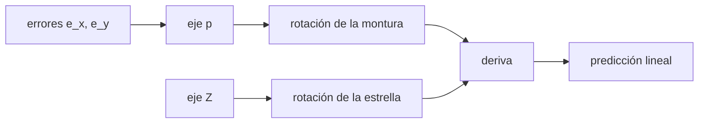

# B43-C17 — Alineación polar

<!-- nav:top -->
[🏠 Programa](../../../../README.md) · [📚 Bloque B43](../../../tronco-comun/B43-construccion-y-mecanica-de-telescopios.md) · [← Anterior: B43-C16 — Encoders y medición angular](../B43-C16-encoders-y-medicion-angular/CLASE.md) · [Siguiente: B43-C18 — Colimación instrumental →](../B43-C18-colimacion-instrumental/CLASE.md)
<!-- /nav -->

## 1. Ubicación, nivel y alcance

Clase 17 del bloque B43. Nivel N3. Si el eje de la montura no es paralelo al eje de la Tierra, una estrella deriva en declinación con el tiempo. Aquí calculas esa deriva con rotaciones exactas y la comparas con la predicción lineal, y estimas el error de alineación a partir de una deriva medida, con errores ilustrativos. Usas [B08](../../../tronco-comun/B08-observacion-del-cielo-y-astronomia-practica.md), [B10](../../../tronco-comun/B10-algebra-lineal-y-matematicas-geometricas.md) y [B13](../../../tronco-comun/B13-metrologia-tiempo-y-mediciones-cientificas.md).

## 2. Por qué esta clase existe

La alineación polar se corrige midiendo la deriva de una estrella. La decisión central: **¿qué deriva produce un error de acimut o de altura y cómo se invierte para corregirlo?**

## 3. Lo que podrás hacer al terminar

1. Plantear las rotaciones de una estrella y de la montura.
2. Calcular la deriva con rotaciones de Rodrigues exactas.
3. Predecir la deriva lineal `ω ε`.
4. Distinguir los errores de acimut y de altura según la posición de la estrella.
5. Estimar el error de alineación a partir de una deriva.
6. Reconocer el residuo de segundo orden.

La evidencia es la **ficha de la alineación polar** del ejercicio 12 (sección 20).

## 4. Con qué llegas y cómo comprobarlo

1. ¿Qué es una rotación alrededor de un eje?
2. ¿Qué es la declinación?
3. ¿Qué es el producto vectorial?
4. ¿Qué es una aproximación lineal?
5. ¿Qué es el meridiano?

<details>
<summary>Ver respuestas</summary>

1. Un giro de los vectores alrededor de un eje, por la fórmula de Rodrigues. 2. La latitud celeste. 3. El vector perpendicular a dos vectores. 4. El primer término del desarrollo en serie. 5. El círculo máximo que pasa por el cenit y el polo.
</details>

Con cuatro o cinco aciertos, sigue; si no, repasa los prerrequisitos.

## 5. Un caso de contexto y casos de referencia

Errores ilustrativos de `10'` en acimut y `6'` en altura. Una estrella en el meridiano deriva en declinación `0,04375"/s` (`0,04375"/s` en la predicción lineal) por el error de acimut; a 6 h del meridiano, el error de altura da `0,02625"/s`. Una deriva de `5"` en 5 min corresponde a un error de `3,81'`. Es el **ejemplo conductor**.

## 6. Vocabulario

El **error de acimut** y el **error de altura** del eje. El **método de la deriva**. La **rotación de Rodrigues** `v cos θ + (k×v) sen θ + k (k·v)(1−cos θ)`. La **predicción lineal** `(p − Z) × s`. El **residuo de segundo orden**.

## 7. Modelo mental: una peonza inclinada

Como una peonza inclinada: aunque gire a la velocidad correcta, su eje no coincide con el de la Tierra y la estrella se escapa lentamente en una dirección que depende de dónde está.



*Descripción textual:* la montura gira alrededor de un eje ligeramente distinto del terrestre, y la diferencia entre ambas rotaciones es la deriva.

Analogía: una peonza inclinada. Límite: refracción, flexión y error periódico ignorados; ángulos pequeños.

## 8. La explicación, paso a paso

### 8.1 Derivas (errores de 10' en acimut y 6' en altura; exposición de 300 s)

| Caso | Simulada ("/s) | Predicción lineal ("/s) |
|---|---|---|
| meridiano, dec 0, error de acimut | 0,043749 | 0,043753 |
| meridiano, dec 60, error de acimut | 0,043748 | 0,043753 |
| 6 h al este, dec 0, error de altura | -0,026249 | -0,026252 |
| 6 h al oeste, dec 0, error de altura | 0,026249 | 0,026252 |
| meridiano, dec 0, error de altura | 0,000287 | -0,000000 |

En el meridiano la deriva depende solo del error de acimut e **no depende de la declinación** (filas 1 y 2). A seis horas del meridiano depende del error de altura y cambia de signo entre este y oeste (filas 3 y 4). El caso de error de altura en el meridiano es nulo en primer orden; la simulación muestra un residuo de segundo orden de `0,0003"/s`.

### 8.2 Inversión

`ω e` para `e = 10'` es `0,04375"/s`. Una deriva de `5" ` en 300 s (`0,01667"/s`) corresponde a `e = deriva/ω = 3,809'`.

## 9. Magnitudes, símbolos y unidades

| Símbolo | Qué es | Unidad | Valor / nota |
|---|---|---|---|
| `ω` | velocidad angular de la Tierra | rad/s | 7,2921 × 10⁻⁵ |
| `e_y` | error de acimut | ' | 10 (ilustrativo) |
| `e_x` | error de altura | ' | 6 (ilustrativo) |
| `t` | exposición | s | 300 |

## 10. Convenciones y referencias

Unidades del SI; coma decimal en el texto y punto decimal en las salidas del laboratorio; los ángulos están en radianes salvo que se indique y las longitudes de onda en nanómetros. Los telescopios y materiales de los ejemplos son ilustrativos.

## 11. De dónde sale lo que afirmamos

| ID | Fuente | Localizador | Respalda | Estado |
|---|---|---|---|---|
| S1 | Método de la deriva | — | descripción del método de alineación (no consultada) | No consultado |

Límites: El método de la deriva se describe de memoria, sin fuente; la predicción lineal y la simulación se contrastan entre sí. Se ignoran refracción y flexión.

## 12. Cómo ver las derivas

| Caso | Deriva ("/s) |
|---|---|
| meridiano, dec 0, error de acimut | 0,04375 |
| meridiano, dec 60, error de acimut | 0,04375 |
| 6 h al este, dec 0, error de altura | -0,02625 |
| 6 h al oeste, dec 0, error de altura | 0,02625 |
| meridiano, dec 0, error de altura | 0,00029 |

Descripción larga: la deriva cambia de signo con el lado del meridiano en el caso de altura.

## 13. Ejemplo trabajado: la deriva por error de acimut

**Paso 1 · Error.** `e = 10' = 600"`.

**Paso 2 · Velocidad.** `ω e = 0,04375"/s`.

**Paso 3 · Simulación.** `0,04375"/s`.

## 14. Distintas formas de describir la alineación

**En palabras:** la deriva es la diferencia de dos rotaciones. **En fórmulas:** `dδ/dt = ω e_y` en el meridiano. **En tabla:** casos. **En código:** `alineacion_polar.py`.

## 15. Práctica guiada

**Ejercicio 1 · con los pasos indicados.** Error de acimut en segundos de arco.

<details><summary>Solución comentada</summary>

`600"`.
</details>

**Ejercicio 2 · con una pista.** Deriva en el meridiano.

<details><summary>Solución comentada</summary>

`0,0438"/s`.
</details>

**Ejercicio 3 · casi autónomo.** Deriva en 5 min.

<details><summary>Solución comentada</summary>

`13,13"`.
</details>

## 16. Práctica autónoma, transferencia e integrador

**Ejercicio 4.** Deriva a 6 h del meridiano por un error de altura de 6'.

<details><summary>Solución comentada</summary>

`0,0262"/s`.
</details>

**Ejercicio 5.** Error estimado con 5" en 5 min.

<details><summary>Solución comentada</summary>

`3,81'`.
</details>

**Ejercicio 6.** Deriva en el meridiano a declinación 60°.

<details><summary>Solución comentada</summary>

`0,0437"/s`, igual que a 0°.
</details>

**Ejercicio 7.** Cociente entre derivas de acimut y altura en las condiciones del ejemplo.

<details><summary>Solución comentada</summary>

`1,667` (10'/6' = 1,667).
</details>

**Ejercicio 8.** Deriva en el meridiano por error de altura.

<details><summary>Solución comentada</summary>

≈ 0 en primer orden; residuo `0,0003"/s`.
</details>

**Ejercicio 9 · transferencia.** **Transferencia.** ¿Por qué se mide la deriva en dos lugares distintos?

<details><summary>Solución comentada</summary>

Porque cada error domina en una posición distinta de la estrella.
</details>

**Ejercicio 10 · transferencia.** **Transferencia.** ¿Por qué el error de altura casi no se ve en el meridiano?

<details><summary>Solución comentada</summary>

Porque el desplazamiento del polo es paralelo a la dirección de la estrella.
</details>

**Ejercicio 11 · transferencia.** **Transferencia.** ¿Son esos errores de una montura real?

<details><summary>Solución comentada</summary>

No: son ilustrativos.
</details>

**Ejercicio 12.** **Integrador.** Elabora tu *ficha de la alineación polar*: derivas e inversión.

<details><summary>Solución comentada</summary>

Secciones 8.1–8.2.
</details>

**Ejercicio 12 · integrador.** **Integrador.** Elabora tu *ficha de la alineación polar*: derivas e inversión.

<details><summary>Solución modelo</summary>

Secciones 8.1–8.2.
</details>

## 17. Laboratorio: deriva con rotaciones exactas

El script [alineacion_polar.py](alineacion_polar.py) simula la deriva con rotaciones de Rodrigues, la compara con la predicción lineal e invierte para estimar el error (**comprueba** `1 %`).

**Datos:** errores **ilustrativos**. **Predice antes de ejecutar:** ¿qué deriva da 10' de acimut? (≈ 0,0437"/s.) **Ejecución del 2026-11-09 (Python 3.12.9):**

```text
Python 3.12.9 (biblioteca estandar)
caso | deriva simulada ("/s) | prediccion lineal ("/s)
meridiano, dec 0, error de acimut | 0.043749 | 0.043753
meridiano, dec 60, error de acimut | 0.043748 | 0.043753
6 h al este, dec 0, error de altura | -0.026249 | -0.026252
6 h al oeste, dec 0, error de altura | 0.026249 | 0.026252
meridiano, dec 0, error de altura | 0.000287 | -0.000000
omega_e_acimut = 0.0437527
e_estimado_arcmin = 3.80929
Pruebas superadas.
```

```bash
python programa/clases/B43/B43-C17-alineacion-polar/alineacion_polar.py
```

**Límites:** ángulos pequeños; sin refracción.

## 18. Errores frecuentes y cómo corregirlos

**Confundir los errores de acimut y altura.** Se corrige con 8.1.

**Usar una estrella lejos del ecuador sin ver la forma.** Se corrige con 8.1.

**Olvidar el signo.** Se corrige con el contraste de 8.1.

**Suponer una deriva lineal en el tiempo largo.** Se corrige con la sección 10.

## 19. Cómo sabrás que vas bien

Tras la sección 8: ¿qué resultado esperabas y cuál obtuviste? Si dudas, repasa el ejemplo 13. Tras el laboratorio: ¿qué comprueba? (ver la sección 17).

## 20. Qué entregas y cómo se evalúa

El producto es tu **ficha de la alineación polar** (ejercicio 12).

| Criterio | Inicial | En desarrollo | Logrado | Destacado |
|---|---|---|---|---|
| Conceptos | Los confunde | Parciales | conceptos de la clase | Explica los límites |
| Cálculo | Sin unidades | Con errores | Tablas completas | Calcula casos nuevos |
| Numérico | Sin comprobar | Un caso | Contraste con el análisis | Interpreta las diferencias |
| Fuentes | Sin fuente | Sin fecha | fuentes con fecha | Declara lo ilustrativo |
| Límites | No los nombra | Uno | Tres | Discute qué falta del modelo |

**Condiciones críticas (no se compensan con promedio):** rotular los errores como ilustrativos; no atribuir el método a una fuente no leída; no presentar la simulación como medición.

## 21. Ética, seguridad y límites

Clase educativa: los modelos son simplificados. Accesibilidad: tablas equivalentes a las gráficas, fórmulas en texto, ejercicios sin conexión.

## 22. Para cerrar y seguir

Un error de acimut de 10' produce `0,044"/s` de deriva y una deriva de 5" en 5 min indica `3,8'`. Queda una pregunta: ¿cómo se alinea el sistema óptico?

**Glosario español–inglés.** alineación polar · *polar alignment*; deriva · *drift*; declinación · *declination*; rotación de Rodrigues · *Rodrigues rotation*; meridiano · *meridian*.

**Continuidad.** [B43-C18](../B43-C18-colimacion-instrumental/CLASE.md) estudia la colimación instrumental.

**Referencias:** ver sección 11.

<!-- nav:bottom -->
---

[← Anterior: B43-C16 — Encoders y medición angular](../B43-C16-encoders-y-medicion-angular/CLASE.md) · [📚 Bloque B43](../../../tronco-comun/B43-construccion-y-mecanica-de-telescopios.md) · [Siguiente: B43-C18 — Colimación instrumental →](../B43-C18-colimacion-instrumental/CLASE.md)
<!-- /nav -->
