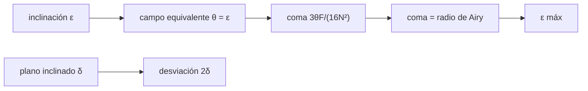

# B43-C18 — Colimación instrumental

<!-- nav:top -->
[🏠 Programa](../../../../README.md) · [📚 Bloque B43](../../../tronco-comun/B43-construccion-y-mecanica-de-telescopios.md) · [← Anterior: B43-C17 — Alineación polar](../B43-C17-alineacion-polar/CLASE.md) · [Siguiente: B43-C19 — Seguridad y mantenimiento →](../B43-C19-seguridad-y-mantenimiento/CLASE.md)
<!-- /nav -->

## 1. Ubicación, nivel y alcance

Clase 18 del bloque B43. Nivel N3. Un telescopio colimado tiene todos sus ejes alineados. Una pequeña inclinación del primario añade coma como si la estrella estuviera fuera del eje. Aquí calculas la tolerancia de inclinación con un criterio explícito y la desviación de un plano secundario inclinado, con un newtoniano ilustrativo. Usas [B41](../../../tronco-comun/B41-optica-geometrica-y-diseno-de-telescopios.md), [B42](../../../tronco-comun/B42-optica-fisica-y-optica-adaptativa.md) y [B50](../../../tronco-comun/B50-diseno-optico-computacional-y-tolerancias.md).

## 2. Por qué esta clase existe

Colimar es ajustar tornillos hasta que el coma deje de verse; el modelo dice cuánto es «suficiente». La decisión central: **¿qué inclinación del primario produce un coma igual al radio de Airy y cuánto desvía un plano inclinado?**

## 3. Lo que podrás hacer al terminar

1. Equiparar una inclinación del primario a un ángulo de campo.
2. Calcular el coma `3θF/(16N²)` y contrastarlo con un trazado exacto.
3. Plantear el criterio coma = radio de Airy.
4. Resolver la inclinación máxima.
5. Calcular la desviación `2δ` de un plano inclinado.
6. Reconocer la distinción entre coma y descentrado.

La evidencia es la **ficha de colimación** del ejercicio 12 (sección 20).

## 4. Con qué llegas y cómo comprobarlo

1. ¿Qué es el coma?
2. ¿Qué es el radio de Airy?
3. ¿Qué es la colimación?
4. ¿Qué es un plano secundario?
5. ¿Qué es un criterio de tolerancia?

<details>
<summary>Ver respuestas</summary>

1. Una aberración de campo en forma de cometa. 2. `1,22 λ N`. 3. La alineación de los ejes ópticos y mecánicos. 4. El espejo plano a 45° de un newtoniano. 5. Un límite fijado de antemano para aceptar un error.
</details>

Con cuatro o cinco aciertos, sigue; si no, repasa los prerrequisitos.

## 5. Un caso de contexto y casos de referencia

Newtoniano ilustrativo de `D = 200 mm`, `f/5`, `λ = 550 nm`. El radio de Airy es `3,355 µm`; el coma iguala ese valor con una inclinación de `1,538'` (`0,000447 rad`), y el trazado confirma `3,366 µm`. Un plano inclinado `0,5°` desvía el haz `0,01745 rad` y mueve el foco `4,36 mm` a 250 mm. Es el **ejemplo conductor**.

## 6. Vocabulario

La **colimación** alinea primario, secundario y eje del portaocular. El **coma** de campo. El **criterio de tolerancia** pide coma menor que el radio de Airy. La **desviación del plano** es el doble de su inclinación. La **inclinación equivalente** a un ángulo de campo.

## 7. Modelo mental: una linterna torcida

Como una linterna torcida: aunque el haz esté bien enfocado, su patrón se deforma en un lado; torcer el espejo es como mirar a una estrella fuera del eje.



*Descripción textual:* la inclinación del primario es un ángulo de campo; el coma resultante se compara con Airy; el plano inclinado desvía el haz.

Analogía: una linterna torcida. Límite: geométrico, meridional, inclinación pequeña.

## 8. La explicación, paso a paso

### 8.1 Coma por inclinación

| ε (') | Coma trazada (µm) | Fórmula (µm) |
|---|---|---|
| 0,5 | 1,0945 | 1,0908 |
| 1,0 | 2,1890 | 2,1817 |
| 2,0 | 4,3780 | 4,3633 |
| 4,0 | 8,7563 | 8,7266 |

### 8.2 Tolerancia

El radio de Airy es `1,22 λ N = 3,355 µm`. Igualando el coma a ese valor, `ε_máx = 1,22 λ N · 16 N²/(3 F) = 0,000447 rad = 1,538'`. El trazado a ese ángulo da `3,366 µm` (diferencia de `0,33 %`).

### 8.3 Plano secundario

Una inclinación `δ = 0,5°` del plano desvía el haz `0,017453 rad` (valor esperado `2δ = 0,017453 rad`) y el centro del campo se mueve `2δ × 250 mm = 4,363 mm`: no añade aberración, pero sí descentra el portaocular.

## 9. Magnitudes, símbolos y unidades

| Símbolo | Qué es | Unidad | Valor / nota |
|---|---|---|---|
| `ε` | inclinación del primario | rad | 0,000447 (máx.) |
| `N` | razón focal | — | 5 |
| `δ` | inclinación del plano | rad | 8,7 × 10⁻³ (0,5°) |
| `λ` | longitud de onda | nm | 550 |

## 10. Convenciones y referencias

Unidades del SI; coma decimal en el texto y punto decimal en las salidas del laboratorio; los ángulos están en radianes salvo que se indique y las longitudes de onda en nanómetros. Los telescopios y materiales de los ejemplos son ilustrativos.

## 11. De dónde sale lo que afirmamos

| ID | Fuente | Localizador | Respalda | Estado |
|---|---|---|---|---|
| S1 | Teoría de aberraciones de tercer orden | — | fórmula del coma `3θ/(16N²)`; verificada por trazado, texto no consultado | No consultado |

Límites: La fórmula del coma se verifica por trazado exacto, no con un texto; el criterio coma = Airy es ilustrativo y distinto de otros criterios usados en práctica.

## 12. Cómo ver las tolerancias

| ε (') | Coma (µm) |
|---|---|
| 0,5 | 1,094 |
| 1,0 | 2,189 |
| 2,0 | 4,378 |
| 4,0 | 8,756 |

Descripción larga: el coma crece linealmente con la inclinación.

## 13. Ejemplo trabajado: la tolerancia de inclinación

**Paso 1 · Airy.** `1,22 · 0,55 µm · 5 = 3,355 µm`.

**Paso 2 · Despeje.** `ε = 3,355 µm · 16 · 25/(3 · 1000 mm)`.

**Paso 3 · Resultado.** `1,54'`.

## 14. Distintas formas de describir la colimación

**En palabras:** la inclinación equivale a un campo y produce coma. **En fórmulas:** `ε_máx = 1,22λN·16N²/(3F)`. **En tabla:** comas. **En código:** `colimacion.py`.

## 15. Práctica guiada

**Ejercicio 1 · con los pasos indicados.** Radio de Airy en µm.

<details><summary>Solución comentada</summary>

`3,355 µm`.
</details>

**Ejercicio 2 · con una pista.** Coma de 1' (fórmula).

<details><summary>Solución comentada</summary>

`2,182 µm`.
</details>

**Ejercicio 3 · casi autónomo.** Coma de 4' (trazado).

<details><summary>Solución comentada</summary>

`8,756 µm`.
</details>

## 16. Práctica autónoma, transferencia e integrador

**Ejercicio 4.** `ε_máx` en radianes.

<details><summary>Solución comentada</summary>

`0,000447`.
</details>

**Ejercicio 5.** `ε_máx` en minutos de arco.

<details><summary>Solución comentada</summary>

`1,54'`.
</details>

**Ejercicio 6.** Desviación de un plano inclinado `0,5°`.

<details><summary>Solución comentada</summary>

`0,01745 rad`.
</details>

**Ejercicio 7.** Movimiento del foco a 250 mm.

<details><summary>Solución comentada</summary>

`4,36 mm`.
</details>

**Ejercicio 8.** Si `N` pasa a 8, ¿cómo cambia `ε_máx` con `F` fijo?

<details><summary>Solución comentada</summary>

Crece como `N³`: `(8/5)³ = 4,10` veces.
</details>

**Ejercicio 9 · transferencia.** **Transferencia.** ¿Por qué un telescopio rápido es más difícil de colimar?

<details><summary>Solución comentada</summary>

Porque la tolerancia se achica con `N³`.
</details>

**Ejercicio 10 · transferencia.** **Transferencia.** ¿Se pueden usar otros criterios?

<details><summary>Solución comentada</summary>

Sí; este es ilustrativo y debe declararse.
</details>

**Ejercicio 11 · transferencia.** **Transferencia.** ¿Es la tolerancia calculada la de un instrumento real?

<details><summary>Solución comentada</summary>

No: es ilustrativa.
</details>

**Ejercicio 12.** **Integrador.** Elabora tu *ficha de colimación*: coma, tolerancia y plano.

<details><summary>Solución comentada</summary>

Secciones 8.1–8.3.
</details>

**Ejercicio 12 · integrador.** **Integrador.** Elabora tu *ficha de colimación*: coma, tolerancia y plano.

<details><summary>Solución modelo</summary>

Secciones 8.1–8.3.
</details>

## 17. Laboratorio: trazado de la colimación

El script [colimacion.py](colimacion.py) traza el coma por inclinación, calcula la tolerancia y la desviación de un plano (**comprueba** `2 %` y `10⁻⁹ rad`).

**Datos:** newtoniano **ilustrativo**. **Predice antes de ejecutar:** ¿cuánta inclinación tolera? (≈ 1,5'.) **Ejecución del 2026-11-09 (Python 3.12.9):**

```text
Python 3.12.9 (biblioteca estandar)
airy_um = 3.355
eps_max_rad = 0.000447333
eps_max_arcmin = 1.53782
coma_en_eps_max_um = 3.36624
desv_plano_rad = 0.0174533
desv_esperada = 0.0174533
desplazamiento_foco_mm = 4.36332
eps (arcmin) | coma trazada (um) | formula (um)
0.5 | 1.0945 | 1.0908
1.0 | 2.1890 | 2.1817
2.0 | 4.3780 | 4.3633
4.0 | 8.7563 | 8.7266
Pruebas superadas.
```

```bash
python programa/clases/B43/B43-C18-colimacion-instrumental/colimacion.py
```

**Límites:** geométrico; meridional.

## 18. Errores frecuentes y cómo corregirlos

**Confundir descentrado con inclinación.** Se corrige con 8.3.

**Olvidar la dependencia con `N`.** Se corrige con el ejercicio 8.

**Tomar el criterio como único.** Se corrige con los límites.

**Pasar de rad a minutos sin convertir.** Se corrige con la sección 9.

## 19. Cómo sabrás que vas bien

Tras la sección 8: ¿qué resultado esperabas y cuál obtuviste? Si dudas, repasa el ejemplo 13. Tras el laboratorio: ¿qué comprueba? (ver la sección 17).

## 20. Qué entregas y cómo se evalúa

El producto es tu **ficha de colimación** (ejercicio 12).

| Criterio | Inicial | En desarrollo | Logrado | Destacado |
|---|---|---|---|---|
| Conceptos | Los confunde | Parciales | conceptos de la clase | Explica los límites |
| Cálculo | Sin unidades | Con errores | Tablas completas | Calcula casos nuevos |
| Numérico | Sin comprobar | Un caso | Contraste con el análisis | Interpreta las diferencias |
| Fuentes | Sin fuente | Sin fecha | fuentes con fecha | Declara lo ilustrativo |
| Límites | No los nombra | Uno | Tres | Discute qué falta del modelo |

**Condiciones críticas (no se compensan con promedio):** rotular el criterio y el telescopio como ilustrativos; no citar fuentes no leídas; declarar que es un trazado.

## 21. Ética, seguridad y límites

Clase educativa: los modelos son simplificados. Accesibilidad: tablas equivalentes a las gráficas, fórmulas en texto, ejercicios sin conexión.

## 22. Para cerrar y seguir

El newtoniano ilustrativo tolera una inclinación de `1,54'` y un plano inclinado desvía el haz el doble. Queda una pregunta: ¿cómo se mantiene seguro todo esto?

**Glosario español–inglés.** colimación · *collimation*; coma · *coma*; inclinación · *tilt*; plano secundario · *diagonal*; tolerancia · *tolerance*.

**Continuidad.** [B43-C19](../B43-C19-seguridad-y-mantenimiento/CLASE.md) estudia la seguridad y el mantenimiento.

**Referencias:** ver sección 11.

<!-- nav:bottom -->
---

[← Anterior: B43-C17 — Alineación polar](../B43-C17-alineacion-polar/CLASE.md) · [📚 Bloque B43](../../../tronco-comun/B43-construccion-y-mecanica-de-telescopios.md) · [Siguiente: B43-C19 — Seguridad y mantenimiento →](../B43-C19-seguridad-y-mantenimiento/CLASE.md)
<!-- /nav -->
