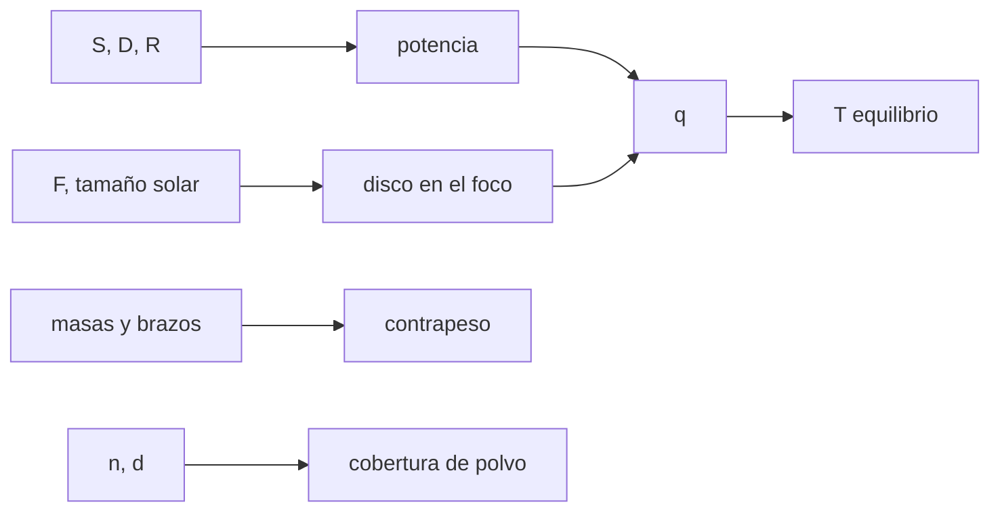

# B43-C19 — Seguridad y mantenimiento

<!-- nav:top -->
[🏠 Programa](../../../../README.md) · [📚 Bloque B43](../../../tronco-comun/B43-construccion-y-mecanica-de-telescopios.md) · [← Anterior: B43-C18 — Colimación instrumental](../B43-C18-colimacion-instrumental/CLASE.md) · [Siguiente: B43-C20 — Proyecto mecánico completo de telescopio →](../B43-C20-proyecto-mecanico-completo-de-telescopio/CLASE.md)
<!-- /nav -->

## 1. Ubicación, nivel y alcance

Clase 19 del bloque B43. Nivel N3. Un telescopio concentra la luz: apuntado al Sol sin filtro puede quemar y cegar. Además hay cargas pesadas, piezas frágiles y polvo. Aquí calculas, con física, cuánta luz solar llega al foco, el equilibrio de una montura y la cobertura de polvo, con un telescopio ilustrativo. No es un procedimiento de taller. Usas [B05](../../../tronco-comun/B05-fisica-fundamental-para-el-espacio.md), [B12](../../../tronco-comun/B12-probabilidad-estadistica-e-incertidumbre.md) y [B08](../../../tronco-comun/B08-observacion-del-cielo-y-astronomia-practica.md).

## 2. Por qué esta clase existe

La seguridad empieza por saber cuán grande es el riesgo. La decisión central: **¿cuánta potencia y qué temperatura aparecen en el foco, cómo se balancea la montura y cuánto polvo es aceptable?**

## 3. Lo que podrás hacer al terminar

1. Calcular la potencia solar recogida por la apertura.
2. Calcular el diámetro del disco solar en el foco y la concentración.
3. Estimar la temperatura de equilibrio de un absorbente.
4. Calcular el factor de amplificación respecto de la pupila del ojo.
5. Equilibrar una montura con un contrapeso.
6. Estimar la cobertura de polvo por dos vías.

La evidencia es la **ficha de seguridad y mantenimiento** del ejercicio 12 (sección 20).

## 4. Con qué llegas y cómo comprobarlo

1. ¿Qué es la irradiancia?
2. ¿Qué es la ley de Stefan-Boltzmann?
3. ¿Qué es un contrapeso?
4. ¿Qué es la cobertura de una superficie?
5. ¿Qué es un filtro solar?

<details>
<summary>Ver respuestas</summary>

1. La potencia por unidad de área. 2. `q = σ T⁴`. 3. Una masa que equilibra los momentos. 4. La fracción de área tapada. 5. Un filtro que atenúa la luz solar en toda la apertura, de forma certificada.
</details>

Con cuatro o cinco aciertos, sigue; si no, repasa los prerrequisitos.

## 5. Un caso de contexto y casos de referencia

Telescopio ilustrativo de 200 mm f/5. La apertura recoge `38,5 W` del Sol (`S = 1361 W/m²`, reflectancia 0,90) en un disco de `9,30 mm`: `566 kW/m²`, `416` veces el Sol; un absorbente negro idealizado alcanzaría `1778 K`. Es el **ejemplo conductor** y ejemplifica por qué el Sol exige un filtro certificado en la apertura.

## 6. Vocabulario

La **irradiancia solar total** `S`. La **concentración**. La **temperatura de equilibrio** `T = (q/σ)^(1/4)`. El **filtro en la apertura**. El **contrapeso** `m_c r_c = m_t r_t`. La **cobertura de polvo** `1 − exp(−n π d²/4)`.

## 7. Modelo mental: una lupa al sol

Como una lupa al sol: la potencia recogida por una gran área se junta en un punto pequeño; cuanto mayor la apertura, mayor el riesgo.



*Descripción textual:* la apertura recoge potencia, el foco la concentra y el equilibrio térmico da el riesgo; las masas se equilibran y el polvo se estima.

Analogía: una lupa al sol. Límite: sin atmósfera, absorbente ideal, polvo opaco.

## 8. La explicación, paso a paso

### 8.1 Sol en el foco

`ángulo solar = 2 R_N/au = 9,3009 mrad = 31,974'`. Potencia `38,48 W`; disco `9,301 mm`; irradiancia `566,4 kW/m²`; concentración `416,1`; temperatura de equilibrio de un absorbente negro que irradia por una cara `1777,8 K`.

### 8.2 El ojo

El cociente de áreas entre la apertura y una pupila de 7 mm es `816,3`: sin filtro, el ojo recibiría cientos de veces la irradiancia del Sol. Un filtro certificado de densidad óptica 5 transmite `10⁻⁵`.

### 8.3 Equilibrio

Un tubo de 7 kg con el centro a 0,20 m y un contrapeso de 4 kg a 0,35 m dejan un desbalance de `2,2 × 10⁻¹⁶ kg m`; el contrapeso necesario es `4,000 kg`.

### 8.4 Polvo

Con `100` partículas de `20 µm` por mm², la cobertura teórica es `3,093 %`. Una simulación en un parche de 2 × 2 mm con `400` partículas (semilla 20261109) da `3,042 %`. La pérdida de reflectancia por oclusión es `2,78 puntos`.

## 9. Magnitudes, símbolos y unidades

| Símbolo | Qué es | Unidad | Valor / nota |
|---|---|---|---|
| `S` | irradiancia solar nominal | W/m² | 1361 (UAI B3, leído) |
| `R_N` | radio solar nominal | m | 6,957 × 10⁸ (UAI B3, leído) |
| `σ` | Stefan-Boltzmann | W/m²/K⁴ | 5,670374419 × 10⁻⁸ (NIST) |
| `D` | apertura | m | 0,200 (ilustrativo) |

## 10. Convenciones y referencias

Unidades del SI; coma decimal en el texto y punto decimal en las salidas del laboratorio; los ángulos están en radianes salvo que se indique y las longitudes de onda en nanómetros. Los telescopios y materiales de los ejemplos son ilustrativos.

## 11. De dónde sale lo que afirmamos

| ID | Fuente | Localizador | Respalda | Estado |
|---|---|---|---|---|
| S1 | NIST, *Fundamental Physical Constants* (CODATA 2022) | https://physics.nist.gov/cuu/Constants/Table/allascii.txt | constantes citadas en la sección 9 | Consultada el 2026-11-09 |
| S2 | Mamajek et al., *IAU 2015 Resolution B3 on Recommended Nominal Conversion Constants* | https://arxiv.org/abs/1510.07674 | irradiancia solar nominal 1361 W m⁻² y radio solar nominal 6,957 × 10⁸ m (texto completo del PDF leído) | Texto completo extraído del PDF, consultado el 2026-11-09 |

Límites: La resolución B3 de la UAI se leyó en el texto completo del PDF; NIST solo para la constante de Stefan-Boltzmann. Los números de polvo, contrapeso y absorbente son ilustrativos. Esta clase no es un procedimiento de seguridad.

## 12. Cómo ver los riesgos

| Magnitud | Valor |
|---|---|
| Potencia recogida | 38,5 W |
| Disco en el foco | 9,30 mm |
| Concentración | 416 |
| Temperatura de equilibrio | 1778 K |

Descripción larga: unos 38 W se concentran en un disco de 9 mm.

## 13. Ejemplo trabajado: la potencia en el foco

**Paso 1 · Potencia.** `1361 · π · 0,1² · 0,90 = 38,48 W`.

**Paso 2 · Disco.** `1 m · 9,3009 mrad = 9,301 mm`.

**Paso 3 · Irradiancia.** `566,4 kW/m²`.

## 14. Distintas formas de describir la prevención

**En palabras:** la apertura reúne la luz y el foco la concentra. **En fórmulas:** `q = P/(π(F θ/2)²)`. **En tabla:** riesgos. **En código:** `seguridad.py`.

## 15. Práctica guiada

**Ejercicio 1 · con los pasos indicados.** Ángulo solar en mrad.

<details><summary>Solución comentada</summary>

`9,301 mrad`.
</details>

**Ejercicio 2 · con una pista.** Potencia recogida (R = 0,9).

<details><summary>Solución comentada</summary>

`38,5 W`.
</details>

**Ejercicio 3 · casi autónomo.** Diámetro del disco solar a 1000 mm.

<details><summary>Solución comentada</summary>

`9,30 mm`.
</details>

## 16. Práctica autónoma, transferencia e integrador

**Ejercicio 4.** Concentración.

<details><summary>Solución comentada</summary>

`416`.
</details>

**Ejercicio 5.** Cociente de áreas apertura/pupila.

<details><summary>Solución comentada</summary>

`816`.
</details>

**Ejercicio 6.** Contrapeso requerido.

<details><summary>Solución comentada</summary>

`4,00 kg`.
</details>

**Ejercicio 7.** Cobertura de polvo teórica.

<details><summary>Solución comentada</summary>

`3,09 %`.
</details>

**Ejercicio 8.** Pérdida de reflectancia.

<details><summary>Solución comentada</summary>

`2,78 puntos`.
</details>

**Ejercicio 9 · transferencia.** **Transferencia.** ¿Por qué el filtro va delante y no en el ocular?

<details><summary>Solución comentada</summary>

Porque debe frenar la luz antes de concentrarla; en el ocular el calor ya está dentro.
</details>

**Ejercicio 10 · transferencia.** **Transferencia.** ¿Es seguro mirar el Sol por un telescopio con un filtro casero?

<details><summary>Solución comentada</summary>

No: solo con filtros solares certificados colocados en la apertura.
</details>

**Ejercicio 11 · transferencia.** **Transferencia.** ¿Es esta clase un manual de taller?

<details><summary>Solución comentada</summary>

No: calcula riesgos con física; no da procedimientos.
</details>

**Ejercicio 12.** **Integrador.** Elabora tu *ficha de seguridad y mantenimiento*: potencia, equilibrio y polvo.

<details><summary>Solución comentada</summary>

Secciones 8.1–8.4.
</details>

**Ejercicio 12 · integrador.** **Integrador.** Elabora tu *ficha de seguridad y mantenimiento*: potencia, equilibrio y polvo.

<details><summary>Solución modelo</summary>

Secciones 8.1–8.4.
</details>

## 17. Laboratorio: riesgo solar, equilibrio y polvo

El script [seguridad.py](seguridad.py) calcula la potencia en el foco, el equilibrio y la cobertura de polvo (**comprueba** `15 %` en el polvo).

**Datos:** S y R_N de la UAI; σ de NIST; resto **ilustrativo**. **Predice antes de ejecutar:** ¿qué potencia llega al foco? (≈ 38 W.) **Ejecución del 2026-11-09 (Python 3.12.9):**

```text
Python 3.12.9 (biblioteca estandar)
diam_solar_mrad = 9.30093
diam_solar_arcmin = 31.9743
potencia_W = 38.4814
disco_mm = 9.30093
irradiancia_foco_kWm2 = 566.379
concentracion = 416.149
T_equilibrio_K = 1777.76
razon_ojo = 816.327
OD5_transmision = 1e-05
potencia_ojo_filtro_mW = 0.000523774
balance_contrapeso_kg = 4
desbalance_dado_kgm = 2.22045e-16
cobertura_teorica = 0.0309276
cobertura_sim = 0.030425
particulas = 400
perdida_reflectancia = 0.0278348
Pruebas superadas.
```

```bash
python programa/clases/B43/B43-C19-seguridad-y-mantenimiento/seguridad.py
```

**Límites:** sin atmósfera; absorbente ideal.

## 18. Errores frecuentes y cómo corregirlos

**Pensar que un filtro en el ocular basta.** Se corrige con el ejercicio 9.

**Olvidar la reflectancia.** Se corrige con 8.1.

**Equilibrar sin medir las masas.** Se corrige con 8.3.

**Subestimar el polvo.** Se corrige con 8.4.

## 19. Cómo sabrás que vas bien

Tras la sección 8: ¿qué resultado esperabas y cuál obtuviste? Si dudas, repasa el ejemplo 13. Tras el laboratorio: ¿qué comprueba? (ver la sección 17).

## 20. Qué entregas y cómo se evalúa

El producto es tu **ficha de seguridad y mantenimiento** (ejercicio 12).

| Criterio | Inicial | En desarrollo | Logrado | Destacado |
|---|---|---|---|---|
| Conceptos | Los confunde | Parciales | conceptos de la clase | Explica los límites |
| Cálculo | Sin unidades | Con errores | Tablas completas | Calcula casos nuevos |
| Numérico | Sin comprobar | Un caso | Contraste con el análisis | Interpreta las diferencias |
| Fuentes | Sin fuente | Sin fecha | fuentes con fecha | Declara lo ilustrativo |
| Límites | No los nombra | Uno | Tres | Discute qué falta del modelo |

**Condiciones críticas (no se compensan con promedio):** no apuntar nunca al Sol sin filtro certificado; no usar esta clase como procedimiento; rotular lo ilustrativo; seguir las normas de seguridad del lugar.

## 21. Ética, seguridad y límites

Clase educativa: los modelos son simplificados. Accesibilidad: tablas equivalentes a las gráficas, fórmulas en texto, ejercicios sin conexión.

## 22. Para cerrar y seguir

La apertura de 200 mm concentra `38 W` en un disco de `9 mm` y el polvo cubre `3,1 %` con 100 partículas por mm². Queda una pregunta: ¿cómo se integra todo?

**Glosario español–inglés.** irradiancia · *irradiance*; filtro solar · *solar filter*; contrapeso · *counterweight*; polvo · *dust*; concentración · *concentration*.

**Continuidad.** [B43-C20](../B43-C20-proyecto-mecanico-completo-de-telescopio/CLASE.md) reúne todo en el proyecto mecánico completo.

**Referencias:** ver sección 11.

<!-- nav:bottom -->
---

[← Anterior: B43-C18 — Colimación instrumental](../B43-C18-colimacion-instrumental/CLASE.md) · [📚 Bloque B43](../../../tronco-comun/B43-construccion-y-mecanica-de-telescopios.md) · [Siguiente: B43-C20 — Proyecto mecánico completo de telescopio →](../B43-C20-proyecto-mecanico-completo-de-telescopio/CLASE.md)
<!-- /nav -->
